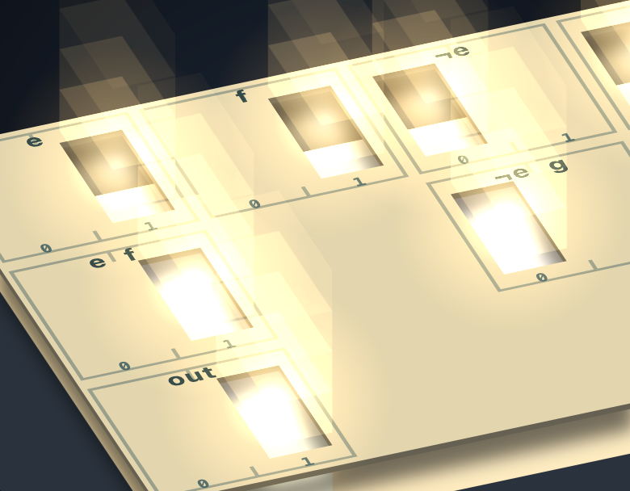

**tl;dr:** You can use stacks of sheets with holes in them to visually verify moderately-large computations including widely used [cryptographic hash functions](https://en.wikipedia.org/wiki/Cryptographic_hash_function), within human-scale timeframes.

Imagine that all the world's computers have been taken over by an AI swarm. You don't know whether you can trust the AI swarm to be honest with you - you're skeptical, in part because it just took over all the world's computers, which doesn't seem like an act of a particularly trustworthy AI swarm.

Here's the thing: you really need to run an important program you've written down. Maybe you need to check a [cryptographically signed message](https://en.wikipedia.org/wiki/Lamport_signature) from your spy friend. Or maybe you work in a map factory and you really need to figure out [how many colors you need](https://en.wikipedia.org/wiki/Four_color_theorem) to color all the countries on your latest map. An AI tells you that it would be happy to run the program for you, but you think you heard it snickering behind your back. Is there any way you can trust the results it gives you? You don't trust anything you can see on a screen, since the AI swarm controls all the screens and can change the results it shows you.

One way you might trust a computation, is if you saw the entire trace (the values of all the variables at every time step) as a printout. You could walk through it line by line, checking the operations one after another. But this would be almost as slow as doing the computation yourself.

There are many ways to verify that some computation has been faithfully accomplished. Some methods are specific to particular problems (e.g. it's easy to verify that a number has been factored: "When I multiply the output numbers, do I get back the number I wanted to factor?"). Some methods are very general, like [zkSNARKs](https://en.wikipedia.org/wiki/Non-interactive_zero-knowledge_proof). Unfortunately, even though these general methods for verification are shockingly efficient compared to performing the whole underlying computation yourself, the verification is still not feasible with human-scale time and resources (without depending on some kind of automatic computer). In order to verify computations at human-scale, we'll need to make the verification very efficient, and *also* take advantage of tasks that are easy for humans to do at massive scale, without the aid of computers.

Usually when we think about executing a program, we think about executing steps sequentially. But we can also think about certain computations as [circuits](https://en.wikipedia.org/wiki/Boolean_circuit). Instead of manipulating variables step by step, the data gets transformed by many "gates": simple functions that transform data (1s and 0s) from input "wires" to output "wires", like `AND(X, Y)` (which is 1 when its inputs are both 1, and 0 otherwise), `XOR(X, Y)` (which is 1 when exactly one of its inputs is 1, and 0 otherwise) and `NOT(X)` (which is 1 if its input is 0 and vice versa). These gates are chained together to form potentially very complicated circuits, that can do a lot of useful work. Given such a circuit and an input, a "trace" is an assignment of a value (in this case, 0 or 1) to every wire in the circuit, which should correspond to what you get by executing each gate on its inputs until you've produced the outputs.


<iframe class="lightbox-widget" title="Logic gates" sandbox="allow-scripts" loading="lazy" style="width:100%;height:390px;border:0;border-radius:10px;display:block;margin:1.5em 0" srcdoc="&lt;!DOCTYPE html&gt;&#10;&lt;html lang=&quot;en&quot;&gt;&#10;&lt;head&gt;&#10;&lt;meta charset=&quot;utf-8&quot;&gt;&#10;&lt;meta name=&quot;viewport&quot; content=&quot;width=device-width,initial-scale=1&quot;&gt;&#10;&lt;title&gt;Logic gates&lt;/title&gt;&#10;&lt;style&gt;&#10;*{box-sizing:border-box}&#10;html,body{margin:0;padding:0;background:transparent}&#10;body{float:left;width:100%}&#10;body{font:14px/1.45 &quot;Avenir Next&quot;,&quot;Segoe UI Variable Text&quot;,&quot;Segoe UI&quot;,system-ui,-apple-system,sans-serif;color:#e8e3d3;-webkit-font-smoothing:antialiased}&#10;.pv{--room:#10151d;--room2:#182130;--line:#2b3646;--text:#e8e3d3;--dim:#9aa7b6;--faint:#64728a;--light:#ffd98a;--hot:#fff3d0;--cool:#86c5cf;--paper:#e9dcb8;&#10;background:var(--room);border-radius:10px;padding:12px 12px 10px;color:var(--text);overflow:hidden}&#10;.pv-head{display:flex;align-items:center;justify-content:space-between;gap:10px;margin:0 2px 9px}&#10;.pv-title{font-weight:650;font-size:15px;letter-spacing:.005em}&#10;.pv-main{display:grid;grid-template-columns:minmax(0,1fr) 250px;gap:12px;align-items:stretch}&#10;.pv-wide .pv-main{grid-template-columns:minmax(0,1fr) 270px}&#10;.pv-stage{display:flex;flex-direction:column;gap:8px;min-width:0}&#10;.pv-cwrap{position:relative;border-radius:8px;overflow:hidden;background:#0c1017;height:348px;flex:1 1 auto}&#10;.pv-canvas{display:block;width:100%;height:100%;position:absolute;inset:0;touch-action:pan-y;cursor:grab}&#10;.pv-canvas.pv-zoomed{touch-action:none;cursor:move}&#10;.pv-canvas:active{cursor:grabbing}&#10;.pv-legend{position:absolute;left:9px;top:8px;font-size:12px;line-height:1.5;color:var(--dim);pointer-events:none;text-shadow:0 1px 2px #000}&#10;.pv-leg b{color:var(--text);font-weight:600}&#10;.pv-chip{display:inline-block;width:10px;height:10px;border-radius:2px;margin-right:6px;vertical-align:-1px;box-shadow:0 0 0 1px rgba(255,255,255,.14)}&#10;.pv-view{display:flex;flex-wrap:wrap;gap:7px;align-items:center}&#10;.pv-tip{position:absolute;right:9px;top:8px;max-width:62%;font-size:12px;color:var(--text);background:rgba(12,16,23,.82);border:1px solid var(--line);border-radius:6px;padding:4px 8px;display:none;pointer-events:none}&#10;.pv-tip.on{display:block}&#10;.pv-side{display:flex;flex-direction:column;gap:10px;min-width:0}&#10;.pv-side p{margin:0;color:var(--dim);font-size:13px}&#10;.pv-side p b,.pv-foot b{color:var(--text);font-weight:600}&#10;.pv-foot{margin:9px 2px 0;color:var(--dim);font-size:13px;min-height:0}&#10;.pv-foot:empty{display:none}&#10;.pv-seg{display:inline-flex;background:#0c1017;border:1px solid var(--line);border-radius:7px;padding:2px;gap:2px}&#10;.pv-seg button{font:inherit;font-size:12.5px;color:var(--dim);background:transparent;border:0;border-radius:5px;padding:4px 9px;cursor:pointer;white-space:nowrap}&#10;.pv-seg button:hover{color:var(--text)}&#10;.pv-seg button[aria-pressed=true]{background:#2a3648;color:var(--text)}&#10;.pv-seg.pv-col{display:flex;flex-direction:column;align-items:stretch}&#10;.pv-seg.pv-col button{text-align:left;padding:6px 9px;white-space:normal}&#10;.pv-btn{font:inherit;font-size:13px;color:var(--text);background:#223044;border:1px solid #34445c;border-radius:7px;padding:6px 11px;cursor:pointer}&#10;.pv-btn:hover{background:#2a3a52}&#10;.pv-btn.pv-quiet{background:transparent;border-color:var(--line);color:var(--dim)}&#10;.pv-btn.pv-quiet:hover{color:var(--text)}&#10;.pv-btn.pv-go{background:#f1d08a;border-color:#f1d08a;color:#1b1608;font-weight:650}&#10;.pv-btn.pv-go:hover{background:#ffe2a6}&#10;.pv-btn.pv-sq{width:28px;padding:4px 0;text-align:center;font-weight:700}&#10;.pv-btn.pv-sm{padding:4px 8px;font-size:12px}&#10;.pv-btn:disabled{opacity:.45;cursor:default}&#10;.pv-row{display:flex;flex-wrap:wrap;gap:7px;align-items:center}&#10;.pv-tog{font:inherit;font-size:12.5px;color:var(--dim);background:#0c1017;border:1px solid var(--line);border-radius:7px;padding:5px 9px 5px 7px;cursor:pointer;display:inline-flex;align-items:center;gap:6px}&#10;.pv-tog-dot{width:9px;height:9px;border-radius:50%;background:#3a4658}&#10;.pv-tog[aria-pressed=true]{color:var(--text)}&#10;.pv-tog[aria-pressed=true] .pv-tog-dot{background:var(--light);box-shadow:0 0 7px var(--light)}&#10;.pv-rangewrap{display:inline-flex;align-items:center;gap:6px;font-size:12.5px;color:var(--dim);background:#0c1017;border:1px solid var(--line);border-radius:7px;padding:3px 9px}&#10;.pv-range{width:64px;accent-color:#f1d08a;height:18px}&#10;.pv-zoom{position:absolute;right:8px;bottom:8px;display:inline-flex;gap:4px}&#10;.pv-zoom .pv-btn{background:rgba(24,33,48,.88)}&#10;.pv-verdict{border-radius:8px;padding:8px 10px;font-size:13px;line-height:1.4;border:1px solid var(--line);color:var(--dim)}&#10;.pv-verdict b{color:inherit;font-weight:650}&#10;.pv-verdict.pv-dark{border-color:#34586a;background:#13232c;color:#a9d9e2}&#10;.pv-verdict.pv-light{border-color:#b98a2e;background:#3a2c0e;color:var(--hot)}&#10;.pv-verdict.pv-good{border-color:#3f7a5a;background:#12281e;color:#a8e2c0}&#10;.pv-verdict.pv-bad{border-color:#8a4a3e;background:#2e1612;color:#f0b9ac}&#10;.pv-label{font-size:12px;color:var(--faint);margin:0 0 -5px}&#10;.pv-mono{font-family:ui-monospace,&quot;SF Mono&quot;,&quot;Cascadia Mono&quot;,&quot;Roboto Mono&quot;,Menlo,Consolas,monospace}&#10;.pv-score{font-size:12.5px;color:var(--dim)}&#10;.pv-list{display:flex;flex-direction:column;gap:2px;overflow:auto;max-height:238px;border:1px solid var(--line);border-radius:8px;padding:3px;background:#0c1017}&#10;.pv-list button{font:inherit;font-size:12.5px;text-align:left;color:var(--dim);background:transparent;border:0;border-radius:5px;padding:4px 7px;cursor:pointer;display:flex;gap:7px;align-items:baseline}&#10;.pv-list button:hover{color:var(--text);background:#151c27}&#10;.pv-list button[aria-current=true]{background:#2a3648;color:var(--text)}&#10;.pv-list .pv-grp{font-size:11.5px;color:var(--faint);padding:5px 7px 1px}&#10;.pv-dot{flex:none;width:8px;height:8px;border-radius:50%;background:#3a4658;align-self:center}&#10;.pv-dot.d{background:#3d7f8c}.pv-dot.l{background:var(--light);box-shadow:0 0 6px var(--light)}&#10;.pv-in{font:inherit;font-size:13px;color:var(--text);background:#0c1017;border:1px solid var(--line);border-radius:7px;padding:5px 8px;min-width:0;width:100%}&#10;.pv-in:focus,.pv-btn:focus-visible,.pv-seg button:focus-visible,.pv-tog:focus-visible,.pv-list button:focus-visible{outline:2px solid #f1d08a;outline-offset:1px}&#10;.pv-field{display:flex;flex-direction:column;gap:3px;font-size:12px;color:var(--faint)}&#10;select.pv-in{appearance:auto}&#10;@media (max-width:600px){&#10;.pv-main,.pv-wide .pv-main{grid-template-columns:1fr}&#10;.pv-cwrap{height:290px}&#10;.pv-list{max-height:170px}&#10;}&#10;@media (prefers-reduced-motion:reduce){*{transition:none!important}}&#10;.pv-keyrow{display:flex;gap:10px;align-items:center}&#10;.pv-key{flex:none;line-height:0}&#10;.pv-key svg{display:block}&#10;.pv-cards{display:grid;grid-template-columns:repeat(3,minmax(0,1fr));gap:10px}&#10;.pv-card{background:#0c1017;border-radius:8px;padding:10px 10px 12px;display:flex;flex-direction:column;gap:6px;align-items:stretch}&#10;.pv-cardhead{display:flex;flex-direction:column;gap:1px;min-height:54px}&#10;.pv-cardhead b{font-size:15px;letter-spacing:.03em}&#10;.pv-cardhead span{font-size:12.5px;color:var(--dim)}&#10;.pv-card svg{margin:0 auto}&#10;.pv-tt{border-collapse:collapse;margin:2px auto 0;font-family:ui-monospace,&quot;SF Mono&quot;,&quot;Cascadia Mono&quot;,Menlo,Consolas,monospace;font-size:13px}&#10;.pv-tt th{font-family:Georgia,serif;font-style:italic;font-weight:400;color:var(--dim);padding:1px 12px 3px;border-bottom:1px solid var(--line)}&#10;.pv-tt td{text-align:center;padding:2px 12px;color:var(--faint)}&#10;.pv-tt tr.cur td{color:var(--text);background:#243044}&#10;.pv-tt tr.cur td:first-child{border-radius:5px 0 0 5px}.pv-tt tr.cur td:last-child{border-radius:0 5px 5px 0}&#10;.pv-tt tr.cur td.o{color:#1b1608;background:var(--light);font-weight:700}&#10;.pv-inpad:focus-visible circle{stroke:#f1d08a;stroke-width:3}&#10;.pv-inpad:focus{outline:none}&#10;@media (max-width:600px){.pv-cards{grid-template-columns:1fr}.pv-cardhead{min-height:0}}&#10;.pv-circ{background:#0c1017;border-radius:8px;padding:14px 10px;display:flex;align-items:center;justify-content:center;min-height:250px;flex:1}&#10;.pv-trace{display:flex;flex-wrap:wrap;gap:4px 5px;font-size:12.5px}&#10;.pv-trace span{border:1px solid var(--line);border-radius:5px;padding:1px 6px;color:var(--dim);white-space:nowrap}&#10;.pv-trace span.one{color:#1b1608;background:var(--paper);border-color:var(--paper)}&#10;.pv-gate:hover rect[fill=transparent]{fill:rgba(255,217,138,.10)}&#10;.pv-minicirc{background:#0c1017;border-radius:8px;padding:6px 4px}&#10;.pv-q{font-family:Georgia,serif;font-style:italic;color:#cfd8e2;width:44px;text-align:right}&#10;.pv-claim{font-size:12.5px;color:var(--dim);line-height:1.45}&#10;.pv-claim .pv-mono{color:var(--text);font-size:13px}&#10;.pv-hash{word-spacing:.1em;font-size:11.5px!important;display:inline-block}&#10;.pv-okc{color:#8fd1a8}.pv-badc{color:#f0a892}&#10;.pv-nowrap{flex-wrap:nowrap}&#10;.pv-wide .pv-list{max-height:186px}&#10;.pv-wide .pv-verdict{font-size:12.5px}&#10;.pv-seg.pv-grid2{display:grid;grid-template-columns:1fr 1fr}&#10;.pv-times{border-collapse:collapse;width:100%;font-size:12.5px;color:var(--dim)}&#10;.pv-times th{text-align:left;font-weight:400;color:var(--faint);padding:2px 4px;border-bottom:1px solid var(--line)}&#10;.pv-times td{padding:3px 4px}&#10;.pv-times td:first-child{color:var(--text)}&#10;.pv-ctl{display:flex;flex-wrap:wrap;gap:10px 14px;align-items:flex-end;margin:0 2px 10px}&#10;.pv-ctl .pv-field{min-width:120px}&#10;.pv-grow{flex:1 1 180px}&#10;.pv-range.pv-long{width:100%}&#10;.pv-tablewrap{overflow-x:auto;background:#0c1017;border-radius:8px;padding:4px 6px}&#10;.pv-big{border-collapse:collapse;width:100%;font-size:12.5px;min-width:600px}&#10;.pv-big th{text-align:left;font-weight:400;color:var(--faint);padding:7px 6px 6px;border-bottom:1px solid var(--line);vertical-align:bottom;line-height:1.25}&#10;.pv-big td{padding:7px 6px;border-bottom:1px solid #1a2230;color:var(--dim);vertical-align:top}&#10;.pv-big td:first-child{color:var(--text);min-width:150px}&#10;.pv-big td.nw{white-space:nowrap}&#10;.pv-big td b{color:var(--hot);font-weight:650;white-space:nowrap}&#10;.pv-big tr:last-child td{border-bottom:0}&#10;.pv-rough{font-size:11px;color:#1b1608;background:#c9b27a;border-radius:4px;padding:0 5px;margin-left:3px}&#10;&lt;/style&gt;&#10;&lt;/head&gt;&#10;&lt;body&gt;&#10;&lt;script&gt;&#10;var PV=window.PV=window.PV||{};PV.CONFIG={},(function(g){&quot;use strict&quot;;var c=g.PV=g.PV||{},h=c.GATES={AND:{n:2,sym:&quot;∧&quot;,f:function(e,t){return e&amp;t},cl:[[0,-1,1],[-1,0,1],[1,1,0]],names:[&quot;a&quot;,&quot;b&quot;]},OR:{n:2,sym:&quot;∨&quot;,f:function(e,t){return e|t},cl:[[1,-1,0],[-1,1,0],[0,0,1]],names:[&quot;a&quot;,&quot;b&quot;]},XOR:{n:2,sym:&quot;⊕&quot;,f:function(e,t){return e^t},cl:[[0,0,1],[0,1,0],[1,0,0],[1,1,1]],names:[&quot;a&quot;,&quot;b&quot;]},NOT:{n:1,sym:&quot;¬&quot;,f:function(e){return 1-e},cl:[[0,0],[1,1]],names:[&quot;a&quot;]},COPY:{n:1,sym:&quot;=&quot;,f:function(e){return e},cl:[[0,1],[1,0]],names:[&quot;a&quot;]},MUX:{n:3,sym:&quot;?:&quot;,f:function(e,t,r){return e?t:r},cl:[[1,1,-1,0],[1,0,-1,1],[0,-1,1,0],[0,-1,0,1]],names:[&quot;s&quot;,&quot;a&quot;,&quot;b&quot;]},MAJ:{n:3,sym:&quot;maj&quot;,f:function(e,t,r){return e+t+r&gt;&gt;1},cl:[[1,1,-1,0],[1,-1,1,0],[-1,1,1,0],[0,0,-1,1],[0,-1,0,1],[-1,0,0,1]],names:[&quot;a&quot;,&quot;b&quot;,&quot;c&quot;]}};function o(e,t,r){this.rows=e,this.cols=t,this.n=e*t,this.name=r||&quot;&quot;,this.p=new Uint8Array(this.n),this.kind=new Uint8Array(this.n),this.pats=[],this.gPat=[],this.gOut=[],this.fixed=[],this.regions=[],this.outputs=[]}o.prototype.i=function(e,t){return e*this.cols+t},o.prototype.v=function(e){return this.p[e]===2?1:0},o.prototype.setv=function(e,t){this.p[e]=t?2:1},o.prototype.input=function(e,t,r,i){var n=e*this.cols+t;return this.kind[n]=1,this.p[n]=r?2:1,i!==!1&amp;&amp;this.fixed.push({i:n,v:r?1:0,why:&quot;in&quot;}),n},o.prototype.constant=function(e,t,r){var i=e*this.cols+t;return this.kind[i]=2,this.p[i]=r?2:1,this.fixed.push({i,v:r?1:0,why:&quot;const&quot;}),i},o.prototype.claimOutput=function(e){this.outputs.push(e)},o.prototype.pattern=function(e,t,r){for(var i=e+&quot;:&quot;+t.map(function(f){return f[0]+&quot;,&quot;+f[1]}).join(&quot;;&quot;),n=0;n&lt;this.pats.length;n++)if(this.pats[n].key===i)return n;var a=this.cols;return this.pats.push({key:i,type:e,offs:t,label:r||e,doff:t.map(function(f){return f[0]*a+f[1]}),anchors:[]}),this.pats.length-1},o.prototype.g=function(e,t,r){var i=this.pats[e],n=t*this.cols+r,a=i.doff,f=this.p,l,p=f[n+a[0]]===2?1:0;if(c.DEBUG){if(this.kind[n])throw new Error(&quot;cell reused at &quot;+t+&quot;,&quot;+r+&quot; (&quot;+i.label+&quot;)&quot;);for(var u=0;u&lt;a.length;u++)if(!this.kind[n+a[u]])throw new Error(&quot;input &quot;+u+&quot; of &quot;+i.label+&quot; at &quot;+t+&quot;,&quot;+r+&quot; reads an empty cell&quot;)}switch(i.type){case&quot;COPY&quot;:l=p;break;case&quot;NOT&quot;:l=1-p;break;case&quot;AND&quot;:l=p&amp;(f[n+a[1]]===2?1:0);break;case&quot;OR&quot;:l=p|(f[n+a[1]]===2?1:0);break;case&quot;XOR&quot;:l=p^(f[n+a[1]]===2?1:0);break;case&quot;MUX&quot;:l=p?f[n+a[1]]===2?1:0:f[n+a[2]]===2?1:0;break;case&quot;MAJ&quot;:l=p+(f[n+a[1]]===2?1:0)+(f[n+a[2]]===2?1:0)&gt;&gt;1;break}return f[n]=l?2:1,this.kind[n]=3,i.anchors.push(n),this.gPat.push(e),this.gOut.push(n),n},o.prototype.region=function(e,t,r,i,n,a){this.regions.push({r0:e,c0:t,r1:r,c1:i,name:n,bitAt:a})},o.prototype.describe=function(e){for(var t=e/this.cols|0,r=e%this.cols,i=this.regions.length-1;i&gt;=0;i--){var n=this.regions[i];if(t&gt;=n.r0&amp;&amp;t&lt;=n.r1&amp;&amp;r&gt;=n.c0&amp;&amp;r&lt;=n.c1)return typeof n.name==&quot;function&quot;?n.name(t,r):n.name+(n.bitAt?&quot; &quot;+n.bitAt(t,r):&quot;&quot;)}return&quot;row &quot;+t+&quot;, col &quot;+r},o.prototype.propagate=function(e){for(var t=this.p,r=this.gOut.length,i=0;i&lt;r;i++){var n=this.pats[this.gPat[i]],a=this.gOut[i],f=n.doff,l=h[n.type],p;l.n===1?p=l.f(t[a+f[0]]===2?1:0):l.n===2?p=l.f(t[a+f[0]]===2?1:0,t[a+f[1]]===2?1:0):p=l.f(t[a+f[0]]===2?1:0,t[a+f[1]]===2?1:0,t[a+f[2]]===2?1:0),i===e&amp;&amp;(p=1-p),t[a]=p?2:1}},o.prototype.cellCount=function(){for(var e=0,t=0;t&lt;this.n;t++)this.kind[t]&amp;&amp;e++;return e},o.prototype.gateOf=function(e){if(!this._gateOf){this._gateOf=new Int32Array(this.n).fill(-1);for(var t=0;t&lt;this.gOut.length;t++)this._gateOf[this.gOut[t]]=t}return this._gateOf[e]};function s(e,t){var r=[];if(e&amp;&amp;r.push((e&lt;0?&quot;north &quot;:&quot;south &quot;)+Math.abs(e)),t){var i=Math.abs(t),n=i&gt;&gt;1?String(i&gt;&gt;1):&quot;&quot;;i&amp;1&amp;&amp;(n+=&quot;½&quot;),r.push((t&lt;0?&quot;west &quot;:&quot;east &quot;)+n)}return r.length?r.join(&quot;, &quot;):&quot;not shifted&quot;}c.dirWords=s,c.buildChecks=function(e){var t=[];return e.pats.forEach(function(r,i){var n=h[r.type];n.cl.forEach(function(a,f){for(var l=[],p=0;p&lt;n.n;p++)a[p]&gt;=0&amp;&amp;l.push({k:p,dr:r.offs[p][0],dc:r.offs[p][1],v:a[p],name:n.names[p]});l.push({k:-1,dr:0,dc:0,v:a[n.n],name:&quot;out&quot;});var u=l[0],v=1e9;l.forEach(function(x){var d=0;l.forEach(function(y){d=Math.max(d,Math.abs(x.dr-y.dr)+Math.abs(2*x.dc+x.v-2*y.dc-y.v)/2)}),d&lt;v-.6&amp;&amp;(v=d,u=x)});var m=2*u.dc+u.v;l.forEach(function(x){x.sdr=u.dr-x.dr,x.sdx2=m-(2*x.dc+x.v)}),t.push({kind:&quot;gate&quot;,pi:i,ci:f,lits:l,maskDr:u.dr,maskDx2:m,title:r.label,syndrome:l.map(function(x){return x.name+&quot;=&quot;+x.v}).join(&quot;, &quot;)})})}),t.push({kind:&quot;fixed&quot;,title:&quot;Inputs and constants&quot;,syndrome:&quot;a known cell holds the wrong value&quot;}),t},c.checkHits=function(e,t,r){var i=[],n,a;if(t.kind===&quot;fixed&quot;){var f=r?r[0]:e.p;for(n=0;n&lt;e.fixed.length;n++){var l=e.fixed[n];f[l.i]&amp;1&lt;&lt;1-l.v&amp;&amp;i.push(l.i)}return i}var p=e.pats[t.pi],u=p.anchors,v=t.lits,m=v.length,x=[],d=[],y=[];for(n=0;n&lt;m;n++)x.push(v[n].k&lt;0?0:p.doff[v[n].k]),d.push(1&lt;&lt;v[n].v),y.push(r?r[n]:e.p);for(a=0;a&lt;u.length;a++){var b=u[a],w=!0;for(n=0;n&lt;m;n++)if(!(y[n][b+x[n]]&amp;d[n])){w=!1;break}w&amp;&amp;i.push(b)}return i},c.selfTestGates=function(){return Object.keys(h).forEach(function(e){for(var t=h[e],r=t.n,i=0;i&lt;1&lt;&lt;r+1;i++){for(var n=[],a=0;a&lt;=r;a++)n.push(i&gt;&gt;a&amp;1);var f=n[r]!==t.f.apply(null,n.slice(0,r)),l=t.cl.some(function(p){return p.every(function(u,v){return u&lt;0||u===n[v]})});if(f!==l)throw new Error(&quot;syndrome table wrong for &quot;+e+&quot; at &quot;+n.join(&quot;&quot;))}}),!0},c.chooseLayout=function(e,t,r){var i=new o(3,4,&quot;choose&quot;);i.input(0,0,e),i.input(0,1,t),i.input(0,3,r);var n=i.pattern(&quot;NOT&quot;,[[0,-2]],&quot;NOT&quot;),a=i.pattern(&quot;AND&quot;,[[-1,0],[-1,1]],&quot;AND&quot;),f=i.pattern(&quot;XOR&quot;,[[-1,0],[-1,2]],&quot;XOR&quot;);return i.g(n,0,2),i.g(a,1,0),i.g(a,1,2),i.g(f,2,0),i.names={0:&quot;e&quot;,1:&quot;f&quot;,2:&quot;¬e&quot;,3:&quot;g&quot;,4:&quot;e∧f&quot;,6:&quot;¬e∧g&quot;,8:&quot;out&quot;},i.claimOutput(i.i(2,0)),i},c.andLayout=function(e,t,r){var i=e.length,n=Math.ceil(i/r),a=new o(n*2,r*2,&quot;and&quot;),f=a.pattern(&quot;AND&quot;,[[-1,0],[-1,1]],&quot;AND&quot;);a.names={};for(var l=0;l&lt;i;l++){var p=(l/r|0)*2,u=l%r*2;a.names[a.input(p,u,e[l],!1)]=&quot;x&quot;+l,a.names[a.input(p,u+1,t[l],!1)]=&quot;y&quot;+l}for(l=0;l&lt;i;l++)p=(l/r|0)*2,u=l%r*2,a.names[a.g(f,p+1,u)]=&quot;x&quot;+l+&quot;∧y&quot;+l;return a},c.Layout=o,typeof module!=&quot;undefined&quot;&amp;&amp;module.exports&amp;&amp;(module.exports=c)})(typeof window!=&quot;undefined&quot;?window:globalThis),(function(g){&quot;use strict&quot;;var c=g.PV;function h(o,s){var e=document.createElement(o),t,r;if(s)for(t in s)t===&quot;class&quot;?e.className=s[t]:t===&quot;text&quot;?e.textContent=s[t]:t===&quot;html&quot;?e.innerHTML=s[t]:t.slice(0,2)===&quot;on&quot;?e.addEventListener(t.slice(2),s[t]):s[t]!==!1&amp;&amp;s[t]!=null&amp;&amp;e.setAttribute(t,s[t]);for(r=2;r&lt;arguments.length;r++){var i=arguments[r];i==null||i===!1||(Array.isArray(i)?i.forEach(function(n){n&amp;&amp;e.appendChild(typeof n==&quot;string&quot;?document.createTextNode(n):n)}):e.appendChild(typeof i==&quot;string&quot;?document.createTextNode(i):i))}return e}c.h=h,c.seg=function(o,s,e,t){var r=h(&quot;div&quot;,{class:&quot;pv-seg &quot;+(t||&quot;&quot;),role:&quot;group&quot;}),i={};return o.forEach(function(n){var a=h(&quot;button&quot;,{type:&quot;button&quot;,&quot;aria-pressed&quot;:n.value===s?&quot;true&quot;:&quot;false&quot;,title:n.title||null,onclick:function(){r.value!==n.value&amp;&amp;(r.set(n.value),e(n.value))}},n.label);i[n.value]=a,r.appendChild(a)}),r.value=s,r.set=function(n){r.value=n;for(var a in i)i[a].setAttribute(&quot;aria-pressed&quot;,String(a)===String(n)?&quot;true&quot;:&quot;false&quot;)},r.btns=i,r},c.button=function(o,s,e){return h(&quot;button&quot;,{type:&quot;button&quot;,class:&quot;pv-btn &quot;+(e||&quot;&quot;),onclick:s},o)},c.toggle=function(o,s,e){var t=h(&quot;button&quot;,{type:&quot;button&quot;,class:&quot;pv-tog&quot;,&quot;aria-pressed&quot;:s?&quot;true&quot;:&quot;false&quot;,onclick:function(){var r=t.getAttribute(&quot;aria-pressed&quot;)!==&quot;true&quot;;t.setAttribute(&quot;aria-pressed&quot;,r?&quot;true&quot;:&quot;false&quot;),e(r)}},h(&quot;span&quot;,{class:&quot;pv-tog-dot&quot;}),o);return t.set=function(r){t.setAttribute(&quot;aria-pressed&quot;,r?&quot;true&quot;:&quot;false&quot;)},t},c.frame=function(o){var s=h(&quot;div&quot;,{class:&quot;pv-title&quot;,text:o.title}),e=null,t=h(&quot;div&quot;,{class:&quot;pv-side&quot;}),r=h(&quot;div&quot;,{class:&quot;pv-foot&quot;}),i=h(&quot;div&quot;,{class:&quot;pv-head&quot;},s);o.modes&amp;&amp;(e=c.seg(o.modes,o.mode||o.modes[0].value,o.onMode,&quot;pv-modes&quot;),i.appendChild(e));var n=h(&quot;div&quot;,{class:&quot;pv-stage&quot;+(o.stageClass?&quot; &quot;+o.stageClass:&quot;&quot;)}),a=h(&quot;div&quot;,{class:&quot;pv&quot;+(o.wide?&quot; pv-wide&quot;:&quot;&quot;)},i,h(&quot;div&quot;,{class:&quot;pv-main&quot;},n,t),r);return document.body.appendChild(a),c.autoHeight(),{root:a,head:i,stage:n,side:t,foot:r,modes:e,title:s}},c.stage3d=function(o,s){var e=h(&quot;canvas&quot;,{class:&quot;pv-canvas&quot;,&quot;aria-label&quot;:s.label||&quot;Light table&quot;}),t=h(&quot;div&quot;,{class:&quot;pv-legend&quot;}),r=h(&quot;div&quot;,{class:&quot;pv-view&quot;}),i=h(&quot;div&quot;,{class:&quot;pv-tip&quot;}),n=h(&quot;div&quot;,{class:&quot;pv-cwrap&quot;},e,t,i);s.height&amp;&amp;(n.style.height=s.height+&quot;px&quot;),o.appendChild(n),o.appendChild(r);var a=new c.Scene(e,s),f=c.seg([{value:&quot;3d&quot;,label:&quot;Tilted&quot;},{value:&quot;top&quot;,label:s.shortBar?&quot;Above&quot;:&quot;From above&quot;}],s.view||&quot;3d&quot;,function(u){a.setView(u),u===&quot;top&quot;&amp;&amp;s.pressOnTop!==!1?(l.value=0,a.tween(a,{explode:0},500)):u===&quot;3d&quot;&amp;&amp;a.explode&lt;.05&amp;&amp;(l.value=60,a.tween(a,{explode:.6*(s.maxExplode||1)},500))}),l=h(&quot;input&quot;,{type:&quot;range&quot;,min:0,max:100,value:Math.round(100*a.explode/(s.maxExplode||1)),class:&quot;pv-range&quot;,&quot;aria-label&quot;:&quot;Spread the sheets apart&quot;,oninput:function(){a.explode=(s.maxExplode||1)*l.value/100,a.dirty=!0}}),p=c.toggle(s.shortBar?&quot;Lights&quot;:&quot;Room lights&quot;,a.ambient&gt;.5,function(u){a.tween(a,{ambient:u?1:.12},350)});return r.appendChild(f),s.spread!==!1&amp;&amp;r.appendChild(h(&quot;label&quot;,{class:&quot;pv-rangewrap&quot;},h(&quot;span&quot;,{text:&quot;Spread&quot;}),l)),r.appendChild(p),s.mode===&quot;pan&quot;&amp;&amp;n.appendChild(h(&quot;span&quot;,{class:&quot;pv-zoom&quot;},c.button(&quot;−&quot;,function(){a.zoomAt(1/1.8,null,220)},&quot;pv-sq&quot;),c.button(&quot;+&quot;,function(){a.zoomAt(1.8,null,220)},&quot;pv-sq&quot;),c.button(&quot;Fit&quot;,function(){a.resetView()},&quot;pv-sm&quot;))),a.ui={legend:t,view:f,spread:l,lights:p,tip:i,bar:r},a.setLegend=function(){t.innerHTML=&quot;&quot;,a.layers.slice().reverse().forEach(function(u){var v=h(&quot;span&quot;,{class:&quot;pv-chip&quot;,style:&quot;background:&quot;+(u.type===&quot;mask&quot;?&quot;#2b3644&quot;:c.TINTS[u.tint%4])}),m=u.dr||u.dx2?c.dirWords(u.dr,u.dx2):u.type===&quot;mask&quot;?&quot;&quot;:a.layers.filter(function(x){return x.type===&quot;sheet&quot;}).length&gt;1?&quot;stays put&quot;:&quot;&quot;;t.appendChild(h(&quot;div&quot;,{class:&quot;pv-leg&quot;},v,h(&quot;b&quot;,{text:u.label}),m?h(&quot;span&quot;,{text:&quot; &quot;+m}):null))})},a},c.autoHeight=function(){if(c._ah)return;c._ah=!0;function o(){try{var s=document.body,e=getComputedStyle(s),t=Math.ceil(s.offsetHeight+(parseFloat(e.marginTop)||0)+(parseFloat(e.marginBottom)||0));parent.postMessage({type:&quot;iframe-widget-resize&quot;,height:t},&quot;*&quot;)}catch{}}g.ResizeObserver&amp;&amp;new ResizeObserver(function(){requestAnimationFrame(o)}).observe(document.documentElement),g.addEventListener(&quot;load&quot;,o),setTimeout(o,60)},c.verdict=function(o,s,e){o.className=&quot;pv-verdict pv-&quot;+s,o.innerHTML=e},c.rnd=function(o){return Math.random()*o|0},c.fmtTime=function(o){var s=Math.round(o/1e3);return s&lt;60?s+&quot; s&quot;:Math.floor(s/60)+&quot; min &quot;+s%60+&quot; s&quot;},c.syndromeKey=function(o,s,e){var t=[{dr:0,dc:0,name:&quot;out&quot;}].concat(o.map(function(v,m){return{dr:v[0],dc:v[1],name:e[m]}})),r=Math.min.apply(null,t.map(function(v){return v.dr})),i=Math.min.apply(null,t.map(function(v){return v.dc})),n=Math.max.apply(null,t.map(function(v){return v.dr})),a=Math.max.apply(null,t.map(function(v){return v.dc})),f=46,l=(a-i+1)*f+2,p=(n-r+1)*(f+14)+2,u='&lt;svg xmlns=&quot;http://www.w3.org/2000/svg&quot; viewBox=&quot;0 0 '+l+&quot; &quot;+p+'&quot; width=&quot;'+l+'&quot; height=&quot;'+p+'&quot; role=&quot;img&quot; aria-label=&quot;Which halves must line up&quot;&gt;';return t.forEach(function(v){var m=1+(v.dc-i)*f,x=13+(v.dr-r)*(f+14),d=null;s.forEach(function(b){(b.k&lt;0&amp;&amp;v.name===&quot;out&quot;||b.k&gt;=0&amp;&amp;e[b.k]===v.name)&amp;&amp;(d=b.v)}),u+='&lt;text x=&quot;'+(m+f/2)+'&quot; y=&quot;'+(x-3)+'&quot; text-anchor=&quot;middle&quot; font-size=&quot;10.5&quot; fill=&quot;#9aa7b6&quot;&gt;'+v.name+&quot;&lt;/text&gt;&quot;,u+='&lt;rect x=&quot;'+(m+1)+'&quot; y=&quot;'+x+'&quot; width=&quot;'+(f-2)+'&quot; height=&quot;'+(f-2)+'&quot; rx=&quot;3&quot; fill=&quot;#e9dcb8&quot; opacity=&quot;'+(d===null?.28:1)+'&quot;/&gt;';for(var y=0;y&lt;2;y++)u+='&lt;rect x=&quot;'+(m+1+(y?.6:.1)*(f-2))+'&quot; y=&quot;'+(x+.16*(f-2))+'&quot; width=&quot;'+.3*(f-2)+'&quot; height=&quot;'+.68*(f-2)+'&quot; rx=&quot;1.5&quot; fill=&quot;'+(d===y?&quot;#ffd98a&quot;:&quot;none&quot;)+'&quot; stroke=&quot;'+(d===null?&quot;#6b6452&quot;:d===y?&quot;#b07a12&quot;:&quot;#a89f86&quot;)+'&quot; stroke-width=&quot;1&quot; stroke-dasharray=&quot;'+(d===y?&quot;0&quot;:&quot;2 2&quot;)+'&quot;/&gt;&lt;text x=&quot;'+(m+1+(y?.75:.25)*(f-2))+'&quot; y=&quot;'+(x+.6*(f-2))+'&quot; text-anchor=&quot;middle&quot; font-size=&quot;11&quot; font-weight=&quot;700&quot; fill=&quot;'+(d===y?&quot;#3b2a05&quot;:d===null?&quot;#8d8672&quot;:&quot;#8a826b&quot;)+'&quot;&gt;'+y+&quot;&lt;/text&gt;&quot;}),u+&quot;&lt;/svg&gt;&quot;},c.maskHoles=function(o,s){var e=o._mask||(o._mask=new Uint8Array(o.n)),t;if(e.fill(0),e._ver=(e._ver||0)+1,s.kind===&quot;fixed&quot;)for(t=0;t&lt;o.fixed.length;t++)e[o.fixed[t].i]|=1&lt;&lt;1-o.fixed[t].v;else{var r=o.pats[s.pi].anchors;for(t=0;t&lt;r.length;t++)e[r[t]]=1}return e},c.addMaskFor=function(o,s,e,t,r){var i=o.addMask({p:c.maskHoles(s,e),rows:s.rows,cols:s.cols,label:&quot;mask&quot;}),n=e.maskDr||0,a=e.maskDx2||0,f=o.sheetBounds(),l=Math.max(.5,.012*Math.max(s.rows,s.cols));return i.id=&quot;mask&quot;,i.body={x0:f.x0-a/2-l,y0:f.y0-n-l,x1:f.x1-a/2+l,y1:f.y1-n+l},r?(i.ar=r.ar,i.ax=r.ax):(i.ar=n,i.ax=a/2,i.alpha=0,o.tween(i,{alpha:1},320)),o.moveLayer(i,n,a,t),i},c.stackFor=function(o,s,e,t){t=t||{};var r={};o.layers.forEach(function(m){r[m.id]=m}),o.clearLayers();var i=t.copies||[s.p,s.p,s.p],n={sheets:[],mask:null},a=t.ms;function f(m,x,d,y){m.id=x;var b=r[x];b?(m.ar=b.ar,m.ax=b.ax):(m.ar=d,m.ax=y/2,m.alpha=0,o.tween(m,{alpha:1},300)),o.moveLayer(m,d,y,a)}if(e.kind===&quot;gate&quot;||e.kind===&quot;fixed&quot;){var l=e.kind===&quot;fixed&quot;?[{sdr:0,sdx2:0}]:e.lits;l.forEach(function(m,x){var d=o.addSheet({p:i[x],kind:s.kind,rows:s.rows,cols:s.cols,tint:x,label:&quot;copy &quot;+(x+1),names:s.names,bandLines:s.bandLines,drag:!!(t.drag&amp;&amp;(m.sdr||m.sdx2||x&gt;0))});f(d,&quot;copy&quot;+x,t.scatter?0:m.sdr,t.scatter?0:m.sdx2),n.sheets.push(d)}),t.mask!==!1&amp;&amp;c.addMaskFor(o,s,e,a,r.mask),n.mask=o.layers[o.layers.length-1].type===&quot;mask&quot;?o.layers[o.layers.length-1]:null,o.glow=!0}else{for(var p=e.kind===&quot;copies&quot;?3:1,u=0;u&lt;p;u++){var v=o.addSheet({p:i[u],kind:s.kind,rows:s.rows,cols:s.cols,tint:u,label:&quot;copy &quot;+(u+1),names:s.names,bandLines:s.bandLines,style:t.style});f(v,&quot;copy&quot;+u,0,0),n.sheets.push(v)}o.glow=!1}return o.marks=[],e.kind===&quot;gate&quot;&amp;&amp;t.mask===!1&amp;&amp;s.pats[e.pi].anchors.forEach(function(m){o.marks.push({R:(m/s.cols|0)+e.maskDr,X2:2*(m%s.cols)+e.maskDx2})}),o.marks.length&gt;400&amp;&amp;(o.marks=[]),o.refit(a),o.setLegend&amp;&amp;o.setLegend(),n}})(typeof window!=&quot;undefined&quot;?window:globalThis),(function(g){&quot;use strict&quot;;var c=g.PV,h=&quot;#f4ecd6&quot;,o=&quot;#55647a&quot;,s=&quot;#e9dcb8&quot;,e=&quot;#243238&quot;;function t(a){return a===&quot;AND&quot;?'&lt;path d=&quot;M-24 -19 H0 A19 19 0 0 1 0 19 H-24 Z&quot; fill=&quot;'+s+'&quot; stroke=&quot;'+e+'&quot; stroke-width=&quot;1.5&quot;/&gt;':a===&quot;XOR&quot;?'&lt;path d=&quot;M-20 -19 Q-9 0 -20 19 Q6 19 24 0 Q6 -19 -20 -19 Z&quot; fill=&quot;'+s+'&quot; stroke=&quot;'+e+'&quot; stroke-width=&quot;1.5&quot;/&gt;&lt;path d=&quot;M-27 -19 Q-16 0 -27 19&quot; fill=&quot;none&quot; stroke=&quot;'+s+'&quot; stroke-width=&quot;2&quot;/&gt;':a===&quot;OR&quot;?'&lt;path d=&quot;M-24 -19 Q-13 0 -24 19 Q6 19 24 0 Q6 -19 -24 -19 Z&quot; fill=&quot;'+s+'&quot; stroke=&quot;'+e+'&quot; stroke-width=&quot;1.5&quot;/&gt;':a===&quot;NOT&quot;?'&lt;path d=&quot;M-20 -16 L12 0 L-20 16 Z&quot; fill=&quot;'+s+'&quot; stroke=&quot;'+e+'&quot; stroke-width=&quot;1.5&quot;/&gt;&lt;circle cx=&quot;18&quot; cy=&quot;0&quot; r=&quot;5&quot; fill=&quot;'+s+'&quot; stroke=&quot;'+e+'&quot; stroke-width=&quot;1.5&quot;/&gt;':&quot;&quot;}c.gateShape=t;function r(a,f){var l=a.ins.length;return[a.x-(a.type===&quot;NOT&quot;?20:a.type===&quot;XOR&quot;?23:24),a.y+(l===1?0:f===0?-9:9)]}function i(a){return[a.x+(a.type===&quot;NOT&quot;?23:24),a.y]}function n(a,f,l,p,u){return'&lt;g class=&quot;'+(p||&quot;&quot;)+'&quot; '+(u||&quot;&quot;)+'&gt;&lt;circle cx=&quot;'+a+'&quot; cy=&quot;'+f+'&quot; r=&quot;9.5&quot; fill=&quot;'+(l?h:&quot;#1a2330&quot;)+'&quot; stroke=&quot;'+(l?h:o)+'&quot; stroke-width=&quot;1.5&quot;/&gt;&lt;text x=&quot;'+a+'&quot; y=&quot;'+(f+4.2)+'&quot; text-anchor=&quot;middle&quot; font-size=&quot;12&quot; font-weight=&quot;700&quot; font-family=&quot;ui-monospace,Menlo,Consolas,monospace&quot; fill=&quot;'+(l?&quot;#1b1608&quot;:&quot;#aab6c4&quot;)+'&quot;&gt;'+l+&quot;&lt;/text&gt;&lt;/g&gt;&quot;}c.circuitSVG=function(a,f,l){l=l||{};var p={},u='&lt;svg xmlns=&quot;http://www.w3.org/2000/svg&quot; viewBox=&quot;0 0 '+a.w+&quot; &quot;+a.h+'&quot; role=&quot;img&quot; aria-label=&quot;Circuit diagram&quot; style=&quot;display:block;width:100%;height:auto;max-width:'+(l.maxW||a.w)+'px&quot;&gt;';a.inputs.forEach(function(d){p[d.id]=[d.x+13,d.y]}),a.gates.forEach(function(d){p[d.id]=i(d)});var v=&quot;&quot;,m=&quot;&quot;,x={};return a.gates.forEach(function(d){d.ins.forEach(function(y){var b=y.from||y;x[b]=(x[b]||0)+1})}),a.gates.forEach(function(d){d.ins.forEach(function(y,b){var w=y.from||y,k=p[w],O=r(d,b),A=y.mx!=null?y.mx:Math.round((k[0]+O[0])/2),E=f[w];v+='&lt;path d=&quot;M'+k[0]+&quot; &quot;+k[1]+&quot; H&quot;+A+&quot; V&quot;+O[1]+&quot; H&quot;+O[0]+'&quot; fill=&quot;none&quot; stroke=&quot;'+(E?h:o)+'&quot; stroke-width=&quot;'+(E?2.6:2)+'&quot; stroke-linejoin=&quot;round&quot;/&gt;',x[w]&gt;1&amp;&amp;k[1]!==O[1]&amp;&amp;(m+='&lt;circle cx=&quot;'+A+'&quot; cy=&quot;'+k[1]+'&quot; r=&quot;3&quot; fill=&quot;'+(E?h:o)+'&quot;/&gt;')})}),(a.outs||[]).forEach(function(d){var y=p[d.from],b=f[d.from];v+='&lt;path d=&quot;M'+y[0]+&quot; &quot;+y[1]+&quot; H&quot;+(a.w-34)+'&quot; fill=&quot;none&quot; stroke=&quot;'+(b?h:o)+'&quot; stroke-width=&quot;'+(b?2.6:2)+'&quot;/&gt;'}),u+=v+m,a.gates.forEach(function(d){if(u+='&lt;g class=&quot;pv-gate&quot; data-gate=&quot;'+d.id+'&quot; transform=&quot;translate('+d.x+&quot; &quot;+d.y+')&quot; style=&quot;cursor:'+(l.gateClick?&quot;pointer&quot;:&quot;default&quot;)+'&quot;&gt;'+(l.flag===d.id?'&lt;rect x=&quot;-34&quot; y=&quot;-27&quot; width=&quot;68&quot; height=&quot;54&quot; rx=&quot;9&quot; fill=&quot;rgba(255,217,138,.12)&quot; stroke=&quot;#ffd98a&quot; stroke-width=&quot;2&quot; stroke-dasharray=&quot;5 4&quot;/&gt;':&quot;&quot;)+(l.gateClick?'&lt;rect x=&quot;-34&quot; y=&quot;-27&quot; width=&quot;68&quot; height=&quot;54&quot; rx=&quot;9&quot; fill=&quot;transparent&quot;/&gt;':&quot;&quot;)+t(d.type)+'&lt;text x=&quot;'+(d.type===&quot;NOT&quot;?-9:-2)+'&quot; y=&quot;4&quot; text-anchor=&quot;middle&quot; font-size=&quot;'+(d.type===&quot;NOT&quot;?8.5:10)+'&quot; font-weight=&quot;700&quot; fill=&quot;'+e+'&quot; font-family=&quot;system-ui,sans-serif&quot;&gt;'+d.type+&quot;&lt;/text&gt;&lt;/g&gt;&quot;,!l.hideVals){var y=p[d.id];u+=n(y[0]+13,y[1]-13,f[d.id])}var b=d.label||l.wireNames&amp;&amp;l.wireNames[d.id];if(b){var w=p[d.id];u+='&lt;text x=&quot;'+(w[0]+5)+'&quot; y=&quot;'+(w[1]+15)+'&quot; font-size=&quot;11&quot; fill=&quot;#9aa7b6&quot; font-family=&quot;ui-monospace,Menlo,Consolas,monospace&quot;&gt;'+b+&quot;&lt;/text&gt;&quot;}}),a.inputs.forEach(function(d){u+='&lt;text x=&quot;'+(d.x-17)+'&quot; y=&quot;'+(d.y+4)+'&quot; text-anchor=&quot;end&quot; font-size=&quot;13&quot; font-style=&quot;italic&quot; fill=&quot;#cfd8e2&quot; font-family=&quot;Georgia,serif&quot;&gt;'+d.label+'&lt;/text&gt;&lt;g class=&quot;pv-inpad&quot; data-in=&quot;'+d.id+'&quot; style=&quot;cursor:'+(l.inputClick===!1?&quot;default&quot;:&quot;pointer&quot;)+'&quot; tabindex=&quot;'+(l.inputClick===!1?-1:0)+'&quot; role=&quot;button&quot; aria-label=&quot;input '+d.label+&quot; is &quot;+f[d.id]+'&quot;&gt;&lt;circle cx=&quot;'+d.x+'&quot; cy=&quot;'+d.y+'&quot; r=&quot;13&quot; fill=&quot;'+(f[d.id]?h:&quot;#1a2330&quot;)+'&quot; stroke=&quot;'+(f[d.id]?h:&quot;#7a8aa0&quot;)+'&quot; stroke-width=&quot;1.8&quot;/&gt;&lt;text x=&quot;'+d.x+'&quot; y=&quot;'+(d.y+5)+'&quot; text-anchor=&quot;middle&quot; font-size=&quot;14&quot; font-weight=&quot;700&quot; font-family=&quot;ui-monospace,Menlo,Consolas,monospace&quot; fill=&quot;'+(f[d.id]?&quot;#1b1608&quot;:&quot;#d5dde6&quot;)+'&quot;&gt;'+f[d.id]+&quot;&lt;/text&gt;&lt;/g&gt;&quot;}),(a.outs||[]).forEach(function(d){var y=p[d.from];u+='&lt;text x=&quot;'+(a.w-28)+'&quot; y=&quot;'+(y[1]+4.5)+'&quot; font-size=&quot;13&quot; font-style=&quot;italic&quot; fill=&quot;#cfd8e2&quot; font-family=&quot;Georgia,serif&quot;&gt;'+d.label+&quot;&lt;/text&gt;&quot;}),u+&quot;&lt;/svg&gt;&quot;},c.evalCircuit=function(a,f,l){var p={};return a.inputs.forEach(function(u){p[u.id]=f[u.id]?1:0}),a.gates.forEach(function(u){var v=u.ins.map(function(m){return p[m.from||m]});p[u.id]=c.GATES[u.type].f.apply(null,v),l===u.id&amp;&amp;(p[u.id]=1-p[u.id])}),p},c.CIRCUITS={choose:{name:&quot;Chooser&quot;,blurb:'If e is 1 the output copies f, otherwise it copies g. SHA-256 calls this function &quot;Ch&quot; and uses it 2,048 times.',w:430,h:210,inputs:[{id:&quot;e&quot;,label:&quot;e&quot;,x:44,y:38},{id:&quot;f&quot;,label:&quot;f&quot;,x:44,y:88},{id:&quot;g&quot;,label:&quot;g&quot;,x:44,y:172}],gates:[{id:&quot;n&quot;,type:&quot;NOT&quot;,ins:[{from:&quot;e&quot;,mx:84}],x:150,y:138},{id:&quot;a1&quot;,type:&quot;AND&quot;,ins:[{from:&quot;e&quot;,mx:190},{from:&quot;f&quot;,mx:170}],x:250,y:62},{id:&quot;a2&quot;,type:&quot;AND&quot;,ins:[{from:&quot;n&quot;,mx:200},{from:&quot;g&quot;,mx:200}],x:250,y:156},{id:&quot;x&quot;,type:&quot;XOR&quot;,ins:[{from:&quot;a1&quot;,mx:300},{from:&quot;a2&quot;,mx:300}],x:345,y:108}],outs:[{from:&quot;x&quot;,label:&quot;out&quot;}]},adder:{name:&quot;Full adder&quot;,blurb:'Adds three bits: &quot;sum&quot; is the low digit of a + b + c, &quot;carry&quot; the high digit. SHA-256 and the multiplier below are mostly these.',w:430,h:210,inputs:[{id:&quot;a&quot;,label:&quot;a&quot;,x:44,y:36},{id:&quot;b&quot;,label:&quot;b&quot;,x:44,y:84},{id:&quot;c&quot;,label:&quot;c&quot;,x:44,y:150}],gates:[{id:&quot;x1&quot;,type:&quot;XOR&quot;,ins:[{from:&quot;a&quot;,mx:96},{from:&quot;b&quot;,mx:84}],x:150,y:50},{id:&quot;a1&quot;,type:&quot;AND&quot;,ins:[{from:&quot;a&quot;,mx:96},{from:&quot;b&quot;,mx:84}],x:150,y:112},{id:&quot;x2&quot;,type:&quot;XOR&quot;,ins:[{from:&quot;x1&quot;,mx:204},{from:&quot;c&quot;,mx:218}],x:270,y:60},{id:&quot;a2&quot;,type:&quot;AND&quot;,ins:[{from:&quot;x1&quot;,mx:204},{from:&quot;c&quot;,mx:218}],x:270,y:160},{id:&quot;x3&quot;,type:&quot;XOR&quot;,ins:[{from:&quot;a1&quot;,mx:312},{from:&quot;a2&quot;,mx:312}],x:352,y:136}],outs:[{from:&quot;x2&quot;,label:&quot;sum&quot;},{from:&quot;x3&quot;,label:&quot;carry&quot;}]}}})(typeof window!=&quot;undefined&quot;?window:globalThis),(function(){&quot;use strict&quot;;var g=PV.h,c=[{type:&quot;AND&quot;,say:&quot;1 only when both inputs are 1.&quot;,ins:[1,0]},{type:&quot;XOR&quot;,say:&quot;1 when exactly one input is 1.&quot;,ins:[1,0]},{type:&quot;NOT&quot;,say:&quot;1 when the input is 0, and the other way round.&quot;,ins:[0]}],h=PV.frame({title:&quot;Three gates. Click an input to flip it.&quot;});h.root.classList.add(&quot;pv-nomain&quot;);var o=g(&quot;div&quot;,{class:&quot;pv-cards&quot;});h.root.insertBefore(o,h.foot),h.root.querySelector(&quot;.pv-main&quot;).remove(),c.forEach(function(s){var e=g(&quot;div&quot;,{class:&quot;pv-card&quot;}),t=g(&quot;div&quot;),r=g(&quot;div&quot;),i={w:220,h:104,inputs:s.ins.length===2?[{id:&quot;a&quot;,label:&quot;a&quot;,x:40,y:32},{id:&quot;b&quot;,label:&quot;b&quot;,x:40,y:72}]:[{id:&quot;a&quot;,label:&quot;a&quot;,x:40,y:52}],gates:[{id:&quot;o&quot;,type:s.type,ins:s.ins.length===2?[&quot;a&quot;,&quot;b&quot;]:[&quot;a&quot;],x:118,y:52}],outs:[{from:&quot;o&quot;,label:&quot;out&quot;}]};i.gates[0].ins=i.gates[0].ins.map(function(a,f){return{from:a,mx:74}});function n(){var a={a:s.ins[0],b:s.ins[1]},f=PV.evalCircuit(i,a);t.innerHTML=PV.circuitSVG(i,f,{maxW:240}),t.querySelectorAll(&quot;.pv-inpad&quot;).forEach(function(y){function b(){var w=y.getAttribute(&quot;data-in&quot;)===&quot;a&quot;?0:1;s.ins[w]^=1,n()}y.addEventListener(&quot;click&quot;,b),y.addEventListener(&quot;keydown&quot;,function(w){(w.key===&quot; &quot;||w.key===&quot;Enter&quot;)&amp;&amp;(w.preventDefault(),b(),t.querySelector(&quot;[data-in=&quot;+y.getAttribute(&quot;data-in&quot;)+&quot;]&quot;).focus())})});for(var l=s.ins.length,p=&quot;&quot;,u=0;u&lt;1&lt;&lt;l;u++){var v=l===2?u&gt;&gt;1&amp;1:u&amp;1,m=u&amp;1,x=PV.GATES[s.type].f(v,m),d=v===s.ins[0]&amp;&amp;(l===1||m===s.ins[1]);p+='&lt;tr class=&quot;'+(d?&quot;cur&quot;:&quot;&quot;)+'&quot;&gt;&lt;td&gt;'+v+&quot;&lt;/td&gt;&quot;+(l===2?&quot;&lt;td&gt;&quot;+m+&quot;&lt;/td&gt;&quot;:&quot;&quot;)+'&lt;td class=&quot;o&quot;&gt;'+x+&quot;&lt;/td&gt;&lt;/tr&gt;&quot;}r.innerHTML='&lt;table class=&quot;pv-tt&quot;&gt;&lt;thead&gt;&lt;tr&gt;&lt;th&gt;a&lt;/th&gt;'+(l===2?&quot;&lt;th&gt;b&lt;/th&gt;&quot;:&quot;&quot;)+&quot;&lt;th&gt;out&lt;/th&gt;&lt;/tr&gt;&lt;/thead&gt;&lt;tbody&gt;&quot;+p+&quot;&lt;/tbody&gt;&lt;/table&gt;&quot;}e.appendChild(g(&quot;div&quot;,{class:&quot;pv-cardhead&quot;},g(&quot;b&quot;,{text:s.type}),g(&quot;span&quot;,{text:s.say}))),e.appendChild(t),e.appendChild(r),o.appendChild(e),n()}),h.foot.textContent=&quot;The table under each gate lists every case. The lit row is the one you have set.&quot;})();&#10;&lt;/script&gt;&#10;&lt;/body&gt;&#10;&lt;/html&gt;&#10;"></iframe>



<iframe class="lightbox-widget" title="A small circuit and its trace" sandbox="allow-scripts" loading="lazy" style="width:100%;height:350px;border:0;border-radius:10px;display:block;margin:1.5em 0" srcdoc="&lt;!DOCTYPE html&gt;&#10;&lt;html lang=&quot;en&quot;&gt;&#10;&lt;head&gt;&#10;&lt;meta charset=&quot;utf-8&quot;&gt;&#10;&lt;meta name=&quot;viewport&quot; content=&quot;width=device-width,initial-scale=1&quot;&gt;&#10;&lt;title&gt;A small circuit and its trace&lt;/title&gt;&#10;&lt;style&gt;&#10;*{box-sizing:border-box}&#10;html,body{margin:0;padding:0;background:transparent}&#10;body{float:left;width:100%}&#10;body{font:14px/1.45 &quot;Avenir Next&quot;,&quot;Segoe UI Variable Text&quot;,&quot;Segoe UI&quot;,system-ui,-apple-system,sans-serif;color:#e8e3d3;-webkit-font-smoothing:antialiased}&#10;.pv{--room:#10151d;--room2:#182130;--line:#2b3646;--text:#e8e3d3;--dim:#9aa7b6;--faint:#64728a;--light:#ffd98a;--hot:#fff3d0;--cool:#86c5cf;--paper:#e9dcb8;&#10;background:var(--room);border-radius:10px;padding:12px 12px 10px;color:var(--text);overflow:hidden}&#10;.pv-head{display:flex;align-items:center;justify-content:space-between;gap:10px;margin:0 2px 9px}&#10;.pv-title{font-weight:650;font-size:15px;letter-spacing:.005em}&#10;.pv-main{display:grid;grid-template-columns:minmax(0,1fr) 250px;gap:12px;align-items:stretch}&#10;.pv-wide .pv-main{grid-template-columns:minmax(0,1fr) 270px}&#10;.pv-stage{display:flex;flex-direction:column;gap:8px;min-width:0}&#10;.pv-cwrap{position:relative;border-radius:8px;overflow:hidden;background:#0c1017;height:348px;flex:1 1 auto}&#10;.pv-canvas{display:block;width:100%;height:100%;position:absolute;inset:0;touch-action:pan-y;cursor:grab}&#10;.pv-canvas.pv-zoomed{touch-action:none;cursor:move}&#10;.pv-canvas:active{cursor:grabbing}&#10;.pv-legend{position:absolute;left:9px;top:8px;font-size:12px;line-height:1.5;color:var(--dim);pointer-events:none;text-shadow:0 1px 2px #000}&#10;.pv-leg b{color:var(--text);font-weight:600}&#10;.pv-chip{display:inline-block;width:10px;height:10px;border-radius:2px;margin-right:6px;vertical-align:-1px;box-shadow:0 0 0 1px rgba(255,255,255,.14)}&#10;.pv-view{display:flex;flex-wrap:wrap;gap:7px;align-items:center}&#10;.pv-tip{position:absolute;right:9px;top:8px;max-width:62%;font-size:12px;color:var(--text);background:rgba(12,16,23,.82);border:1px solid var(--line);border-radius:6px;padding:4px 8px;display:none;pointer-events:none}&#10;.pv-tip.on{display:block}&#10;.pv-side{display:flex;flex-direction:column;gap:10px;min-width:0}&#10;.pv-side p{margin:0;color:var(--dim);font-size:13px}&#10;.pv-side p b,.pv-foot b{color:var(--text);font-weight:600}&#10;.pv-foot{margin:9px 2px 0;color:var(--dim);font-size:13px;min-height:0}&#10;.pv-foot:empty{display:none}&#10;.pv-seg{display:inline-flex;background:#0c1017;border:1px solid var(--line);border-radius:7px;padding:2px;gap:2px}&#10;.pv-seg button{font:inherit;font-size:12.5px;color:var(--dim);background:transparent;border:0;border-radius:5px;padding:4px 9px;cursor:pointer;white-space:nowrap}&#10;.pv-seg button:hover{color:var(--text)}&#10;.pv-seg button[aria-pressed=true]{background:#2a3648;color:var(--text)}&#10;.pv-seg.pv-col{display:flex;flex-direction:column;align-items:stretch}&#10;.pv-seg.pv-col button{text-align:left;padding:6px 9px;white-space:normal}&#10;.pv-btn{font:inherit;font-size:13px;color:var(--text);background:#223044;border:1px solid #34445c;border-radius:7px;padding:6px 11px;cursor:pointer}&#10;.pv-btn:hover{background:#2a3a52}&#10;.pv-btn.pv-quiet{background:transparent;border-color:var(--line);color:var(--dim)}&#10;.pv-btn.pv-quiet:hover{color:var(--text)}&#10;.pv-btn.pv-go{background:#f1d08a;border-color:#f1d08a;color:#1b1608;font-weight:650}&#10;.pv-btn.pv-go:hover{background:#ffe2a6}&#10;.pv-btn.pv-sq{width:28px;padding:4px 0;text-align:center;font-weight:700}&#10;.pv-btn.pv-sm{padding:4px 8px;font-size:12px}&#10;.pv-btn:disabled{opacity:.45;cursor:default}&#10;.pv-row{display:flex;flex-wrap:wrap;gap:7px;align-items:center}&#10;.pv-tog{font:inherit;font-size:12.5px;color:var(--dim);background:#0c1017;border:1px solid var(--line);border-radius:7px;padding:5px 9px 5px 7px;cursor:pointer;display:inline-flex;align-items:center;gap:6px}&#10;.pv-tog-dot{width:9px;height:9px;border-radius:50%;background:#3a4658}&#10;.pv-tog[aria-pressed=true]{color:var(--text)}&#10;.pv-tog[aria-pressed=true] .pv-tog-dot{background:var(--light);box-shadow:0 0 7px var(--light)}&#10;.pv-rangewrap{display:inline-flex;align-items:center;gap:6px;font-size:12.5px;color:var(--dim);background:#0c1017;border:1px solid var(--line);border-radius:7px;padding:3px 9px}&#10;.pv-range{width:64px;accent-color:#f1d08a;height:18px}&#10;.pv-zoom{position:absolute;right:8px;bottom:8px;display:inline-flex;gap:4px}&#10;.pv-zoom .pv-btn{background:rgba(24,33,48,.88)}&#10;.pv-verdict{border-radius:8px;padding:8px 10px;font-size:13px;line-height:1.4;border:1px solid var(--line);color:var(--dim)}&#10;.pv-verdict b{color:inherit;font-weight:650}&#10;.pv-verdict.pv-dark{border-color:#34586a;background:#13232c;color:#a9d9e2}&#10;.pv-verdict.pv-light{border-color:#b98a2e;background:#3a2c0e;color:var(--hot)}&#10;.pv-verdict.pv-good{border-color:#3f7a5a;background:#12281e;color:#a8e2c0}&#10;.pv-verdict.pv-bad{border-color:#8a4a3e;background:#2e1612;color:#f0b9ac}&#10;.pv-label{font-size:12px;color:var(--faint);margin:0 0 -5px}&#10;.pv-mono{font-family:ui-monospace,&quot;SF Mono&quot;,&quot;Cascadia Mono&quot;,&quot;Roboto Mono&quot;,Menlo,Consolas,monospace}&#10;.pv-score{font-size:12.5px;color:var(--dim)}&#10;.pv-list{display:flex;flex-direction:column;gap:2px;overflow:auto;max-height:238px;border:1px solid var(--line);border-radius:8px;padding:3px;background:#0c1017}&#10;.pv-list button{font:inherit;font-size:12.5px;text-align:left;color:var(--dim);background:transparent;border:0;border-radius:5px;padding:4px 7px;cursor:pointer;display:flex;gap:7px;align-items:baseline}&#10;.pv-list button:hover{color:var(--text);background:#151c27}&#10;.pv-list button[aria-current=true]{background:#2a3648;color:var(--text)}&#10;.pv-list .pv-grp{font-size:11.5px;color:var(--faint);padding:5px 7px 1px}&#10;.pv-dot{flex:none;width:8px;height:8px;border-radius:50%;background:#3a4658;align-self:center}&#10;.pv-dot.d{background:#3d7f8c}.pv-dot.l{background:var(--light);box-shadow:0 0 6px var(--light)}&#10;.pv-in{font:inherit;font-size:13px;color:var(--text);background:#0c1017;border:1px solid var(--line);border-radius:7px;padding:5px 8px;min-width:0;width:100%}&#10;.pv-in:focus,.pv-btn:focus-visible,.pv-seg button:focus-visible,.pv-tog:focus-visible,.pv-list button:focus-visible{outline:2px solid #f1d08a;outline-offset:1px}&#10;.pv-field{display:flex;flex-direction:column;gap:3px;font-size:12px;color:var(--faint)}&#10;select.pv-in{appearance:auto}&#10;@media (max-width:600px){&#10;.pv-main,.pv-wide .pv-main{grid-template-columns:1fr}&#10;.pv-cwrap{height:290px}&#10;.pv-list{max-height:170px}&#10;}&#10;@media (prefers-reduced-motion:reduce){*{transition:none!important}}&#10;.pv-keyrow{display:flex;gap:10px;align-items:center}&#10;.pv-key{flex:none;line-height:0}&#10;.pv-key svg{display:block}&#10;.pv-cards{display:grid;grid-template-columns:repeat(3,minmax(0,1fr));gap:10px}&#10;.pv-card{background:#0c1017;border-radius:8px;padding:10px 10px 12px;display:flex;flex-direction:column;gap:6px;align-items:stretch}&#10;.pv-cardhead{display:flex;flex-direction:column;gap:1px;min-height:54px}&#10;.pv-cardhead b{font-size:15px;letter-spacing:.03em}&#10;.pv-cardhead span{font-size:12.5px;color:var(--dim)}&#10;.pv-card svg{margin:0 auto}&#10;.pv-tt{border-collapse:collapse;margin:2px auto 0;font-family:ui-monospace,&quot;SF Mono&quot;,&quot;Cascadia Mono&quot;,Menlo,Consolas,monospace;font-size:13px}&#10;.pv-tt th{font-family:Georgia,serif;font-style:italic;font-weight:400;color:var(--dim);padding:1px 12px 3px;border-bottom:1px solid var(--line)}&#10;.pv-tt td{text-align:center;padding:2px 12px;color:var(--faint)}&#10;.pv-tt tr.cur td{color:var(--text);background:#243044}&#10;.pv-tt tr.cur td:first-child{border-radius:5px 0 0 5px}.pv-tt tr.cur td:last-child{border-radius:0 5px 5px 0}&#10;.pv-tt tr.cur td.o{color:#1b1608;background:var(--light);font-weight:700}&#10;.pv-inpad:focus-visible circle{stroke:#f1d08a;stroke-width:3}&#10;.pv-inpad:focus{outline:none}&#10;@media (max-width:600px){.pv-cards{grid-template-columns:1fr}.pv-cardhead{min-height:0}}&#10;.pv-circ{background:#0c1017;border-radius:8px;padding:14px 10px;display:flex;align-items:center;justify-content:center;min-height:250px;flex:1}&#10;.pv-trace{display:flex;flex-wrap:wrap;gap:4px 5px;font-size:12.5px}&#10;.pv-trace span{border:1px solid var(--line);border-radius:5px;padding:1px 6px;color:var(--dim);white-space:nowrap}&#10;.pv-trace span.one{color:#1b1608;background:var(--paper);border-color:var(--paper)}&#10;.pv-gate:hover rect[fill=transparent]{fill:rgba(255,217,138,.10)}&#10;.pv-minicirc{background:#0c1017;border-radius:8px;padding:6px 4px}&#10;.pv-q{font-family:Georgia,serif;font-style:italic;color:#cfd8e2;width:44px;text-align:right}&#10;.pv-claim{font-size:12.5px;color:var(--dim);line-height:1.45}&#10;.pv-claim .pv-mono{color:var(--text);font-size:13px}&#10;.pv-hash{word-spacing:.1em;font-size:11.5px!important;display:inline-block}&#10;.pv-okc{color:#8fd1a8}.pv-badc{color:#f0a892}&#10;.pv-nowrap{flex-wrap:nowrap}&#10;.pv-wide .pv-list{max-height:186px}&#10;.pv-wide .pv-verdict{font-size:12.5px}&#10;.pv-seg.pv-grid2{display:grid;grid-template-columns:1fr 1fr}&#10;.pv-times{border-collapse:collapse;width:100%;font-size:12.5px;color:var(--dim)}&#10;.pv-times th{text-align:left;font-weight:400;color:var(--faint);padding:2px 4px;border-bottom:1px solid var(--line)}&#10;.pv-times td{padding:3px 4px}&#10;.pv-times td:first-child{color:var(--text)}&#10;.pv-ctl{display:flex;flex-wrap:wrap;gap:10px 14px;align-items:flex-end;margin:0 2px 10px}&#10;.pv-ctl .pv-field{min-width:120px}&#10;.pv-grow{flex:1 1 180px}&#10;.pv-range.pv-long{width:100%}&#10;.pv-tablewrap{overflow-x:auto;background:#0c1017;border-radius:8px;padding:4px 6px}&#10;.pv-big{border-collapse:collapse;width:100%;font-size:12.5px;min-width:600px}&#10;.pv-big th{text-align:left;font-weight:400;color:var(--faint);padding:7px 6px 6px;border-bottom:1px solid var(--line);vertical-align:bottom;line-height:1.25}&#10;.pv-big td{padding:7px 6px;border-bottom:1px solid #1a2230;color:var(--dim);vertical-align:top}&#10;.pv-big td:first-child{color:var(--text);min-width:150px}&#10;.pv-big td.nw{white-space:nowrap}&#10;.pv-big td b{color:var(--hot);font-weight:650;white-space:nowrap}&#10;.pv-big tr:last-child td{border-bottom:0}&#10;.pv-rough{font-size:11px;color:#1b1608;background:#c9b27a;border-radius:4px;padding:0 5px;margin-left:3px}&#10;&lt;/style&gt;&#10;&lt;/head&gt;&#10;&lt;body&gt;&#10;&lt;script&gt;&#10;var PV=window.PV=window.PV||{};PV.CONFIG={},(function(w){&quot;use strict&quot;;var v=w.PV=w.PV||{},m=v.GATES={AND:{n:2,sym:&quot;∧&quot;,f:function(e,t){return e&amp;t},cl:[[0,-1,1],[-1,0,1],[1,1,0]],names:[&quot;a&quot;,&quot;b&quot;]},OR:{n:2,sym:&quot;∨&quot;,f:function(e,t){return e|t},cl:[[1,-1,0],[-1,1,0],[0,0,1]],names:[&quot;a&quot;,&quot;b&quot;]},XOR:{n:2,sym:&quot;⊕&quot;,f:function(e,t){return e^t},cl:[[0,0,1],[0,1,0],[1,0,0],[1,1,1]],names:[&quot;a&quot;,&quot;b&quot;]},NOT:{n:1,sym:&quot;¬&quot;,f:function(e){return 1-e},cl:[[0,0],[1,1]],names:[&quot;a&quot;]},COPY:{n:1,sym:&quot;=&quot;,f:function(e){return e},cl:[[0,1],[1,0]],names:[&quot;a&quot;]},MUX:{n:3,sym:&quot;?:&quot;,f:function(e,t,a){return e?t:a},cl:[[1,1,-1,0],[1,0,-1,1],[0,-1,1,0],[0,-1,0,1]],names:[&quot;s&quot;,&quot;a&quot;,&quot;b&quot;]},MAJ:{n:3,sym:&quot;maj&quot;,f:function(e,t,a){return e+t+a&gt;&gt;1},cl:[[1,1,-1,0],[1,-1,1,0],[-1,1,1,0],[0,0,-1,1],[0,-1,0,1],[-1,0,0,1]],names:[&quot;a&quot;,&quot;b&quot;,&quot;c&quot;]}};function s(e,t,a){this.rows=e,this.cols=t,this.n=e*t,this.name=a||&quot;&quot;,this.p=new Uint8Array(this.n),this.kind=new Uint8Array(this.n),this.pats=[],this.gPat=[],this.gOut=[],this.fixed=[],this.regions=[],this.outputs=[]}s.prototype.i=function(e,t){return e*this.cols+t},s.prototype.v=function(e){return this.p[e]===2?1:0},s.prototype.setv=function(e,t){this.p[e]=t?2:1},s.prototype.input=function(e,t,a,r){var i=e*this.cols+t;return this.kind[i]=1,this.p[i]=a?2:1,r!==!1&amp;&amp;this.fixed.push({i,v:a?1:0,why:&quot;in&quot;}),i},s.prototype.constant=function(e,t,a){var r=e*this.cols+t;return this.kind[r]=2,this.p[r]=a?2:1,this.fixed.push({i:r,v:a?1:0,why:&quot;const&quot;}),r},s.prototype.claimOutput=function(e){this.outputs.push(e)},s.prototype.pattern=function(e,t,a){for(var r=e+&quot;:&quot;+t.map(function(f){return f[0]+&quot;,&quot;+f[1]}).join(&quot;;&quot;),i=0;i&lt;this.pats.length;i++)if(this.pats[i].key===r)return i;var n=this.cols;return this.pats.push({key:r,type:e,offs:t,label:a||e,doff:t.map(function(f){return f[0]*n+f[1]}),anchors:[]}),this.pats.length-1},s.prototype.g=function(e,t,a){var r=this.pats[e],i=t*this.cols+a,n=r.doff,f=this.p,o,d=f[i+n[0]]===2?1:0;if(v.DEBUG){if(this.kind[i])throw new Error(&quot;cell reused at &quot;+t+&quot;,&quot;+a+&quot; (&quot;+r.label+&quot;)&quot;);for(var u=0;u&lt;n.length;u++)if(!this.kind[i+n[u]])throw new Error(&quot;input &quot;+u+&quot; of &quot;+r.label+&quot; at &quot;+t+&quot;,&quot;+a+&quot; reads an empty cell&quot;)}switch(r.type){case&quot;COPY&quot;:o=d;break;case&quot;NOT&quot;:o=1-d;break;case&quot;AND&quot;:o=d&amp;(f[i+n[1]]===2?1:0);break;case&quot;OR&quot;:o=d|(f[i+n[1]]===2?1:0);break;case&quot;XOR&quot;:o=d^(f[i+n[1]]===2?1:0);break;case&quot;MUX&quot;:o=d?f[i+n[1]]===2?1:0:f[i+n[2]]===2?1:0;break;case&quot;MAJ&quot;:o=d+(f[i+n[1]]===2?1:0)+(f[i+n[2]]===2?1:0)&gt;&gt;1;break}return f[i]=o?2:1,this.kind[i]=3,r.anchors.push(i),this.gPat.push(e),this.gOut.push(i),i},s.prototype.region=function(e,t,a,r,i,n){this.regions.push({r0:e,c0:t,r1:a,c1:r,name:i,bitAt:n})},s.prototype.describe=function(e){for(var t=e/this.cols|0,a=e%this.cols,r=this.regions.length-1;r&gt;=0;r--){var i=this.regions[r];if(t&gt;=i.r0&amp;&amp;t&lt;=i.r1&amp;&amp;a&gt;=i.c0&amp;&amp;a&lt;=i.c1)return typeof i.name==&quot;function&quot;?i.name(t,a):i.name+(i.bitAt?&quot; &quot;+i.bitAt(t,a):&quot;&quot;)}return&quot;row &quot;+t+&quot;, col &quot;+a},s.prototype.propagate=function(e){for(var t=this.p,a=this.gOut.length,r=0;r&lt;a;r++){var i=this.pats[this.gPat[r]],n=this.gOut[r],f=i.doff,o=m[i.type],d;o.n===1?d=o.f(t[n+f[0]]===2?1:0):o.n===2?d=o.f(t[n+f[0]]===2?1:0,t[n+f[1]]===2?1:0):d=o.f(t[n+f[0]]===2?1:0,t[n+f[1]]===2?1:0,t[n+f[2]]===2?1:0),r===e&amp;&amp;(d=1-d),t[n]=d?2:1}},s.prototype.cellCount=function(){for(var e=0,t=0;t&lt;this.n;t++)this.kind[t]&amp;&amp;e++;return e},s.prototype.gateOf=function(e){if(!this._gateOf){this._gateOf=new Int32Array(this.n).fill(-1);for(var t=0;t&lt;this.gOut.length;t++)this._gateOf[this.gOut[t]]=t}return this._gateOf[e]};function l(e,t){var a=[];if(e&amp;&amp;a.push((e&lt;0?&quot;north &quot;:&quot;south &quot;)+Math.abs(e)),t){var r=Math.abs(t),i=r&gt;&gt;1?String(r&gt;&gt;1):&quot;&quot;;r&amp;1&amp;&amp;(i+=&quot;½&quot;),a.push((t&lt;0?&quot;west &quot;:&quot;east &quot;)+i)}return a.length?a.join(&quot;, &quot;):&quot;not shifted&quot;}v.dirWords=l,v.buildChecks=function(e){var t=[];return e.pats.forEach(function(a,r){var i=m[a.type];i.cl.forEach(function(n,f){for(var o=[],d=0;d&lt;i.n;d++)n[d]&gt;=0&amp;&amp;o.push({k:d,dr:a.offs[d][0],dc:a.offs[d][1],v:n[d],name:i.names[d]});o.push({k:-1,dr:0,dc:0,v:n[i.n],name:&quot;out&quot;});var u=o[0],h=1e9;o.forEach(function(y){var c=0;o.forEach(function(x){c=Math.max(c,Math.abs(y.dr-x.dr)+Math.abs(2*y.dc+y.v-2*x.dc-x.v)/2)}),c&lt;h-.6&amp;&amp;(h=c,u=y)});var p=2*u.dc+u.v;o.forEach(function(y){y.sdr=u.dr-y.dr,y.sdx2=p-(2*y.dc+y.v)}),t.push({kind:&quot;gate&quot;,pi:r,ci:f,lits:o,maskDr:u.dr,maskDx2:p,title:a.label,syndrome:o.map(function(y){return y.name+&quot;=&quot;+y.v}).join(&quot;, &quot;)})})}),t.push({kind:&quot;fixed&quot;,title:&quot;Inputs and constants&quot;,syndrome:&quot;a known cell holds the wrong value&quot;}),t},v.checkHits=function(e,t,a){var r=[],i,n;if(t.kind===&quot;fixed&quot;){var f=a?a[0]:e.p;for(i=0;i&lt;e.fixed.length;i++){var o=e.fixed[i];f[o.i]&amp;1&lt;&lt;1-o.v&amp;&amp;r.push(o.i)}return r}var d=e.pats[t.pi],u=d.anchors,h=t.lits,p=h.length,y=[],c=[],x=[];for(i=0;i&lt;p;i++)y.push(h[i].k&lt;0?0:d.doff[h[i].k]),c.push(1&lt;&lt;h[i].v),x.push(a?a[i]:e.p);for(n=0;n&lt;u.length;n++){var g=u[n],k=!0;for(i=0;i&lt;p;i++)if(!(x[i][g+y[i]]&amp;c[i])){k=!1;break}k&amp;&amp;r.push(g)}return r},v.selfTestGates=function(){return Object.keys(m).forEach(function(e){for(var t=m[e],a=t.n,r=0;r&lt;1&lt;&lt;a+1;r++){for(var i=[],n=0;n&lt;=a;n++)i.push(r&gt;&gt;n&amp;1);var f=i[a]!==t.f.apply(null,i.slice(0,a)),o=t.cl.some(function(d){return d.every(function(u,h){return u&lt;0||u===i[h]})});if(f!==o)throw new Error(&quot;syndrome table wrong for &quot;+e+&quot; at &quot;+i.join(&quot;&quot;))}}),!0},v.chooseLayout=function(e,t,a){var r=new s(3,4,&quot;choose&quot;);r.input(0,0,e),r.input(0,1,t),r.input(0,3,a);var i=r.pattern(&quot;NOT&quot;,[[0,-2]],&quot;NOT&quot;),n=r.pattern(&quot;AND&quot;,[[-1,0],[-1,1]],&quot;AND&quot;),f=r.pattern(&quot;XOR&quot;,[[-1,0],[-1,2]],&quot;XOR&quot;);return r.g(i,0,2),r.g(n,1,0),r.g(n,1,2),r.g(f,2,0),r.names={0:&quot;e&quot;,1:&quot;f&quot;,2:&quot;¬e&quot;,3:&quot;g&quot;,4:&quot;e∧f&quot;,6:&quot;¬e∧g&quot;,8:&quot;out&quot;},r.claimOutput(r.i(2,0)),r},v.andLayout=function(e,t,a){var r=e.length,i=Math.ceil(r/a),n=new s(i*2,a*2,&quot;and&quot;),f=n.pattern(&quot;AND&quot;,[[-1,0],[-1,1]],&quot;AND&quot;);n.names={};for(var o=0;o&lt;r;o++){var d=(o/a|0)*2,u=o%a*2;n.names[n.input(d,u,e[o],!1)]=&quot;x&quot;+o,n.names[n.input(d,u+1,t[o],!1)]=&quot;y&quot;+o}for(o=0;o&lt;r;o++)d=(o/a|0)*2,u=o%a*2,n.names[n.g(f,d+1,u)]=&quot;x&quot;+o+&quot;∧y&quot;+o;return n},v.Layout=s,typeof module!=&quot;undefined&quot;&amp;&amp;module.exports&amp;&amp;(module.exports=v)})(typeof window!=&quot;undefined&quot;?window:globalThis),(function(w){&quot;use strict&quot;;var v=w.PV;function m(s,l){var e=document.createElement(s),t,a;if(l)for(t in l)t===&quot;class&quot;?e.className=l[t]:t===&quot;text&quot;?e.textContent=l[t]:t===&quot;html&quot;?e.innerHTML=l[t]:t.slice(0,2)===&quot;on&quot;?e.addEventListener(t.slice(2),l[t]):l[t]!==!1&amp;&amp;l[t]!=null&amp;&amp;e.setAttribute(t,l[t]);for(a=2;a&lt;arguments.length;a++){var r=arguments[a];r==null||r===!1||(Array.isArray(r)?r.forEach(function(i){i&amp;&amp;e.appendChild(typeof i==&quot;string&quot;?document.createTextNode(i):i)}):e.appendChild(typeof r==&quot;string&quot;?document.createTextNode(r):r))}return e}v.h=m,v.seg=function(s,l,e,t){var a=m(&quot;div&quot;,{class:&quot;pv-seg &quot;+(t||&quot;&quot;),role:&quot;group&quot;}),r={};return s.forEach(function(i){var n=m(&quot;button&quot;,{type:&quot;button&quot;,&quot;aria-pressed&quot;:i.value===l?&quot;true&quot;:&quot;false&quot;,title:i.title||null,onclick:function(){a.value!==i.value&amp;&amp;(a.set(i.value),e(i.value))}},i.label);r[i.value]=n,a.appendChild(n)}),a.value=l,a.set=function(i){a.value=i;for(var n in r)r[n].setAttribute(&quot;aria-pressed&quot;,String(n)===String(i)?&quot;true&quot;:&quot;false&quot;)},a.btns=r,a},v.button=function(s,l,e){return m(&quot;button&quot;,{type:&quot;button&quot;,class:&quot;pv-btn &quot;+(e||&quot;&quot;),onclick:l},s)},v.toggle=function(s,l,e){var t=m(&quot;button&quot;,{type:&quot;button&quot;,class:&quot;pv-tog&quot;,&quot;aria-pressed&quot;:l?&quot;true&quot;:&quot;false&quot;,onclick:function(){var a=t.getAttribute(&quot;aria-pressed&quot;)!==&quot;true&quot;;t.setAttribute(&quot;aria-pressed&quot;,a?&quot;true&quot;:&quot;false&quot;),e(a)}},m(&quot;span&quot;,{class:&quot;pv-tog-dot&quot;}),s);return t.set=function(a){t.setAttribute(&quot;aria-pressed&quot;,a?&quot;true&quot;:&quot;false&quot;)},t},v.frame=function(s){var l=m(&quot;div&quot;,{class:&quot;pv-title&quot;,text:s.title}),e=null,t=m(&quot;div&quot;,{class:&quot;pv-side&quot;}),a=m(&quot;div&quot;,{class:&quot;pv-foot&quot;}),r=m(&quot;div&quot;,{class:&quot;pv-head&quot;},l);s.modes&amp;&amp;(e=v.seg(s.modes,s.mode||s.modes[0].value,s.onMode,&quot;pv-modes&quot;),r.appendChild(e));var i=m(&quot;div&quot;,{class:&quot;pv-stage&quot;+(s.stageClass?&quot; &quot;+s.stageClass:&quot;&quot;)}),n=m(&quot;div&quot;,{class:&quot;pv&quot;+(s.wide?&quot; pv-wide&quot;:&quot;&quot;)},r,m(&quot;div&quot;,{class:&quot;pv-main&quot;},i,t),a);return document.body.appendChild(n),v.autoHeight(),{root:n,head:r,stage:i,side:t,foot:a,modes:e,title:l}},v.stage3d=function(s,l){var e=m(&quot;canvas&quot;,{class:&quot;pv-canvas&quot;,&quot;aria-label&quot;:l.label||&quot;Light table&quot;}),t=m(&quot;div&quot;,{class:&quot;pv-legend&quot;}),a=m(&quot;div&quot;,{class:&quot;pv-view&quot;}),r=m(&quot;div&quot;,{class:&quot;pv-tip&quot;}),i=m(&quot;div&quot;,{class:&quot;pv-cwrap&quot;},e,t,r);l.height&amp;&amp;(i.style.height=l.height+&quot;px&quot;),s.appendChild(i),s.appendChild(a);var n=new v.Scene(e,l),f=v.seg([{value:&quot;3d&quot;,label:&quot;Tilted&quot;},{value:&quot;top&quot;,label:l.shortBar?&quot;Above&quot;:&quot;From above&quot;}],l.view||&quot;3d&quot;,function(u){n.setView(u),u===&quot;top&quot;&amp;&amp;l.pressOnTop!==!1?(o.value=0,n.tween(n,{explode:0},500)):u===&quot;3d&quot;&amp;&amp;n.explode&lt;.05&amp;&amp;(o.value=60,n.tween(n,{explode:.6*(l.maxExplode||1)},500))}),o=m(&quot;input&quot;,{type:&quot;range&quot;,min:0,max:100,value:Math.round(100*n.explode/(l.maxExplode||1)),class:&quot;pv-range&quot;,&quot;aria-label&quot;:&quot;Spread the sheets apart&quot;,oninput:function(){n.explode=(l.maxExplode||1)*o.value/100,n.dirty=!0}}),d=v.toggle(l.shortBar?&quot;Lights&quot;:&quot;Room lights&quot;,n.ambient&gt;.5,function(u){n.tween(n,{ambient:u?1:.12},350)});return a.appendChild(f),l.spread!==!1&amp;&amp;a.appendChild(m(&quot;label&quot;,{class:&quot;pv-rangewrap&quot;},m(&quot;span&quot;,{text:&quot;Spread&quot;}),o)),a.appendChild(d),l.mode===&quot;pan&quot;&amp;&amp;i.appendChild(m(&quot;span&quot;,{class:&quot;pv-zoom&quot;},v.button(&quot;−&quot;,function(){n.zoomAt(1/1.8,null,220)},&quot;pv-sq&quot;),v.button(&quot;+&quot;,function(){n.zoomAt(1.8,null,220)},&quot;pv-sq&quot;),v.button(&quot;Fit&quot;,function(){n.resetView()},&quot;pv-sm&quot;))),n.ui={legend:t,view:f,spread:o,lights:d,tip:r,bar:a},n.setLegend=function(){t.innerHTML=&quot;&quot;,n.layers.slice().reverse().forEach(function(u){var h=m(&quot;span&quot;,{class:&quot;pv-chip&quot;,style:&quot;background:&quot;+(u.type===&quot;mask&quot;?&quot;#2b3644&quot;:v.TINTS[u.tint%4])}),p=u.dr||u.dx2?v.dirWords(u.dr,u.dx2):u.type===&quot;mask&quot;?&quot;&quot;:n.layers.filter(function(y){return y.type===&quot;sheet&quot;}).length&gt;1?&quot;stays put&quot;:&quot;&quot;;t.appendChild(m(&quot;div&quot;,{class:&quot;pv-leg&quot;},h,m(&quot;b&quot;,{text:u.label}),p?m(&quot;span&quot;,{text:&quot; &quot;+p}):null))})},n},v.autoHeight=function(){if(v._ah)return;v._ah=!0;function s(){try{var l=document.body,e=getComputedStyle(l),t=Math.ceil(l.offsetHeight+(parseFloat(e.marginTop)||0)+(parseFloat(e.marginBottom)||0));parent.postMessage({type:&quot;iframe-widget-resize&quot;,height:t},&quot;*&quot;)}catch{}}w.ResizeObserver&amp;&amp;new ResizeObserver(function(){requestAnimationFrame(s)}).observe(document.documentElement),w.addEventListener(&quot;load&quot;,s),setTimeout(s,60)},v.verdict=function(s,l,e){s.className=&quot;pv-verdict pv-&quot;+l,s.innerHTML=e},v.rnd=function(s){return Math.random()*s|0},v.fmtTime=function(s){var l=Math.round(s/1e3);return l&lt;60?l+&quot; s&quot;:Math.floor(l/60)+&quot; min &quot;+l%60+&quot; s&quot;},v.syndromeKey=function(s,l,e){var t=[{dr:0,dc:0,name:&quot;out&quot;}].concat(s.map(function(h,p){return{dr:h[0],dc:h[1],name:e[p]}})),a=Math.min.apply(null,t.map(function(h){return h.dr})),r=Math.min.apply(null,t.map(function(h){return h.dc})),i=Math.max.apply(null,t.map(function(h){return h.dr})),n=Math.max.apply(null,t.map(function(h){return h.dc})),f=46,o=(n-r+1)*f+2,d=(i-a+1)*(f+14)+2,u='&lt;svg xmlns=&quot;http://www.w3.org/2000/svg&quot; viewBox=&quot;0 0 '+o+&quot; &quot;+d+'&quot; width=&quot;'+o+'&quot; height=&quot;'+d+'&quot; role=&quot;img&quot; aria-label=&quot;Which halves must line up&quot;&gt;';return t.forEach(function(h){var p=1+(h.dc-r)*f,y=13+(h.dr-a)*(f+14),c=null;l.forEach(function(g){(g.k&lt;0&amp;&amp;h.name===&quot;out&quot;||g.k&gt;=0&amp;&amp;e[g.k]===h.name)&amp;&amp;(c=g.v)}),u+='&lt;text x=&quot;'+(p+f/2)+'&quot; y=&quot;'+(y-3)+'&quot; text-anchor=&quot;middle&quot; font-size=&quot;10.5&quot; fill=&quot;#9aa7b6&quot;&gt;'+h.name+&quot;&lt;/text&gt;&quot;,u+='&lt;rect x=&quot;'+(p+1)+'&quot; y=&quot;'+y+'&quot; width=&quot;'+(f-2)+'&quot; height=&quot;'+(f-2)+'&quot; rx=&quot;3&quot; fill=&quot;#e9dcb8&quot; opacity=&quot;'+(c===null?.28:1)+'&quot;/&gt;';for(var x=0;x&lt;2;x++)u+='&lt;rect x=&quot;'+(p+1+(x?.6:.1)*(f-2))+'&quot; y=&quot;'+(y+.16*(f-2))+'&quot; width=&quot;'+.3*(f-2)+'&quot; height=&quot;'+.68*(f-2)+'&quot; rx=&quot;1.5&quot; fill=&quot;'+(c===x?&quot;#ffd98a&quot;:&quot;none&quot;)+'&quot; stroke=&quot;'+(c===null?&quot;#6b6452&quot;:c===x?&quot;#b07a12&quot;:&quot;#a89f86&quot;)+'&quot; stroke-width=&quot;1&quot; stroke-dasharray=&quot;'+(c===x?&quot;0&quot;:&quot;2 2&quot;)+'&quot;/&gt;&lt;text x=&quot;'+(p+1+(x?.75:.25)*(f-2))+'&quot; y=&quot;'+(y+.6*(f-2))+'&quot; text-anchor=&quot;middle&quot; font-size=&quot;11&quot; font-weight=&quot;700&quot; fill=&quot;'+(c===x?&quot;#3b2a05&quot;:c===null?&quot;#8d8672&quot;:&quot;#8a826b&quot;)+'&quot;&gt;'+x+&quot;&lt;/text&gt;&quot;}),u+&quot;&lt;/svg&gt;&quot;},v.maskHoles=function(s,l){var e=s._mask||(s._mask=new Uint8Array(s.n)),t;if(e.fill(0),e._ver=(e._ver||0)+1,l.kind===&quot;fixed&quot;)for(t=0;t&lt;s.fixed.length;t++)e[s.fixed[t].i]|=1&lt;&lt;1-s.fixed[t].v;else{var a=s.pats[l.pi].anchors;for(t=0;t&lt;a.length;t++)e[a[t]]=1}return e},v.addMaskFor=function(s,l,e,t,a){var r=s.addMask({p:v.maskHoles(l,e),rows:l.rows,cols:l.cols,label:&quot;mask&quot;}),i=e.maskDr||0,n=e.maskDx2||0,f=s.sheetBounds(),o=Math.max(.5,.012*Math.max(l.rows,l.cols));return r.id=&quot;mask&quot;,r.body={x0:f.x0-n/2-o,y0:f.y0-i-o,x1:f.x1-n/2+o,y1:f.y1-i+o},a?(r.ar=a.ar,r.ax=a.ax):(r.ar=i,r.ax=n/2,r.alpha=0,s.tween(r,{alpha:1},320)),s.moveLayer(r,i,n,t),r},v.stackFor=function(s,l,e,t){t=t||{};var a={};s.layers.forEach(function(p){a[p.id]=p}),s.clearLayers();var r=t.copies||[l.p,l.p,l.p],i={sheets:[],mask:null},n=t.ms;function f(p,y,c,x){p.id=y;var g=a[y];g?(p.ar=g.ar,p.ax=g.ax):(p.ar=c,p.ax=x/2,p.alpha=0,s.tween(p,{alpha:1},300)),s.moveLayer(p,c,x,n)}if(e.kind===&quot;gate&quot;||e.kind===&quot;fixed&quot;){var o=e.kind===&quot;fixed&quot;?[{sdr:0,sdx2:0}]:e.lits;o.forEach(function(p,y){var c=s.addSheet({p:r[y],kind:l.kind,rows:l.rows,cols:l.cols,tint:y,label:&quot;copy &quot;+(y+1),names:l.names,bandLines:l.bandLines,drag:!!(t.drag&amp;&amp;(p.sdr||p.sdx2||y&gt;0))});f(c,&quot;copy&quot;+y,t.scatter?0:p.sdr,t.scatter?0:p.sdx2),i.sheets.push(c)}),t.mask!==!1&amp;&amp;v.addMaskFor(s,l,e,n,a.mask),i.mask=s.layers[s.layers.length-1].type===&quot;mask&quot;?s.layers[s.layers.length-1]:null,s.glow=!0}else{for(var d=e.kind===&quot;copies&quot;?3:1,u=0;u&lt;d;u++){var h=s.addSheet({p:r[u],kind:l.kind,rows:l.rows,cols:l.cols,tint:u,label:&quot;copy &quot;+(u+1),names:l.names,bandLines:l.bandLines,style:t.style});f(h,&quot;copy&quot;+u,0,0),i.sheets.push(h)}s.glow=!1}return s.marks=[],e.kind===&quot;gate&quot;&amp;&amp;t.mask===!1&amp;&amp;l.pats[e.pi].anchors.forEach(function(p){s.marks.push({R:(p/l.cols|0)+e.maskDr,X2:2*(p%l.cols)+e.maskDx2})}),s.marks.length&gt;400&amp;&amp;(s.marks=[]),s.refit(n),s.setLegend&amp;&amp;s.setLegend(),i}})(typeof window!=&quot;undefined&quot;?window:globalThis),(function(w){&quot;use strict&quot;;var v=w.PV,m=&quot;#f4ecd6&quot;,s=&quot;#55647a&quot;,l=&quot;#e9dcb8&quot;,e=&quot;#243238&quot;;function t(n){return n===&quot;AND&quot;?'&lt;path d=&quot;M-24 -19 H0 A19 19 0 0 1 0 19 H-24 Z&quot; fill=&quot;'+l+'&quot; stroke=&quot;'+e+'&quot; stroke-width=&quot;1.5&quot;/&gt;':n===&quot;XOR&quot;?'&lt;path d=&quot;M-20 -19 Q-9 0 -20 19 Q6 19 24 0 Q6 -19 -20 -19 Z&quot; fill=&quot;'+l+'&quot; stroke=&quot;'+e+'&quot; stroke-width=&quot;1.5&quot;/&gt;&lt;path d=&quot;M-27 -19 Q-16 0 -27 19&quot; fill=&quot;none&quot; stroke=&quot;'+l+'&quot; stroke-width=&quot;2&quot;/&gt;':n===&quot;OR&quot;?'&lt;path d=&quot;M-24 -19 Q-13 0 -24 19 Q6 19 24 0 Q6 -19 -24 -19 Z&quot; fill=&quot;'+l+'&quot; stroke=&quot;'+e+'&quot; stroke-width=&quot;1.5&quot;/&gt;':n===&quot;NOT&quot;?'&lt;path d=&quot;M-20 -16 L12 0 L-20 16 Z&quot; fill=&quot;'+l+'&quot; stroke=&quot;'+e+'&quot; stroke-width=&quot;1.5&quot;/&gt;&lt;circle cx=&quot;18&quot; cy=&quot;0&quot; r=&quot;5&quot; fill=&quot;'+l+'&quot; stroke=&quot;'+e+'&quot; stroke-width=&quot;1.5&quot;/&gt;':&quot;&quot;}v.gateShape=t;function a(n,f){var o=n.ins.length;return[n.x-(n.type===&quot;NOT&quot;?20:n.type===&quot;XOR&quot;?23:24),n.y+(o===1?0:f===0?-9:9)]}function r(n){return[n.x+(n.type===&quot;NOT&quot;?23:24),n.y]}function i(n,f,o,d,u){return'&lt;g class=&quot;'+(d||&quot;&quot;)+'&quot; '+(u||&quot;&quot;)+'&gt;&lt;circle cx=&quot;'+n+'&quot; cy=&quot;'+f+'&quot; r=&quot;9.5&quot; fill=&quot;'+(o?m:&quot;#1a2330&quot;)+'&quot; stroke=&quot;'+(o?m:s)+'&quot; stroke-width=&quot;1.5&quot;/&gt;&lt;text x=&quot;'+n+'&quot; y=&quot;'+(f+4.2)+'&quot; text-anchor=&quot;middle&quot; font-size=&quot;12&quot; font-weight=&quot;700&quot; font-family=&quot;ui-monospace,Menlo,Consolas,monospace&quot; fill=&quot;'+(o?&quot;#1b1608&quot;:&quot;#aab6c4&quot;)+'&quot;&gt;'+o+&quot;&lt;/text&gt;&lt;/g&gt;&quot;}v.circuitSVG=function(n,f,o){o=o||{};var d={},u='&lt;svg xmlns=&quot;http://www.w3.org/2000/svg&quot; viewBox=&quot;0 0 '+n.w+&quot; &quot;+n.h+'&quot; role=&quot;img&quot; aria-label=&quot;Circuit diagram&quot; style=&quot;display:block;width:100%;height:auto;max-width:'+(o.maxW||n.w)+'px&quot;&gt;';n.inputs.forEach(function(c){d[c.id]=[c.x+13,c.y]}),n.gates.forEach(function(c){d[c.id]=r(c)});var h=&quot;&quot;,p=&quot;&quot;,y={};return n.gates.forEach(function(c){c.ins.forEach(function(x){var g=x.from||x;y[g]=(y[g]||0)+1})}),n.gates.forEach(function(c){c.ins.forEach(function(x,g){var k=x.from||x,C=d[k],E=a(c,g),b=x.mx!=null?x.mx:Math.round((C[0]+E[0])/2),O=f[k];h+='&lt;path d=&quot;M'+C[0]+&quot; &quot;+C[1]+&quot; H&quot;+b+&quot; V&quot;+E[1]+&quot; H&quot;+E[0]+'&quot; fill=&quot;none&quot; stroke=&quot;'+(O?m:s)+'&quot; stroke-width=&quot;'+(O?2.6:2)+'&quot; stroke-linejoin=&quot;round&quot;/&gt;',y[k]&gt;1&amp;&amp;C[1]!==E[1]&amp;&amp;(p+='&lt;circle cx=&quot;'+b+'&quot; cy=&quot;'+C[1]+'&quot; r=&quot;3&quot; fill=&quot;'+(O?m:s)+'&quot;/&gt;')})}),(n.outs||[]).forEach(function(c){var x=d[c.from],g=f[c.from];h+='&lt;path d=&quot;M'+x[0]+&quot; &quot;+x[1]+&quot; H&quot;+(n.w-34)+'&quot; fill=&quot;none&quot; stroke=&quot;'+(g?m:s)+'&quot; stroke-width=&quot;'+(g?2.6:2)+'&quot;/&gt;'}),u+=h+p,n.gates.forEach(function(c){if(u+='&lt;g class=&quot;pv-gate&quot; data-gate=&quot;'+c.id+'&quot; transform=&quot;translate('+c.x+&quot; &quot;+c.y+')&quot; style=&quot;cursor:'+(o.gateClick?&quot;pointer&quot;:&quot;default&quot;)+'&quot;&gt;'+(o.flag===c.id?'&lt;rect x=&quot;-34&quot; y=&quot;-27&quot; width=&quot;68&quot; height=&quot;54&quot; rx=&quot;9&quot; fill=&quot;rgba(255,217,138,.12)&quot; stroke=&quot;#ffd98a&quot; stroke-width=&quot;2&quot; stroke-dasharray=&quot;5 4&quot;/&gt;':&quot;&quot;)+(o.gateClick?'&lt;rect x=&quot;-34&quot; y=&quot;-27&quot; width=&quot;68&quot; height=&quot;54&quot; rx=&quot;9&quot; fill=&quot;transparent&quot;/&gt;':&quot;&quot;)+t(c.type)+'&lt;text x=&quot;'+(c.type===&quot;NOT&quot;?-9:-2)+'&quot; y=&quot;4&quot; text-anchor=&quot;middle&quot; font-size=&quot;'+(c.type===&quot;NOT&quot;?8.5:10)+'&quot; font-weight=&quot;700&quot; fill=&quot;'+e+'&quot; font-family=&quot;system-ui,sans-serif&quot;&gt;'+c.type+&quot;&lt;/text&gt;&lt;/g&gt;&quot;,!o.hideVals){var x=d[c.id];u+=i(x[0]+13,x[1]-13,f[c.id])}var g=c.label||o.wireNames&amp;&amp;o.wireNames[c.id];if(g){var k=d[c.id];u+='&lt;text x=&quot;'+(k[0]+5)+'&quot; y=&quot;'+(k[1]+15)+'&quot; font-size=&quot;11&quot; fill=&quot;#9aa7b6&quot; font-family=&quot;ui-monospace,Menlo,Consolas,monospace&quot;&gt;'+g+&quot;&lt;/text&gt;&quot;}}),n.inputs.forEach(function(c){u+='&lt;text x=&quot;'+(c.x-17)+'&quot; y=&quot;'+(c.y+4)+'&quot; text-anchor=&quot;end&quot; font-size=&quot;13&quot; font-style=&quot;italic&quot; fill=&quot;#cfd8e2&quot; font-family=&quot;Georgia,serif&quot;&gt;'+c.label+'&lt;/text&gt;&lt;g class=&quot;pv-inpad&quot; data-in=&quot;'+c.id+'&quot; style=&quot;cursor:'+(o.inputClick===!1?&quot;default&quot;:&quot;pointer&quot;)+'&quot; tabindex=&quot;'+(o.inputClick===!1?-1:0)+'&quot; role=&quot;button&quot; aria-label=&quot;input '+c.label+&quot; is &quot;+f[c.id]+'&quot;&gt;&lt;circle cx=&quot;'+c.x+'&quot; cy=&quot;'+c.y+'&quot; r=&quot;13&quot; fill=&quot;'+(f[c.id]?m:&quot;#1a2330&quot;)+'&quot; stroke=&quot;'+(f[c.id]?m:&quot;#7a8aa0&quot;)+'&quot; stroke-width=&quot;1.8&quot;/&gt;&lt;text x=&quot;'+c.x+'&quot; y=&quot;'+(c.y+5)+'&quot; text-anchor=&quot;middle&quot; font-size=&quot;14&quot; font-weight=&quot;700&quot; font-family=&quot;ui-monospace,Menlo,Consolas,monospace&quot; fill=&quot;'+(f[c.id]?&quot;#1b1608&quot;:&quot;#d5dde6&quot;)+'&quot;&gt;'+f[c.id]+&quot;&lt;/text&gt;&lt;/g&gt;&quot;}),(n.outs||[]).forEach(function(c){var x=d[c.from];u+='&lt;text x=&quot;'+(n.w-28)+'&quot; y=&quot;'+(x[1]+4.5)+'&quot; font-size=&quot;13&quot; font-style=&quot;italic&quot; fill=&quot;#cfd8e2&quot; font-family=&quot;Georgia,serif&quot;&gt;'+c.label+&quot;&lt;/text&gt;&quot;}),u+&quot;&lt;/svg&gt;&quot;},v.evalCircuit=function(n,f,o){var d={};return n.inputs.forEach(function(u){d[u.id]=f[u.id]?1:0}),n.gates.forEach(function(u){var h=u.ins.map(function(p){return d[p.from||p]});d[u.id]=v.GATES[u.type].f.apply(null,h),o===u.id&amp;&amp;(d[u.id]=1-d[u.id])}),d},v.CIRCUITS={choose:{name:&quot;Chooser&quot;,blurb:'If e is 1 the output copies f, otherwise it copies g. SHA-256 calls this function &quot;Ch&quot; and uses it 2,048 times.',w:430,h:210,inputs:[{id:&quot;e&quot;,label:&quot;e&quot;,x:44,y:38},{id:&quot;f&quot;,label:&quot;f&quot;,x:44,y:88},{id:&quot;g&quot;,label:&quot;g&quot;,x:44,y:172}],gates:[{id:&quot;n&quot;,type:&quot;NOT&quot;,ins:[{from:&quot;e&quot;,mx:84}],x:150,y:138},{id:&quot;a1&quot;,type:&quot;AND&quot;,ins:[{from:&quot;e&quot;,mx:190},{from:&quot;f&quot;,mx:170}],x:250,y:62},{id:&quot;a2&quot;,type:&quot;AND&quot;,ins:[{from:&quot;n&quot;,mx:200},{from:&quot;g&quot;,mx:200}],x:250,y:156},{id:&quot;x&quot;,type:&quot;XOR&quot;,ins:[{from:&quot;a1&quot;,mx:300},{from:&quot;a2&quot;,mx:300}],x:345,y:108}],outs:[{from:&quot;x&quot;,label:&quot;out&quot;}]},adder:{name:&quot;Full adder&quot;,blurb:'Adds three bits: &quot;sum&quot; is the low digit of a + b + c, &quot;carry&quot; the high digit. SHA-256 and the multiplier below are mostly these.',w:430,h:210,inputs:[{id:&quot;a&quot;,label:&quot;a&quot;,x:44,y:36},{id:&quot;b&quot;,label:&quot;b&quot;,x:44,y:84},{id:&quot;c&quot;,label:&quot;c&quot;,x:44,y:150}],gates:[{id:&quot;x1&quot;,type:&quot;XOR&quot;,ins:[{from:&quot;a&quot;,mx:96},{from:&quot;b&quot;,mx:84}],x:150,y:50},{id:&quot;a1&quot;,type:&quot;AND&quot;,ins:[{from:&quot;a&quot;,mx:96},{from:&quot;b&quot;,mx:84}],x:150,y:112},{id:&quot;x2&quot;,type:&quot;XOR&quot;,ins:[{from:&quot;x1&quot;,mx:204},{from:&quot;c&quot;,mx:218}],x:270,y:60},{id:&quot;a2&quot;,type:&quot;AND&quot;,ins:[{from:&quot;x1&quot;,mx:204},{from:&quot;c&quot;,mx:218}],x:270,y:160},{id:&quot;x3&quot;,type:&quot;XOR&quot;,ins:[{from:&quot;a1&quot;,mx:312},{from:&quot;a2&quot;,mx:312}],x:352,y:136}],outs:[{from:&quot;x2&quot;,label:&quot;sum&quot;},{from:&quot;x3&quot;,label:&quot;carry&quot;}]}}})(typeof window!=&quot;undefined&quot;?window:globalThis),(function(){&quot;use strict&quot;;var w=PV.h,v=PV.CIRCUITS,m=&quot;choose&quot;,s=&quot;explore&quot;,l={choose:{e:1,f:0,g:1},adder:{a:1,b:1,c:0}},e=PV.frame({title:&quot;A small circuit, and its trace&quot;,modes:[{value:&quot;explore&quot;,label:&quot;Explore&quot;},{value:&quot;play&quot;,label:&quot;Play&quot;}],onMode:function(d){s=d,d===&quot;play&quot;&amp;&amp;n(),o()}}),t=w(&quot;div&quot;,{class:&quot;pv-circ&quot;});e.stage.appendChild(t);var a={n:0,right:0,total:0,lie:null,vals:null,answered:null,t0:0};function r(d){var u={};return d.inputs.forEach(function(h){u[h.id]=h.label}),d.gates.forEach(function(h){u[h.id]=h.type+&quot;(&quot;+h.ins.map(function(p){return u[p.from||p]}).join(&quot;, &quot;)+&quot;)&quot;}),u}function i(d){var u={},h=1;return d.inputs.forEach(function(p){u[p.id]=p.label}),d.gates.forEach(function(p){u[p.id]=&quot;w&quot;+h++}),(d.outs||[]).forEach(function(p){u[p.from]=p.label}),u}function n(){m=Math.random()&lt;.5?&quot;choose&quot;:&quot;adder&quot;;var d=v[m];d.inputs.forEach(function(u){l[m][u.id]=PV.rnd(2)}),a.lie=Math.random()&lt;.7?d.gates[PV.rnd(d.gates.length)].id:null,a.vals=PV.evalCircuit(d,l[m],a.lie),a.answered=null,a.t0=performance.now()}function f(d){a.answered===null&amp;&amp;(a.answered=d||&quot;none&quot;,a.n++,a.total+=performance.now()-a.t0,(a.lie||&quot;none&quot;)===a.answered&amp;&amp;a.right++,o())}function o(){var d=v[m],u=s===&quot;play&quot;?a.vals:PV.evalCircuit(d,l[m]),h=i(d),p=s===&quot;play&quot;&amp;&amp;a.answered!==null,y={};d.gates.forEach(function(b){/^w/.test(h[b.id])&amp;&amp;(y[b.id]=h[b.id])}),t.innerHTML=PV.circuitSVG(d,u,{maxW:470,wireNames:y,gateClick:s===&quot;play&quot;&amp;&amp;!p,inputClick:s===&quot;explore&quot;?void 0:!1,flag:p?a.lie:null}),s===&quot;explore&quot;?t.querySelectorAll(&quot;.pv-inpad&quot;).forEach(function(b){function O(){var A=b.getAttribute(&quot;data-in&quot;);l[m][A]^=1,o();var M=t.querySelector(&quot;[data-in=&quot;+A+&quot;]&quot;);document.activeElement===document.body||!document.activeElement||M&amp;&amp;M.focus()}b.addEventListener(&quot;click&quot;,O),b.addEventListener(&quot;keydown&quot;,function(A){(A.key===&quot; &quot;||A.key===&quot;Enter&quot;)&amp;&amp;(A.preventDefault(),O())})}):p||t.querySelectorAll(&quot;.pv-gate&quot;).forEach(function(b){b.addEventListener(&quot;click&quot;,function(){f(b.getAttribute(&quot;data-gate&quot;))})}),e.side.innerHTML=&quot;&quot;;var c=w(&quot;div&quot;,{class:&quot;pv-trace pv-mono&quot;});if(d.inputs.concat(d.gates).forEach(function(b){c.appendChild(w(&quot;span&quot;,{class:u[b.id]?&quot;one&quot;:&quot;&quot;},h[b.id]+&quot; = &quot;+u[b.id]))}),s===&quot;explore&quot;)e.side.appendChild(PV.seg([{value:&quot;choose&quot;,label:&quot;Chooser&quot;},{value:&quot;adder&quot;,label:&quot;Full adder&quot;}],m,function(b){m=b,o()})),e.side.appendChild(w(&quot;p&quot;,{text:d.blurb})),e.side.appendChild(w(&quot;div&quot;,{class:&quot;pv-label&quot;,text:&quot;The trace: one value for every wire&quot;})),e.side.appendChild(c),e.foot.textContent=&quot;Click the round inputs on the left. Every wire in the drawing gets a value; that full list is the trace.&quot;;else{e.side.appendChild(w(&quot;p&quot;,{html:&quot;The swarm ran &lt;b&gt;&quot;+d.name.toLowerCase()+&quot;&lt;/b&gt; and hands you this trace. Check each gate against its inputs.&quot;})),e.side.appendChild(w(&quot;div&quot;,{class:&quot;pv-label&quot;,text:&quot;The claimed trace&quot;})),e.side.appendChild(c);var x=w(&quot;div&quot;,{class:&quot;pv-verdict&quot;});if(!p)e.side.appendChild(w(&quot;p&quot;,{text:&quot;Click the gate whose output is wrong, or:&quot;})),e.side.appendChild(w(&quot;div&quot;,{class:&quot;pv-row&quot;},PV.button(&quot;Every gate is right&quot;,function(){f(null)},&quot;pv-go&quot;)));else{var g=(a.lie||&quot;none&quot;)===a.answered,k=a.lie&amp;&amp;d.gates.filter(function(b){return b.id===a.lie})[0];PV.verdict(x,g?&quot;good&quot;:&quot;bad&quot;,(g?&quot;&lt;b&gt;Right.&lt;/b&gt; &quot;:&quot;&lt;b&gt;Not this time.&lt;/b&gt; &quot;)+(k?&quot;The outlined &quot;+k.type+&quot; gate has inputs &quot;+k.ins.map(function(b){return u[b.from||b]}).join(&quot; and &quot;)+&quot; but claims &quot;+u[k.id]+&quot;.&quot;:&quot;The trace was honest.&quot;)),e.side.appendChild(x),e.side.appendChild(w(&quot;div&quot;,{class:&quot;pv-row&quot;},PV.button(&quot;Next trace&quot;,function(){n(),o()},&quot;pv-go&quot;)))}if(a.n){var C=a.total/a.n/d.gates.length,E=C*132456/36e5;e.side.appendChild(w(&quot;div&quot;,{class:&quot;pv-score&quot;,html:a.right+&quot; of &quot;+a.n+&quot; right, about &quot;+(C/1e3).toFixed(1)+&quot; s per gate. At that pace the 132,456 gates of one SHA-256 block would take you &lt;b&gt;&quot;+(E&gt;=48?Math.round(E/24)+&quot; days&quot;:Math.round(E)+&quot; hours&quot;)+&quot;&lt;/b&gt; without a break.&quot;}))}e.foot.textContent=&quot;This is the slow way: one gate at a time. The rest of the post is about checking them all at once.&quot;}}o()})();&#10;&lt;/script&gt;&#10;&lt;/body&gt;&#10;&lt;/html&gt;&#10;"></iframe>


And if we have a program implemented as a logic circuit, there's a neat way to quickly verify a trace of that circuit "by eye", much faster than checking each operation one at a time.

# visually verifying circuits

Start by deciding on a "layout" for the circuit: Every wire in the circuit gets a location in a large rectangular grid, with the input wires at the top and the output wires at the bottom. In principle, wires can go anywhere, but it will work better if there's only a small number of offset patterns for each gate type (like, for an AND gate, if the input wires are always next to each other and the output wire is always directly beneath the left input, that's only one offset pattern; if it's that way sometimes but sometimes the output is under the right input, that's two offset patterns). We'll call a combination of a gate and an offset pattern a "gate pattern".

Then, we want a way to check that the data in a trace, when arranged into our chosen layout, doesn't contain any errors: For each gate in the circuit, we want a way to notice if the output wire doesn't match the gate's action on its inputs.

In order to achieve this, we'll punch holes in paper: Each cell in the grid layout has either its left or right half (left for 0 and right for 1) "punched out" based on its value in the trace, so that the pattern of transparent holes in the sheet indicates the values in the trace.


<iframe class="lightbox-widget" title="A trace punched into a sheet" sandbox="allow-scripts" loading="lazy" style="width:100%;height:490px;border:0;border-radius:10px;display:block;margin:1.5em 0" srcdoc="&lt;!DOCTYPE html&gt;&#10;&lt;html lang=&quot;en&quot;&gt;&#10;&lt;head&gt;&#10;&lt;meta charset=&quot;utf-8&quot;&gt;&#10;&lt;meta name=&quot;viewport&quot; content=&quot;width=device-width,initial-scale=1&quot;&gt;&#10;&lt;title&gt;A trace punched into a sheet&lt;/title&gt;&#10;&lt;style&gt;&#10;*{box-sizing:border-box}&#10;html,body{margin:0;padding:0;background:transparent}&#10;body{float:left;width:100%}&#10;body{font:14px/1.45 &quot;Avenir Next&quot;,&quot;Segoe UI Variable Text&quot;,&quot;Segoe UI&quot;,system-ui,-apple-system,sans-serif;color:#e8e3d3;-webkit-font-smoothing:antialiased}&#10;.pv{--room:#10151d;--room2:#182130;--line:#2b3646;--text:#e8e3d3;--dim:#9aa7b6;--faint:#64728a;--light:#ffd98a;--hot:#fff3d0;--cool:#86c5cf;--paper:#e9dcb8;&#10;background:var(--room);border-radius:10px;padding:12px 12px 10px;color:var(--text);overflow:hidden}&#10;.pv-head{display:flex;align-items:center;justify-content:space-between;gap:10px;margin:0 2px 9px}&#10;.pv-title{font-weight:650;font-size:15px;letter-spacing:.005em}&#10;.pv-main{display:grid;grid-template-columns:minmax(0,1fr) 250px;gap:12px;align-items:stretch}&#10;.pv-wide .pv-main{grid-template-columns:minmax(0,1fr) 270px}&#10;.pv-stage{display:flex;flex-direction:column;gap:8px;min-width:0}&#10;.pv-cwrap{position:relative;border-radius:8px;overflow:hidden;background:#0c1017;height:348px;flex:1 1 auto}&#10;.pv-canvas{display:block;width:100%;height:100%;position:absolute;inset:0;touch-action:pan-y;cursor:grab}&#10;.pv-canvas.pv-zoomed{touch-action:none;cursor:move}&#10;.pv-canvas:active{cursor:grabbing}&#10;.pv-legend{position:absolute;left:9px;top:8px;font-size:12px;line-height:1.5;color:var(--dim);pointer-events:none;text-shadow:0 1px 2px #000}&#10;.pv-leg b{color:var(--text);font-weight:600}&#10;.pv-chip{display:inline-block;width:10px;height:10px;border-radius:2px;margin-right:6px;vertical-align:-1px;box-shadow:0 0 0 1px rgba(255,255,255,.14)}&#10;.pv-view{display:flex;flex-wrap:wrap;gap:7px;align-items:center}&#10;.pv-tip{position:absolute;right:9px;top:8px;max-width:62%;font-size:12px;color:var(--text);background:rgba(12,16,23,.82);border:1px solid var(--line);border-radius:6px;padding:4px 8px;display:none;pointer-events:none}&#10;.pv-tip.on{display:block}&#10;.pv-side{display:flex;flex-direction:column;gap:10px;min-width:0}&#10;.pv-side p{margin:0;color:var(--dim);font-size:13px}&#10;.pv-side p b,.pv-foot b{color:var(--text);font-weight:600}&#10;.pv-foot{margin:9px 2px 0;color:var(--dim);font-size:13px;min-height:0}&#10;.pv-foot:empty{display:none}&#10;.pv-seg{display:inline-flex;background:#0c1017;border:1px solid var(--line);border-radius:7px;padding:2px;gap:2px}&#10;.pv-seg button{font:inherit;font-size:12.5px;color:var(--dim);background:transparent;border:0;border-radius:5px;padding:4px 9px;cursor:pointer;white-space:nowrap}&#10;.pv-seg button:hover{color:var(--text)}&#10;.pv-seg button[aria-pressed=true]{background:#2a3648;color:var(--text)}&#10;.pv-seg.pv-col{display:flex;flex-direction:column;align-items:stretch}&#10;.pv-seg.pv-col button{text-align:left;padding:6px 9px;white-space:normal}&#10;.pv-btn{font:inherit;font-size:13px;color:var(--text);background:#223044;border:1px solid #34445c;border-radius:7px;padding:6px 11px;cursor:pointer}&#10;.pv-btn:hover{background:#2a3a52}&#10;.pv-btn.pv-quiet{background:transparent;border-color:var(--line);color:var(--dim)}&#10;.pv-btn.pv-quiet:hover{color:var(--text)}&#10;.pv-btn.pv-go{background:#f1d08a;border-color:#f1d08a;color:#1b1608;font-weight:650}&#10;.pv-btn.pv-go:hover{background:#ffe2a6}&#10;.pv-btn.pv-sq{width:28px;padding:4px 0;text-align:center;font-weight:700}&#10;.pv-btn.pv-sm{padding:4px 8px;font-size:12px}&#10;.pv-btn:disabled{opacity:.45;cursor:default}&#10;.pv-row{display:flex;flex-wrap:wrap;gap:7px;align-items:center}&#10;.pv-tog{font:inherit;font-size:12.5px;color:var(--dim);background:#0c1017;border:1px solid var(--line);border-radius:7px;padding:5px 9px 5px 7px;cursor:pointer;display:inline-flex;align-items:center;gap:6px}&#10;.pv-tog-dot{width:9px;height:9px;border-radius:50%;background:#3a4658}&#10;.pv-tog[aria-pressed=true]{color:var(--text)}&#10;.pv-tog[aria-pressed=true] .pv-tog-dot{background:var(--light);box-shadow:0 0 7px var(--light)}&#10;.pv-rangewrap{display:inline-flex;align-items:center;gap:6px;font-size:12.5px;color:var(--dim);background:#0c1017;border:1px solid var(--line);border-radius:7px;padding:3px 9px}&#10;.pv-range{width:64px;accent-color:#f1d08a;height:18px}&#10;.pv-zoom{position:absolute;right:8px;bottom:8px;display:inline-flex;gap:4px}&#10;.pv-zoom .pv-btn{background:rgba(24,33,48,.88)}&#10;.pv-verdict{border-radius:8px;padding:8px 10px;font-size:13px;line-height:1.4;border:1px solid var(--line);color:var(--dim)}&#10;.pv-verdict b{color:inherit;font-weight:650}&#10;.pv-verdict.pv-dark{border-color:#34586a;background:#13232c;color:#a9d9e2}&#10;.pv-verdict.pv-light{border-color:#b98a2e;background:#3a2c0e;color:var(--hot)}&#10;.pv-verdict.pv-good{border-color:#3f7a5a;background:#12281e;color:#a8e2c0}&#10;.pv-verdict.pv-bad{border-color:#8a4a3e;background:#2e1612;color:#f0b9ac}&#10;.pv-label{font-size:12px;color:var(--faint);margin:0 0 -5px}&#10;.pv-mono{font-family:ui-monospace,&quot;SF Mono&quot;,&quot;Cascadia Mono&quot;,&quot;Roboto Mono&quot;,Menlo,Consolas,monospace}&#10;.pv-score{font-size:12.5px;color:var(--dim)}&#10;.pv-list{display:flex;flex-direction:column;gap:2px;overflow:auto;max-height:238px;border:1px solid var(--line);border-radius:8px;padding:3px;background:#0c1017}&#10;.pv-list button{font:inherit;font-size:12.5px;text-align:left;color:var(--dim);background:transparent;border:0;border-radius:5px;padding:4px 7px;cursor:pointer;display:flex;gap:7px;align-items:baseline}&#10;.pv-list button:hover{color:var(--text);background:#151c27}&#10;.pv-list button[aria-current=true]{background:#2a3648;color:var(--text)}&#10;.pv-list .pv-grp{font-size:11.5px;color:var(--faint);padding:5px 7px 1px}&#10;.pv-dot{flex:none;width:8px;height:8px;border-radius:50%;background:#3a4658;align-self:center}&#10;.pv-dot.d{background:#3d7f8c}.pv-dot.l{background:var(--light);box-shadow:0 0 6px var(--light)}&#10;.pv-in{font:inherit;font-size:13px;color:var(--text);background:#0c1017;border:1px solid var(--line);border-radius:7px;padding:5px 8px;min-width:0;width:100%}&#10;.pv-in:focus,.pv-btn:focus-visible,.pv-seg button:focus-visible,.pv-tog:focus-visible,.pv-list button:focus-visible{outline:2px solid #f1d08a;outline-offset:1px}&#10;.pv-field{display:flex;flex-direction:column;gap:3px;font-size:12px;color:var(--faint)}&#10;select.pv-in{appearance:auto}&#10;@media (max-width:600px){&#10;.pv-main,.pv-wide .pv-main{grid-template-columns:1fr}&#10;.pv-cwrap{height:290px}&#10;.pv-list{max-height:170px}&#10;}&#10;@media (prefers-reduced-motion:reduce){*{transition:none!important}}&#10;.pv-keyrow{display:flex;gap:10px;align-items:center}&#10;.pv-key{flex:none;line-height:0}&#10;.pv-key svg{display:block}&#10;.pv-cards{display:grid;grid-template-columns:repeat(3,minmax(0,1fr));gap:10px}&#10;.pv-card{background:#0c1017;border-radius:8px;padding:10px 10px 12px;display:flex;flex-direction:column;gap:6px;align-items:stretch}&#10;.pv-cardhead{display:flex;flex-direction:column;gap:1px;min-height:54px}&#10;.pv-cardhead b{font-size:15px;letter-spacing:.03em}&#10;.pv-cardhead span{font-size:12.5px;color:var(--dim)}&#10;.pv-card svg{margin:0 auto}&#10;.pv-tt{border-collapse:collapse;margin:2px auto 0;font-family:ui-monospace,&quot;SF Mono&quot;,&quot;Cascadia Mono&quot;,Menlo,Consolas,monospace;font-size:13px}&#10;.pv-tt th{font-family:Georgia,serif;font-style:italic;font-weight:400;color:var(--dim);padding:1px 12px 3px;border-bottom:1px solid var(--line)}&#10;.pv-tt td{text-align:center;padding:2px 12px;color:var(--faint)}&#10;.pv-tt tr.cur td{color:var(--text);background:#243044}&#10;.pv-tt tr.cur td:first-child{border-radius:5px 0 0 5px}.pv-tt tr.cur td:last-child{border-radius:0 5px 5px 0}&#10;.pv-tt tr.cur td.o{color:#1b1608;background:var(--light);font-weight:700}&#10;.pv-inpad:focus-visible circle{stroke:#f1d08a;stroke-width:3}&#10;.pv-inpad:focus{outline:none}&#10;@media (max-width:600px){.pv-cards{grid-template-columns:1fr}.pv-cardhead{min-height:0}}&#10;.pv-circ{background:#0c1017;border-radius:8px;padding:14px 10px;display:flex;align-items:center;justify-content:center;min-height:250px;flex:1}&#10;.pv-trace{display:flex;flex-wrap:wrap;gap:4px 5px;font-size:12.5px}&#10;.pv-trace span{border:1px solid var(--line);border-radius:5px;padding:1px 6px;color:var(--dim);white-space:nowrap}&#10;.pv-trace span.one{color:#1b1608;background:var(--paper);border-color:var(--paper)}&#10;.pv-gate:hover rect[fill=transparent]{fill:rgba(255,217,138,.10)}&#10;.pv-minicirc{background:#0c1017;border-radius:8px;padding:6px 4px}&#10;.pv-q{font-family:Georgia,serif;font-style:italic;color:#cfd8e2;width:44px;text-align:right}&#10;.pv-claim{font-size:12.5px;color:var(--dim);line-height:1.45}&#10;.pv-claim .pv-mono{color:var(--text);font-size:13px}&#10;.pv-hash{word-spacing:.1em;font-size:11.5px!important;display:inline-block}&#10;.pv-okc{color:#8fd1a8}.pv-badc{color:#f0a892}&#10;.pv-nowrap{flex-wrap:nowrap}&#10;.pv-wide .pv-list{max-height:186px}&#10;.pv-wide .pv-verdict{font-size:12.5px}&#10;.pv-seg.pv-grid2{display:grid;grid-template-columns:1fr 1fr}&#10;.pv-times{border-collapse:collapse;width:100%;font-size:12.5px;color:var(--dim)}&#10;.pv-times th{text-align:left;font-weight:400;color:var(--faint);padding:2px 4px;border-bottom:1px solid var(--line)}&#10;.pv-times td{padding:3px 4px}&#10;.pv-times td:first-child{color:var(--text)}&#10;.pv-ctl{display:flex;flex-wrap:wrap;gap:10px 14px;align-items:flex-end;margin:0 2px 10px}&#10;.pv-ctl .pv-field{min-width:120px}&#10;.pv-grow{flex:1 1 180px}&#10;.pv-range.pv-long{width:100%}&#10;.pv-tablewrap{overflow-x:auto;background:#0c1017;border-radius:8px;padding:4px 6px}&#10;.pv-big{border-collapse:collapse;width:100%;font-size:12.5px;min-width:600px}&#10;.pv-big th{text-align:left;font-weight:400;color:var(--faint);padding:7px 6px 6px;border-bottom:1px solid var(--line);vertical-align:bottom;line-height:1.25}&#10;.pv-big td{padding:7px 6px;border-bottom:1px solid #1a2230;color:var(--dim);vertical-align:top}&#10;.pv-big td:first-child{color:var(--text);min-width:150px}&#10;.pv-big td.nw{white-space:nowrap}&#10;.pv-big td b{color:var(--hot);font-weight:650;white-space:nowrap}&#10;.pv-big tr:last-child td{border-bottom:0}&#10;.pv-rough{font-size:11px;color:#1b1608;background:#c9b27a;border-radius:4px;padding:0 5px;margin-left:3px}&#10;&lt;/style&gt;&#10;&lt;/head&gt;&#10;&lt;body&gt;&#10;&lt;script&gt;&#10;var PV=window.PV=window.PV||{};PV.CONFIG={},(function(I){&quot;use strict&quot;;var T=I.PV=I.PV||{},S=T.GATES={AND:{n:2,sym:&quot;∧&quot;,f:function(n,r){return n&amp;r},cl:[[0,-1,1],[-1,0,1],[1,1,0]],names:[&quot;a&quot;,&quot;b&quot;]},OR:{n:2,sym:&quot;∨&quot;,f:function(n,r){return n|r},cl:[[1,-1,0],[-1,1,0],[0,0,1]],names:[&quot;a&quot;,&quot;b&quot;]},XOR:{n:2,sym:&quot;⊕&quot;,f:function(n,r){return n^r},cl:[[0,0,1],[0,1,0],[1,0,0],[1,1,1]],names:[&quot;a&quot;,&quot;b&quot;]},NOT:{n:1,sym:&quot;¬&quot;,f:function(n){return 1-n},cl:[[0,0],[1,1]],names:[&quot;a&quot;]},COPY:{n:1,sym:&quot;=&quot;,f:function(n){return n},cl:[[0,1],[1,0]],names:[&quot;a&quot;]},MUX:{n:3,sym:&quot;?:&quot;,f:function(n,r,h){return n?r:h},cl:[[1,1,-1,0],[1,0,-1,1],[0,-1,1,0],[0,-1,0,1]],names:[&quot;s&quot;,&quot;a&quot;,&quot;b&quot;]},MAJ:{n:3,sym:&quot;maj&quot;,f:function(n,r,h){return n+r+h&gt;&gt;1},cl:[[1,1,-1,0],[1,-1,1,0],[-1,1,1,0],[0,0,-1,1],[0,-1,0,1],[-1,0,0,1]],names:[&quot;a&quot;,&quot;b&quot;,&quot;c&quot;]}};function p(n,r,h){this.rows=n,this.cols=r,this.n=n*r,this.name=h||&quot;&quot;,this.p=new Uint8Array(this.n),this.kind=new Uint8Array(this.n),this.pats=[],this.gPat=[],this.gOut=[],this.fixed=[],this.regions=[],this.outputs=[]}p.prototype.i=function(n,r){return n*this.cols+r},p.prototype.v=function(n){return this.p[n]===2?1:0},p.prototype.setv=function(n,r){this.p[n]=r?2:1},p.prototype.input=function(n,r,h,u){var o=n*this.cols+r;return this.kind[o]=1,this.p[o]=h?2:1,u!==!1&amp;&amp;this.fixed.push({i:o,v:h?1:0,why:&quot;in&quot;}),o},p.prototype.constant=function(n,r,h){var u=n*this.cols+r;return this.kind[u]=2,this.p[u]=h?2:1,this.fixed.push({i:u,v:h?1:0,why:&quot;const&quot;}),u},p.prototype.claimOutput=function(n){this.outputs.push(n)},p.prototype.pattern=function(n,r,h){for(var u=n+&quot;:&quot;+r.map(function(x){return x[0]+&quot;,&quot;+x[1]}).join(&quot;;&quot;),o=0;o&lt;this.pats.length;o++)if(this.pats[o].key===u)return o;var a=this.cols;return this.pats.push({key:u,type:n,offs:r,label:h||n,doff:r.map(function(x){return x[0]*a+x[1]}),anchors:[]}),this.pats.length-1},p.prototype.g=function(n,r,h){var u=this.pats[n],o=r*this.cols+h,a=u.doff,x=this.p,y,M=x[o+a[0]]===2?1:0;if(T.DEBUG){if(this.kind[o])throw new Error(&quot;cell reused at &quot;+r+&quot;,&quot;+h+&quot; (&quot;+u.label+&quot;)&quot;);for(var m=0;m&lt;a.length;m++)if(!this.kind[o+a[m]])throw new Error(&quot;input &quot;+m+&quot; of &quot;+u.label+&quot; at &quot;+r+&quot;,&quot;+h+&quot; reads an empty cell&quot;)}switch(u.type){case&quot;COPY&quot;:y=M;break;case&quot;NOT&quot;:y=1-M;break;case&quot;AND&quot;:y=M&amp;(x[o+a[1]]===2?1:0);break;case&quot;OR&quot;:y=M|(x[o+a[1]]===2?1:0);break;case&quot;XOR&quot;:y=M^(x[o+a[1]]===2?1:0);break;case&quot;MUX&quot;:y=M?x[o+a[1]]===2?1:0:x[o+a[2]]===2?1:0;break;case&quot;MAJ&quot;:y=M+(x[o+a[1]]===2?1:0)+(x[o+a[2]]===2?1:0)&gt;&gt;1;break}return x[o]=y?2:1,this.kind[o]=3,u.anchors.push(o),this.gPat.push(n),this.gOut.push(o),o},p.prototype.region=function(n,r,h,u,o,a){this.regions.push({r0:n,c0:r,r1:h,c1:u,name:o,bitAt:a})},p.prototype.describe=function(n){for(var r=n/this.cols|0,h=n%this.cols,u=this.regions.length-1;u&gt;=0;u--){var o=this.regions[u];if(r&gt;=o.r0&amp;&amp;r&lt;=o.r1&amp;&amp;h&gt;=o.c0&amp;&amp;h&lt;=o.c1)return typeof o.name==&quot;function&quot;?o.name(r,h):o.name+(o.bitAt?&quot; &quot;+o.bitAt(r,h):&quot;&quot;)}return&quot;row &quot;+r+&quot;, col &quot;+h},p.prototype.propagate=function(n){for(var r=this.p,h=this.gOut.length,u=0;u&lt;h;u++){var o=this.pats[this.gPat[u]],a=this.gOut[u],x=o.doff,y=S[o.type],M;y.n===1?M=y.f(r[a+x[0]]===2?1:0):y.n===2?M=y.f(r[a+x[0]]===2?1:0,r[a+x[1]]===2?1:0):M=y.f(r[a+x[0]]===2?1:0,r[a+x[1]]===2?1:0,r[a+x[2]]===2?1:0),u===n&amp;&amp;(M=1-M),r[a]=M?2:1}},p.prototype.cellCount=function(){for(var n=0,r=0;r&lt;this.n;r++)this.kind[r]&amp;&amp;n++;return n},p.prototype.gateOf=function(n){if(!this._gateOf){this._gateOf=new Int32Array(this.n).fill(-1);for(var r=0;r&lt;this.gOut.length;r++)this._gateOf[this.gOut[r]]=r}return this._gateOf[n]};function v(n,r){var h=[];if(n&amp;&amp;h.push((n&lt;0?&quot;north &quot;:&quot;south &quot;)+Math.abs(n)),r){var u=Math.abs(r),o=u&gt;&gt;1?String(u&gt;&gt;1):&quot;&quot;;u&amp;1&amp;&amp;(o+=&quot;½&quot;),h.push((r&lt;0?&quot;west &quot;:&quot;east &quot;)+o)}return h.length?h.join(&quot;, &quot;):&quot;not shifted&quot;}T.dirWords=v,T.buildChecks=function(n){var r=[];return n.pats.forEach(function(h,u){var o=S[h.type];o.cl.forEach(function(a,x){for(var y=[],M=0;M&lt;o.n;M++)a[M]&gt;=0&amp;&amp;y.push({k:M,dr:h.offs[M][0],dc:h.offs[M][1],v:a[M],name:o.names[M]});y.push({k:-1,dr:0,dc:0,v:a[o.n],name:&quot;out&quot;});var m=y[0],H=1e9;y.forEach(function(O){var g=0;y.forEach(function(t){g=Math.max(g,Math.abs(O.dr-t.dr)+Math.abs(2*O.dc+O.v-2*t.dc-t.v)/2)}),g&lt;H-.6&amp;&amp;(H=g,m=O)});var E=2*m.dc+m.v;y.forEach(function(O){O.sdr=m.dr-O.dr,O.sdx2=E-(2*O.dc+O.v)}),r.push({kind:&quot;gate&quot;,pi:u,ci:x,lits:y,maskDr:m.dr,maskDx2:E,title:h.label,syndrome:y.map(function(O){return O.name+&quot;=&quot;+O.v}).join(&quot;, &quot;)})})}),r.push({kind:&quot;fixed&quot;,title:&quot;Inputs and constants&quot;,syndrome:&quot;a known cell holds the wrong value&quot;}),r},T.checkHits=function(n,r,h){var u=[],o,a;if(r.kind===&quot;fixed&quot;){var x=h?h[0]:n.p;for(o=0;o&lt;n.fixed.length;o++){var y=n.fixed[o];x[y.i]&amp;1&lt;&lt;1-y.v&amp;&amp;u.push(y.i)}return u}var M=n.pats[r.pi],m=M.anchors,H=r.lits,E=H.length,O=[],g=[],t=[];for(o=0;o&lt;E;o++)O.push(H[o].k&lt;0?0:M.doff[H[o].k]),g.push(1&lt;&lt;H[o].v),t.push(h?h[o]:n.p);for(a=0;a&lt;m.length;a++){var e=m[a],s=!0;for(o=0;o&lt;E;o++)if(!(t[o][e+O[o]]&amp;g[o])){s=!1;break}s&amp;&amp;u.push(e)}return u},T.selfTestGates=function(){return Object.keys(S).forEach(function(n){for(var r=S[n],h=r.n,u=0;u&lt;1&lt;&lt;h+1;u++){for(var o=[],a=0;a&lt;=h;a++)o.push(u&gt;&gt;a&amp;1);var x=o[h]!==r.f.apply(null,o.slice(0,h)),y=r.cl.some(function(M){return M.every(function(m,H){return m&lt;0||m===o[H]})});if(x!==y)throw new Error(&quot;syndrome table wrong for &quot;+n+&quot; at &quot;+o.join(&quot;&quot;))}}),!0},T.chooseLayout=function(n,r,h){var u=new p(3,4,&quot;choose&quot;);u.input(0,0,n),u.input(0,1,r),u.input(0,3,h);var o=u.pattern(&quot;NOT&quot;,[[0,-2]],&quot;NOT&quot;),a=u.pattern(&quot;AND&quot;,[[-1,0],[-1,1]],&quot;AND&quot;),x=u.pattern(&quot;XOR&quot;,[[-1,0],[-1,2]],&quot;XOR&quot;);return u.g(o,0,2),u.g(a,1,0),u.g(a,1,2),u.g(x,2,0),u.names={0:&quot;e&quot;,1:&quot;f&quot;,2:&quot;¬e&quot;,3:&quot;g&quot;,4:&quot;e∧f&quot;,6:&quot;¬e∧g&quot;,8:&quot;out&quot;},u.claimOutput(u.i(2,0)),u},T.andLayout=function(n,r,h){var u=n.length,o=Math.ceil(u/h),a=new p(o*2,h*2,&quot;and&quot;),x=a.pattern(&quot;AND&quot;,[[-1,0],[-1,1]],&quot;AND&quot;);a.names={};for(var y=0;y&lt;u;y++){var M=(y/h|0)*2,m=y%h*2;a.names[a.input(M,m,n[y],!1)]=&quot;x&quot;+y,a.names[a.input(M,m+1,r[y],!1)]=&quot;y&quot;+y}for(y=0;y&lt;u;y++)M=(y/h|0)*2,m=y%h*2,a.names[a.g(x,M+1,m)]=&quot;x&quot;+y+&quot;∧y&quot;+y;return a},T.Layout=p,typeof module!=&quot;undefined&quot;&amp;&amp;module.exports&amp;&amp;(module.exports=T)})(typeof window!=&quot;undefined&quot;?window:globalThis),(function(I){&quot;use strict&quot;;var T=I.PV,S=[&quot;#e3d5ae&quot;,&quot;#c4dbc9&quot;,&quot;#e8c3b2&quot;,&quot;#d6d4ea&quot;],p=&quot;#1c232d&quot;,v=&quot;#31535a&quot;,n=.1,r=.3,h=.16,u=.68;T.HOLE={HX:n,HW:r,HY:h,HH:u},T.TINTS=S;function o(t){return[parseInt(t.slice(1,3),16),parseInt(t.slice(3,5),16),parseInt(t.slice(5,7),16)]}function a(t,e,s){var i=o(t),l=o(e);return&quot;rgb(&quot;+[0,1,2].map(function(f){return Math.round(i[f]+(l[f]-i[f])*s)}).join(&quot;,&quot;)+&quot;)&quot;}T.mix=a;function x(t){return t&lt;.5?4*t*t*t:1-Math.pow(-2*t+2,3)/2}var y=typeof matchMedia!=&quot;undefined&quot;&amp;&amp;matchMedia(&quot;(prefers-reduced-motion: reduce)&quot;).matches;function M(t,e){e=e||{},this.cv=t,this.ctx=t.getContext(&quot;2d&quot;),this.rows=e.rows,this.cols=e.cols,this.layers=[],this.yaw=e.yaw!=null?e.yaw:-.42,this.pitch=e.pitch!=null?e.pitch:.9,this.home={yaw:this.yaw,pitch:this.pitch},this.explode=e.explode!=null?e.explode:1,this.ambient=e.ambient!=null?e.ambient:1,this.uz=1,this.ux=0,this.uy=0,this.mode=e.mode||&quot;orbit&quot;,this.beams=e.beams!==!1,this.glow=e.glow!==!1,this.marks=[],this.spots=[],this.spotsDirty=!0,this.env=null,this.pad=e.pad||26,this.gapUnit=e.gapUnit||Math.max(1.1,.16*Math.max(e.rows,e.cols)),this.anims=[],this.dirty=!0,this.onChange=e.onChange||function(){},this.onClick=e.onClick||null,this.onSheetMoved=e.onSheetMoved||null,this.onHover=e.onHover||null,this.scratch=document.createElement(&quot;canvas&quot;),this.scratch2=document.createElement(&quot;canvas&quot;),this.dpr=Math.min(2,I.devicePixelRatio||1),this._bind();var s=this;(function i(){s._tick(),s._raf=requestAnimationFrame(i)})()}var m=M.prototype;m.addSheet=function(t){var e={type:&quot;sheet&quot;,p:t.p,kind:t.kind,rows:t.rows||this.rows,cols:t.cols||this.cols,tint:t.tint||0,label:t.label||&quot;&quot;,names:t.names||null,style:t.style||&quot;halves&quot;,bandLines:t.bandLines||null,dr:0,dx2:0,ar:0,ax:0,alpha:1,drag:!!t.drag,ver:0,hi:null};return this.layers.push(e),this.spotsDirty=this.dirty=!0,e},m.addMask=function(t){var e={type:&quot;mask&quot;,p:t.p,rows:t.rows||this.rows,cols:t.cols||this.cols,label:t.label||&quot;mask&quot;,style:&quot;halves&quot;,dr:0,dx2:0,ar:0,ax:0,alpha:1,ver:0};return this.layers.push(e),this.spotsDirty=this.dirty=!0,e},m.clearLayers=function(){this.layers=[],this.spotsDirty=this.dirty=!0},m.touch=function(){this.layers.forEach(function(t){t.p._ver=(t.p._ver||0)+.5}),this.spotsDirty=this.dirty=!0},m.removeLayer=function(t){var e=this.layers.indexOf(t);e&gt;=0&amp;&amp;this.layers.splice(e,1),this.spotsDirty=this.dirty=!0},m.moveLayer=function(t,e,s,i){t.dr=e,t.dx2=s,this.spotsDirty=!0,this.tween(t,{ar:e,ax:s/2},i==null?520:i)},m.tween=function(t,e,s,i){y&amp;&amp;(s=0);var l={},f;for(f in e)l[f]=t[f];if(this.anims=this.anims.filter(function(c){return c.obj!==t||!Object.keys(e).some(function(d){return d in c.to})}),!s){for(f in e)t[f]=e[f];this.dirty=!0,i&amp;&amp;i();return}this.anims.push({obj:t,from:l,to:e,t0:performance.now(),ms:s,done:i}),this.dirty=!0},m._tick=function(){var t=performance.now(),e=this;this.anims.length&amp;&amp;(this.anims=this.anims.filter(function(l){var f=Math.min(1,(t-l.t0)/l.ms),c=x(f);for(var d in l.to)l.obj[d]=l.from[d]+(l.to[d]-l.from[d])*c;return f&gt;=1?(l.done&amp;&amp;l.done(),!1):!0}),this.dirty=!0);var s=this.cv.clientWidth,i=this.cv.clientHeight;s&amp;&amp;i&amp;&amp;(this.cv.width!==Math.round(s*this.dpr)||this.cv.height!==Math.round(i*this.dpr))&amp;&amp;(this.cv.width=Math.round(s*this.dpr),this.cv.height=Math.round(i*this.dpr),this.dirty=!0),this.mode===&quot;pan&quot;&amp;&amp;this.uz&gt;1.01!==this._zc&amp;&amp;(this._zc=this.uz&gt;1.01,this.cv.classList.toggle(&quot;pv-zoomed&quot;,this._zc)),this.dirty&amp;&amp;s&amp;&amp;i&amp;&amp;(this.dirty=!1,this.draw())},m.destroy=function(){cancelAnimationFrame(this._raf)},m.zOf=function(t){return .05+this.explode*this.gapUnit*.55+t*(.07+this.explode*this.gapUnit)},m.envelope=function(t){var e=this.margin!=null?this.margin:Math.min(1,.3+.05*Math.max(this.rows,this.cols)),s=-e,i=-e,l=this.cols+e,f=this.rows+e;return this.layers.forEach(function(c){if(c.type===&quot;sheet&quot;){var d=t?c.dx2/2:c.ax,b=t?c.dr:c.ar;s=Math.min(s,d-.3),i=Math.min(i,b-.3),l=Math.max(l,d+c.cols+.3),f=Math.max(f,b+c.rows+.3)}}),{x0:s,y0:i,x1:l,y1:f}},m.sheetBounds=function(){var t=0,e=0,s=this.cols,i=this.rows;return this.layers.forEach(function(l){l.type===&quot;sheet&quot;&amp;&amp;(t=Math.min(t,l.dx2/2),e=Math.min(e,l.dr),s=Math.max(s,l.dx2/2+l.cols),i=Math.max(i,l.dr+l.rows))}),{x0:t,y0:e,x1:s,y1:i}},m.refit=function(t){var e=this.fixedEnv||this.envelope(!0);this.env?this.tween(this.env,e,t==null?520:t):(this.env=e,this.dirty=!0)},m._cam=function(){var t=this.cv.width,e=this.cv.height,s=this.yaw,i=this.pitch,l=Math.cos(s),f=Math.sin(s),c=Math.sin(i),d=Math.cos(i);this.env||(this.env=this.fixedEnv||this.envelope(!0));for(var b=this.env,k=this.zOf(Math.max(0,this.layers.length-1))+.4,w=-.06*Math.max(this.rows,this.cols)-.2,A=[b.x0,b.x1],z=[b.y0,b.y1],R=[w,k],_=1e9,P=-1e9,D=1e9,W=-1e9,V=0;V&lt;2;V++)for(var U=0;U&lt;2;U++)for(var F=0;F&lt;2;F++){var B=A[V]*l-z[U]*f,X=(A[V]*f+z[U]*l)*c-R[F]*d;_=Math.min(_,B),P=Math.max(P,B),D=Math.min(D,X),W=Math.max(W,X)}var Y=this.pad*this.dpr,Z=Math.min((t-2*Y)/(P-_),(e-2*Y)/(W-D))*this.uz;return{W:t,H:e,ct:l,st:f,sp:c,cp:d,s:Z,mx:(_+P)/2+this.ux,my:(D+W)/2+this.uy}},m.project=function(t,e,s,i){return i=i||this._cam(),[i.W/2+i.s*(t*i.ct-e*i.st-i.mx),i.H/2+i.s*((t*i.st+e*i.ct)*i.sp-s*i.cp-i.my)]},m.unproject=function(t,e,s,i){i=i||this._cam();var l=(t-i.W/2)/i.s+i.mx,f=(e-i.H/2)/i.s+i.my,c=(f+s*i.cp)/Math.max(.05,i.sp);return[l*i.ct+c*i.st,-l*i.st+c*i.ct]},m._T=function(t,e,s,i,l){t.setTransform(e.s*e.ct,e.s*e.st*e.sp,-e.s*e.st,e.s*e.ct*e.sp,e.W/2+e.s*(i*e.ct-l*e.st-e.mx),e.H/2+e.s*((i*e.st+l*e.ct)*e.sp-s*e.cp-e.my))},m._visible=function(t,e,s){var i=[[0,0],[t.W,0],[0,t.H],[t.W,t.H]],l=1e9,f=-1e9,c=1e9,d=-1e9,b=this;return i.forEach(function(k){var w=b.unproject(k[0],k[1],e,t);l=Math.min(l,w[0]),f=Math.max(f,w[0]),c=Math.min(c,w[1]),d=Math.max(d,w[1])}),{c0:Math.max(0,Math.floor(l-s.ax)),c1:Math.min(s.cols,Math.ceil(f-s.ax)),r0:Math.max(0,Math.floor(c-s.ar)),r1:Math.min(s.rows,Math.ceil(d-s.ar))}},m.holeAt=function(t,e,s){var i=e-t.dr,l=s-t.dx2,f=l&gt;&gt;1;return i&lt;0||i&gt;=t.rows||l&lt;0||f&gt;=t.cols?t.type!==&quot;mask&quot;:t.p[i*t.cols+f]&gt;&gt;(l&amp;1)&amp;1},m.computeSpots=function(){var t=this.layers,e=[],s=this;if(this.spotsDirty=!1,this.spots=e,!t.length||this.glow===!1)return e;var i=t[0],l=this.beams&amp;&amp;t[0].rows*t[0].cols&lt;=700;if(!l){for(var f=0;f&lt;t.length;f++)if(t[f].type===&quot;mask&quot;){i=t[f];break}}for(var c=this.spotLimit||6e4,d=i.rows*i.cols,b=0,k=0;k&lt;d&amp;&amp;b&lt;c;k++){var w=i.p[k];if(w){for(var A=0;A&lt;2;A++)if(w&amp;1&lt;&lt;A){for(var z=(k/i.cols|0)+i.dr,R=2*(k%i.cols)+A+i.dx2,_=t.length,P=0;P&lt;t.length;P++)if(t[P]!==i&amp;&amp;!s.holeAt(t[P],z,R)){_=P;break}(_===t.length||s.beams)&amp;&amp;(e.push({R:z,X2:R,blocked:_,src:t.indexOf(i)}),b++)}}}return e},m.escaped=function(){return this.spotsDirty&amp;&amp;this.computeSpots(),this.spots.filter(function(t){return t.blocked===this.layers.length},this)};function H(t,e,s,i){var l=e.p,f=e.cols,c,d,b,k,w;if(t.beginPath(),i===&quot;truchet&quot;){for(c=s.r0;c&lt;s.r1;c++)for(d=s.c0;d&lt;s.c1;d++)if(b=l[c*f+d],!!b){k=d,w=c;var A=.13,z=Math.PI/2;b&amp;1&amp;&amp;(t.moveTo(k+.5*Math.cos(A),w+.5*Math.sin(A)),t.arc(k,w,.5,A,z-A),t.moveTo(k+1+.5*Math.cos(Math.PI+A),w+1+.5*Math.sin(Math.PI+A)),t.arc(k+1,w+1,.5,Math.PI+A,Math.PI+z-A)),b&amp;2&amp;&amp;(t.moveTo(k+1+.5*Math.cos(z+A),w+.5*Math.sin(z+A)),t.arc(k+1,w,.5,z+A,Math.PI-A),t.moveTo(k+.5*Math.cos(-z+A),w+1+.5*Math.sin(-z+A)),t.arc(k,w+1,.5,-z+A,-A))}return&quot;stroke&quot;}var R=i===&quot;slots&quot;||i===&quot;meander&quot;,_=R?.035:h,P=R?.93:u,D=R?.12:n,W=R?.26:r;for(c=s.r0;c&lt;s.r1;c++)for(d=s.c0;d&lt;s.c1;d++)b=l[c*f+d],b&amp;&amp;(b&amp;1&amp;&amp;t.rect(d+D,c+_,W,P),b&amp;2&amp;&amp;t.rect(d+.5+D,c+_,W,P),i===&quot;meander&quot;&amp;&amp;(b&amp;1&amp;&amp;(t.rect(d+D+W-.01,c+_,.56-D-W+.01,.13),t.rect(d+D+W-.01,c+_+P-.13,.56-D-W+.01,.13)),b&amp;2&amp;&amp;(t.rect(d+.44,c+_,.5+D-.44+.01,.13),t.rect(d+.44,c+_+P-.13,.5+D-.44+.01,.13))));return&quot;fill&quot;}m._texture=function(t){var e=t.p,s=e._ver||0;if(e._tex&amp;&amp;e._texVer===s)return e._tex;var i=Math.max(2,Math.min(8,Math.floor(Math.sqrt(34e5/(t.rows*t.cols))))),l=e._tex||document.createElement(&quot;canvas&quot;);l.width=t.cols*i,l.height=t.rows*i;var f=l.getContext(&quot;2d&quot;);return f.setTransform(i,0,0,i,0,0),f.globalCompositeOperation=&quot;source-over&quot;,f.fillStyle=&quot;#fff&quot;,f.fillRect(0,0,t.cols,t.rows),f.globalCompositeOperation=&quot;destination-out&quot;,H(f,t,{r0:0,r1:t.rows,c0:0,c1:t.cols},&quot;halves&quot;),f.fill(),e._tex=l,e._texVer=s,e._ppc=i,l},m._face=function(t){return t.type===&quot;mask&quot;?a(&quot;#07090c&quot;,p,.35+.65*this.ambient):a(&quot;#0b0f15&quot;,S[t.tint%S.length],.1+.9*this.ambient)},m._edge=function(t){return t.type===&quot;mask&quot;?&quot;#090c10&quot;:a(&quot;#06080b&quot;,S[t.tint%S.length],.05+.38*this.ambient)},m._print=function(t,e,s,i){var l=this.ambient,f=i/this.dpr,c,d,b;if(e.type===&quot;mask&quot;){var k=e.body;k&amp;&amp;f&gt;=3&amp;&amp;(t.strokeStyle=&quot;rgba(134,197,207,&quot;+(.1+.25*l)+&quot;)&quot;,t.lineWidth=Math.max(.03,1.2*this.dpr/i),t.strokeRect(k.x0+.08,k.y0+.08,k.x1-k.x0-.16,k.y1-k.y0-.16));return}if(l&gt;.2){var w=e.bandLines;if(w&amp;&amp;f*w.rowEvery&gt;=3){for(t.fillStyle=&quot;rgba(40,70,80,&quot;+.08*l+&quot;)&quot;,c=w.rowOff;c&lt;e.rows;c+=2*w.rowEvery)t.fillRect(0,c,e.cols,Math.min(w.rowEvery,e.rows-c));t.fillStyle=&quot;rgba(40,70,80,&quot;+.24*l+&quot;)&quot;;var A=Math.max(.05,1/f);for(c=w.colEvery+w.colOff;c&lt;e.cols;c+=w.colEvery)t.fillRect(c-A/2,0,A,e.rows)}if(f&gt;=9&amp;&amp;e.kind){for(t.strokeStyle=&quot;rgba(49,83,90,&quot;+.42*l+&quot;)&quot;,t.lineWidth=Math.max(.018,.8*this.dpr/i),t.beginPath(),d=s.r0;d&lt;s.r1;d++)for(b=s.c0;b&lt;s.c1;b++)e.kind[d*e.cols+b]&amp;&amp;(t.rect(b+.035,d+.045,.93,.91),e.style===&quot;halves&quot;&amp;&amp;(t.moveTo(b+.5,d+.045),t.lineTo(b+.5,d+.13),t.moveTo(b+.5,d+.87),t.lineTo(b+.5,d+.955)));t.stroke()}if(f&gt;=30&amp;&amp;e.kind&amp;&amp;e.style===&quot;halves&quot;){for(t.save(),t.scale(1/100,1/100),t.fillStyle=&quot;rgba(49,83,90,&quot;+.8*l+&quot;)&quot;,t.textAlign=&quot;center&quot;,t.textBaseline=&quot;alphabetic&quot;,d=s.r0;d&lt;s.r1;d++)for(b=s.c0;b&lt;s.c1;b++){var z=d*e.cols+b;e.kind[z]&amp;&amp;(t.font=&quot;700 9px ui-monospace,Menlo,Consolas,monospace&quot;,t.fillText(&quot;0&quot;,b*100+25,d*100+95.5),t.fillText(&quot;1&quot;,b*100+75,d*100+95.5),e.names&amp;&amp;e.names[z]&amp;&amp;f&gt;=34&amp;&amp;(t.font=&quot;700 &quot;+(f&gt;=60?13:11)+&quot;px system-ui,sans-serif&quot;,t.fillStyle=&quot;rgba(30,58,64,&quot;+.95*l+&quot;)&quot;,t.fillText(e.names[z],b*100+50,d*100+15),t.fillStyle=&quot;rgba(49,83,90,&quot;+.8*l+&quot;)&quot;))}t.restore()}}if(e.hi)for(c=0;c&lt;e.hi.length;c++){var R=e.hi[c];t.fillStyle=R.color,t.fillRect(R.c+.02,R.r+.02,.96,.96)}},m._drawLayer=function(t,e,s){var i=this.ctx,l=this._visible(t,s,e),f=Math.max(0,(l.r1-l.r0)*(l.c1-l.c0)),c=Math.max(1,Math.min(7,Math.round(.075*t.s*t.cp))),d=this.explode*this.gapUnit*t.s*t.cp,b=this.scratch,k=this.scratch2;(b.width!==t.W||b.height!==t.H)&amp;&amp;(b.width=k.width=t.W,b.height=k.height=t.H);var w=b.getContext(&quot;2d&quot;);w.setTransform(1,0,0,1,0,0),w.globalCompositeOperation=&quot;source-over&quot;,w.clearRect(0,0,t.W,t.H),this._T(w,t,s,e.ax,e.ar),w.fillStyle=&quot;#fff&quot;;var A=e.type===&quot;mask&quot;&amp;&amp;e.body||{x0:0,y0:0,x1:e.cols,y1:e.rows};if(w.fillRect(A.x0,A.y0,A.x1-A.x0,A.y1-A.y0),f&gt;14e3&amp;&amp;e.style===&quot;halves&quot;){var z=this._texture(e),R=e.p._ppc;w.globalCompositeOperation=&quot;destination-out&quot;,w.fillRect(0,0,e.cols,e.rows),w.globalCompositeOperation=&quot;source-over&quot;,w.imageSmoothingEnabled=!0,w.transform(1/R,0,0,1/R,0,0),w.drawImage(z,0,0)}else w.globalCompositeOperation=&quot;destination-out&quot;,w.fillStyle=&quot;#000&quot;,w.strokeStyle=&quot;#000&quot;,H(w,e,l,e.style)===&quot;stroke&quot;?(w.lineWidth=.2,w.lineCap=&quot;butt&quot;,w.stroke()):w.fill();w.setTransform(1,0,0,1,0,0),w.globalCompositeOperation=&quot;source-in&quot;,w.fillStyle=this._face(e),w.fillRect(0,0,t.W,t.H),w.globalCompositeOperation=&quot;source-atop&quot;,this._T(w,t,s,e.ax,e.ar),this._print(w,e,l,t.s);var _=k.getContext(&quot;2d&quot;);_.setTransform(1,0,0,1,0,0),_.globalCompositeOperation=&quot;copy&quot;,_.drawImage(b,0,0),_.globalCompositeOperation=&quot;source-in&quot;,_.fillStyle=this._edge(e),_.fillRect(0,0,t.W,t.H);var P=e.alpha;e.type===&quot;mask&quot;&amp;&amp;this.maskSee&amp;&amp;(P*=1-this.maskSee*Math.min(1,this.explode/.3)*Math.max(0,(this.ambient-.12)/.88)),i.setTransform(1,0,0,1,0,0),i.globalAlpha=P,i.save(),i.shadowColor=&quot;rgba(0,0,0,&quot;+(.25+.3*this.ambient)+&quot;)&quot;,i.shadowBlur=Math.min(22,4+d*.35),i.shadowOffsetY=Math.min(26,2+d*.45),i.drawImage(k,0,c),i.restore();for(var D=c-1;D&gt;=1;D--)i.drawImage(k,0,D);i.drawImage(b,0,0),i.globalAlpha=1};function E(t){t.sort(function(f,c){return f[0]-c[0]||f[1]-c[1]});function e(f,c,d){return(c[0]-f[0])*(d[1]-f[1])-(c[1]-f[1])*(d[0]-f[0])}var s=[],i=[],l;for(l=0;l&lt;t.length;l++){for(;s.length&gt;=2&amp;&amp;e(s[s.length-2],s[s.length-1],t[l])&lt;=0;)s.pop();s.push(t[l])}for(l=t.length-1;l&gt;=0;l--){for(;i.length&gt;=2&amp;&amp;e(i[i.length-2],i[i.length-1],t[l])&lt;=0;)i.pop();i.push(t[l])}return s.pop(),i.pop(),s.concat(i)}m._beam=function(t,e,s,i,l){var f=e.X2/2+n,c=e.R+h,d=[],b=this;[[f,c],[f+r,c],[f+r,c+u],[f,c+u]].forEach(function(z){d.push(b.project(z[0],z[1],s,t)),d.push(b.project(z[0],z[1],i,t))});var k=E(d),w=this.ctx;w.beginPath(),w.moveTo(k[0][0],k[0][1]);for(var A=1;A&lt;k.length;A++)w.lineTo(k[A][0],k[A][1]);w.closePath(),w.globalAlpha=l,w.fill()};var O=null;function g(){if(O)return O;var t=document.createElement(&quot;canvas&quot;);t.width=t.height=96;var e=t.getContext(&quot;2d&quot;),s=e.createRadialGradient(48,48,0,48,48,48);return s.addColorStop(0,&quot;rgba(255,250,232,1)&quot;),s.addColorStop(.16,&quot;rgba(255,232,170,0.85)&quot;),s.addColorStop(.45,&quot;rgba(255,196,96,0.28)&quot;),s.addColorStop(1,&quot;rgba(255,170,60,0)&quot;),e.fillStyle=s,e.fillRect(0,0,96,96),O=t}m.draw=function(){var t=this.ctx,e=this._cam(),s=this.layers,i=this,l,f;this.spotsDirty&amp;&amp;this.computeSpots(),t.setTransform(1,0,0,1,0,0),t.globalAlpha=1,t.globalCompositeOperation=&quot;source-over&quot;;var c=t.createRadialGradient(e.W/2,e.H*.55,0,e.W/2,e.H*.55,Math.max(e.W,e.H)*.75);c.addColorStop(0,a(&quot;#141b26&quot;,&quot;#1d2634&quot;,this.ambient)),c.addColorStop(1,&quot;#0c1017&quot;),t.fillStyle=c,t.fillRect(0,0,e.W,e.H);var d=this.rows,b=this.cols,k=Math.max(.3,Math.min(.9,.11*Math.max(d,b)),.035*Math.max(d,b)),w=.06*Math.max(d,b)+.2,A=[[-k,-k],[b+k,-k],[b+k,d+k],[-k,d+k]],z=[];A.forEach(function(N){z.push(i.project(N[0],N[1],0,e)),z.push(i.project(N[0],N[1],-w,e))});var R=E(z);t.beginPath(),R.forEach(function(N,C){C?t.lineTo(N[0],N[1]):t.moveTo(N[0],N[1])}),t.closePath(),t.fillStyle=&quot;#0a0d12&quot;,t.fill(),this._T(t,e,0,0,0),t.fillStyle=a(&quot;#11161d&quot;,&quot;#2a323d&quot;,this.ambient),t.fillRect(-k,-k,b+2*k,d+2*k);var _=t.createRadialGradient(b/2,d/2,0,b/2,d/2,Math.max(d,b)*.75);_.addColorStop(0,&quot;#fff7e0&quot;),_.addColorStop(1,&quot;#ffdf9c&quot;),t.fillStyle=_,t.fillRect(.12,.12,b-.24,d-.24),t.setTransform(1,0,0,1,0,0);var P=e.s/this.dpr,D=this.explode*this.gapUnit*e.s*e.cp/this.dpr,W=this.beams&amp;&amp;D&gt;3&amp;&amp;P&gt;6&amp;&amp;this.spots.length&lt;=1400;for(l=0;l&lt;s.length;l++){if(W){t.globalCompositeOperation=&quot;lighter&quot;,t.fillStyle=&quot;#ffd27a&quot;;var V=l===0?0:this.zOf(l-1)+.07,U=this.zOf(l);for(f=0;f&lt;this.spots.length;f++){var F=this.spots[f];F.blocked&gt;=l&amp;&amp;this._beam(e,F,V,U,F.blocked===s.length?.34:.12)}t.globalAlpha=1,t.globalCompositeOperation=&quot;source-over&quot;}this._drawLayer(e,s[l],this.zOf(l))}if(s.length&amp;&amp;this.glow!==!1){var B=this.zOf(s.length-1)+.07,X=this.spots.filter(function(N){return N.blocked===s.length}),Y=g();if(t.globalCompositeOperation=&quot;lighter&quot;,W){t.fillStyle=&quot;#ffd27a&quot;;var Z=X.length&lt;=6,$=Z?.55:.22;X.forEach(function(N){for(var C=0;C&lt;4;C++)i._beam(e,N,B+C*$,B+(C+1)*$,(Z?.36:.14)*(1-C/4))}),t.globalAlpha=1}var K=Math.max(14*this.dpr,(X.length&lt;=6?2.3:1.05)*e.s);t.globalAlpha=X.length&lt;=6?1:.45,X.forEach(function(N){var C=i.project(N.X2/2+n+r/2,N.R+.5,B,e);t.drawImage(Y,C[0]-K/2,C[1]-K/2,K,K)}),t.globalAlpha=1,t.globalCompositeOperation=&quot;source-over&quot;}if(this.marks.length&amp;&amp;s.length&amp;&amp;(this._T(t,e,this.zOf(s.length-1)+.08,0,0),t.lineWidth=Math.max(.03,1.4*this.dpr/e.s),this.marks.forEach(function(N){if(t.strokeStyle=N.color||&quot;rgba(127,214,226,0.95)&quot;,N.full){var C=Math.max(.3,5*i.dpr/e.s);t.strokeRect(N.X2/2-C,N.R-C,1+2*C,1+2*C)}else t.strokeRect(N.X2/2+.035,N.R+.08,.43,.84)}),t.setTransform(1,0,0,1,0,0)),this.compass!==!1){var j=e.W-30*this.dpr,G=30*this.dpr,L=15*this.dpr,Q=e.st,J=-e.ct*e.sp,q=e.ct,tt=e.st*e.sp;t.globalAlpha=.9,t.lineWidth=1.2*this.dpr,t.strokeStyle=&quot;rgba(154,167,182,0.5)&quot;,t.beginPath(),t.moveTo(j-Q*L,G-J*L),t.lineTo(j+Q*L,G+J*L),t.moveTo(j-q*L*.6,G-tt*L*.6),t.lineTo(j+q*L*.6,G+tt*L*.6),t.stroke(),t.fillStyle=&quot;#c9d3df&quot;,t.font=&quot;700 &quot;+11*this.dpr+&quot;px system-ui,sans-serif&quot;,t.textAlign=&quot;center&quot;,t.textBaseline=&quot;middle&quot;,t.fillText(&quot;N&quot;,j+Q*(L+8*this.dpr),G+J*(L+8*this.dpr)),t.globalAlpha=1}this.lastCam=e,this.onChange(this)},m._bind=function(){var t=this.cv,e=this,s={},i=null;function l(c){var d=t.getBoundingClientRect();return[(c.clientX-d.left)*e.dpr,(c.clientY-d.top)*e.dpr]}t.addEventListener(&quot;pointerdown&quot;,function(c){var d=l(c);s[c.pointerId]=d,t.setPointerCapture(c.pointerId);var b=Object.keys(s);if(b.length===2){var k=s[b[0]],w=s[b[1]];i={kind:&quot;pinch&quot;,d0:Math.hypot(k[0]-w[0],k[1]-w[1]),uz0:e.uz};return}i={kind:e.mode===&quot;pan&quot;&amp;&amp;e.uz&gt;1.01?&quot;pan&quot;:&quot;orbit&quot;,x:d[0],y:d[1],sx:d[0],sy:d[1],moved:0,yaw:e.yaw,pitch:e.pitch,ux:e.ux,uy:e.uy};for(var A=e._cam(),z=e.layers.length-1;z&gt;=0;z--){var R=e.layers[z];if(R.drag){var _=e.unproject(d[0],d[1],e.zOf(z),A);if(_[0]&gt;=R.ax&amp;&amp;_[0]&lt;=R.ax+R.cols&amp;&amp;_[1]&gt;=R.ar&amp;&amp;_[1]&lt;=R.ar+R.rows){i.kind=&quot;sheet&quot;,i.layer=R,i.k=z,i.w0=_,i.a0=[R.ax,R.ar],t.style.cursor=&quot;grabbing&quot;;break}}}}),t.addEventListener(&quot;pointermove&quot;,function(c){var d=l(c);if(!i){e.onHover&amp;&amp;e.onHover(d[0],d[1]);return}if(c.pointerId in s){if(s[c.pointerId]=d,i.kind===&quot;pinch&quot;){var b=Object.keys(s);if(b.length&lt;2)return;var k=s[b[0]],w=s[b[1]];e.uz=Math.max(1,Math.min(e.maxZoom||40,i.uz0*Math.hypot(k[0]-w[0],k[1]-w[1])/i.d0)),e.dirty=!0;return}var A=d[0]-i.sx,z=d[1]-i.sy;if(i.moved=Math.max(i.moved,Math.hypot(A,z)),i.kind===&quot;sheet&quot;){var R=e.unproject(d[0],d[1],e.zOf(i.k)),_=i.layer;_.ax=i.a0[0]+R[0]-i.w0[0],_.ar=i.a0[1]+R[1]-i.w0[1];var P=e.dragLimit||3;_.ax=Math.max(-P,Math.min(P,_.ax)),_.ar=Math.max(-P,Math.min(P,_.ar));var D=Math.round(_.ar),W=Math.round(_.ax*2);(D!==_.dr||W!==_.dx2)&amp;&amp;(_.dr=D,_.dx2=W,e.spotsDirty=!0,e.onSheetMoved&amp;&amp;e.onSheetMoved(_,!1)),e.dirty=!0}else if(i.kind===&quot;orbit&quot;)e.yaw=Math.max(-1.05,Math.min(1.05,i.yaw-A*.006/e.dpr)),e.pitch=Math.max(.38,Math.min(Math.PI/2,i.pitch+z*.006/e.dpr)),e.dirty=!0;else if(i.kind===&quot;pan&quot;){var V=e._cam();e.ux=i.ux-A/V.s,e.uy=i.uy-z/V.s,e.dirty=!0}}});function f(c){if(delete s[c.pointerId],!!i){var d=i;if(!Object.keys(s).length){if(i=null,t.style.cursor=&quot;&quot;,d.kind===&quot;sheet&quot;){var b=d.layer;e.tween(b,{ar:b.dr,ax:b.dx2/2},160),e.onSheetMoved&amp;&amp;e.onSheetMoved(b,!0)}d.kind!==&quot;pinch&quot;&amp;&amp;d.moved&lt;6*e.dpr&amp;&amp;e.onClick&amp;&amp;e.onClick(d.sx,d.sy)}}}t.addEventListener(&quot;pointerup&quot;,f),t.addEventListener(&quot;pointercancel&quot;,f),t.addEventListener(&quot;wheel&quot;,function(c){!(c.ctrlKey||c.metaKey)&amp;&amp;!e.wheelZoom||(c.preventDefault(),e.zoomAt(Math.exp(-c.deltaY*(c.ctrlKey?.012:.0022)),l(c)))},{passive:!1}),t.addEventListener(&quot;dblclick&quot;,function(c){e.mode===&quot;pan&quot;&amp;&amp;e.zoomAt(2.2,l(c),260)})},m.zoomAt=function(t,e,s){var i=this._cam(),l=Math.max(1,Math.min(this.maxZoom||40,this.uz*t));if(t=l/this.uz,t!==1){e=e||[i.W/2,i.H/2];var f=(e[0]-i.W/2)/i.s,c=(e[1]-i.H/2)/i.s,d={uz:l,ux:this.ux+f*(1-1/t),uy:this.uy+c*(1-1/t)};l===1&amp;&amp;(d.ux=0,d.uy=0),s?this.tween(this,d,s):(this.uz=d.uz,this.ux=d.ux,this.uy=d.uy,this.dirty=!0)}},m.resetView=function(t){this.tween(this,{uz:1,ux:0,uy:0},t==null?350:t)},m.setView=function(t,e){var s=t===&quot;top&quot;?{yaw:0,pitch:Math.PI/2}:{yaw:this.home.yaw,pitch:this.home.pitch};this.tween(this,s,e==null?600:e)},m.focus=function(t,e,s,i){var l={uz:this.uz,ux:this.ux,uy:this.uy};this.uz=1,this.ux=0,this.uy=0;var f=this._cam(),c=this.zOf(Math.max(0,this.layers.length-1)),d=Math.max(1,Math.min(this.maxZoom||40,f.W/s/f.s)),b=(e/2+.25)*f.ct-(t+.5)*f.st,k=((e/2+.25)*f.st+(t+.5)*f.ct)*f.sp-c*f.cp;this.uz=l.uz,this.ux=l.ux,this.uy=l.uy,this.tween(this,{uz:d,ux:b-f.mx,uy:k-f.my},i==null?500:i)},m.pick=function(t,e,s){var i=this.layers.indexOf(s),l=this.unproject(t,e,this.zOf(i)),f=Math.floor(l[0]-s.ax),c=Math.floor(l[1]-s.ar);return c&lt;0||f&lt;0||c&gt;=s.rows||f&gt;=s.cols?null:{r:c,c:f,i:c*s.cols+f,half:l[0]-s.ax-f&gt;=.5?1:0}},T.Scene=M})(typeof window!=&quot;undefined&quot;?window:globalThis),(function(I){&quot;use strict&quot;;var T=I.PV;function S(p,v){var n=document.createElement(p),r,h;if(v)for(r in v)r===&quot;class&quot;?n.className=v[r]:r===&quot;text&quot;?n.textContent=v[r]:r===&quot;html&quot;?n.innerHTML=v[r]:r.slice(0,2)===&quot;on&quot;?n.addEventListener(r.slice(2),v[r]):v[r]!==!1&amp;&amp;v[r]!=null&amp;&amp;n.setAttribute(r,v[r]);for(h=2;h&lt;arguments.length;h++){var u=arguments[h];u==null||u===!1||(Array.isArray(u)?u.forEach(function(o){o&amp;&amp;n.appendChild(typeof o==&quot;string&quot;?document.createTextNode(o):o)}):n.appendChild(typeof u==&quot;string&quot;?document.createTextNode(u):u))}return n}T.h=S,T.seg=function(p,v,n,r){var h=S(&quot;div&quot;,{class:&quot;pv-seg &quot;+(r||&quot;&quot;),role:&quot;group&quot;}),u={};return p.forEach(function(o){var a=S(&quot;button&quot;,{type:&quot;button&quot;,&quot;aria-pressed&quot;:o.value===v?&quot;true&quot;:&quot;false&quot;,title:o.title||null,onclick:function(){h.value!==o.value&amp;&amp;(h.set(o.value),n(o.value))}},o.label);u[o.value]=a,h.appendChild(a)}),h.value=v,h.set=function(o){h.value=o;for(var a in u)u[a].setAttribute(&quot;aria-pressed&quot;,String(a)===String(o)?&quot;true&quot;:&quot;false&quot;)},h.btns=u,h},T.button=function(p,v,n){return S(&quot;button&quot;,{type:&quot;button&quot;,class:&quot;pv-btn &quot;+(n||&quot;&quot;),onclick:v},p)},T.toggle=function(p,v,n){var r=S(&quot;button&quot;,{type:&quot;button&quot;,class:&quot;pv-tog&quot;,&quot;aria-pressed&quot;:v?&quot;true&quot;:&quot;false&quot;,onclick:function(){var h=r.getAttribute(&quot;aria-pressed&quot;)!==&quot;true&quot;;r.setAttribute(&quot;aria-pressed&quot;,h?&quot;true&quot;:&quot;false&quot;),n(h)}},S(&quot;span&quot;,{class:&quot;pv-tog-dot&quot;}),p);return r.set=function(h){r.setAttribute(&quot;aria-pressed&quot;,h?&quot;true&quot;:&quot;false&quot;)},r},T.frame=function(p){var v=S(&quot;div&quot;,{class:&quot;pv-title&quot;,text:p.title}),n=null,r=S(&quot;div&quot;,{class:&quot;pv-side&quot;}),h=S(&quot;div&quot;,{class:&quot;pv-foot&quot;}),u=S(&quot;div&quot;,{class:&quot;pv-head&quot;},v);p.modes&amp;&amp;(n=T.seg(p.modes,p.mode||p.modes[0].value,p.onMode,&quot;pv-modes&quot;),u.appendChild(n));var o=S(&quot;div&quot;,{class:&quot;pv-stage&quot;+(p.stageClass?&quot; &quot;+p.stageClass:&quot;&quot;)}),a=S(&quot;div&quot;,{class:&quot;pv&quot;+(p.wide?&quot; pv-wide&quot;:&quot;&quot;)},u,S(&quot;div&quot;,{class:&quot;pv-main&quot;},o,r),h);return document.body.appendChild(a),T.autoHeight(),{root:a,head:u,stage:o,side:r,foot:h,modes:n,title:v}},T.stage3d=function(p,v){var n=S(&quot;canvas&quot;,{class:&quot;pv-canvas&quot;,&quot;aria-label&quot;:v.label||&quot;Light table&quot;}),r=S(&quot;div&quot;,{class:&quot;pv-legend&quot;}),h=S(&quot;div&quot;,{class:&quot;pv-view&quot;}),u=S(&quot;div&quot;,{class:&quot;pv-tip&quot;}),o=S(&quot;div&quot;,{class:&quot;pv-cwrap&quot;},n,r,u);v.height&amp;&amp;(o.style.height=v.height+&quot;px&quot;),p.appendChild(o),p.appendChild(h);var a=new T.Scene(n,v),x=T.seg([{value:&quot;3d&quot;,label:&quot;Tilted&quot;},{value:&quot;top&quot;,label:v.shortBar?&quot;Above&quot;:&quot;From above&quot;}],v.view||&quot;3d&quot;,function(m){a.setView(m),m===&quot;top&quot;&amp;&amp;v.pressOnTop!==!1?(y.value=0,a.tween(a,{explode:0},500)):m===&quot;3d&quot;&amp;&amp;a.explode&lt;.05&amp;&amp;(y.value=60,a.tween(a,{explode:.6*(v.maxExplode||1)},500))}),y=S(&quot;input&quot;,{type:&quot;range&quot;,min:0,max:100,value:Math.round(100*a.explode/(v.maxExplode||1)),class:&quot;pv-range&quot;,&quot;aria-label&quot;:&quot;Spread the sheets apart&quot;,oninput:function(){a.explode=(v.maxExplode||1)*y.value/100,a.dirty=!0}}),M=T.toggle(v.shortBar?&quot;Lights&quot;:&quot;Room lights&quot;,a.ambient&gt;.5,function(m){a.tween(a,{ambient:m?1:.12},350)});return h.appendChild(x),v.spread!==!1&amp;&amp;h.appendChild(S(&quot;label&quot;,{class:&quot;pv-rangewrap&quot;},S(&quot;span&quot;,{text:&quot;Spread&quot;}),y)),h.appendChild(M),v.mode===&quot;pan&quot;&amp;&amp;o.appendChild(S(&quot;span&quot;,{class:&quot;pv-zoom&quot;},T.button(&quot;−&quot;,function(){a.zoomAt(1/1.8,null,220)},&quot;pv-sq&quot;),T.button(&quot;+&quot;,function(){a.zoomAt(1.8,null,220)},&quot;pv-sq&quot;),T.button(&quot;Fit&quot;,function(){a.resetView()},&quot;pv-sm&quot;))),a.ui={legend:r,view:x,spread:y,lights:M,tip:u,bar:h},a.setLegend=function(){r.innerHTML=&quot;&quot;,a.layers.slice().reverse().forEach(function(m){var H=S(&quot;span&quot;,{class:&quot;pv-chip&quot;,style:&quot;background:&quot;+(m.type===&quot;mask&quot;?&quot;#2b3644&quot;:T.TINTS[m.tint%4])}),E=m.dr||m.dx2?T.dirWords(m.dr,m.dx2):m.type===&quot;mask&quot;?&quot;&quot;:a.layers.filter(function(O){return O.type===&quot;sheet&quot;}).length&gt;1?&quot;stays put&quot;:&quot;&quot;;r.appendChild(S(&quot;div&quot;,{class:&quot;pv-leg&quot;},H,S(&quot;b&quot;,{text:m.label}),E?S(&quot;span&quot;,{text:&quot; &quot;+E}):null))})},a},T.autoHeight=function(){if(T._ah)return;T._ah=!0;function p(){try{var v=document.body,n=getComputedStyle(v),r=Math.ceil(v.offsetHeight+(parseFloat(n.marginTop)||0)+(parseFloat(n.marginBottom)||0));parent.postMessage({type:&quot;iframe-widget-resize&quot;,height:r},&quot;*&quot;)}catch{}}I.ResizeObserver&amp;&amp;new ResizeObserver(function(){requestAnimationFrame(p)}).observe(document.documentElement),I.addEventListener(&quot;load&quot;,p),setTimeout(p,60)},T.verdict=function(p,v,n){p.className=&quot;pv-verdict pv-&quot;+v,p.innerHTML=n},T.rnd=function(p){return Math.random()*p|0},T.fmtTime=function(p){var v=Math.round(p/1e3);return v&lt;60?v+&quot; s&quot;:Math.floor(v/60)+&quot; min &quot;+v%60+&quot; s&quot;},T.syndromeKey=function(p,v,n){var r=[{dr:0,dc:0,name:&quot;out&quot;}].concat(p.map(function(H,E){return{dr:H[0],dc:H[1],name:n[E]}})),h=Math.min.apply(null,r.map(function(H){return H.dr})),u=Math.min.apply(null,r.map(function(H){return H.dc})),o=Math.max.apply(null,r.map(function(H){return H.dr})),a=Math.max.apply(null,r.map(function(H){return H.dc})),x=46,y=(a-u+1)*x+2,M=(o-h+1)*(x+14)+2,m='&lt;svg xmlns=&quot;http://www.w3.org/2000/svg&quot; viewBox=&quot;0 0 '+y+&quot; &quot;+M+'&quot; width=&quot;'+y+'&quot; height=&quot;'+M+'&quot; role=&quot;img&quot; aria-label=&quot;Which halves must line up&quot;&gt;';return r.forEach(function(H){var E=1+(H.dc-u)*x,O=13+(H.dr-h)*(x+14),g=null;v.forEach(function(e){(e.k&lt;0&amp;&amp;H.name===&quot;out&quot;||e.k&gt;=0&amp;&amp;n[e.k]===H.name)&amp;&amp;(g=e.v)}),m+='&lt;text x=&quot;'+(E+x/2)+'&quot; y=&quot;'+(O-3)+'&quot; text-anchor=&quot;middle&quot; font-size=&quot;10.5&quot; fill=&quot;#9aa7b6&quot;&gt;'+H.name+&quot;&lt;/text&gt;&quot;,m+='&lt;rect x=&quot;'+(E+1)+'&quot; y=&quot;'+O+'&quot; width=&quot;'+(x-2)+'&quot; height=&quot;'+(x-2)+'&quot; rx=&quot;3&quot; fill=&quot;#e9dcb8&quot; opacity=&quot;'+(g===null?.28:1)+'&quot;/&gt;';for(var t=0;t&lt;2;t++)m+='&lt;rect x=&quot;'+(E+1+(t?.6:.1)*(x-2))+'&quot; y=&quot;'+(O+.16*(x-2))+'&quot; width=&quot;'+.3*(x-2)+'&quot; height=&quot;'+.68*(x-2)+'&quot; rx=&quot;1.5&quot; fill=&quot;'+(g===t?&quot;#ffd98a&quot;:&quot;none&quot;)+'&quot; stroke=&quot;'+(g===null?&quot;#6b6452&quot;:g===t?&quot;#b07a12&quot;:&quot;#a89f86&quot;)+'&quot; stroke-width=&quot;1&quot; stroke-dasharray=&quot;'+(g===t?&quot;0&quot;:&quot;2 2&quot;)+'&quot;/&gt;&lt;text x=&quot;'+(E+1+(t?.75:.25)*(x-2))+'&quot; y=&quot;'+(O+.6*(x-2))+'&quot; text-anchor=&quot;middle&quot; font-size=&quot;11&quot; font-weight=&quot;700&quot; fill=&quot;'+(g===t?&quot;#3b2a05&quot;:g===null?&quot;#8d8672&quot;:&quot;#8a826b&quot;)+'&quot;&gt;'+t+&quot;&lt;/text&gt;&quot;}),m+&quot;&lt;/svg&gt;&quot;},T.maskHoles=function(p,v){var n=p._mask||(p._mask=new Uint8Array(p.n)),r;if(n.fill(0),n._ver=(n._ver||0)+1,v.kind===&quot;fixed&quot;)for(r=0;r&lt;p.fixed.length;r++)n[p.fixed[r].i]|=1&lt;&lt;1-p.fixed[r].v;else{var h=p.pats[v.pi].anchors;for(r=0;r&lt;h.length;r++)n[h[r]]=1}return n},T.addMaskFor=function(p,v,n,r,h){var u=p.addMask({p:T.maskHoles(v,n),rows:v.rows,cols:v.cols,label:&quot;mask&quot;}),o=n.maskDr||0,a=n.maskDx2||0,x=p.sheetBounds(),y=Math.max(.5,.012*Math.max(v.rows,v.cols));return u.id=&quot;mask&quot;,u.body={x0:x.x0-a/2-y,y0:x.y0-o-y,x1:x.x1-a/2+y,y1:x.y1-o+y},h?(u.ar=h.ar,u.ax=h.ax):(u.ar=o,u.ax=a/2,u.alpha=0,p.tween(u,{alpha:1},320)),p.moveLayer(u,o,a,r),u},T.stackFor=function(p,v,n,r){r=r||{};var h={};p.layers.forEach(function(E){h[E.id]=E}),p.clearLayers();var u=r.copies||[v.p,v.p,v.p],o={sheets:[],mask:null},a=r.ms;function x(E,O,g,t){E.id=O;var e=h[O];e?(E.ar=e.ar,E.ax=e.ax):(E.ar=g,E.ax=t/2,E.alpha=0,p.tween(E,{alpha:1},300)),p.moveLayer(E,g,t,a)}if(n.kind===&quot;gate&quot;||n.kind===&quot;fixed&quot;){var y=n.kind===&quot;fixed&quot;?[{sdr:0,sdx2:0}]:n.lits;y.forEach(function(E,O){var g=p.addSheet({p:u[O],kind:v.kind,rows:v.rows,cols:v.cols,tint:O,label:&quot;copy &quot;+(O+1),names:v.names,bandLines:v.bandLines,drag:!!(r.drag&amp;&amp;(E.sdr||E.sdx2||O&gt;0))});x(g,&quot;copy&quot;+O,r.scatter?0:E.sdr,r.scatter?0:E.sdx2),o.sheets.push(g)}),r.mask!==!1&amp;&amp;T.addMaskFor(p,v,n,a,h.mask),o.mask=p.layers[p.layers.length-1].type===&quot;mask&quot;?p.layers[p.layers.length-1]:null,p.glow=!0}else{for(var M=n.kind===&quot;copies&quot;?3:1,m=0;m&lt;M;m++){var H=p.addSheet({p:u[m],kind:v.kind,rows:v.rows,cols:v.cols,tint:m,label:&quot;copy &quot;+(m+1),names:v.names,bandLines:v.bandLines,style:r.style});x(H,&quot;copy&quot;+m,0,0),o.sheets.push(H)}p.glow=!1}return p.marks=[],n.kind===&quot;gate&quot;&amp;&amp;r.mask===!1&amp;&amp;v.pats[n.pi].anchors.forEach(function(E){p.marks.push({R:(E/v.cols|0)+n.maskDr,X2:2*(E%v.cols)+n.maskDx2})}),p.marks.length&gt;400&amp;&amp;(p.marks=[]),p.refit(a),p.setLegend&amp;&amp;p.setLegend(),o}})(typeof window!=&quot;undefined&quot;?window:globalThis),(function(I){&quot;use strict&quot;;var T=I.PV,S=&quot;#f4ecd6&quot;,p=&quot;#55647a&quot;,v=&quot;#e9dcb8&quot;,n=&quot;#243238&quot;;function r(a){return a===&quot;AND&quot;?'&lt;path d=&quot;M-24 -19 H0 A19 19 0 0 1 0 19 H-24 Z&quot; fill=&quot;'+v+'&quot; stroke=&quot;'+n+'&quot; stroke-width=&quot;1.5&quot;/&gt;':a===&quot;XOR&quot;?'&lt;path d=&quot;M-20 -19 Q-9 0 -20 19 Q6 19 24 0 Q6 -19 -20 -19 Z&quot; fill=&quot;'+v+'&quot; stroke=&quot;'+n+'&quot; stroke-width=&quot;1.5&quot;/&gt;&lt;path d=&quot;M-27 -19 Q-16 0 -27 19&quot; fill=&quot;none&quot; stroke=&quot;'+v+'&quot; stroke-width=&quot;2&quot;/&gt;':a===&quot;OR&quot;?'&lt;path d=&quot;M-24 -19 Q-13 0 -24 19 Q6 19 24 0 Q6 -19 -24 -19 Z&quot; fill=&quot;'+v+'&quot; stroke=&quot;'+n+'&quot; stroke-width=&quot;1.5&quot;/&gt;':a===&quot;NOT&quot;?'&lt;path d=&quot;M-20 -16 L12 0 L-20 16 Z&quot; fill=&quot;'+v+'&quot; stroke=&quot;'+n+'&quot; stroke-width=&quot;1.5&quot;/&gt;&lt;circle cx=&quot;18&quot; cy=&quot;0&quot; r=&quot;5&quot; fill=&quot;'+v+'&quot; stroke=&quot;'+n+'&quot; stroke-width=&quot;1.5&quot;/&gt;':&quot;&quot;}T.gateShape=r;function h(a,x){var y=a.ins.length;return[a.x-(a.type===&quot;NOT&quot;?20:a.type===&quot;XOR&quot;?23:24),a.y+(y===1?0:x===0?-9:9)]}function u(a){return[a.x+(a.type===&quot;NOT&quot;?23:24),a.y]}function o(a,x,y,M,m){return'&lt;g class=&quot;'+(M||&quot;&quot;)+'&quot; '+(m||&quot;&quot;)+'&gt;&lt;circle cx=&quot;'+a+'&quot; cy=&quot;'+x+'&quot; r=&quot;9.5&quot; fill=&quot;'+(y?S:&quot;#1a2330&quot;)+'&quot; stroke=&quot;'+(y?S:p)+'&quot; stroke-width=&quot;1.5&quot;/&gt;&lt;text x=&quot;'+a+'&quot; y=&quot;'+(x+4.2)+'&quot; text-anchor=&quot;middle&quot; font-size=&quot;12&quot; font-weight=&quot;700&quot; font-family=&quot;ui-monospace,Menlo,Consolas,monospace&quot; fill=&quot;'+(y?&quot;#1b1608&quot;:&quot;#aab6c4&quot;)+'&quot;&gt;'+y+&quot;&lt;/text&gt;&lt;/g&gt;&quot;}T.circuitSVG=function(a,x,y){y=y||{};var M={},m='&lt;svg xmlns=&quot;http://www.w3.org/2000/svg&quot; viewBox=&quot;0 0 '+a.w+&quot; &quot;+a.h+'&quot; role=&quot;img&quot; aria-label=&quot;Circuit diagram&quot; style=&quot;display:block;width:100%;height:auto;max-width:'+(y.maxW||a.w)+'px&quot;&gt;';a.inputs.forEach(function(g){M[g.id]=[g.x+13,g.y]}),a.gates.forEach(function(g){M[g.id]=u(g)});var H=&quot;&quot;,E=&quot;&quot;,O={};return a.gates.forEach(function(g){g.ins.forEach(function(t){var e=t.from||t;O[e]=(O[e]||0)+1})}),a.gates.forEach(function(g){g.ins.forEach(function(t,e){var s=t.from||t,i=M[s],l=h(g,e),f=t.mx!=null?t.mx:Math.round((i[0]+l[0])/2),c=x[s];H+='&lt;path d=&quot;M'+i[0]+&quot; &quot;+i[1]+&quot; H&quot;+f+&quot; V&quot;+l[1]+&quot; H&quot;+l[0]+'&quot; fill=&quot;none&quot; stroke=&quot;'+(c?S:p)+'&quot; stroke-width=&quot;'+(c?2.6:2)+'&quot; stroke-linejoin=&quot;round&quot;/&gt;',O[s]&gt;1&amp;&amp;i[1]!==l[1]&amp;&amp;(E+='&lt;circle cx=&quot;'+f+'&quot; cy=&quot;'+i[1]+'&quot; r=&quot;3&quot; fill=&quot;'+(c?S:p)+'&quot;/&gt;')})}),(a.outs||[]).forEach(function(g){var t=M[g.from],e=x[g.from];H+='&lt;path d=&quot;M'+t[0]+&quot; &quot;+t[1]+&quot; H&quot;+(a.w-34)+'&quot; fill=&quot;none&quot; stroke=&quot;'+(e?S:p)+'&quot; stroke-width=&quot;'+(e?2.6:2)+'&quot;/&gt;'}),m+=H+E,a.gates.forEach(function(g){if(m+='&lt;g class=&quot;pv-gate&quot; data-gate=&quot;'+g.id+'&quot; transform=&quot;translate('+g.x+&quot; &quot;+g.y+')&quot; style=&quot;cursor:'+(y.gateClick?&quot;pointer&quot;:&quot;default&quot;)+'&quot;&gt;'+(y.flag===g.id?'&lt;rect x=&quot;-34&quot; y=&quot;-27&quot; width=&quot;68&quot; height=&quot;54&quot; rx=&quot;9&quot; fill=&quot;rgba(255,217,138,.12)&quot; stroke=&quot;#ffd98a&quot; stroke-width=&quot;2&quot; stroke-dasharray=&quot;5 4&quot;/&gt;':&quot;&quot;)+(y.gateClick?'&lt;rect x=&quot;-34&quot; y=&quot;-27&quot; width=&quot;68&quot; height=&quot;54&quot; rx=&quot;9&quot; fill=&quot;transparent&quot;/&gt;':&quot;&quot;)+r(g.type)+'&lt;text x=&quot;'+(g.type===&quot;NOT&quot;?-9:-2)+'&quot; y=&quot;4&quot; text-anchor=&quot;middle&quot; font-size=&quot;'+(g.type===&quot;NOT&quot;?8.5:10)+'&quot; font-weight=&quot;700&quot; fill=&quot;'+n+'&quot; font-family=&quot;system-ui,sans-serif&quot;&gt;'+g.type+&quot;&lt;/text&gt;&lt;/g&gt;&quot;,!y.hideVals){var t=M[g.id];m+=o(t[0]+13,t[1]-13,x[g.id])}var e=g.label||y.wireNames&amp;&amp;y.wireNames[g.id];if(e){var s=M[g.id];m+='&lt;text x=&quot;'+(s[0]+5)+'&quot; y=&quot;'+(s[1]+15)+'&quot; font-size=&quot;11&quot; fill=&quot;#9aa7b6&quot; font-family=&quot;ui-monospace,Menlo,Consolas,monospace&quot;&gt;'+e+&quot;&lt;/text&gt;&quot;}}),a.inputs.forEach(function(g){m+='&lt;text x=&quot;'+(g.x-17)+'&quot; y=&quot;'+(g.y+4)+'&quot; text-anchor=&quot;end&quot; font-size=&quot;13&quot; font-style=&quot;italic&quot; fill=&quot;#cfd8e2&quot; font-family=&quot;Georgia,serif&quot;&gt;'+g.label+'&lt;/text&gt;&lt;g class=&quot;pv-inpad&quot; data-in=&quot;'+g.id+'&quot; style=&quot;cursor:'+(y.inputClick===!1?&quot;default&quot;:&quot;pointer&quot;)+'&quot; tabindex=&quot;'+(y.inputClick===!1?-1:0)+'&quot; role=&quot;button&quot; aria-label=&quot;input '+g.label+&quot; is &quot;+x[g.id]+'&quot;&gt;&lt;circle cx=&quot;'+g.x+'&quot; cy=&quot;'+g.y+'&quot; r=&quot;13&quot; fill=&quot;'+(x[g.id]?S:&quot;#1a2330&quot;)+'&quot; stroke=&quot;'+(x[g.id]?S:&quot;#7a8aa0&quot;)+'&quot; stroke-width=&quot;1.8&quot;/&gt;&lt;text x=&quot;'+g.x+'&quot; y=&quot;'+(g.y+5)+'&quot; text-anchor=&quot;middle&quot; font-size=&quot;14&quot; font-weight=&quot;700&quot; font-family=&quot;ui-monospace,Menlo,Consolas,monospace&quot; fill=&quot;'+(x[g.id]?&quot;#1b1608&quot;:&quot;#d5dde6&quot;)+'&quot;&gt;'+x[g.id]+&quot;&lt;/text&gt;&lt;/g&gt;&quot;}),(a.outs||[]).forEach(function(g){var t=M[g.from];m+='&lt;text x=&quot;'+(a.w-28)+'&quot; y=&quot;'+(t[1]+4.5)+'&quot; font-size=&quot;13&quot; font-style=&quot;italic&quot; fill=&quot;#cfd8e2&quot; font-family=&quot;Georgia,serif&quot;&gt;'+g.label+&quot;&lt;/text&gt;&quot;}),m+&quot;&lt;/svg&gt;&quot;},T.evalCircuit=function(a,x,y){var M={};return a.inputs.forEach(function(m){M[m.id]=x[m.id]?1:0}),a.gates.forEach(function(m){var H=m.ins.map(function(E){return M[E.from||E]});M[m.id]=T.GATES[m.type].f.apply(null,H),y===m.id&amp;&amp;(M[m.id]=1-M[m.id])}),M},T.CIRCUITS={choose:{name:&quot;Chooser&quot;,blurb:'If e is 1 the output copies f, otherwise it copies g. SHA-256 calls this function &quot;Ch&quot; and uses it 2,048 times.',w:430,h:210,inputs:[{id:&quot;e&quot;,label:&quot;e&quot;,x:44,y:38},{id:&quot;f&quot;,label:&quot;f&quot;,x:44,y:88},{id:&quot;g&quot;,label:&quot;g&quot;,x:44,y:172}],gates:[{id:&quot;n&quot;,type:&quot;NOT&quot;,ins:[{from:&quot;e&quot;,mx:84}],x:150,y:138},{id:&quot;a1&quot;,type:&quot;AND&quot;,ins:[{from:&quot;e&quot;,mx:190},{from:&quot;f&quot;,mx:170}],x:250,y:62},{id:&quot;a2&quot;,type:&quot;AND&quot;,ins:[{from:&quot;n&quot;,mx:200},{from:&quot;g&quot;,mx:200}],x:250,y:156},{id:&quot;x&quot;,type:&quot;XOR&quot;,ins:[{from:&quot;a1&quot;,mx:300},{from:&quot;a2&quot;,mx:300}],x:345,y:108}],outs:[{from:&quot;x&quot;,label:&quot;out&quot;}]},adder:{name:&quot;Full adder&quot;,blurb:'Adds three bits: &quot;sum&quot; is the low digit of a + b + c, &quot;carry&quot; the high digit. SHA-256 and the multiplier below are mostly these.',w:430,h:210,inputs:[{id:&quot;a&quot;,label:&quot;a&quot;,x:44,y:36},{id:&quot;b&quot;,label:&quot;b&quot;,x:44,y:84},{id:&quot;c&quot;,label:&quot;c&quot;,x:44,y:150}],gates:[{id:&quot;x1&quot;,type:&quot;XOR&quot;,ins:[{from:&quot;a&quot;,mx:96},{from:&quot;b&quot;,mx:84}],x:150,y:50},{id:&quot;a1&quot;,type:&quot;AND&quot;,ins:[{from:&quot;a&quot;,mx:96},{from:&quot;b&quot;,mx:84}],x:150,y:112},{id:&quot;x2&quot;,type:&quot;XOR&quot;,ins:[{from:&quot;x1&quot;,mx:204},{from:&quot;c&quot;,mx:218}],x:270,y:60},{id:&quot;a2&quot;,type:&quot;AND&quot;,ins:[{from:&quot;x1&quot;,mx:204},{from:&quot;c&quot;,mx:218}],x:270,y:160},{id:&quot;x3&quot;,type:&quot;XOR&quot;,ins:[{from:&quot;a1&quot;,mx:312},{from:&quot;a2&quot;,mx:312}],x:352,y:136}],outs:[{from:&quot;x2&quot;,label:&quot;sum&quot;},{from:&quot;x3&quot;,label:&quot;carry&quot;}]}}})(typeof window!=&quot;undefined&quot;?window:globalThis),(function(){&quot;use strict&quot;;var I=PV.h,T=PV.CIRCUITS.choose,S=&quot;explore&quot;,p={e:1,f:0,g:1},v={e:[0,0],f:[0,1],n:[0,2],g:[0,3],a1:[1,0],a2:[1,2],x:[2,0]},n=null,r=PV.chooseLayout(p.e,p.f,p.g),h=PV.frame({title:&quot;The same trace, punched into a sheet&quot;,modes:[{value:&quot;explore&quot;,label:&quot;Explore&quot;},{value:&quot;play&quot;,label:&quot;Play&quot;}],onMode:function(O){S=O,O===&quot;play&quot;?H():(n=null,y()),E()}}),u=PV.stage3d(h.stage,{rows:3,cols:4,explode:.4,gapUnit:1.2,pitch:.93,yaw:-.3,onClick:M,onHover:m,maxExplode:1,pad:10}),o=u.addSheet({p:r.p,kind:r.kind,rows:3,cols:4,names:r.names,label:&quot;trace sheet&quot;});u.refit(0),u.setLegend(),u.cv.addEventListener(&quot;pointerleave&quot;,function(){n&amp;&amp;(n=null,E())});var a={n:0,right:0,guess:{},done:!1,t0:0,total:0};function x(O){for(var g in v)if(v[g][0]*4+v[g][1]===O)return g;return null}function y(){var O=PV.chooseLayout(p.e,p.f,p.g);r.p.set(O.p),u.touch()}function M(O,g){if(S===&quot;explore&quot;){var t=u.pick(O,g,o),e=t&amp;&amp;x(t.i);e&amp;&amp;p[e]!=null&amp;&amp;(p[e]^=1,y(),E())}}function m(O,g){if(S===&quot;explore&quot;){var t=u.pick(O,g,o),e=t?x(t.i):null;e!==n&amp;&amp;(n=e,E())}}function H(){p.e=PV.rnd(2),p.f=PV.rnd(2),p.g=PV.rnd(2),y(),a.guess={},a.done=!1,a.t0=performance.now()}function E(){var O=PV.evalCircuit(T,p);if(o.hi=n?[{r:v[n][0],c:v[n][1],color:&quot;rgba(255,190,70,0.45)&quot;}]:null,u.dirty=!0,h.side.innerHTML=&quot;&quot;,S===&quot;explore&quot;){var g=I(&quot;div&quot;,{class:&quot;pv-minicirc&quot;});g.innerHTML=PV.circuitSVG(T,O,{maxW:260,flag:n&amp;&amp;!p.hasOwnProperty(n)?n:null}),g.querySelectorAll(&quot;.pv-inpad&quot;).forEach(function(f){f.addEventListener(&quot;click&quot;,function(){p[f.getAttribute(&quot;data-in&quot;)]^=1,y(),E()}),f.addEventListener(&quot;keydown&quot;,function(c){(c.key===&quot; &quot;||c.key===&quot;Enter&quot;)&amp;&amp;(c.preventDefault(),p[f.getAttribute(&quot;data-in&quot;)]^=1,y(),E())})}),g.querySelectorAll(&quot;.pv-gate&quot;).forEach(function(f){f.addEventListener(&quot;mouseenter&quot;,function(){n=f.getAttribute(&quot;data-gate&quot;),o.hi=[{r:v[n][0],c:v[n][1],color:&quot;rgba(255,190,70,0.45)&quot;}],u.dirty=!0}),f.addEventListener(&quot;mouseleave&quot;,function(){n=null,o.hi=null,u.dirty=!0})}),h.side.appendChild(g),h.side.appendChild(I(&quot;p&quot;,{html:&quot;Each wire gets one cell. Punch the &lt;b&gt;left half for 0&lt;/b&gt;, the &lt;b&gt;right half for 1&lt;/b&gt;. Inputs sit in the top row, the output at the bottom.&quot;}));var t=I(&quot;div&quot;,{class:&quot;pv-verdict&quot;});if(n){var e=v[n][0]*4+v[n][1];PV.verdict(t,&quot;idle&quot;,&quot;&lt;b&gt;&quot;+r.names[e]+&quot; = &quot;+r.v(e)+&quot;&lt;/b&gt;: &quot;+(r.v(e)?&quot;right&quot;:&quot;left&quot;)+&quot; half punched.&quot;)}else PV.verdict(t,&quot;idle&quot;,&quot;Point at a cell or a gate to see which is which.&quot;);h.side.appendChild(t),h.foot.textContent=&quot;Flip an input in the drawing or on the sheet and watch the holes move.&quot;}else{h.side.appendChild(I(&quot;p&quot;,{html:&quot;A fresh sheet. Read the holes: &lt;b&gt;left = 0, right = 1&lt;/b&gt;.&quot;})),[&quot;e&quot;,&quot;f&quot;,&quot;g&quot;,&quot;x&quot;].forEach(function(f){var c=I(&quot;div&quot;,{class:&quot;pv-row&quot;},I(&quot;span&quot;,{class:&quot;pv-q&quot;,text:(f===&quot;x&quot;?&quot;out&quot;:f)+&quot; =&quot;}),PV.seg([{value:0,label:&quot;0&quot;},{value:1,label:&quot;1&quot;}],a.guess[f],function(d){a.guess[f]=+d,E()}));h.side.appendChild(c)});var s=I(&quot;div&quot;,{class:&quot;pv-verdict&quot;}),i=[&quot;e&quot;,&quot;f&quot;,&quot;g&quot;,&quot;x&quot;].every(function(f){return a.guess[f]!=null});if(a.done)PV.verdict(s,a.ok?&quot;good&quot;:&quot;bad&quot;,a.ok?&quot;&lt;b&gt;Right.&lt;/b&gt; That is what the sheet says.&quot;:&quot;&lt;b&gt;Not quite.&lt;/b&gt; The sheet says e = &quot;+O.e+&quot;, f = &quot;+O.f+&quot;, g = &quot;+O.g+&quot;, out = &quot;+O.x+&quot;.&quot;),h.side.appendChild(s),h.side.appendChild(I(&quot;div&quot;,{class:&quot;pv-row&quot;},PV.button(&quot;Another sheet&quot;,function(){H(),E()},&quot;pv-go&quot;)));else{var l=PV.button(&quot;Check my reading&quot;,function(){a.done=!0,a.n++,a.total+=performance.now()-a.t0,a.ok=[&quot;e&quot;,&quot;f&quot;,&quot;g&quot;,&quot;x&quot;].every(function(f){return a.guess[f]===O[f]}),a.ok&amp;&amp;a.right++,E()},&quot;pv-go&quot;);l.disabled=!i,h.side.appendChild(I(&quot;div&quot;,{class:&quot;pv-row&quot;},l))}a.n&amp;&amp;h.side.appendChild(I(&quot;div&quot;,{class:&quot;pv-score&quot;,text:a.right+&quot; of &quot;+a.n+&quot; read correctly, &quot;+PV.fmtTime(a.total/a.n)+&quot; each.&quot;})),h.foot.textContent='The wire names are printed on the sheet. Try &quot;From above&quot; if the tilt gets in the way.'}}E()})();&#10;&lt;/script&gt;&#10;&lt;/body&gt;&#10;&lt;/html&gt;&#10;"></iframe>


The untrusted computer gives us a bunch of copies of the same trace sheet for the computation; assume for now that we have a way to easily check that all these trace sheets are identical, and that the cells all obey the proper format (where exactly one of the two halves is punched out).

Each simple logic gate has only [a finite number of ways that it might be incorrect](https://en.wikipedia.org/wiki/Tseytin_transformation): An AND gate is incorrect when either (a) its left input is 0 and its output is 1, (b) its right input is 0 and its output is 1, or (c) its inputs are both 1 and its output is 0. Because of the way we've encoded our circuits, we can overlay our copies of the trace sheets on top of each other with carefully chosen offsets, and then check if light shines through at the relevant locations in order to verify that each error is not present in our gate: light shining through means there's an error; no light means the none of the gates in this pattern exhibit this error. And we only need to run one of these checks per gate pattern on a given sheet.

For example, let's assume our AND gates are always laid out with the inputs next to each other and the output underneath the left input.

To check that a 0 on the left input never corresponds to a 1 at the output, we take two sheets and stack them so that the top sheet is offset upward ("north") by one cell and left ("west") by half a cell. Because the top sheet now has its "output 1" right on top of the bottom sheet's "left input 0", light will only shine through that location if this error is present in that gate. And to test the same thing about the right input, we just do a shift of 1 cell north and a shift east by half a cell. Finally we add a third trace sheet, and line them all up so that light shines through exactly when the inputs are both 1 and the output is 0. Now we've checked all the possible errors for AND gates.


<iframe class="lightbox-widget" title="Checking every AND gate at once" sandbox="allow-scripts" loading="lazy" style="width:100%;height:490px;border:0;border-radius:10px;display:block;margin:1.5em 0" srcdoc="&lt;!DOCTYPE html&gt;&#10;&lt;html lang=&quot;en&quot;&gt;&#10;&lt;head&gt;&#10;&lt;meta charset=&quot;utf-8&quot;&gt;&#10;&lt;meta name=&quot;viewport&quot; content=&quot;width=device-width,initial-scale=1&quot;&gt;&#10;&lt;title&gt;AND check (a)&lt;/title&gt;&#10;&lt;style&gt;&#10;*{box-sizing:border-box}&#10;html,body{margin:0;padding:0;background:transparent}&#10;body{float:left;width:100%}&#10;body{font:14px/1.45 &quot;Avenir Next&quot;,&quot;Segoe UI Variable Text&quot;,&quot;Segoe UI&quot;,system-ui,-apple-system,sans-serif;color:#e8e3d3;-webkit-font-smoothing:antialiased}&#10;.pv{--room:#10151d;--room2:#182130;--line:#2b3646;--text:#e8e3d3;--dim:#9aa7b6;--faint:#64728a;--light:#ffd98a;--hot:#fff3d0;--cool:#86c5cf;--paper:#e9dcb8;&#10;background:var(--room);border-radius:10px;padding:12px 12px 10px;color:var(--text);overflow:hidden}&#10;.pv-head{display:flex;align-items:center;justify-content:space-between;gap:10px;margin:0 2px 9px}&#10;.pv-title{font-weight:650;font-size:15px;letter-spacing:.005em}&#10;.pv-main{display:grid;grid-template-columns:minmax(0,1fr) 250px;gap:12px;align-items:stretch}&#10;.pv-wide .pv-main{grid-template-columns:minmax(0,1fr) 270px}&#10;.pv-stage{display:flex;flex-direction:column;gap:8px;min-width:0}&#10;.pv-cwrap{position:relative;border-radius:8px;overflow:hidden;background:#0c1017;height:348px;flex:1 1 auto}&#10;.pv-canvas{display:block;width:100%;height:100%;position:absolute;inset:0;touch-action:pan-y;cursor:grab}&#10;.pv-canvas.pv-zoomed{touch-action:none;cursor:move}&#10;.pv-canvas:active{cursor:grabbing}&#10;.pv-legend{position:absolute;left:9px;top:8px;font-size:12px;line-height:1.5;color:var(--dim);pointer-events:none;text-shadow:0 1px 2px #000}&#10;.pv-leg b{color:var(--text);font-weight:600}&#10;.pv-chip{display:inline-block;width:10px;height:10px;border-radius:2px;margin-right:6px;vertical-align:-1px;box-shadow:0 0 0 1px rgba(255,255,255,.14)}&#10;.pv-view{display:flex;flex-wrap:wrap;gap:7px;align-items:center}&#10;.pv-tip{position:absolute;right:9px;top:8px;max-width:62%;font-size:12px;color:var(--text);background:rgba(12,16,23,.82);border:1px solid var(--line);border-radius:6px;padding:4px 8px;display:none;pointer-events:none}&#10;.pv-tip.on{display:block}&#10;.pv-side{display:flex;flex-direction:column;gap:10px;min-width:0}&#10;.pv-side p{margin:0;color:var(--dim);font-size:13px}&#10;.pv-side p b,.pv-foot b{color:var(--text);font-weight:600}&#10;.pv-foot{margin:9px 2px 0;color:var(--dim);font-size:13px;min-height:0}&#10;.pv-foot:empty{display:none}&#10;.pv-seg{display:inline-flex;background:#0c1017;border:1px solid var(--line);border-radius:7px;padding:2px;gap:2px}&#10;.pv-seg button{font:inherit;font-size:12.5px;color:var(--dim);background:transparent;border:0;border-radius:5px;padding:4px 9px;cursor:pointer;white-space:nowrap}&#10;.pv-seg button:hover{color:var(--text)}&#10;.pv-seg button[aria-pressed=true]{background:#2a3648;color:var(--text)}&#10;.pv-seg.pv-col{display:flex;flex-direction:column;align-items:stretch}&#10;.pv-seg.pv-col button{text-align:left;padding:6px 9px;white-space:normal}&#10;.pv-btn{font:inherit;font-size:13px;color:var(--text);background:#223044;border:1px solid #34445c;border-radius:7px;padding:6px 11px;cursor:pointer}&#10;.pv-btn:hover{background:#2a3a52}&#10;.pv-btn.pv-quiet{background:transparent;border-color:var(--line);color:var(--dim)}&#10;.pv-btn.pv-quiet:hover{color:var(--text)}&#10;.pv-btn.pv-go{background:#f1d08a;border-color:#f1d08a;color:#1b1608;font-weight:650}&#10;.pv-btn.pv-go:hover{background:#ffe2a6}&#10;.pv-btn.pv-sq{width:28px;padding:4px 0;text-align:center;font-weight:700}&#10;.pv-btn.pv-sm{padding:4px 8px;font-size:12px}&#10;.pv-btn:disabled{opacity:.45;cursor:default}&#10;.pv-row{display:flex;flex-wrap:wrap;gap:7px;align-items:center}&#10;.pv-tog{font:inherit;font-size:12.5px;color:var(--dim);background:#0c1017;border:1px solid var(--line);border-radius:7px;padding:5px 9px 5px 7px;cursor:pointer;display:inline-flex;align-items:center;gap:6px}&#10;.pv-tog-dot{width:9px;height:9px;border-radius:50%;background:#3a4658}&#10;.pv-tog[aria-pressed=true]{color:var(--text)}&#10;.pv-tog[aria-pressed=true] .pv-tog-dot{background:var(--light);box-shadow:0 0 7px var(--light)}&#10;.pv-rangewrap{display:inline-flex;align-items:center;gap:6px;font-size:12.5px;color:var(--dim);background:#0c1017;border:1px solid var(--line);border-radius:7px;padding:3px 9px}&#10;.pv-range{width:64px;accent-color:#f1d08a;height:18px}&#10;.pv-zoom{position:absolute;right:8px;bottom:8px;display:inline-flex;gap:4px}&#10;.pv-zoom .pv-btn{background:rgba(24,33,48,.88)}&#10;.pv-verdict{border-radius:8px;padding:8px 10px;font-size:13px;line-height:1.4;border:1px solid var(--line);color:var(--dim)}&#10;.pv-verdict b{color:inherit;font-weight:650}&#10;.pv-verdict.pv-dark{border-color:#34586a;background:#13232c;color:#a9d9e2}&#10;.pv-verdict.pv-light{border-color:#b98a2e;background:#3a2c0e;color:var(--hot)}&#10;.pv-verdict.pv-good{border-color:#3f7a5a;background:#12281e;color:#a8e2c0}&#10;.pv-verdict.pv-bad{border-color:#8a4a3e;background:#2e1612;color:#f0b9ac}&#10;.pv-label{font-size:12px;color:var(--faint);margin:0 0 -5px}&#10;.pv-mono{font-family:ui-monospace,&quot;SF Mono&quot;,&quot;Cascadia Mono&quot;,&quot;Roboto Mono&quot;,Menlo,Consolas,monospace}&#10;.pv-score{font-size:12.5px;color:var(--dim)}&#10;.pv-list{display:flex;flex-direction:column;gap:2px;overflow:auto;max-height:238px;border:1px solid var(--line);border-radius:8px;padding:3px;background:#0c1017}&#10;.pv-list button{font:inherit;font-size:12.5px;text-align:left;color:var(--dim);background:transparent;border:0;border-radius:5px;padding:4px 7px;cursor:pointer;display:flex;gap:7px;align-items:baseline}&#10;.pv-list button:hover{color:var(--text);background:#151c27}&#10;.pv-list button[aria-current=true]{background:#2a3648;color:var(--text)}&#10;.pv-list .pv-grp{font-size:11.5px;color:var(--faint);padding:5px 7px 1px}&#10;.pv-dot{flex:none;width:8px;height:8px;border-radius:50%;background:#3a4658;align-self:center}&#10;.pv-dot.d{background:#3d7f8c}.pv-dot.l{background:var(--light);box-shadow:0 0 6px var(--light)}&#10;.pv-in{font:inherit;font-size:13px;color:var(--text);background:#0c1017;border:1px solid var(--line);border-radius:7px;padding:5px 8px;min-width:0;width:100%}&#10;.pv-in:focus,.pv-btn:focus-visible,.pv-seg button:focus-visible,.pv-tog:focus-visible,.pv-list button:focus-visible{outline:2px solid #f1d08a;outline-offset:1px}&#10;.pv-field{display:flex;flex-direction:column;gap:3px;font-size:12px;color:var(--faint)}&#10;select.pv-in{appearance:auto}&#10;@media (max-width:600px){&#10;.pv-main,.pv-wide .pv-main{grid-template-columns:1fr}&#10;.pv-cwrap{height:290px}&#10;.pv-list{max-height:170px}&#10;}&#10;@media (prefers-reduced-motion:reduce){*{transition:none!important}}&#10;.pv-keyrow{display:flex;gap:10px;align-items:center}&#10;.pv-key{flex:none;line-height:0}&#10;.pv-key svg{display:block}&#10;.pv-cards{display:grid;grid-template-columns:repeat(3,minmax(0,1fr));gap:10px}&#10;.pv-card{background:#0c1017;border-radius:8px;padding:10px 10px 12px;display:flex;flex-direction:column;gap:6px;align-items:stretch}&#10;.pv-cardhead{display:flex;flex-direction:column;gap:1px;min-height:54px}&#10;.pv-cardhead b{font-size:15px;letter-spacing:.03em}&#10;.pv-cardhead span{font-size:12.5px;color:var(--dim)}&#10;.pv-card svg{margin:0 auto}&#10;.pv-tt{border-collapse:collapse;margin:2px auto 0;font-family:ui-monospace,&quot;SF Mono&quot;,&quot;Cascadia Mono&quot;,Menlo,Consolas,monospace;font-size:13px}&#10;.pv-tt th{font-family:Georgia,serif;font-style:italic;font-weight:400;color:var(--dim);padding:1px 12px 3px;border-bottom:1px solid var(--line)}&#10;.pv-tt td{text-align:center;padding:2px 12px;color:var(--faint)}&#10;.pv-tt tr.cur td{color:var(--text);background:#243044}&#10;.pv-tt tr.cur td:first-child{border-radius:5px 0 0 5px}.pv-tt tr.cur td:last-child{border-radius:0 5px 5px 0}&#10;.pv-tt tr.cur td.o{color:#1b1608;background:var(--light);font-weight:700}&#10;.pv-inpad:focus-visible circle{stroke:#f1d08a;stroke-width:3}&#10;.pv-inpad:focus{outline:none}&#10;@media (max-width:600px){.pv-cards{grid-template-columns:1fr}.pv-cardhead{min-height:0}}&#10;.pv-circ{background:#0c1017;border-radius:8px;padding:14px 10px;display:flex;align-items:center;justify-content:center;min-height:250px;flex:1}&#10;.pv-trace{display:flex;flex-wrap:wrap;gap:4px 5px;font-size:12.5px}&#10;.pv-trace span{border:1px solid var(--line);border-radius:5px;padding:1px 6px;color:var(--dim);white-space:nowrap}&#10;.pv-trace span.one{color:#1b1608;background:var(--paper);border-color:var(--paper)}&#10;.pv-gate:hover rect[fill=transparent]{fill:rgba(255,217,138,.10)}&#10;.pv-minicirc{background:#0c1017;border-radius:8px;padding:6px 4px}&#10;.pv-q{font-family:Georgia,serif;font-style:italic;color:#cfd8e2;width:44px;text-align:right}&#10;.pv-claim{font-size:12.5px;color:var(--dim);line-height:1.45}&#10;.pv-claim .pv-mono{color:var(--text);font-size:13px}&#10;.pv-hash{word-spacing:.1em;font-size:11.5px!important;display:inline-block}&#10;.pv-okc{color:#8fd1a8}.pv-badc{color:#f0a892}&#10;.pv-nowrap{flex-wrap:nowrap}&#10;.pv-wide .pv-list{max-height:186px}&#10;.pv-wide .pv-verdict{font-size:12.5px}&#10;.pv-seg.pv-grid2{display:grid;grid-template-columns:1fr 1fr}&#10;.pv-times{border-collapse:collapse;width:100%;font-size:12.5px;color:var(--dim)}&#10;.pv-times th{text-align:left;font-weight:400;color:var(--faint);padding:2px 4px;border-bottom:1px solid var(--line)}&#10;.pv-times td{padding:3px 4px}&#10;.pv-times td:first-child{color:var(--text)}&#10;.pv-ctl{display:flex;flex-wrap:wrap;gap:10px 14px;align-items:flex-end;margin:0 2px 10px}&#10;.pv-ctl .pv-field{min-width:120px}&#10;.pv-grow{flex:1 1 180px}&#10;.pv-range.pv-long{width:100%}&#10;.pv-tablewrap{overflow-x:auto;background:#0c1017;border-radius:8px;padding:4px 6px}&#10;.pv-big{border-collapse:collapse;width:100%;font-size:12.5px;min-width:600px}&#10;.pv-big th{text-align:left;font-weight:400;color:var(--faint);padding:7px 6px 6px;border-bottom:1px solid var(--line);vertical-align:bottom;line-height:1.25}&#10;.pv-big td{padding:7px 6px;border-bottom:1px solid #1a2230;color:var(--dim);vertical-align:top}&#10;.pv-big td:first-child{color:var(--text);min-width:150px}&#10;.pv-big td.nw{white-space:nowrap}&#10;.pv-big td b{color:var(--hot);font-weight:650;white-space:nowrap}&#10;.pv-big tr:last-child td{border-bottom:0}&#10;.pv-rough{font-size:11px;color:#1b1608;background:#c9b27a;border-radius:4px;padding:0 5px;margin-left:3px}&#10;&lt;/style&gt;&#10;&lt;/head&gt;&#10;&lt;body&gt;&#10;&lt;script&gt;&#10;var PV=window.PV=window.PV||{};PV.CONFIG={check:&quot;a&quot;,mask:!0},(function(j){&quot;use strict&quot;;var S=j.PV=j.PV||{},H=S.GATES={AND:{n:2,sym:&quot;∧&quot;,f:function(r,a){return r&amp;a},cl:[[0,-1,1],[-1,0,1],[1,1,0]],names:[&quot;a&quot;,&quot;b&quot;]},OR:{n:2,sym:&quot;∨&quot;,f:function(r,a){return r|a},cl:[[1,-1,0],[-1,1,0],[0,0,1]],names:[&quot;a&quot;,&quot;b&quot;]},XOR:{n:2,sym:&quot;⊕&quot;,f:function(r,a){return r^a},cl:[[0,0,1],[0,1,0],[1,0,0],[1,1,1]],names:[&quot;a&quot;,&quot;b&quot;]},NOT:{n:1,sym:&quot;¬&quot;,f:function(r){return 1-r},cl:[[0,0],[1,1]],names:[&quot;a&quot;]},COPY:{n:1,sym:&quot;=&quot;,f:function(r){return r},cl:[[0,1],[1,0]],names:[&quot;a&quot;]},MUX:{n:3,sym:&quot;?:&quot;,f:function(r,a,f){return r?a:f},cl:[[1,1,-1,0],[1,0,-1,1],[0,-1,1,0],[0,-1,0,1]],names:[&quot;s&quot;,&quot;a&quot;,&quot;b&quot;]},MAJ:{n:3,sym:&quot;maj&quot;,f:function(r,a,f){return r+a+f&gt;&gt;1},cl:[[1,1,-1,0],[1,-1,1,0],[-1,1,1,0],[0,0,-1,1],[0,-1,0,1],[-1,0,0,1]],names:[&quot;a&quot;,&quot;b&quot;,&quot;c&quot;]}};function m(r,a,f){this.rows=r,this.cols=a,this.n=r*a,this.name=f||&quot;&quot;,this.p=new Uint8Array(this.n),this.kind=new Uint8Array(this.n),this.pats=[],this.gPat=[],this.gOut=[],this.fixed=[],this.regions=[],this.outputs=[]}m.prototype.i=function(r,a){return r*this.cols+a},m.prototype.v=function(r){return this.p[r]===2?1:0},m.prototype.setv=function(r,a){this.p[r]=a?2:1},m.prototype.input=function(r,a,f,u){var o=r*this.cols+a;return this.kind[o]=1,this.p[o]=f?2:1,u!==!1&amp;&amp;this.fixed.push({i:o,v:f?1:0,why:&quot;in&quot;}),o},m.prototype.constant=function(r,a,f){var u=r*this.cols+a;return this.kind[u]=2,this.p[u]=f?2:1,this.fixed.push({i:u,v:f?1:0,why:&quot;const&quot;}),u},m.prototype.claimOutput=function(r){this.outputs.push(r)},m.prototype.pattern=function(r,a,f){for(var u=r+&quot;:&quot;+a.map(function(x){return x[0]+&quot;,&quot;+x[1]}).join(&quot;;&quot;),o=0;o&lt;this.pats.length;o++)if(this.pats[o].key===u)return o;var v=this.cols;return this.pats.push({key:u,type:r,offs:a,label:f||r,doff:a.map(function(x){return x[0]*v+x[1]}),anchors:[]}),this.pats.length-1},m.prototype.g=function(r,a,f){var u=this.pats[r],o=a*this.cols+f,v=u.doff,x=this.p,y,k=x[o+v[0]]===2?1:0;if(S.DEBUG){if(this.kind[o])throw new Error(&quot;cell reused at &quot;+a+&quot;,&quot;+f+&quot; (&quot;+u.label+&quot;)&quot;);for(var s=0;s&lt;v.length;s++)if(!this.kind[o+v[s]])throw new Error(&quot;input &quot;+s+&quot; of &quot;+u.label+&quot; at &quot;+a+&quot;,&quot;+f+&quot; reads an empty cell&quot;)}switch(u.type){case&quot;COPY&quot;:y=k;break;case&quot;NOT&quot;:y=1-k;break;case&quot;AND&quot;:y=k&amp;(x[o+v[1]]===2?1:0);break;case&quot;OR&quot;:y=k|(x[o+v[1]]===2?1:0);break;case&quot;XOR&quot;:y=k^(x[o+v[1]]===2?1:0);break;case&quot;MUX&quot;:y=k?x[o+v[1]]===2?1:0:x[o+v[2]]===2?1:0;break;case&quot;MAJ&quot;:y=k+(x[o+v[1]]===2?1:0)+(x[o+v[2]]===2?1:0)&gt;&gt;1;break}return x[o]=y?2:1,this.kind[o]=3,u.anchors.push(o),this.gPat.push(r),this.gOut.push(o),o},m.prototype.region=function(r,a,f,u,o,v){this.regions.push({r0:r,c0:a,r1:f,c1:u,name:o,bitAt:v})},m.prototype.describe=function(r){for(var a=r/this.cols|0,f=r%this.cols,u=this.regions.length-1;u&gt;=0;u--){var o=this.regions[u];if(a&gt;=o.r0&amp;&amp;a&lt;=o.r1&amp;&amp;f&gt;=o.c0&amp;&amp;f&lt;=o.c1)return typeof o.name==&quot;function&quot;?o.name(a,f):o.name+(o.bitAt?&quot; &quot;+o.bitAt(a,f):&quot;&quot;)}return&quot;row &quot;+a+&quot;, col &quot;+f},m.prototype.propagate=function(r){for(var a=this.p,f=this.gOut.length,u=0;u&lt;f;u++){var o=this.pats[this.gPat[u]],v=this.gOut[u],x=o.doff,y=H[o.type],k;y.n===1?k=y.f(a[v+x[0]]===2?1:0):y.n===2?k=y.f(a[v+x[0]]===2?1:0,a[v+x[1]]===2?1:0):k=y.f(a[v+x[0]]===2?1:0,a[v+x[1]]===2?1:0,a[v+x[2]]===2?1:0),u===r&amp;&amp;(k=1-k),a[v]=k?2:1}},m.prototype.cellCount=function(){for(var r=0,a=0;a&lt;this.n;a++)this.kind[a]&amp;&amp;r++;return r},m.prototype.gateOf=function(r){if(!this._gateOf){this._gateOf=new Int32Array(this.n).fill(-1);for(var a=0;a&lt;this.gOut.length;a++)this._gateOf[this.gOut[a]]=a}return this._gateOf[r]};function c(r,a){var f=[];if(r&amp;&amp;f.push((r&lt;0?&quot;north &quot;:&quot;south &quot;)+Math.abs(r)),a){var u=Math.abs(a),o=u&gt;&gt;1?String(u&gt;&gt;1):&quot;&quot;;u&amp;1&amp;&amp;(o+=&quot;½&quot;),f.push((a&lt;0?&quot;west &quot;:&quot;east &quot;)+o)}return f.length?f.join(&quot;, &quot;):&quot;not shifted&quot;}S.dirWords=c,S.buildChecks=function(r){var a=[];return r.pats.forEach(function(f,u){var o=H[f.type];o.cl.forEach(function(v,x){for(var y=[],k=0;k&lt;o.n;k++)v[k]&gt;=0&amp;&amp;y.push({k,dr:f.offs[k][0],dc:f.offs[k][1],v:v[k],name:o.names[k]});y.push({k:-1,dr:0,dc:0,v:v[o.n],name:&quot;out&quot;});var s=y[0],W=1e9;y.forEach(function(z){var D=0;y.forEach(function(t){D=Math.max(D,Math.abs(z.dr-t.dr)+Math.abs(2*z.dc+z.v-2*t.dc-t.v)/2)}),D&lt;W-.6&amp;&amp;(W=D,s=z)});var _=2*s.dc+s.v;y.forEach(function(z){z.sdr=s.dr-z.dr,z.sdx2=_-(2*z.dc+z.v)}),a.push({kind:&quot;gate&quot;,pi:u,ci:x,lits:y,maskDr:s.dr,maskDx2:_,title:f.label,syndrome:y.map(function(z){return z.name+&quot;=&quot;+z.v}).join(&quot;, &quot;)})})}),a.push({kind:&quot;fixed&quot;,title:&quot;Inputs and constants&quot;,syndrome:&quot;a known cell holds the wrong value&quot;}),a},S.checkHits=function(r,a,f){var u=[],o,v;if(a.kind===&quot;fixed&quot;){var x=f?f[0]:r.p;for(o=0;o&lt;r.fixed.length;o++){var y=r.fixed[o];x[y.i]&amp;1&lt;&lt;1-y.v&amp;&amp;u.push(y.i)}return u}var k=r.pats[a.pi],s=k.anchors,W=a.lits,_=W.length,z=[],D=[],t=[];for(o=0;o&lt;_;o++)z.push(W[o].k&lt;0?0:k.doff[W[o].k]),D.push(1&lt;&lt;W[o].v),t.push(f?f[o]:r.p);for(v=0;v&lt;s.length;v++){var e=s[v],n=!0;for(o=0;o&lt;_;o++)if(!(t[o][e+z[o]]&amp;D[o])){n=!1;break}n&amp;&amp;u.push(e)}return u},S.selfTestGates=function(){return Object.keys(H).forEach(function(r){for(var a=H[r],f=a.n,u=0;u&lt;1&lt;&lt;f+1;u++){for(var o=[],v=0;v&lt;=f;v++)o.push(u&gt;&gt;v&amp;1);var x=o[f]!==a.f.apply(null,o.slice(0,f)),y=a.cl.some(function(k){return k.every(function(s,W){return s&lt;0||s===o[W]})});if(x!==y)throw new Error(&quot;syndrome table wrong for &quot;+r+&quot; at &quot;+o.join(&quot;&quot;))}}),!0},S.chooseLayout=function(r,a,f){var u=new m(3,4,&quot;choose&quot;);u.input(0,0,r),u.input(0,1,a),u.input(0,3,f);var o=u.pattern(&quot;NOT&quot;,[[0,-2]],&quot;NOT&quot;),v=u.pattern(&quot;AND&quot;,[[-1,0],[-1,1]],&quot;AND&quot;),x=u.pattern(&quot;XOR&quot;,[[-1,0],[-1,2]],&quot;XOR&quot;);return u.g(o,0,2),u.g(v,1,0),u.g(v,1,2),u.g(x,2,0),u.names={0:&quot;e&quot;,1:&quot;f&quot;,2:&quot;¬e&quot;,3:&quot;g&quot;,4:&quot;e∧f&quot;,6:&quot;¬e∧g&quot;,8:&quot;out&quot;},u.claimOutput(u.i(2,0)),u},S.andLayout=function(r,a,f){var u=r.length,o=Math.ceil(u/f),v=new m(o*2,f*2,&quot;and&quot;),x=v.pattern(&quot;AND&quot;,[[-1,0],[-1,1]],&quot;AND&quot;);v.names={};for(var y=0;y&lt;u;y++){var k=(y/f|0)*2,s=y%f*2;v.names[v.input(k,s,r[y],!1)]=&quot;x&quot;+y,v.names[v.input(k,s+1,a[y],!1)]=&quot;y&quot;+y}for(y=0;y&lt;u;y++)k=(y/f|0)*2,s=y%f*2,v.names[v.g(x,k+1,s)]=&quot;x&quot;+y+&quot;∧y&quot;+y;return v},S.Layout=m,typeof module!=&quot;undefined&quot;&amp;&amp;module.exports&amp;&amp;(module.exports=S)})(typeof window!=&quot;undefined&quot;?window:globalThis),(function(j){&quot;use strict&quot;;var S=j.PV,H=[&quot;#e3d5ae&quot;,&quot;#c4dbc9&quot;,&quot;#e8c3b2&quot;,&quot;#d6d4ea&quot;],m=&quot;#1c232d&quot;,c=&quot;#31535a&quot;,r=.1,a=.3,f=.16,u=.68;S.HOLE={HX:r,HW:a,HY:f,HH:u},S.TINTS=H;function o(t){return[parseInt(t.slice(1,3),16),parseInt(t.slice(3,5),16),parseInt(t.slice(5,7),16)]}function v(t,e,n){var i=o(t),l=o(e);return&quot;rgb(&quot;+[0,1,2].map(function(p){return Math.round(i[p]+(l[p]-i[p])*n)}).join(&quot;,&quot;)+&quot;)&quot;}S.mix=v;function x(t){return t&lt;.5?4*t*t*t:1-Math.pow(-2*t+2,3)/2}var y=typeof matchMedia!=&quot;undefined&quot;&amp;&amp;matchMedia(&quot;(prefers-reduced-motion: reduce)&quot;).matches;function k(t,e){e=e||{},this.cv=t,this.ctx=t.getContext(&quot;2d&quot;),this.rows=e.rows,this.cols=e.cols,this.layers=[],this.yaw=e.yaw!=null?e.yaw:-.42,this.pitch=e.pitch!=null?e.pitch:.9,this.home={yaw:this.yaw,pitch:this.pitch},this.explode=e.explode!=null?e.explode:1,this.ambient=e.ambient!=null?e.ambient:1,this.uz=1,this.ux=0,this.uy=0,this.mode=e.mode||&quot;orbit&quot;,this.beams=e.beams!==!1,this.glow=e.glow!==!1,this.marks=[],this.spots=[],this.spotsDirty=!0,this.env=null,this.pad=e.pad||26,this.gapUnit=e.gapUnit||Math.max(1.1,.16*Math.max(e.rows,e.cols)),this.anims=[],this.dirty=!0,this.onChange=e.onChange||function(){},this.onClick=e.onClick||null,this.onSheetMoved=e.onSheetMoved||null,this.onHover=e.onHover||null,this.scratch=document.createElement(&quot;canvas&quot;),this.scratch2=document.createElement(&quot;canvas&quot;),this.dpr=Math.min(2,j.devicePixelRatio||1),this._bind();var n=this;(function i(){n._tick(),n._raf=requestAnimationFrame(i)})()}var s=k.prototype;s.addSheet=function(t){var e={type:&quot;sheet&quot;,p:t.p,kind:t.kind,rows:t.rows||this.rows,cols:t.cols||this.cols,tint:t.tint||0,label:t.label||&quot;&quot;,names:t.names||null,style:t.style||&quot;halves&quot;,bandLines:t.bandLines||null,dr:0,dx2:0,ar:0,ax:0,alpha:1,drag:!!t.drag,ver:0,hi:null};return this.layers.push(e),this.spotsDirty=this.dirty=!0,e},s.addMask=function(t){var e={type:&quot;mask&quot;,p:t.p,rows:t.rows||this.rows,cols:t.cols||this.cols,label:t.label||&quot;mask&quot;,style:&quot;halves&quot;,dr:0,dx2:0,ar:0,ax:0,alpha:1,ver:0};return this.layers.push(e),this.spotsDirty=this.dirty=!0,e},s.clearLayers=function(){this.layers=[],this.spotsDirty=this.dirty=!0},s.touch=function(){this.layers.forEach(function(t){t.p._ver=(t.p._ver||0)+.5}),this.spotsDirty=this.dirty=!0},s.removeLayer=function(t){var e=this.layers.indexOf(t);e&gt;=0&amp;&amp;this.layers.splice(e,1),this.spotsDirty=this.dirty=!0},s.moveLayer=function(t,e,n,i){t.dr=e,t.dx2=n,this.spotsDirty=!0,this.tween(t,{ar:e,ax:n/2},i==null?520:i)},s.tween=function(t,e,n,i){y&amp;&amp;(n=0);var l={},p;for(p in e)l[p]=t[p];if(this.anims=this.anims.filter(function(d){return d.obj!==t||!Object.keys(e).some(function(h){return h in d.to})}),!n){for(p in e)t[p]=e[p];this.dirty=!0,i&amp;&amp;i();return}this.anims.push({obj:t,from:l,to:e,t0:performance.now(),ms:n,done:i}),this.dirty=!0},s._tick=function(){var t=performance.now(),e=this;this.anims.length&amp;&amp;(this.anims=this.anims.filter(function(l){var p=Math.min(1,(t-l.t0)/l.ms),d=x(p);for(var h in l.to)l.obj[h]=l.from[h]+(l.to[h]-l.from[h])*d;return p&gt;=1?(l.done&amp;&amp;l.done(),!1):!0}),this.dirty=!0);var n=this.cv.clientWidth,i=this.cv.clientHeight;n&amp;&amp;i&amp;&amp;(this.cv.width!==Math.round(n*this.dpr)||this.cv.height!==Math.round(i*this.dpr))&amp;&amp;(this.cv.width=Math.round(n*this.dpr),this.cv.height=Math.round(i*this.dpr),this.dirty=!0),this.mode===&quot;pan&quot;&amp;&amp;this.uz&gt;1.01!==this._zc&amp;&amp;(this._zc=this.uz&gt;1.01,this.cv.classList.toggle(&quot;pv-zoomed&quot;,this._zc)),this.dirty&amp;&amp;n&amp;&amp;i&amp;&amp;(this.dirty=!1,this.draw())},s.destroy=function(){cancelAnimationFrame(this._raf)},s.zOf=function(t){return .05+this.explode*this.gapUnit*.55+t*(.07+this.explode*this.gapUnit)},s.envelope=function(t){var e=this.margin!=null?this.margin:Math.min(1,.3+.05*Math.max(this.rows,this.cols)),n=-e,i=-e,l=this.cols+e,p=this.rows+e;return this.layers.forEach(function(d){if(d.type===&quot;sheet&quot;){var h=t?d.dx2/2:d.ax,g=t?d.dr:d.ar;n=Math.min(n,h-.3),i=Math.min(i,g-.3),l=Math.max(l,h+d.cols+.3),p=Math.max(p,g+d.rows+.3)}}),{x0:n,y0:i,x1:l,y1:p}},s.sheetBounds=function(){var t=0,e=0,n=this.cols,i=this.rows;return this.layers.forEach(function(l){l.type===&quot;sheet&quot;&amp;&amp;(t=Math.min(t,l.dx2/2),e=Math.min(e,l.dr),n=Math.max(n,l.dx2/2+l.cols),i=Math.max(i,l.dr+l.rows))}),{x0:t,y0:e,x1:n,y1:i}},s.refit=function(t){var e=this.fixedEnv||this.envelope(!0);this.env?this.tween(this.env,e,t==null?520:t):(this.env=e,this.dirty=!0)},s._cam=function(){var t=this.cv.width,e=this.cv.height,n=this.yaw,i=this.pitch,l=Math.cos(n),p=Math.sin(n),d=Math.sin(i),h=Math.cos(i);this.env||(this.env=this.fixedEnv||this.envelope(!0));for(var g=this.env,M=this.zOf(Math.max(0,this.layers.length-1))+.4,b=-.06*Math.max(this.rows,this.cols)-.2,O=[g.x0,g.x1],A=[g.y0,g.y1],P=[b,M],T=1e9,I=-1e9,L=1e9,w=-1e9,E=0;E&lt;2;E++)for(var R=0;R&lt;2;R++)for(var V=0;V&lt;2;V++){var F=O[E]*l-A[R]*p,N=(O[E]*p+A[R]*l)*d-P[V]*h;T=Math.min(T,F),I=Math.max(I,F),L=Math.min(L,N),w=Math.max(w,N)}var U=this.pad*this.dpr,G=Math.min((t-2*U)/(I-T),(e-2*U)/(w-L))*this.uz;return{W:t,H:e,ct:l,st:p,sp:d,cp:h,s:G,mx:(T+I)/2+this.ux,my:(L+w)/2+this.uy}},s.project=function(t,e,n,i){return i=i||this._cam(),[i.W/2+i.s*(t*i.ct-e*i.st-i.mx),i.H/2+i.s*((t*i.st+e*i.ct)*i.sp-n*i.cp-i.my)]},s.unproject=function(t,e,n,i){i=i||this._cam();var l=(t-i.W/2)/i.s+i.mx,p=(e-i.H/2)/i.s+i.my,d=(p+n*i.cp)/Math.max(.05,i.sp);return[l*i.ct+d*i.st,-l*i.st+d*i.ct]},s._T=function(t,e,n,i,l){t.setTransform(e.s*e.ct,e.s*e.st*e.sp,-e.s*e.st,e.s*e.ct*e.sp,e.W/2+e.s*(i*e.ct-l*e.st-e.mx),e.H/2+e.s*((i*e.st+l*e.ct)*e.sp-n*e.cp-e.my))},s._visible=function(t,e,n){var i=[[0,0],[t.W,0],[0,t.H],[t.W,t.H]],l=1e9,p=-1e9,d=1e9,h=-1e9,g=this;return i.forEach(function(M){var b=g.unproject(M[0],M[1],e,t);l=Math.min(l,b[0]),p=Math.max(p,b[0]),d=Math.min(d,b[1]),h=Math.max(h,b[1])}),{c0:Math.max(0,Math.floor(l-n.ax)),c1:Math.min(n.cols,Math.ceil(p-n.ax)),r0:Math.max(0,Math.floor(d-n.ar)),r1:Math.min(n.rows,Math.ceil(h-n.ar))}},s.holeAt=function(t,e,n){var i=e-t.dr,l=n-t.dx2,p=l&gt;&gt;1;return i&lt;0||i&gt;=t.rows||l&lt;0||p&gt;=t.cols?t.type!==&quot;mask&quot;:t.p[i*t.cols+p]&gt;&gt;(l&amp;1)&amp;1},s.computeSpots=function(){var t=this.layers,e=[],n=this;if(this.spotsDirty=!1,this.spots=e,!t.length||this.glow===!1)return e;var i=t[0],l=this.beams&amp;&amp;t[0].rows*t[0].cols&lt;=700;if(!l){for(var p=0;p&lt;t.length;p++)if(t[p].type===&quot;mask&quot;){i=t[p];break}}for(var d=this.spotLimit||6e4,h=i.rows*i.cols,g=0,M=0;M&lt;h&amp;&amp;g&lt;d;M++){var b=i.p[M];if(b){for(var O=0;O&lt;2;O++)if(b&amp;1&lt;&lt;O){for(var A=(M/i.cols|0)+i.dr,P=2*(M%i.cols)+O+i.dx2,T=t.length,I=0;I&lt;t.length;I++)if(t[I]!==i&amp;&amp;!n.holeAt(t[I],A,P)){T=I;break}(T===t.length||n.beams)&amp;&amp;(e.push({R:A,X2:P,blocked:T,src:t.indexOf(i)}),g++)}}}return e},s.escaped=function(){return this.spotsDirty&amp;&amp;this.computeSpots(),this.spots.filter(function(t){return t.blocked===this.layers.length},this)};function W(t,e,n,i){var l=e.p,p=e.cols,d,h,g,M,b;if(t.beginPath(),i===&quot;truchet&quot;){for(d=n.r0;d&lt;n.r1;d++)for(h=n.c0;h&lt;n.c1;h++)if(g=l[d*p+h],!!g){M=h,b=d;var O=.13,A=Math.PI/2;g&amp;1&amp;&amp;(t.moveTo(M+.5*Math.cos(O),b+.5*Math.sin(O)),t.arc(M,b,.5,O,A-O),t.moveTo(M+1+.5*Math.cos(Math.PI+O),b+1+.5*Math.sin(Math.PI+O)),t.arc(M+1,b+1,.5,Math.PI+O,Math.PI+A-O)),g&amp;2&amp;&amp;(t.moveTo(M+1+.5*Math.cos(A+O),b+.5*Math.sin(A+O)),t.arc(M+1,b,.5,A+O,Math.PI-O),t.moveTo(M+.5*Math.cos(-A+O),b+1+.5*Math.sin(-A+O)),t.arc(M,b+1,.5,-A+O,-O))}return&quot;stroke&quot;}var P=i===&quot;slots&quot;||i===&quot;meander&quot;,T=P?.035:f,I=P?.93:u,L=P?.12:r,w=P?.26:a;for(d=n.r0;d&lt;n.r1;d++)for(h=n.c0;h&lt;n.c1;h++)g=l[d*p+h],g&amp;&amp;(g&amp;1&amp;&amp;t.rect(h+L,d+T,w,I),g&amp;2&amp;&amp;t.rect(h+.5+L,d+T,w,I),i===&quot;meander&quot;&amp;&amp;(g&amp;1&amp;&amp;(t.rect(h+L+w-.01,d+T,.56-L-w+.01,.13),t.rect(h+L+w-.01,d+T+I-.13,.56-L-w+.01,.13)),g&amp;2&amp;&amp;(t.rect(h+.44,d+T,.5+L-.44+.01,.13),t.rect(h+.44,d+T+I-.13,.5+L-.44+.01,.13))));return&quot;fill&quot;}s._texture=function(t){var e=t.p,n=e._ver||0;if(e._tex&amp;&amp;e._texVer===n)return e._tex;var i=Math.max(2,Math.min(8,Math.floor(Math.sqrt(34e5/(t.rows*t.cols))))),l=e._tex||document.createElement(&quot;canvas&quot;);l.width=t.cols*i,l.height=t.rows*i;var p=l.getContext(&quot;2d&quot;);return p.setTransform(i,0,0,i,0,0),p.globalCompositeOperation=&quot;source-over&quot;,p.fillStyle=&quot;#fff&quot;,p.fillRect(0,0,t.cols,t.rows),p.globalCompositeOperation=&quot;destination-out&quot;,W(p,t,{r0:0,r1:t.rows,c0:0,c1:t.cols},&quot;halves&quot;),p.fill(),e._tex=l,e._texVer=n,e._ppc=i,l},s._face=function(t){return t.type===&quot;mask&quot;?v(&quot;#07090c&quot;,m,.35+.65*this.ambient):v(&quot;#0b0f15&quot;,H[t.tint%H.length],.1+.9*this.ambient)},s._edge=function(t){return t.type===&quot;mask&quot;?&quot;#090c10&quot;:v(&quot;#06080b&quot;,H[t.tint%H.length],.05+.38*this.ambient)},s._print=function(t,e,n,i){var l=this.ambient,p=i/this.dpr,d,h,g;if(e.type===&quot;mask&quot;){var M=e.body;M&amp;&amp;p&gt;=3&amp;&amp;(t.strokeStyle=&quot;rgba(134,197,207,&quot;+(.1+.25*l)+&quot;)&quot;,t.lineWidth=Math.max(.03,1.2*this.dpr/i),t.strokeRect(M.x0+.08,M.y0+.08,M.x1-M.x0-.16,M.y1-M.y0-.16));return}if(l&gt;.2){var b=e.bandLines;if(b&amp;&amp;p*b.rowEvery&gt;=3){for(t.fillStyle=&quot;rgba(40,70,80,&quot;+.08*l+&quot;)&quot;,d=b.rowOff;d&lt;e.rows;d+=2*b.rowEvery)t.fillRect(0,d,e.cols,Math.min(b.rowEvery,e.rows-d));t.fillStyle=&quot;rgba(40,70,80,&quot;+.24*l+&quot;)&quot;;var O=Math.max(.05,1/p);for(d=b.colEvery+b.colOff;d&lt;e.cols;d+=b.colEvery)t.fillRect(d-O/2,0,O,e.rows)}if(p&gt;=9&amp;&amp;e.kind){for(t.strokeStyle=&quot;rgba(49,83,90,&quot;+.42*l+&quot;)&quot;,t.lineWidth=Math.max(.018,.8*this.dpr/i),t.beginPath(),h=n.r0;h&lt;n.r1;h++)for(g=n.c0;g&lt;n.c1;g++)e.kind[h*e.cols+g]&amp;&amp;(t.rect(g+.035,h+.045,.93,.91),e.style===&quot;halves&quot;&amp;&amp;(t.moveTo(g+.5,h+.045),t.lineTo(g+.5,h+.13),t.moveTo(g+.5,h+.87),t.lineTo(g+.5,h+.955)));t.stroke()}if(p&gt;=30&amp;&amp;e.kind&amp;&amp;e.style===&quot;halves&quot;){for(t.save(),t.scale(1/100,1/100),t.fillStyle=&quot;rgba(49,83,90,&quot;+.8*l+&quot;)&quot;,t.textAlign=&quot;center&quot;,t.textBaseline=&quot;alphabetic&quot;,h=n.r0;h&lt;n.r1;h++)for(g=n.c0;g&lt;n.c1;g++){var A=h*e.cols+g;e.kind[A]&amp;&amp;(t.font=&quot;700 9px ui-monospace,Menlo,Consolas,monospace&quot;,t.fillText(&quot;0&quot;,g*100+25,h*100+95.5),t.fillText(&quot;1&quot;,g*100+75,h*100+95.5),e.names&amp;&amp;e.names[A]&amp;&amp;p&gt;=34&amp;&amp;(t.font=&quot;700 &quot;+(p&gt;=60?13:11)+&quot;px system-ui,sans-serif&quot;,t.fillStyle=&quot;rgba(30,58,64,&quot;+.95*l+&quot;)&quot;,t.fillText(e.names[A],g*100+50,h*100+15),t.fillStyle=&quot;rgba(49,83,90,&quot;+.8*l+&quot;)&quot;))}t.restore()}}if(e.hi)for(d=0;d&lt;e.hi.length;d++){var P=e.hi[d];t.fillStyle=P.color,t.fillRect(P.c+.02,P.r+.02,.96,.96)}},s._drawLayer=function(t,e,n){var i=this.ctx,l=this._visible(t,n,e),p=Math.max(0,(l.r1-l.r0)*(l.c1-l.c0)),d=Math.max(1,Math.min(7,Math.round(.075*t.s*t.cp))),h=this.explode*this.gapUnit*t.s*t.cp,g=this.scratch,M=this.scratch2;(g.width!==t.W||g.height!==t.H)&amp;&amp;(g.width=M.width=t.W,g.height=M.height=t.H);var b=g.getContext(&quot;2d&quot;);b.setTransform(1,0,0,1,0,0),b.globalCompositeOperation=&quot;source-over&quot;,b.clearRect(0,0,t.W,t.H),this._T(b,t,n,e.ax,e.ar),b.fillStyle=&quot;#fff&quot;;var O=e.type===&quot;mask&quot;&amp;&amp;e.body||{x0:0,y0:0,x1:e.cols,y1:e.rows};if(b.fillRect(O.x0,O.y0,O.x1-O.x0,O.y1-O.y0),p&gt;14e3&amp;&amp;e.style===&quot;halves&quot;){var A=this._texture(e),P=e.p._ppc;b.globalCompositeOperation=&quot;destination-out&quot;,b.fillRect(0,0,e.cols,e.rows),b.globalCompositeOperation=&quot;source-over&quot;,b.imageSmoothingEnabled=!0,b.transform(1/P,0,0,1/P,0,0),b.drawImage(A,0,0)}else b.globalCompositeOperation=&quot;destination-out&quot;,b.fillStyle=&quot;#000&quot;,b.strokeStyle=&quot;#000&quot;,W(b,e,l,e.style)===&quot;stroke&quot;?(b.lineWidth=.2,b.lineCap=&quot;butt&quot;,b.stroke()):b.fill();b.setTransform(1,0,0,1,0,0),b.globalCompositeOperation=&quot;source-in&quot;,b.fillStyle=this._face(e),b.fillRect(0,0,t.W,t.H),b.globalCompositeOperation=&quot;source-atop&quot;,this._T(b,t,n,e.ax,e.ar),this._print(b,e,l,t.s);var T=M.getContext(&quot;2d&quot;);T.setTransform(1,0,0,1,0,0),T.globalCompositeOperation=&quot;copy&quot;,T.drawImage(g,0,0),T.globalCompositeOperation=&quot;source-in&quot;,T.fillStyle=this._edge(e),T.fillRect(0,0,t.W,t.H);var I=e.alpha;e.type===&quot;mask&quot;&amp;&amp;this.maskSee&amp;&amp;(I*=1-this.maskSee*Math.min(1,this.explode/.3)*Math.max(0,(this.ambient-.12)/.88)),i.setTransform(1,0,0,1,0,0),i.globalAlpha=I,i.save(),i.shadowColor=&quot;rgba(0,0,0,&quot;+(.25+.3*this.ambient)+&quot;)&quot;,i.shadowBlur=Math.min(22,4+h*.35),i.shadowOffsetY=Math.min(26,2+h*.45),i.drawImage(M,0,d),i.restore();for(var L=d-1;L&gt;=1;L--)i.drawImage(M,0,L);i.drawImage(g,0,0),i.globalAlpha=1};function _(t){t.sort(function(p,d){return p[0]-d[0]||p[1]-d[1]});function e(p,d,h){return(d[0]-p[0])*(h[1]-p[1])-(d[1]-p[1])*(h[0]-p[0])}var n=[],i=[],l;for(l=0;l&lt;t.length;l++){for(;n.length&gt;=2&amp;&amp;e(n[n.length-2],n[n.length-1],t[l])&lt;=0;)n.pop();n.push(t[l])}for(l=t.length-1;l&gt;=0;l--){for(;i.length&gt;=2&amp;&amp;e(i[i.length-2],i[i.length-1],t[l])&lt;=0;)i.pop();i.push(t[l])}return n.pop(),i.pop(),n.concat(i)}s._beam=function(t,e,n,i,l){var p=e.X2/2+r,d=e.R+f,h=[],g=this;[[p,d],[p+a,d],[p+a,d+u],[p,d+u]].forEach(function(A){h.push(g.project(A[0],A[1],n,t)),h.push(g.project(A[0],A[1],i,t))});var M=_(h),b=this.ctx;b.beginPath(),b.moveTo(M[0][0],M[0][1]);for(var O=1;O&lt;M.length;O++)b.lineTo(M[O][0],M[O][1]);b.closePath(),b.globalAlpha=l,b.fill()};var z=null;function D(){if(z)return z;var t=document.createElement(&quot;canvas&quot;);t.width=t.height=96;var e=t.getContext(&quot;2d&quot;),n=e.createRadialGradient(48,48,0,48,48,48);return n.addColorStop(0,&quot;rgba(255,250,232,1)&quot;),n.addColorStop(.16,&quot;rgba(255,232,170,0.85)&quot;),n.addColorStop(.45,&quot;rgba(255,196,96,0.28)&quot;),n.addColorStop(1,&quot;rgba(255,170,60,0)&quot;),e.fillStyle=n,e.fillRect(0,0,96,96),z=t}s.draw=function(){var t=this.ctx,e=this._cam(),n=this.layers,i=this,l,p;this.spotsDirty&amp;&amp;this.computeSpots(),t.setTransform(1,0,0,1,0,0),t.globalAlpha=1,t.globalCompositeOperation=&quot;source-over&quot;;var d=t.createRadialGradient(e.W/2,e.H*.55,0,e.W/2,e.H*.55,Math.max(e.W,e.H)*.75);d.addColorStop(0,v(&quot;#141b26&quot;,&quot;#1d2634&quot;,this.ambient)),d.addColorStop(1,&quot;#0c1017&quot;),t.fillStyle=d,t.fillRect(0,0,e.W,e.H);var h=this.rows,g=this.cols,M=Math.max(.3,Math.min(.9,.11*Math.max(h,g)),.035*Math.max(h,g)),b=.06*Math.max(h,g)+.2,O=[[-M,-M],[g+M,-M],[g+M,h+M],[-M,h+M]],A=[];O.forEach(function(C){A.push(i.project(C[0],C[1],0,e)),A.push(i.project(C[0],C[1],-b,e))});var P=_(A);t.beginPath(),P.forEach(function(C,B){B?t.lineTo(C[0],C[1]):t.moveTo(C[0],C[1])}),t.closePath(),t.fillStyle=&quot;#0a0d12&quot;,t.fill(),this._T(t,e,0,0,0),t.fillStyle=v(&quot;#11161d&quot;,&quot;#2a323d&quot;,this.ambient),t.fillRect(-M,-M,g+2*M,h+2*M);var T=t.createRadialGradient(g/2,h/2,0,g/2,h/2,Math.max(h,g)*.75);T.addColorStop(0,&quot;#fff7e0&quot;),T.addColorStop(1,&quot;#ffdf9c&quot;),t.fillStyle=T,t.fillRect(.12,.12,g-.24,h-.24),t.setTransform(1,0,0,1,0,0);var I=e.s/this.dpr,L=this.explode*this.gapUnit*e.s*e.cp/this.dpr,w=this.beams&amp;&amp;L&gt;3&amp;&amp;I&gt;6&amp;&amp;this.spots.length&lt;=1400;for(l=0;l&lt;n.length;l++){if(w){t.globalCompositeOperation=&quot;lighter&quot;,t.fillStyle=&quot;#ffd27a&quot;;var E=l===0?0:this.zOf(l-1)+.07,R=this.zOf(l);for(p=0;p&lt;this.spots.length;p++){var V=this.spots[p];V.blocked&gt;=l&amp;&amp;this._beam(e,V,E,R,V.blocked===n.length?.34:.12)}t.globalAlpha=1,t.globalCompositeOperation=&quot;source-over&quot;}this._drawLayer(e,n[l],this.zOf(l))}if(n.length&amp;&amp;this.glow!==!1){var F=this.zOf(n.length-1)+.07,N=this.spots.filter(function(C){return C.blocked===n.length}),U=D();if(t.globalCompositeOperation=&quot;lighter&quot;,w){t.fillStyle=&quot;#ffd27a&quot;;var G=N.length&lt;=6,$=G?.55:.22;N.forEach(function(C){for(var B=0;B&lt;4;B++)i._beam(e,C,F+B*$,F+(B+1)*$,(G?.36:.14)*(1-B/4))}),t.globalAlpha=1}var Z=Math.max(14*this.dpr,(N.length&lt;=6?2.3:1.05)*e.s);t.globalAlpha=N.length&lt;=6?1:.45,N.forEach(function(C){var B=i.project(C.X2/2+r+a/2,C.R+.5,F,e);t.drawImage(U,B[0]-Z/2,B[1]-Z/2,Z,Z)}),t.globalAlpha=1,t.globalCompositeOperation=&quot;source-over&quot;}if(this.marks.length&amp;&amp;n.length&amp;&amp;(this._T(t,e,this.zOf(n.length-1)+.08,0,0),t.lineWidth=Math.max(.03,1.4*this.dpr/e.s),this.marks.forEach(function(C){if(t.strokeStyle=C.color||&quot;rgba(127,214,226,0.95)&quot;,C.full){var B=Math.max(.3,5*i.dpr/e.s);t.strokeRect(C.X2/2-B,C.R-B,1+2*B,1+2*B)}else t.strokeRect(C.X2/2+.035,C.R+.08,.43,.84)}),t.setTransform(1,0,0,1,0,0)),this.compass!==!1){var Y=e.W-30*this.dpr,K=30*this.dpr,X=15*this.dpr,J=e.st,Q=-e.ct*e.sp,q=e.ct,tt=e.st*e.sp;t.globalAlpha=.9,t.lineWidth=1.2*this.dpr,t.strokeStyle=&quot;rgba(154,167,182,0.5)&quot;,t.beginPath(),t.moveTo(Y-J*X,K-Q*X),t.lineTo(Y+J*X,K+Q*X),t.moveTo(Y-q*X*.6,K-tt*X*.6),t.lineTo(Y+q*X*.6,K+tt*X*.6),t.stroke(),t.fillStyle=&quot;#c9d3df&quot;,t.font=&quot;700 &quot;+11*this.dpr+&quot;px system-ui,sans-serif&quot;,t.textAlign=&quot;center&quot;,t.textBaseline=&quot;middle&quot;,t.fillText(&quot;N&quot;,Y+J*(X+8*this.dpr),K+Q*(X+8*this.dpr)),t.globalAlpha=1}this.lastCam=e,this.onChange(this)},s._bind=function(){var t=this.cv,e=this,n={},i=null;function l(d){var h=t.getBoundingClientRect();return[(d.clientX-h.left)*e.dpr,(d.clientY-h.top)*e.dpr]}t.addEventListener(&quot;pointerdown&quot;,function(d){var h=l(d);n[d.pointerId]=h,t.setPointerCapture(d.pointerId);var g=Object.keys(n);if(g.length===2){var M=n[g[0]],b=n[g[1]];i={kind:&quot;pinch&quot;,d0:Math.hypot(M[0]-b[0],M[1]-b[1]),uz0:e.uz};return}i={kind:e.mode===&quot;pan&quot;&amp;&amp;e.uz&gt;1.01?&quot;pan&quot;:&quot;orbit&quot;,x:h[0],y:h[1],sx:h[0],sy:h[1],moved:0,yaw:e.yaw,pitch:e.pitch,ux:e.ux,uy:e.uy};for(var O=e._cam(),A=e.layers.length-1;A&gt;=0;A--){var P=e.layers[A];if(P.drag){var T=e.unproject(h[0],h[1],e.zOf(A),O);if(T[0]&gt;=P.ax&amp;&amp;T[0]&lt;=P.ax+P.cols&amp;&amp;T[1]&gt;=P.ar&amp;&amp;T[1]&lt;=P.ar+P.rows){i.kind=&quot;sheet&quot;,i.layer=P,i.k=A,i.w0=T,i.a0=[P.ax,P.ar],t.style.cursor=&quot;grabbing&quot;;break}}}}),t.addEventListener(&quot;pointermove&quot;,function(d){var h=l(d);if(!i){e.onHover&amp;&amp;e.onHover(h[0],h[1]);return}if(d.pointerId in n){if(n[d.pointerId]=h,i.kind===&quot;pinch&quot;){var g=Object.keys(n);if(g.length&lt;2)return;var M=n[g[0]],b=n[g[1]];e.uz=Math.max(1,Math.min(e.maxZoom||40,i.uz0*Math.hypot(M[0]-b[0],M[1]-b[1])/i.d0)),e.dirty=!0;return}var O=h[0]-i.sx,A=h[1]-i.sy;if(i.moved=Math.max(i.moved,Math.hypot(O,A)),i.kind===&quot;sheet&quot;){var P=e.unproject(h[0],h[1],e.zOf(i.k)),T=i.layer;T.ax=i.a0[0]+P[0]-i.w0[0],T.ar=i.a0[1]+P[1]-i.w0[1];var I=e.dragLimit||3;T.ax=Math.max(-I,Math.min(I,T.ax)),T.ar=Math.max(-I,Math.min(I,T.ar));var L=Math.round(T.ar),w=Math.round(T.ax*2);(L!==T.dr||w!==T.dx2)&amp;&amp;(T.dr=L,T.dx2=w,e.spotsDirty=!0,e.onSheetMoved&amp;&amp;e.onSheetMoved(T,!1)),e.dirty=!0}else if(i.kind===&quot;orbit&quot;)e.yaw=Math.max(-1.05,Math.min(1.05,i.yaw-O*.006/e.dpr)),e.pitch=Math.max(.38,Math.min(Math.PI/2,i.pitch+A*.006/e.dpr)),e.dirty=!0;else if(i.kind===&quot;pan&quot;){var E=e._cam();e.ux=i.ux-O/E.s,e.uy=i.uy-A/E.s,e.dirty=!0}}});function p(d){if(delete n[d.pointerId],!!i){var h=i;if(!Object.keys(n).length){if(i=null,t.style.cursor=&quot;&quot;,h.kind===&quot;sheet&quot;){var g=h.layer;e.tween(g,{ar:g.dr,ax:g.dx2/2},160),e.onSheetMoved&amp;&amp;e.onSheetMoved(g,!0)}h.kind!==&quot;pinch&quot;&amp;&amp;h.moved&lt;6*e.dpr&amp;&amp;e.onClick&amp;&amp;e.onClick(h.sx,h.sy)}}}t.addEventListener(&quot;pointerup&quot;,p),t.addEventListener(&quot;pointercancel&quot;,p),t.addEventListener(&quot;wheel&quot;,function(d){!(d.ctrlKey||d.metaKey)&amp;&amp;!e.wheelZoom||(d.preventDefault(),e.zoomAt(Math.exp(-d.deltaY*(d.ctrlKey?.012:.0022)),l(d)))},{passive:!1}),t.addEventListener(&quot;dblclick&quot;,function(d){e.mode===&quot;pan&quot;&amp;&amp;e.zoomAt(2.2,l(d),260)})},s.zoomAt=function(t,e,n){var i=this._cam(),l=Math.max(1,Math.min(this.maxZoom||40,this.uz*t));if(t=l/this.uz,t!==1){e=e||[i.W/2,i.H/2];var p=(e[0]-i.W/2)/i.s,d=(e[1]-i.H/2)/i.s,h={uz:l,ux:this.ux+p*(1-1/t),uy:this.uy+d*(1-1/t)};l===1&amp;&amp;(h.ux=0,h.uy=0),n?this.tween(this,h,n):(this.uz=h.uz,this.ux=h.ux,this.uy=h.uy,this.dirty=!0)}},s.resetView=function(t){this.tween(this,{uz:1,ux:0,uy:0},t==null?350:t)},s.setView=function(t,e){var n=t===&quot;top&quot;?{yaw:0,pitch:Math.PI/2}:{yaw:this.home.yaw,pitch:this.home.pitch};this.tween(this,n,e==null?600:e)},s.focus=function(t,e,n,i){var l={uz:this.uz,ux:this.ux,uy:this.uy};this.uz=1,this.ux=0,this.uy=0;var p=this._cam(),d=this.zOf(Math.max(0,this.layers.length-1)),h=Math.max(1,Math.min(this.maxZoom||40,p.W/n/p.s)),g=(e/2+.25)*p.ct-(t+.5)*p.st,M=((e/2+.25)*p.st+(t+.5)*p.ct)*p.sp-d*p.cp;this.uz=l.uz,this.ux=l.ux,this.uy=l.uy,this.tween(this,{uz:h,ux:g-p.mx,uy:M-p.my},i==null?500:i)},s.pick=function(t,e,n){var i=this.layers.indexOf(n),l=this.unproject(t,e,this.zOf(i)),p=Math.floor(l[0]-n.ax),d=Math.floor(l[1]-n.ar);return d&lt;0||p&lt;0||d&gt;=n.rows||p&gt;=n.cols?null:{r:d,c:p,i:d*n.cols+p,half:l[0]-n.ax-p&gt;=.5?1:0}},S.Scene=k})(typeof window!=&quot;undefined&quot;?window:globalThis),(function(j){&quot;use strict&quot;;var S=j.PV;function H(m,c){var r=document.createElement(m),a,f;if(c)for(a in c)a===&quot;class&quot;?r.className=c[a]:a===&quot;text&quot;?r.textContent=c[a]:a===&quot;html&quot;?r.innerHTML=c[a]:a.slice(0,2)===&quot;on&quot;?r.addEventListener(a.slice(2),c[a]):c[a]!==!1&amp;&amp;c[a]!=null&amp;&amp;r.setAttribute(a,c[a]);for(f=2;f&lt;arguments.length;f++){var u=arguments[f];u==null||u===!1||(Array.isArray(u)?u.forEach(function(o){o&amp;&amp;r.appendChild(typeof o==&quot;string&quot;?document.createTextNode(o):o)}):r.appendChild(typeof u==&quot;string&quot;?document.createTextNode(u):u))}return r}S.h=H,S.seg=function(m,c,r,a){var f=H(&quot;div&quot;,{class:&quot;pv-seg &quot;+(a||&quot;&quot;),role:&quot;group&quot;}),u={};return m.forEach(function(o){var v=H(&quot;button&quot;,{type:&quot;button&quot;,&quot;aria-pressed&quot;:o.value===c?&quot;true&quot;:&quot;false&quot;,title:o.title||null,onclick:function(){f.value!==o.value&amp;&amp;(f.set(o.value),r(o.value))}},o.label);u[o.value]=v,f.appendChild(v)}),f.value=c,f.set=function(o){f.value=o;for(var v in u)u[v].setAttribute(&quot;aria-pressed&quot;,String(v)===String(o)?&quot;true&quot;:&quot;false&quot;)},f.btns=u,f},S.button=function(m,c,r){return H(&quot;button&quot;,{type:&quot;button&quot;,class:&quot;pv-btn &quot;+(r||&quot;&quot;),onclick:c},m)},S.toggle=function(m,c,r){var a=H(&quot;button&quot;,{type:&quot;button&quot;,class:&quot;pv-tog&quot;,&quot;aria-pressed&quot;:c?&quot;true&quot;:&quot;false&quot;,onclick:function(){var f=a.getAttribute(&quot;aria-pressed&quot;)!==&quot;true&quot;;a.setAttribute(&quot;aria-pressed&quot;,f?&quot;true&quot;:&quot;false&quot;),r(f)}},H(&quot;span&quot;,{class:&quot;pv-tog-dot&quot;}),m);return a.set=function(f){a.setAttribute(&quot;aria-pressed&quot;,f?&quot;true&quot;:&quot;false&quot;)},a},S.frame=function(m){var c=H(&quot;div&quot;,{class:&quot;pv-title&quot;,text:m.title}),r=null,a=H(&quot;div&quot;,{class:&quot;pv-side&quot;}),f=H(&quot;div&quot;,{class:&quot;pv-foot&quot;}),u=H(&quot;div&quot;,{class:&quot;pv-head&quot;},c);m.modes&amp;&amp;(r=S.seg(m.modes,m.mode||m.modes[0].value,m.onMode,&quot;pv-modes&quot;),u.appendChild(r));var o=H(&quot;div&quot;,{class:&quot;pv-stage&quot;+(m.stageClass?&quot; &quot;+m.stageClass:&quot;&quot;)}),v=H(&quot;div&quot;,{class:&quot;pv&quot;+(m.wide?&quot; pv-wide&quot;:&quot;&quot;)},u,H(&quot;div&quot;,{class:&quot;pv-main&quot;},o,a),f);return document.body.appendChild(v),S.autoHeight(),{root:v,head:u,stage:o,side:a,foot:f,modes:r,title:c}},S.stage3d=function(m,c){var r=H(&quot;canvas&quot;,{class:&quot;pv-canvas&quot;,&quot;aria-label&quot;:c.label||&quot;Light table&quot;}),a=H(&quot;div&quot;,{class:&quot;pv-legend&quot;}),f=H(&quot;div&quot;,{class:&quot;pv-view&quot;}),u=H(&quot;div&quot;,{class:&quot;pv-tip&quot;}),o=H(&quot;div&quot;,{class:&quot;pv-cwrap&quot;},r,a,u);c.height&amp;&amp;(o.style.height=c.height+&quot;px&quot;),m.appendChild(o),m.appendChild(f);var v=new S.Scene(r,c),x=S.seg([{value:&quot;3d&quot;,label:&quot;Tilted&quot;},{value:&quot;top&quot;,label:c.shortBar?&quot;Above&quot;:&quot;From above&quot;}],c.view||&quot;3d&quot;,function(s){v.setView(s),s===&quot;top&quot;&amp;&amp;c.pressOnTop!==!1?(y.value=0,v.tween(v,{explode:0},500)):s===&quot;3d&quot;&amp;&amp;v.explode&lt;.05&amp;&amp;(y.value=60,v.tween(v,{explode:.6*(c.maxExplode||1)},500))}),y=H(&quot;input&quot;,{type:&quot;range&quot;,min:0,max:100,value:Math.round(100*v.explode/(c.maxExplode||1)),class:&quot;pv-range&quot;,&quot;aria-label&quot;:&quot;Spread the sheets apart&quot;,oninput:function(){v.explode=(c.maxExplode||1)*y.value/100,v.dirty=!0}}),k=S.toggle(c.shortBar?&quot;Lights&quot;:&quot;Room lights&quot;,v.ambient&gt;.5,function(s){v.tween(v,{ambient:s?1:.12},350)});return f.appendChild(x),c.spread!==!1&amp;&amp;f.appendChild(H(&quot;label&quot;,{class:&quot;pv-rangewrap&quot;},H(&quot;span&quot;,{text:&quot;Spread&quot;}),y)),f.appendChild(k),c.mode===&quot;pan&quot;&amp;&amp;o.appendChild(H(&quot;span&quot;,{class:&quot;pv-zoom&quot;},S.button(&quot;−&quot;,function(){v.zoomAt(1/1.8,null,220)},&quot;pv-sq&quot;),S.button(&quot;+&quot;,function(){v.zoomAt(1.8,null,220)},&quot;pv-sq&quot;),S.button(&quot;Fit&quot;,function(){v.resetView()},&quot;pv-sm&quot;))),v.ui={legend:a,view:x,spread:y,lights:k,tip:u,bar:f},v.setLegend=function(){a.innerHTML=&quot;&quot;,v.layers.slice().reverse().forEach(function(s){var W=H(&quot;span&quot;,{class:&quot;pv-chip&quot;,style:&quot;background:&quot;+(s.type===&quot;mask&quot;?&quot;#2b3644&quot;:S.TINTS[s.tint%4])}),_=s.dr||s.dx2?S.dirWords(s.dr,s.dx2):s.type===&quot;mask&quot;?&quot;&quot;:v.layers.filter(function(z){return z.type===&quot;sheet&quot;}).length&gt;1?&quot;stays put&quot;:&quot;&quot;;a.appendChild(H(&quot;div&quot;,{class:&quot;pv-leg&quot;},W,H(&quot;b&quot;,{text:s.label}),_?H(&quot;span&quot;,{text:&quot; &quot;+_}):null))})},v},S.autoHeight=function(){if(S._ah)return;S._ah=!0;function m(){try{var c=document.body,r=getComputedStyle(c),a=Math.ceil(c.offsetHeight+(parseFloat(r.marginTop)||0)+(parseFloat(r.marginBottom)||0));parent.postMessage({type:&quot;iframe-widget-resize&quot;,height:a},&quot;*&quot;)}catch{}}j.ResizeObserver&amp;&amp;new ResizeObserver(function(){requestAnimationFrame(m)}).observe(document.documentElement),j.addEventListener(&quot;load&quot;,m),setTimeout(m,60)},S.verdict=function(m,c,r){m.className=&quot;pv-verdict pv-&quot;+c,m.innerHTML=r},S.rnd=function(m){return Math.random()*m|0},S.fmtTime=function(m){var c=Math.round(m/1e3);return c&lt;60?c+&quot; s&quot;:Math.floor(c/60)+&quot; min &quot;+c%60+&quot; s&quot;},S.syndromeKey=function(m,c,r){var a=[{dr:0,dc:0,name:&quot;out&quot;}].concat(m.map(function(W,_){return{dr:W[0],dc:W[1],name:r[_]}})),f=Math.min.apply(null,a.map(function(W){return W.dr})),u=Math.min.apply(null,a.map(function(W){return W.dc})),o=Math.max.apply(null,a.map(function(W){return W.dr})),v=Math.max.apply(null,a.map(function(W){return W.dc})),x=46,y=(v-u+1)*x+2,k=(o-f+1)*(x+14)+2,s='&lt;svg xmlns=&quot;http://www.w3.org/2000/svg&quot; viewBox=&quot;0 0 '+y+&quot; &quot;+k+'&quot; width=&quot;'+y+'&quot; height=&quot;'+k+'&quot; role=&quot;img&quot; aria-label=&quot;Which halves must line up&quot;&gt;';return a.forEach(function(W){var _=1+(W.dc-u)*x,z=13+(W.dr-f)*(x+14),D=null;c.forEach(function(e){(e.k&lt;0&amp;&amp;W.name===&quot;out&quot;||e.k&gt;=0&amp;&amp;r[e.k]===W.name)&amp;&amp;(D=e.v)}),s+='&lt;text x=&quot;'+(_+x/2)+'&quot; y=&quot;'+(z-3)+'&quot; text-anchor=&quot;middle&quot; font-size=&quot;10.5&quot; fill=&quot;#9aa7b6&quot;&gt;'+W.name+&quot;&lt;/text&gt;&quot;,s+='&lt;rect x=&quot;'+(_+1)+'&quot; y=&quot;'+z+'&quot; width=&quot;'+(x-2)+'&quot; height=&quot;'+(x-2)+'&quot; rx=&quot;3&quot; fill=&quot;#e9dcb8&quot; opacity=&quot;'+(D===null?.28:1)+'&quot;/&gt;';for(var t=0;t&lt;2;t++)s+='&lt;rect x=&quot;'+(_+1+(t?.6:.1)*(x-2))+'&quot; y=&quot;'+(z+.16*(x-2))+'&quot; width=&quot;'+.3*(x-2)+'&quot; height=&quot;'+.68*(x-2)+'&quot; rx=&quot;1.5&quot; fill=&quot;'+(D===t?&quot;#ffd98a&quot;:&quot;none&quot;)+'&quot; stroke=&quot;'+(D===null?&quot;#6b6452&quot;:D===t?&quot;#b07a12&quot;:&quot;#a89f86&quot;)+'&quot; stroke-width=&quot;1&quot; stroke-dasharray=&quot;'+(D===t?&quot;0&quot;:&quot;2 2&quot;)+'&quot;/&gt;&lt;text x=&quot;'+(_+1+(t?.75:.25)*(x-2))+'&quot; y=&quot;'+(z+.6*(x-2))+'&quot; text-anchor=&quot;middle&quot; font-size=&quot;11&quot; font-weight=&quot;700&quot; fill=&quot;'+(D===t?&quot;#3b2a05&quot;:D===null?&quot;#8d8672&quot;:&quot;#8a826b&quot;)+'&quot;&gt;'+t+&quot;&lt;/text&gt;&quot;}),s+&quot;&lt;/svg&gt;&quot;},S.maskHoles=function(m,c){var r=m._mask||(m._mask=new Uint8Array(m.n)),a;if(r.fill(0),r._ver=(r._ver||0)+1,c.kind===&quot;fixed&quot;)for(a=0;a&lt;m.fixed.length;a++)r[m.fixed[a].i]|=1&lt;&lt;1-m.fixed[a].v;else{var f=m.pats[c.pi].anchors;for(a=0;a&lt;f.length;a++)r[f[a]]=1}return r},S.addMaskFor=function(m,c,r,a,f){var u=m.addMask({p:S.maskHoles(c,r),rows:c.rows,cols:c.cols,label:&quot;mask&quot;}),o=r.maskDr||0,v=r.maskDx2||0,x=m.sheetBounds(),y=Math.max(.5,.012*Math.max(c.rows,c.cols));return u.id=&quot;mask&quot;,u.body={x0:x.x0-v/2-y,y0:x.y0-o-y,x1:x.x1-v/2+y,y1:x.y1-o+y},f?(u.ar=f.ar,u.ax=f.ax):(u.ar=o,u.ax=v/2,u.alpha=0,m.tween(u,{alpha:1},320)),m.moveLayer(u,o,v,a),u},S.stackFor=function(m,c,r,a){a=a||{};var f={};m.layers.forEach(function(_){f[_.id]=_}),m.clearLayers();var u=a.copies||[c.p,c.p,c.p],o={sheets:[],mask:null},v=a.ms;function x(_,z,D,t){_.id=z;var e=f[z];e?(_.ar=e.ar,_.ax=e.ax):(_.ar=D,_.ax=t/2,_.alpha=0,m.tween(_,{alpha:1},300)),m.moveLayer(_,D,t,v)}if(r.kind===&quot;gate&quot;||r.kind===&quot;fixed&quot;){var y=r.kind===&quot;fixed&quot;?[{sdr:0,sdx2:0}]:r.lits;y.forEach(function(_,z){var D=m.addSheet({p:u[z],kind:c.kind,rows:c.rows,cols:c.cols,tint:z,label:&quot;copy &quot;+(z+1),names:c.names,bandLines:c.bandLines,drag:!!(a.drag&amp;&amp;(_.sdr||_.sdx2||z&gt;0))});x(D,&quot;copy&quot;+z,a.scatter?0:_.sdr,a.scatter?0:_.sdx2),o.sheets.push(D)}),a.mask!==!1&amp;&amp;S.addMaskFor(m,c,r,v,f.mask),o.mask=m.layers[m.layers.length-1].type===&quot;mask&quot;?m.layers[m.layers.length-1]:null,m.glow=!0}else{for(var k=r.kind===&quot;copies&quot;?3:1,s=0;s&lt;k;s++){var W=m.addSheet({p:u[s],kind:c.kind,rows:c.rows,cols:c.cols,tint:s,label:&quot;copy &quot;+(s+1),names:c.names,bandLines:c.bandLines,style:a.style});x(W,&quot;copy&quot;+s,0,0),o.sheets.push(W)}m.glow=!1}return m.marks=[],r.kind===&quot;gate&quot;&amp;&amp;a.mask===!1&amp;&amp;c.pats[r.pi].anchors.forEach(function(_){m.marks.push({R:(_/c.cols|0)+r.maskDr,X2:2*(_%c.cols)+r.maskDx2})}),m.marks.length&gt;400&amp;&amp;(m.marks=[]),m.refit(v),m.setLegend&amp;&amp;m.setLegend(),o}})(typeof window!=&quot;undefined&quot;?window:globalThis),(function(){&quot;use strict&quot;;var j=PV.h,S=PV.CONFIG||{},H=[1,0,1,1,0,1,1,0],m=[1,1,0,1,0,0,1,1],c=PV.andLayout(H,m,4),r=PV.buildChecks(c).filter(function(w){return w.kind===&quot;gate&quot;}),a={a:0,b:1,c:2}[S.check||&quot;a&quot;],f=S.mask!==!1,u=&quot;explore&quot;,o=[&quot;left input 0, output 1&quot;,&quot;right input 0, output 1&quot;,&quot;both inputs 1, output 0&quot;],v={a:&quot;left&quot;,b:&quot;right&quot;,out:&quot;out&quot;},x=PV.frame({title:&quot;Checking every AND gate at once&quot;,modes:[{value:&quot;explore&quot;,label:&quot;Explore&quot;},{value:&quot;play&quot;,label:&quot;Play&quot;}],onMode:L}),y=PV.stage3d(x.stage,{rows:c.rows,cols:c.cols,onClick:M,onSheetMoved:I,explode:.8,gapUnit:2.6,pitch:.74,yaw:-.5});y.fixedEnv={x0:-1.6,y0:-1.7,x1:c.cols+1.6,y1:c.rows+.7},y.pad=14;var k=null,s=null;function W(w){return w.lits.map(function(E){return&quot;&lt;i&gt;&quot;+v[E.name]+&quot; = &quot;+E.v+&quot;&lt;/i&gt;&quot;})}function _(w){var E=w.lits.slice(1).map(function(R,V){return&quot;copy &quot;+(V+2)+&quot; &lt;b&gt;&quot;+PV.dirWords(R.sdr,R.sdx2)+&quot;&lt;/b&gt;&quot;});return&quot;Shift &quot;+E.join(&quot;, &quot;)+&quot; and the lit halves of every gate land on one spot.&quot;}function z(w){return c.names[w]||&quot;a gate&quot;}function D(w){var E=r[a];k=PV.stackFor(y,c,E,{mask:u===&quot;play&quot;?!1:f,drag:u===&quot;play&quot;,scatter:u===&quot;play&quot;,ms:w})}function t(){var w=r[a];return k.sheets.every(function(E,R){return E.dr===w.lits[R].sdr&amp;&amp;E.dx2===w.lits[R].sdx2})}var e,n,i,l,p;function d(){x.side.innerHTML=&quot;&quot;,e=PV.seg(o.map(function(w,E){return{value:E,label:&quot;(&quot;+&quot;abc&quot;[E]+&quot;)  &quot;+w}}),a,function(w){a=+w,D(),h()},&quot;pv-col&quot;),n=j(&quot;p&quot;),i=j(&quot;div&quot;,{class:&quot;pv-verdict&quot;}),p=j(&quot;div&quot;,{class:&quot;pv-key&quot;}),u===&quot;explore&quot;?(l=PV.toggle(&quot;Mask&quot;,f,function(w){f=w,D(0),h()}),x.side.appendChild(j(&quot;div&quot;,{class:&quot;pv-label&quot;,text:&quot;Which mistake to look for&quot;})),x.side.appendChild(e),x.side.appendChild(j(&quot;div&quot;,{class:&quot;pv-keyrow&quot;},p,n)),x.side.appendChild(j(&quot;div&quot;,{class:&quot;pv-row&quot;},l,PV.button(&quot;Break a gate&quot;,g),PV.button(&quot;Repair&quot;,function(){c.propagate(-1),y.touch(),h()},&quot;pv-quiet&quot;))),x.side.appendChild(i),x.foot.innerHTML=&quot;Click any cell to flip its bit. Drag the background to look around.&quot;):(s.status=j(&quot;p&quot;),s.buttons=j(&quot;div&quot;,{class:&quot;pv-row&quot;}),s.score=j(&quot;div&quot;,{class:&quot;pv-score&quot;}),x.side.appendChild(j(&quot;div&quot;,{class:&quot;pv-label&quot;,text:&quot;Run all three checks&quot;})),x.side.appendChild(e),x.side.appendChild(s.status),x.side.appendChild(s.buttons),x.side.appendChild(i),x.side.appendChild(s.score),x.foot.innerHTML=&quot;Drag the upper copies. They click into place every half cell across and every cell up or down.&quot;)}function h(){var w=r[a],E=PV.checkHits(c,w);if(u===&quot;play&quot;)return O();n.innerHTML=_(w),p.innerHTML=PV.syndromeKey(c.pats[0].offs,w.lits,[&quot;left&quot;,&quot;right&quot;]),E.length?PV.verdict(i,&quot;light&quot;,&quot;&lt;b&gt;Light&lt;/b&gt; at &quot;+E.map(z).join(&quot;, &quot;)+&quot;: &quot;+w.lits.map(function(R){return v[R.name]+&quot; = &quot;+R.v}).join(&quot;, &quot;)+&quot;. That gate is wrong.&quot;):PV.verdict(i,&quot;dark&quot;,&quot;&lt;b&gt;Dark.&lt;/b&gt; No gate on the sheet has &quot;+o[a]+&quot;.&quot;+(f?&quot;&quot;:&quot; Light outside the outlined spots is unrelated overlap; the mask hides it.&quot;))}function g(){var w=r[a],E=c.pats[0],R=E.anchors,V=R.filter(function(N){return w.lits.every(function(U){return U.k&lt;0||c.v(N+E.doff[U.k])===U.v})&amp;&amp;PV.checkHits(c,w).indexOf(N)&lt;0}),F=V.length?V[PV.rnd(V.length)]:R[PV.rnd(R.length)];w.lits.forEach(function(N){c.setv(N.k&lt;0?F:F+E.doff[N.k],N.v)}),y.touch(),h()}function M(w,E){if(u===&quot;explore&quot;)for(var R=y.layers.length-1;R&gt;=0;R--){var V=y.layers[R];if(V.type===&quot;sheet&quot;){var F=y.pick(w,E,V);if(F&amp;&amp;c.kind[F.i]){c.p[F.i]^=3,y.touch(),h();return}}}}function b(){for(var w=0;w&lt;8;w++)H[w]=PV.rnd(2),m[w]=PV.rnd(2);var E=PV.andLayout(H,m,4);c.p.set(E.p),s.lie=-1,Math.random()&lt;.72&amp;&amp;(s.lie=PV.rnd(8),c.p[c.gOut[s.lie]]^=3),s.judged=[null,null,null],s.slips=0,s.t0=performance.now(),s.done=!1,a=0,e&amp;&amp;e.set(0),D(0),d(),h()}function O(){var w=r[a],E=t(),R=PV.checkHits(c,w);if(o.forEach(function(F,N){e.btns[N].textContent=(s.judged[N]?s.judged[N]===&quot;dark&quot;?&quot;● &quot;:&quot;☀ &quot;:&quot;○ &quot;)+&quot;(&quot;+&quot;abc&quot;[N]+&quot;)  &quot;+F}),s.buttons.innerHTML=&quot;&quot;,!s.done){var V=w.lits.slice(1).map(function(F,N){var U=k.sheets[N+1],G=U.dr===F.sdr&amp;&amp;U.dx2===F.sdx2;return(G?&quot;✓ &quot;:&quot;&quot;)+&quot;copy &quot;+(N+2)+&quot; → &lt;b&gt;&quot;+PV.dirWords(F.sdr,F.sdx2)+&quot;&lt;/b&gt;&quot;});if(s.judged[a]){s.status.innerHTML=&quot;Done. Pick another check.&quot;,PV.verdict(i,&quot;idle&quot;,&quot;&quot;),i.style.display=&quot;none&quot;;return}s.status.innerHTML=&quot;Slide &quot;+V.join(&quot;, &quot;)+&quot;.&quot;+(E?&quot; In place. What do you see?&quot;:&quot;&quot;),i.style.display=&quot;none&quot;,E&amp;&amp;(s.buttons.appendChild(PV.button(&quot;All dark&quot;,function(){A(&quot;dark&quot;)},&quot;pv-go&quot;)),s.buttons.appendChild(PV.button(&quot;I see light&quot;,function(){A(&quot;light&quot;)},&quot;pv-go&quot;))),s.score.textContent=&quot;Sheets checked: &quot;+s.rounds+&quot; · right calls: &quot;+s.right}}function A(w){var E=PV.checkHits(c,r[a]).length?&quot;light&quot;:&quot;dark&quot;;if(i.style.display=&quot;&quot;,w!==E){s.slips++,PV.verdict(i,&quot;bad&quot;,E===&quot;light&quot;?'Look again: there is a bright spot. Try &quot;From above&quot; with the room lights off.':&quot;Look again: nothing gets through the mask here.&quot;);return}if(s.judged[a]=E,s.judged.every(Boolean))return P();var R=s.judged.indexOf(null);a=R,e.set(R),D(),O(),i.style.display=&quot;&quot;,PV.verdict(i,&quot;good&quot;,&quot;Right. Next: check (&quot;+&quot;abc&quot;[R]+&quot;).&quot;)}function P(){s.done=!0,s.rounds++,s.slips||s.right++;var w=PV.fmtTime(performance.now()-s.t0),E;if(s.lie&lt;0)E=&quot;&lt;b&gt;Honest sheet.&lt;/b&gt; All three checks stayed dark, so every AND gate is right.&quot;;else{var R=c.gOut[s.lie];E=&quot;&lt;b&gt;Caught.&lt;/b&gt; Gate &quot;+z(R)+&quot; claims &quot;+c.v(R)+&quot; for inputs &quot;+c.v(R+c.pats[0].doff[0])+&quot; and &quot;+c.v(R+c.pats[0].doff[1])+&quot;.&quot;}O(),s.status.innerHTML=&quot;Eight gates, three looks, &quot;+w+&quot;.&quot;,i.style.display=&quot;&quot;,PV.verdict(i,s.slips?&quot;idle&quot;:&quot;good&quot;,E+(s.slips?&quot; (&quot;+s.slips+&quot; wrong call&quot;+(s.slips&gt;1?&quot;s&quot;:&quot;&quot;)+&quot; on the way.)&quot;:&quot;&quot;)),s.buttons.appendChild(PV.button(&quot;Another sheet&quot;,b,&quot;pv-go&quot;)),s.score.textContent=&quot;Sheets checked: &quot;+s.rounds+&quot; · without a wrong call: &quot;+s.right}function T(){var w=t()&amp;&amp;!s.done;w&amp;&amp;!k.mask?(k.mask=PV.addMaskFor(y,c,r[a],0),y.marks=[]):!w&amp;&amp;k.mask&amp;&amp;(y.removeLayer(k.mask),k.mask=null,D(0)),y.setLegend()}function I(w,E){u===&quot;play&quot;&amp;&amp;(E||k.mask?T():y.setLegend(),O())}function L(w){u=w,w===&quot;play&quot;?(s={rounds:0,right:0},d(),b()):(c.propagate(-1),D(0),d(),h())}d(),D(0),h(),PV.debug={scene:y,checks:r,L:c,stack:function(){return k},moved:I}})();&#10;&lt;/script&gt;&#10;&lt;/body&gt;&#10;&lt;/html&gt;&#10;"></iframe>


The key thing here is that we can do many of these checks at the same time, since we can check every instance of a gate pattern all at once. We only need a small number of error checks per gate pattern, and for at least some important computations we need a small number of gate patterns. If the tolerances are tight enough, we can have loads of gates in a small space, and thereby verify large circuits.

In order to verify a circuit with multiple gate patterns, we use a trusted "gate pattern mask" for the circuit, that only exposes the relevant gates given an appropriate offset.

Given all of the offset-and-overlapped well-formed traces and gate pattern masks, if all the checks produce no light, we know that none of the potential error syndromes are present, meaning the circuit trace really does compute the given output.

Here's an example, where we can verify a full 32-bit multiplication circuit. It takes some effort, but if you walk through all the checks, you will see at least one lit cell when there's an error introduced.


<iframe class="lightbox-widget" title="Verifying a 32-bit multiplication" sandbox="allow-scripts" loading="lazy" style="width:100%;height:630px;border:0;border-radius:10px;display:block;margin:1.5em 0" srcdoc="&lt;!DOCTYPE html&gt;&#10;&lt;html lang=&quot;en&quot;&gt;&#10;&lt;head&gt;&#10;&lt;meta charset=&quot;utf-8&quot;&gt;&#10;&lt;meta name=&quot;viewport&quot; content=&quot;width=device-width,initial-scale=1&quot;&gt;&#10;&lt;title&gt;Verifying a 32-bit multiplication&lt;/title&gt;&#10;&lt;style&gt;&#10;*{box-sizing:border-box}&#10;html,body{margin:0;padding:0;background:transparent}&#10;body{float:left;width:100%}&#10;body{font:14px/1.45 &quot;Avenir Next&quot;,&quot;Segoe UI Variable Text&quot;,&quot;Segoe UI&quot;,system-ui,-apple-system,sans-serif;color:#e8e3d3;-webkit-font-smoothing:antialiased}&#10;.pv{--room:#10151d;--room2:#182130;--line:#2b3646;--text:#e8e3d3;--dim:#9aa7b6;--faint:#64728a;--light:#ffd98a;--hot:#fff3d0;--cool:#86c5cf;--paper:#e9dcb8;&#10;background:var(--room);border-radius:10px;padding:12px 12px 10px;color:var(--text);overflow:hidden}&#10;.pv-head{display:flex;align-items:center;justify-content:space-between;gap:10px;margin:0 2px 9px}&#10;.pv-title{font-weight:650;font-size:15px;letter-spacing:.005em}&#10;.pv-main{display:grid;grid-template-columns:minmax(0,1fr) 250px;gap:12px;align-items:stretch}&#10;.pv-wide .pv-main{grid-template-columns:minmax(0,1fr) 270px}&#10;.pv-stage{display:flex;flex-direction:column;gap:8px;min-width:0}&#10;.pv-cwrap{position:relative;border-radius:8px;overflow:hidden;background:#0c1017;height:348px;flex:1 1 auto}&#10;.pv-canvas{display:block;width:100%;height:100%;position:absolute;inset:0;touch-action:pan-y;cursor:grab}&#10;.pv-canvas.pv-zoomed{touch-action:none;cursor:move}&#10;.pv-canvas:active{cursor:grabbing}&#10;.pv-legend{position:absolute;left:9px;top:8px;font-size:12px;line-height:1.5;color:var(--dim);pointer-events:none;text-shadow:0 1px 2px #000}&#10;.pv-leg b{color:var(--text);font-weight:600}&#10;.pv-chip{display:inline-block;width:10px;height:10px;border-radius:2px;margin-right:6px;vertical-align:-1px;box-shadow:0 0 0 1px rgba(255,255,255,.14)}&#10;.pv-view{display:flex;flex-wrap:wrap;gap:7px;align-items:center}&#10;.pv-tip{position:absolute;right:9px;top:8px;max-width:62%;font-size:12px;color:var(--text);background:rgba(12,16,23,.82);border:1px solid var(--line);border-radius:6px;padding:4px 8px;display:none;pointer-events:none}&#10;.pv-tip.on{display:block}&#10;.pv-side{display:flex;flex-direction:column;gap:10px;min-width:0}&#10;.pv-side p{margin:0;color:var(--dim);font-size:13px}&#10;.pv-side p b,.pv-foot b{color:var(--text);font-weight:600}&#10;.pv-foot{margin:9px 2px 0;color:var(--dim);font-size:13px;min-height:0}&#10;.pv-foot:empty{display:none}&#10;.pv-seg{display:inline-flex;background:#0c1017;border:1px solid var(--line);border-radius:7px;padding:2px;gap:2px}&#10;.pv-seg button{font:inherit;font-size:12.5px;color:var(--dim);background:transparent;border:0;border-radius:5px;padding:4px 9px;cursor:pointer;white-space:nowrap}&#10;.pv-seg button:hover{color:var(--text)}&#10;.pv-seg button[aria-pressed=true]{background:#2a3648;color:var(--text)}&#10;.pv-seg.pv-col{display:flex;flex-direction:column;align-items:stretch}&#10;.pv-seg.pv-col button{text-align:left;padding:6px 9px;white-space:normal}&#10;.pv-btn{font:inherit;font-size:13px;color:var(--text);background:#223044;border:1px solid #34445c;border-radius:7px;padding:6px 11px;cursor:pointer}&#10;.pv-btn:hover{background:#2a3a52}&#10;.pv-btn.pv-quiet{background:transparent;border-color:var(--line);color:var(--dim)}&#10;.pv-btn.pv-quiet:hover{color:var(--text)}&#10;.pv-btn.pv-go{background:#f1d08a;border-color:#f1d08a;color:#1b1608;font-weight:650}&#10;.pv-btn.pv-go:hover{background:#ffe2a6}&#10;.pv-btn.pv-sq{width:28px;padding:4px 0;text-align:center;font-weight:700}&#10;.pv-btn.pv-sm{padding:4px 8px;font-size:12px}&#10;.pv-btn:disabled{opacity:.45;cursor:default}&#10;.pv-row{display:flex;flex-wrap:wrap;gap:7px;align-items:center}&#10;.pv-tog{font:inherit;font-size:12.5px;color:var(--dim);background:#0c1017;border:1px solid var(--line);border-radius:7px;padding:5px 9px 5px 7px;cursor:pointer;display:inline-flex;align-items:center;gap:6px}&#10;.pv-tog-dot{width:9px;height:9px;border-radius:50%;background:#3a4658}&#10;.pv-tog[aria-pressed=true]{color:var(--text)}&#10;.pv-tog[aria-pressed=true] .pv-tog-dot{background:var(--light);box-shadow:0 0 7px var(--light)}&#10;.pv-rangewrap{display:inline-flex;align-items:center;gap:6px;font-size:12.5px;color:var(--dim);background:#0c1017;border:1px solid var(--line);border-radius:7px;padding:3px 9px}&#10;.pv-range{width:64px;accent-color:#f1d08a;height:18px}&#10;.pv-zoom{position:absolute;right:8px;bottom:8px;display:inline-flex;gap:4px}&#10;.pv-zoom .pv-btn{background:rgba(24,33,48,.88)}&#10;.pv-verdict{border-radius:8px;padding:8px 10px;font-size:13px;line-height:1.4;border:1px solid var(--line);color:var(--dim)}&#10;.pv-verdict b{color:inherit;font-weight:650}&#10;.pv-verdict.pv-dark{border-color:#34586a;background:#13232c;color:#a9d9e2}&#10;.pv-verdict.pv-light{border-color:#b98a2e;background:#3a2c0e;color:var(--hot)}&#10;.pv-verdict.pv-good{border-color:#3f7a5a;background:#12281e;color:#a8e2c0}&#10;.pv-verdict.pv-bad{border-color:#8a4a3e;background:#2e1612;color:#f0b9ac}&#10;.pv-label{font-size:12px;color:var(--faint);margin:0 0 -5px}&#10;.pv-mono{font-family:ui-monospace,&quot;SF Mono&quot;,&quot;Cascadia Mono&quot;,&quot;Roboto Mono&quot;,Menlo,Consolas,monospace}&#10;.pv-score{font-size:12.5px;color:var(--dim)}&#10;.pv-list{display:flex;flex-direction:column;gap:2px;overflow:auto;max-height:238px;border:1px solid var(--line);border-radius:8px;padding:3px;background:#0c1017}&#10;.pv-list button{font:inherit;font-size:12.5px;text-align:left;color:var(--dim);background:transparent;border:0;border-radius:5px;padding:4px 7px;cursor:pointer;display:flex;gap:7px;align-items:baseline}&#10;.pv-list button:hover{color:var(--text);background:#151c27}&#10;.pv-list button[aria-current=true]{background:#2a3648;color:var(--text)}&#10;.pv-list .pv-grp{font-size:11.5px;color:var(--faint);padding:5px 7px 1px}&#10;.pv-dot{flex:none;width:8px;height:8px;border-radius:50%;background:#3a4658;align-self:center}&#10;.pv-dot.d{background:#3d7f8c}.pv-dot.l{background:var(--light);box-shadow:0 0 6px var(--light)}&#10;.pv-in{font:inherit;font-size:13px;color:var(--text);background:#0c1017;border:1px solid var(--line);border-radius:7px;padding:5px 8px;min-width:0;width:100%}&#10;.pv-in:focus,.pv-btn:focus-visible,.pv-seg button:focus-visible,.pv-tog:focus-visible,.pv-list button:focus-visible{outline:2px solid #f1d08a;outline-offset:1px}&#10;.pv-field{display:flex;flex-direction:column;gap:3px;font-size:12px;color:var(--faint)}&#10;select.pv-in{appearance:auto}&#10;@media (max-width:600px){&#10;.pv-main,.pv-wide .pv-main{grid-template-columns:1fr}&#10;.pv-cwrap{height:290px}&#10;.pv-list{max-height:170px}&#10;}&#10;@media (prefers-reduced-motion:reduce){*{transition:none!important}}&#10;.pv-keyrow{display:flex;gap:10px;align-items:center}&#10;.pv-key{flex:none;line-height:0}&#10;.pv-key svg{display:block}&#10;.pv-cards{display:grid;grid-template-columns:repeat(3,minmax(0,1fr));gap:10px}&#10;.pv-card{background:#0c1017;border-radius:8px;padding:10px 10px 12px;display:flex;flex-direction:column;gap:6px;align-items:stretch}&#10;.pv-cardhead{display:flex;flex-direction:column;gap:1px;min-height:54px}&#10;.pv-cardhead b{font-size:15px;letter-spacing:.03em}&#10;.pv-cardhead span{font-size:12.5px;color:var(--dim)}&#10;.pv-card svg{margin:0 auto}&#10;.pv-tt{border-collapse:collapse;margin:2px auto 0;font-family:ui-monospace,&quot;SF Mono&quot;,&quot;Cascadia Mono&quot;,Menlo,Consolas,monospace;font-size:13px}&#10;.pv-tt th{font-family:Georgia,serif;font-style:italic;font-weight:400;color:var(--dim);padding:1px 12px 3px;border-bottom:1px solid var(--line)}&#10;.pv-tt td{text-align:center;padding:2px 12px;color:var(--faint)}&#10;.pv-tt tr.cur td{color:var(--text);background:#243044}&#10;.pv-tt tr.cur td:first-child{border-radius:5px 0 0 5px}.pv-tt tr.cur td:last-child{border-radius:0 5px 5px 0}&#10;.pv-tt tr.cur td.o{color:#1b1608;background:var(--light);font-weight:700}&#10;.pv-inpad:focus-visible circle{stroke:#f1d08a;stroke-width:3}&#10;.pv-inpad:focus{outline:none}&#10;@media (max-width:600px){.pv-cards{grid-template-columns:1fr}.pv-cardhead{min-height:0}}&#10;.pv-circ{background:#0c1017;border-radius:8px;padding:14px 10px;display:flex;align-items:center;justify-content:center;min-height:250px;flex:1}&#10;.pv-trace{display:flex;flex-wrap:wrap;gap:4px 5px;font-size:12.5px}&#10;.pv-trace span{border:1px solid var(--line);border-radius:5px;padding:1px 6px;color:var(--dim);white-space:nowrap}&#10;.pv-trace span.one{color:#1b1608;background:var(--paper);border-color:var(--paper)}&#10;.pv-gate:hover rect[fill=transparent]{fill:rgba(255,217,138,.10)}&#10;.pv-minicirc{background:#0c1017;border-radius:8px;padding:6px 4px}&#10;.pv-q{font-family:Georgia,serif;font-style:italic;color:#cfd8e2;width:44px;text-align:right}&#10;.pv-claim{font-size:12.5px;color:var(--dim);line-height:1.45}&#10;.pv-claim .pv-mono{color:var(--text);font-size:13px}&#10;.pv-hash{word-spacing:.1em;font-size:11.5px!important;display:inline-block}&#10;.pv-okc{color:#8fd1a8}.pv-badc{color:#f0a892}&#10;.pv-nowrap{flex-wrap:nowrap}&#10;.pv-wide .pv-list{max-height:186px}&#10;.pv-wide .pv-verdict{font-size:12.5px}&#10;.pv-seg.pv-grid2{display:grid;grid-template-columns:1fr 1fr}&#10;.pv-times{border-collapse:collapse;width:100%;font-size:12.5px;color:var(--dim)}&#10;.pv-times th{text-align:left;font-weight:400;color:var(--faint);padding:2px 4px;border-bottom:1px solid var(--line)}&#10;.pv-times td{padding:3px 4px}&#10;.pv-times td:first-child{color:var(--text)}&#10;.pv-ctl{display:flex;flex-wrap:wrap;gap:10px 14px;align-items:flex-end;margin:0 2px 10px}&#10;.pv-ctl .pv-field{min-width:120px}&#10;.pv-grow{flex:1 1 180px}&#10;.pv-range.pv-long{width:100%}&#10;.pv-tablewrap{overflow-x:auto;background:#0c1017;border-radius:8px;padding:4px 6px}&#10;.pv-big{border-collapse:collapse;width:100%;font-size:12.5px;min-width:600px}&#10;.pv-big th{text-align:left;font-weight:400;color:var(--faint);padding:7px 6px 6px;border-bottom:1px solid var(--line);vertical-align:bottom;line-height:1.25}&#10;.pv-big td{padding:7px 6px;border-bottom:1px solid #1a2230;color:var(--dim);vertical-align:top}&#10;.pv-big td:first-child{color:var(--text);min-width:150px}&#10;.pv-big td.nw{white-space:nowrap}&#10;.pv-big td b{color:var(--hot);font-weight:650;white-space:nowrap}&#10;.pv-big tr:last-child td{border-bottom:0}&#10;.pv-rough{font-size:11px;color:#1b1608;background:#c9b27a;border-radius:4px;padding:0 5px;margin-left:3px}&#10;&lt;/style&gt;&#10;&lt;/head&gt;&#10;&lt;body&gt;&#10;&lt;script&gt;&#10;var PV=window.PV=window.PV||{};PV.CONFIG={problem:&quot;mult&quot;},(function(B){&quot;use strict&quot;;var C=B.PV=B.PV||{},R=C.GATES={AND:{n:2,sym:&quot;∧&quot;,f:function(a,i){return a&amp;i},cl:[[0,-1,1],[-1,0,1],[1,1,0]],names:[&quot;a&quot;,&quot;b&quot;]},OR:{n:2,sym:&quot;∨&quot;,f:function(a,i){return a|i},cl:[[1,-1,0],[-1,1,0],[0,0,1]],names:[&quot;a&quot;,&quot;b&quot;]},XOR:{n:2,sym:&quot;⊕&quot;,f:function(a,i){return a^i},cl:[[0,0,1],[0,1,0],[1,0,0],[1,1,1]],names:[&quot;a&quot;,&quot;b&quot;]},NOT:{n:1,sym:&quot;¬&quot;,f:function(a){return 1-a},cl:[[0,0],[1,1]],names:[&quot;a&quot;]},COPY:{n:1,sym:&quot;=&quot;,f:function(a){return a},cl:[[0,1],[1,0]],names:[&quot;a&quot;]},MUX:{n:3,sym:&quot;?:&quot;,f:function(a,i,c){return a?i:c},cl:[[1,1,-1,0],[1,0,-1,1],[0,-1,1,0],[0,-1,0,1]],names:[&quot;s&quot;,&quot;a&quot;,&quot;b&quot;]},MAJ:{n:3,sym:&quot;maj&quot;,f:function(a,i,c){return a+i+c&gt;&gt;1},cl:[[1,1,-1,0],[1,-1,1,0],[-1,1,1,0],[0,0,-1,1],[0,-1,0,1],[-1,0,0,1]],names:[&quot;a&quot;,&quot;b&quot;,&quot;c&quot;]}};function b(a,i,c){this.rows=a,this.cols=i,this.n=a*i,this.name=c||&quot;&quot;,this.p=new Uint8Array(this.n),this.kind=new Uint8Array(this.n),this.pats=[],this.gPat=[],this.gOut=[],this.fixed=[],this.regions=[],this.outputs=[]}b.prototype.i=function(a,i){return a*this.cols+i},b.prototype.v=function(a){return this.p[a]===2?1:0},b.prototype.setv=function(a,i){this.p[a]=i?2:1},b.prototype.input=function(a,i,c,l){var o=a*this.cols+i;return this.kind[o]=1,this.p[o]=c?2:1,l!==!1&amp;&amp;this.fixed.push({i:o,v:c?1:0,why:&quot;in&quot;}),o},b.prototype.constant=function(a,i,c){var l=a*this.cols+i;return this.kind[l]=2,this.p[l]=c?2:1,this.fixed.push({i:l,v:c?1:0,why:&quot;const&quot;}),l},b.prototype.claimOutput=function(a){this.outputs.push(a)},b.prototype.pattern=function(a,i,c){for(var l=a+&quot;:&quot;+i.map(function(k){return k[0]+&quot;,&quot;+k[1]}).join(&quot;;&quot;),o=0;o&lt;this.pats.length;o++)if(this.pats[o].key===l)return o;var n=this.cols;return this.pats.push({key:l,type:a,offs:i,label:c||a,doff:i.map(function(k){return k[0]*n+k[1]}),anchors:[]}),this.pats.length-1},b.prototype.g=function(a,i,c){var l=this.pats[a],o=i*this.cols+c,n=l.doff,k=this.p,y,w=k[o+n[0]]===2?1:0;if(C.DEBUG){if(this.kind[o])throw new Error(&quot;cell reused at &quot;+i+&quot;,&quot;+c+&quot; (&quot;+l.label+&quot;)&quot;);for(var f=0;f&lt;n.length;f++)if(!this.kind[o+n[f]])throw new Error(&quot;input &quot;+f+&quot; of &quot;+l.label+&quot; at &quot;+i+&quot;,&quot;+c+&quot; reads an empty cell&quot;)}switch(l.type){case&quot;COPY&quot;:y=w;break;case&quot;NOT&quot;:y=1-w;break;case&quot;AND&quot;:y=w&amp;(k[o+n[1]]===2?1:0);break;case&quot;OR&quot;:y=w|(k[o+n[1]]===2?1:0);break;case&quot;XOR&quot;:y=w^(k[o+n[1]]===2?1:0);break;case&quot;MUX&quot;:y=w?k[o+n[1]]===2?1:0:k[o+n[2]]===2?1:0;break;case&quot;MAJ&quot;:y=w+(k[o+n[1]]===2?1:0)+(k[o+n[2]]===2?1:0)&gt;&gt;1;break}return k[o]=y?2:1,this.kind[o]=3,l.anchors.push(o),this.gPat.push(a),this.gOut.push(o),o},b.prototype.region=function(a,i,c,l,o,n){this.regions.push({r0:a,c0:i,r1:c,c1:l,name:o,bitAt:n})},b.prototype.describe=function(a){for(var i=a/this.cols|0,c=a%this.cols,l=this.regions.length-1;l&gt;=0;l--){var o=this.regions[l];if(i&gt;=o.r0&amp;&amp;i&lt;=o.r1&amp;&amp;c&gt;=o.c0&amp;&amp;c&lt;=o.c1)return typeof o.name==&quot;function&quot;?o.name(i,c):o.name+(o.bitAt?&quot; &quot;+o.bitAt(i,c):&quot;&quot;)}return&quot;row &quot;+i+&quot;, col &quot;+c},b.prototype.propagate=function(a){for(var i=this.p,c=this.gOut.length,l=0;l&lt;c;l++){var o=this.pats[this.gPat[l]],n=this.gOut[l],k=o.doff,y=R[o.type],w;y.n===1?w=y.f(i[n+k[0]]===2?1:0):y.n===2?w=y.f(i[n+k[0]]===2?1:0,i[n+k[1]]===2?1:0):w=y.f(i[n+k[0]]===2?1:0,i[n+k[1]]===2?1:0,i[n+k[2]]===2?1:0),l===a&amp;&amp;(w=1-w),i[n]=w?2:1}},b.prototype.cellCount=function(){for(var a=0,i=0;i&lt;this.n;i++)this.kind[i]&amp;&amp;a++;return a},b.prototype.gateOf=function(a){if(!this._gateOf){this._gateOf=new Int32Array(this.n).fill(-1);for(var i=0;i&lt;this.gOut.length;i++)this._gateOf[this.gOut[i]]=i}return this._gateOf[a]};function u(a,i){var c=[];if(a&amp;&amp;c.push((a&lt;0?&quot;north &quot;:&quot;south &quot;)+Math.abs(a)),i){var l=Math.abs(i),o=l&gt;&gt;1?String(l&gt;&gt;1):&quot;&quot;;l&amp;1&amp;&amp;(o+=&quot;½&quot;),c.push((i&lt;0?&quot;west &quot;:&quot;east &quot;)+o)}return c.length?c.join(&quot;, &quot;):&quot;not shifted&quot;}C.dirWords=u,C.buildChecks=function(a){var i=[];return a.pats.forEach(function(c,l){var o=R[c.type];o.cl.forEach(function(n,k){for(var y=[],w=0;w&lt;o.n;w++)n[w]&gt;=0&amp;&amp;y.push({k:w,dr:c.offs[w][0],dc:c.offs[w][1],v:n[w],name:o.names[w]});y.push({k:-1,dr:0,dc:0,v:n[o.n],name:&quot;out&quot;});var f=y[0],E=1e9;y.forEach(function(I){var Y=0;y.forEach(function(t){Y=Math.max(Y,Math.abs(I.dr-t.dr)+Math.abs(2*I.dc+I.v-2*t.dc-t.v)/2)}),Y&lt;E-.6&amp;&amp;(E=Y,f=I)});var M=2*f.dc+f.v;y.forEach(function(I){I.sdr=f.dr-I.dr,I.sdx2=M-(2*I.dc+I.v)}),i.push({kind:&quot;gate&quot;,pi:l,ci:k,lits:y,maskDr:f.dr,maskDx2:M,title:c.label,syndrome:y.map(function(I){return I.name+&quot;=&quot;+I.v}).join(&quot;, &quot;)})})}),i.push({kind:&quot;fixed&quot;,title:&quot;Inputs and constants&quot;,syndrome:&quot;a known cell holds the wrong value&quot;}),i},C.checkHits=function(a,i,c){var l=[],o,n;if(i.kind===&quot;fixed&quot;){var k=c?c[0]:a.p;for(o=0;o&lt;a.fixed.length;o++){var y=a.fixed[o];k[y.i]&amp;1&lt;&lt;1-y.v&amp;&amp;l.push(y.i)}return l}var w=a.pats[i.pi],f=w.anchors,E=i.lits,M=E.length,I=[],Y=[],t=[];for(o=0;o&lt;M;o++)I.push(E[o].k&lt;0?0:w.doff[E[o].k]),Y.push(1&lt;&lt;E[o].v),t.push(c?c[o]:a.p);for(n=0;n&lt;f.length;n++){var e=f[n],h=!0;for(o=0;o&lt;M;o++)if(!(t[o][e+I[o]]&amp;Y[o])){h=!1;break}h&amp;&amp;l.push(e)}return l},C.selfTestGates=function(){return Object.keys(R).forEach(function(a){for(var i=R[a],c=i.n,l=0;l&lt;1&lt;&lt;c+1;l++){for(var o=[],n=0;n&lt;=c;n++)o.push(l&gt;&gt;n&amp;1);var k=o[c]!==i.f.apply(null,o.slice(0,c)),y=i.cl.some(function(w){return w.every(function(f,E){return f&lt;0||f===o[E]})});if(k!==y)throw new Error(&quot;syndrome table wrong for &quot;+a+&quot; at &quot;+o.join(&quot;&quot;))}}),!0},C.chooseLayout=function(a,i,c){var l=new b(3,4,&quot;choose&quot;);l.input(0,0,a),l.input(0,1,i),l.input(0,3,c);var o=l.pattern(&quot;NOT&quot;,[[0,-2]],&quot;NOT&quot;),n=l.pattern(&quot;AND&quot;,[[-1,0],[-1,1]],&quot;AND&quot;),k=l.pattern(&quot;XOR&quot;,[[-1,0],[-1,2]],&quot;XOR&quot;);return l.g(o,0,2),l.g(n,1,0),l.g(n,1,2),l.g(k,2,0),l.names={0:&quot;e&quot;,1:&quot;f&quot;,2:&quot;¬e&quot;,3:&quot;g&quot;,4:&quot;e∧f&quot;,6:&quot;¬e∧g&quot;,8:&quot;out&quot;},l.claimOutput(l.i(2,0)),l},C.andLayout=function(a,i,c){var l=a.length,o=Math.ceil(l/c),n=new b(o*2,c*2,&quot;and&quot;),k=n.pattern(&quot;AND&quot;,[[-1,0],[-1,1]],&quot;AND&quot;);n.names={};for(var y=0;y&lt;l;y++){var w=(y/c|0)*2,f=y%c*2;n.names[n.input(w,f,a[y],!1)]=&quot;x&quot;+y,n.names[n.input(w,f+1,i[y],!1)]=&quot;y&quot;+y}for(y=0;y&lt;l;y++)w=(y/c|0)*2,f=y%c*2,n.names[n.g(k,w+1,f)]=&quot;x&quot;+y+&quot;∧y&quot;+y;return n},C.Layout=b,typeof module!=&quot;undefined&quot;&amp;&amp;module.exports&amp;&amp;(module.exports=C)})(typeof window!=&quot;undefined&quot;?window:globalThis),(function(B){&quot;use strict&quot;;var C=B.PV,R=C.Layout;C.multLayout=function(a,i,c){i=BigInt(i),c=BigInt(c);var l=2*a+2,o=3*(a+1),n=new R(l,o,&quot;mult&quot;+a);function k(s,H){return 3*s+H}function y(s,H){return Number(s&gt;&gt;BigInt(H)&amp;BigInt(1))}var w,f,E;for(w=0;w&lt;=a;w++)n.constant(0,k(w,1),0);for(w=1;w&lt;=a;w++)n.constant(0,k(w,2),0);var M=n.pattern(&quot;COPY&quot;,[[-2,0]],&quot;copy a down one band&quot;),I=n.pattern(&quot;COPY&quot;,[[0,-3]],&quot;spread b across the band&quot;),Y=n.pattern(&quot;AND&quot;,[[0,-2],[0,-1]],&quot;partial product a ∧ b&quot;),t=n.pattern(&quot;XOR&quot;,[[-1,2],[-2,-2]],&quot;adder: t = product ⊕ sum above&quot;),e=n.pattern(&quot;XOR&quot;,[[0,-1],[-2,1]],&quot;adder: sum = t ⊕ carry above&quot;),h=n.pattern(&quot;MUX&quot;,[[0,-2],[-2,0],[-1,0]],&quot;adder: carry&quot;);for(f=0;f&lt;a;f++){var r=1+2*f,d=r+1;for(w=1;w&lt;=a;w++)f===0?n.input(r,k(w,0),y(i,a-w)):n.g(M,r,k(w,0));for(n.input(r,k(1,1),y(c,f)),w=2;w&lt;=a;w++)n.g(I,r,k(w,1));for(w=1;w&lt;=a;w++)n.g(Y,r,k(w,2));for(n.constant(d,k(0,1),0),w=1;w&lt;=a;w++)n.g(t,d,k(w,0)),n.g(e,d,k(w,1)),n.g(h,d,k(w,2))}var m=2*a+1,p=n.pattern(&quot;XOR&quot;,[[-1,-3],[-1,1]],&quot;final adder: t = sum ⊕ carry&quot;),v=n.pattern(&quot;XOR&quot;,[[0,-1],[0,-2]],&quot;final adder: product bit&quot;),O=n.pattern(&quot;MUX&quot;,[[0,4],[0,3],[-1,1]],&quot;final adder: ripple carry&quot;);for(n.constant(m,k(a,0),0),E=0;E&lt;a;E++)n.g(p,m,k(a-E,1)),n.g(v,m,k(a-E,2)),E&lt;a-1&amp;&amp;n.g(O,m,k(a-E-1,0));for(f=0;f&lt;a;f++)n.claimOutput(n.i(2+2*f,k(a,1)));for(E=0;E&lt;a;E++)n.claimOutput(n.i(m,k(a-E,2)));n.meta={n:a,a:i,b:c},n.product=function(){for(var s=BigInt(0),H=0;H&lt;2*a;H++)n.v(n.outputs[H])&amp;&amp;(s|=BigInt(1)&lt;&lt;BigInt(H));return s};var A=[[&quot;a&quot;,&quot;b&quot;,&quot;a∧b&quot;],[&quot;adder t&quot;,&quot;sum&quot;,&quot;carry&quot;]];return n.describe=function(s){var H=s/o|0,z=s%o,D=z/3|0,_=z%3,N=a-D;if(H===0)return&quot;starting &quot;+(_===1?&quot;sum&quot;:&quot;carry&quot;)+&quot; (constant 0)&quot;;if(H===m)return _===2?&quot;product bit &quot;+(a+N):[&quot;final adder carry&quot;,&quot;final adder t&quot;][_]+&quot;, bit &quot;+N;var V=H-1&gt;&gt;1,W=H-1&amp;1;return D===0?&quot;padding (constant 0)&quot;:W===0&amp;&amp;_===1?&quot;b bit &quot;+V+(D===1?&quot; (input)&quot;:&quot; (spread across)&quot;):W===0&amp;&amp;_===0&amp;&amp;V===0?&quot;a bit &quot;+N+&quot; (input)&quot;:W===1&amp;&amp;_===1&amp;&amp;N===0?&quot;product bit &quot;+V:A[W][_]+&quot;, band &quot;+V+&quot;, bit &quot;+N},n.bandLines={rowEvery:2,rowOff:1,colEvery:12,colOff:-9},n};var b=[],u=[];(function(){var a=2,i=0;function c(o){for(var n=2;n*n&lt;=o;n++)if(o%n===0)return!1;return!0}function l(o){return(o-Math.floor(o))*4294967296&gt;&gt;&gt;0}for(;i&lt;64;)c(a)&amp;&amp;(i&lt;8&amp;&amp;u.push(l(Math.sqrt(a))),b.push(l(Math.cbrt(a))),i++),a++})(),C.SHA_K=b,C.SHA_IV=u,C.shaPad=function(a){var i=a.length,c=Math.ceil((i+9)/64),l=new Uint8Array(c*64);l.set(a),l[i]=128;for(var o=i*8,n=0;n&lt;8;n++)l[c*64-1-n]=o%256,o=Math.floor(o/256);return l},C.shaLayout=function(a){var i=C.shaPad(a),c=i.length/64,l=6,o=68*l+4,n=c*o,k=480,y=new R(n,k,&quot;sha256&quot;),w=function(G,K){return G*32+31-K},f=function(G,K,j){return y.pattern(G,K,j)},E=f(&quot;COPY&quot;,[[0,-32]],&quot;second copy of a word (for rotations)&quot;),M=f(&quot;COPY&quot;,[[4,-32]],&quot;hand sum and carry to the next adder&quot;),I=f(&quot;COPY&quot;,[[4,-128]],&quot;hand T1 to the a-adder&quot;),Y=f(&quot;COPY&quot;,[[4,-64]],&quot;hand schedule sum and carry to the last adder&quot;),t=f(&quot;COPY&quot;,[[-20,128]],&quot;fetch h (e from 3 rounds ago)&quot;),e=f(&quot;COPY&quot;,[[-22,160]],&quot;fetch d (a from 3 rounds ago)&quot;),h=f(&quot;COPY&quot;,[[2,352]],&quot;fetch W[t] into the round&quot;),r=f(&quot;COPY&quot;,[[-92,96]],&quot;fetch W[t−16]&quot;),d=f(&quot;COPY&quot;,[[-40,96]],&quot;fetch W[t−7]&quot;),m=f(&quot;XOR&quot;,[[-2,-230],[-2,-235]],&quot;Σ1 part 1: (e⋙6) ⊕ (e⋙11)&quot;),p=f(&quot;XOR&quot;,[[-1,384],[-3,135]],&quot;Σ1 part 2: ⊕ (e⋙25)&quot;),v=f(&quot;MUX&quot;,[[-4,128],[-10,128],[-16,128]],&quot;Ch: e ? f : g&quot;),O=f(&quot;XOR&quot;,[[-3,-98],[-3,-109]],&quot;Σ0 part 1: (a⋙2) ⊕ (a⋙13)&quot;),A=f(&quot;XOR&quot;,[[-1,192],[-4,74]],&quot;Σ0 part 2: ⊕ (a⋙22)&quot;),s=f(&quot;MAJ&quot;,[[-4,32],[-10,32],[-16,32]],&quot;Maj(a, b, c)&quot;),H=f(&quot;XOR&quot;,[[-88,57],[-88,46]],&quot;σ0 part 1: (w⋙7) ⊕ (w⋙18)&quot;),z=f(&quot;XOR&quot;,[[1,64],[-87,93]],&quot;σ0 part 2: ⊕ (w≫3)&quot;),D=f(&quot;XOR&quot;,[[-11,47],[-11,45]],&quot;σ1 part 1: (w⋙17) ⊕ (w⋙19)&quot;),_=f(&quot;XOR&quot;,[[1,32],[-10,54]],&quot;σ1 part 2: ⊕ (w≫10)&quot;),N=f(&quot;XOR&quot;,[[-3,0],[-2,0]],&quot;adder: t = x ⊕ y&quot;),V=f(&quot;XOR&quot;,[[-1,0],[-2,0]],&quot;adder: sum = t ⊕ z&quot;),W=f(&quot;MUX&quot;,[[-2,1],[-3,1],[-5,1]],&quot;adder: carry (carry-save)&quot;),Q=f(&quot;MUX&quot;,[[1,1],[0,1],[-2,1]],&quot;adder: carry (ripple)&quot;),tt=f(&quot;COPY&quot;,[[-385,-32]],&quot;fetch the starting hash word&quot;),at=f(&quot;COPY&quot;,[[-2,-32]],&quot;fetch the final working word&quot;),q=null,g,x,S,X;function L(G,K){for(var j=0;j&lt;32;j++)y.g(N,G+3,w(K,j)),y.g(V,G+4,w(K,j));for(y.constant(G+5,w(K,0),0),j=0;j&lt;31;j++)y.g(W,G+5,w(K,j+1))}function F(G,K){y.constant(G+2,w(K,0),0);for(var j=0;j&lt;32;j++)y.g(N,G+3,w(K,j)),y.g(V,G+4,w(K,j)),j&lt;31&amp;&amp;y.g(Q,G+2,w(K,j+1))}function P(G,K,j){for(var U=0;U&lt;32;U++)y.g(G,K,w(j,U))}function Z(G,K,j){for(var U=0;U&lt;32;U++)y.constant(G,w(K,U),j&gt;&gt;&gt;U&amp;1)}for(var $=[],rt=0;rt&lt;c;rt++){var ot=rt*o,et=function(G,K){return ot+(G+4)*l+K};for(rt&gt;0&amp;&amp;q===null&amp;&amp;(q=f(&quot;COPY&quot;,[[-23,32]],&quot;carry the hash into the next block&quot;)),x=0;x&lt;4;x++)rt===0?(Z(et(-1-x,4),8,u[x]),Z(et(-1-x,4),4,u[4+x])):(P(q,et(-1-x,4),8),P(q,et(-1-x,4),4)),P(E,et(-1-x,4),9),P(E,et(-1-x,4),5);for(S=0;S&lt;64;S++){var T=et(S,0);if(S&lt;16)for(g=0;g&lt;32;g++)y.input(T+4,w(13,g),i[rt*64+S*4+3-(g&gt;&gt;3)]&gt;&gt;(g&amp;7)&amp;1);else P(H,T+2,12),P(z,T+1,10),P(r,T,10),P(d,T+2,10),L(T,10),P(M,T,11),P(M,T+1,11),P(D,T+3,12),P(_,T+2,11),L(T,11),P(Y,T,13),P(Y,T+1,13),F(T,13);for(P(E,T+4,14),g=0;g&lt;10;g++)y.constant(T+4,w(12,g),0);P(m,T,12),P(t,T,0),P(p,T+1,0),P(v,T+2,0),L(T,0),P(M,T,1),P(M,T+1,1),Z(T+2,1,b[S]),L(T,1),P(M,T,2),P(M,T+1,2),P(h,T+2,2),L(T,2),P(M,T,3),P(M,T+1,3),P(e,T+2,3),L(T,3),P(M,T,4),P(M,T+1,4),F(T,4),P(E,T+4,5),P(I,T,6),P(I,T+1,6),P(O,T+1,12),P(A,T+2,6),L(T,6),P(M,T,7),P(M,T+1,7),P(s,T+2,7),L(T,7),P(M,T,8),P(M,T+1,8),F(T,8),P(E,T+4,9)}$=[];for(var J=0;J&lt;2;J++)for(x=0;x&lt;4;x++){var lt=J?5:9,ht=et(64-x,0);P(tt,ht-1,lt),P(at,ht,lt),F(ht-1,lt),$.push({r:ht+3,g:lt})}}y.hashCells=[],$.forEach(function(G){for(var K=31;K&gt;=0;K--){var j=y.i(G.r,w(G.g,K));y.hashCells.push(j),y.claimOutput(j)}}),y.hashHex=function(){for(var G=&quot;&quot;,K=0;K&lt;8;K++){for(var j=0,U=0;U&lt;32;U++)j=j*2+y.v(y.hashCells[K*32+U])&gt;&gt;&gt;0;G+=(&quot;00000000&quot;+j.toString(16)).slice(-8)}return G};var pt=[[&quot;h&quot;,&quot;Σ1(e)&quot;,&quot;Ch(e,f,g)&quot;],[&quot;sum so far&quot;,&quot;carry so far&quot;,&quot;K constant&quot;],[&quot;sum so far&quot;,&quot;carry so far&quot;,&quot;W[t]&quot;],[&quot;sum so far&quot;,&quot;carry so far&quot;,&quot;d&quot;],null,null,[&quot;T1 sum&quot;,&quot;T1 carry&quot;,&quot;Σ0(a)&quot;],[&quot;sum so far&quot;,&quot;carry so far&quot;,&quot;Maj(a,b,c)&quot;],null,null,[&quot;W[t−16]&quot;,&quot;σ0(W[t−15])&quot;,&quot;W[t−7]&quot;],[&quot;sum so far&quot;,&quot;carry so far&quot;,&quot;σ1(W[t−2])&quot;],null,null,null],vt=[&quot;Σ1 scratch&quot;,&quot;Σ0 scratch&quot;,&quot;σ0 scratch&quot;,&quot;σ1 scratch&quot;];return y.describe=function(G){var K=G/k|0,j=G%k,U=j&gt;&gt;5,ct=31-(j&amp;31),ft=K/o|0,dt=K-ft*o,nt=(dt/l|0)-4,it=dt%l,st,ut=c&gt;1?&quot;block &quot;+ft+&quot;, &quot;:&quot;&quot;;return(U===5||U===9)&amp;&amp;(it&lt;4||it===5)&amp;&amp;nt&gt;=60?(st=it===5?&quot;starting hash word&quot;:[&quot;final working word&quot;,&quot;output adder carry&quot;,&quot;output adder t&quot;,&quot;hash output&quot;][it],ut+st+&quot;, bit &quot;+ct):nt&lt;0?ut+&quot;starting value of &quot;+(U===8||U===9?&quot;abcd&quot;[-1-nt]:&quot;efgh&quot;[-1-nt])+(U===5||U===9?&quot; (second copy)&quot;:&quot;&quot;)+&quot;, bit &quot;+ct:(U===12?st=it&lt;4?vt[it]:&quot;zero padding&quot;:U===4||U===8||U===13?st=(U===4?&quot;e&quot;:U===8?&quot;a&quot;:&quot;W&quot;)+[&quot;-adder input (sum)&quot;,&quot;-adder input (carry)&quot;,&quot;-adder ripple carry&quot;,&quot;-adder t&quot;,U===13?&quot;[&quot;+nt+&quot;]&quot;:&quot; after round &quot;+nt][it]:U===5||U===9||U===14?st=(U===5?&quot;e&quot;:U===9?&quot;a&quot;:&quot;W&quot;)+(U===14?&quot;[&quot;+nt+&quot;]&quot;:&quot; after round &quot;+nt)+&quot; (second copy)&quot;:st=it&lt;3?pt[U][it]:[&quot;adder t&quot;,&quot;adder sum&quot;,&quot;adder carry&quot;][it-3],ut+&quot;round &quot;+nt+&quot;: &quot;+st+&quot;, bit &quot;+ct)},y.meta={nb:c,BH:l,BP:o},y.bandLines={rowEvery:l,rowOff:0,colEvery:32,colOff:0},y}})(typeof window!=&quot;undefined&quot;?window:globalThis),(function(B){&quot;use strict&quot;;var C=B.PV,R=[&quot;#e3d5ae&quot;,&quot;#c4dbc9&quot;,&quot;#e8c3b2&quot;,&quot;#d6d4ea&quot;],b=&quot;#1c232d&quot;,u=&quot;#31535a&quot;,a=.1,i=.3,c=.16,l=.68;C.HOLE={HX:a,HW:i,HY:c,HH:l},C.TINTS=R;function o(t){return[parseInt(t.slice(1,3),16),parseInt(t.slice(3,5),16),parseInt(t.slice(5,7),16)]}function n(t,e,h){var r=o(t),d=o(e);return&quot;rgb(&quot;+[0,1,2].map(function(m){return Math.round(r[m]+(d[m]-r[m])*h)}).join(&quot;,&quot;)+&quot;)&quot;}C.mix=n;function k(t){return t&lt;.5?4*t*t*t:1-Math.pow(-2*t+2,3)/2}var y=typeof matchMedia!=&quot;undefined&quot;&amp;&amp;matchMedia(&quot;(prefers-reduced-motion: reduce)&quot;).matches;function w(t,e){e=e||{},this.cv=t,this.ctx=t.getContext(&quot;2d&quot;),this.rows=e.rows,this.cols=e.cols,this.layers=[],this.yaw=e.yaw!=null?e.yaw:-.42,this.pitch=e.pitch!=null?e.pitch:.9,this.home={yaw:this.yaw,pitch:this.pitch},this.explode=e.explode!=null?e.explode:1,this.ambient=e.ambient!=null?e.ambient:1,this.uz=1,this.ux=0,this.uy=0,this.mode=e.mode||&quot;orbit&quot;,this.beams=e.beams!==!1,this.glow=e.glow!==!1,this.marks=[],this.spots=[],this.spotsDirty=!0,this.env=null,this.pad=e.pad||26,this.gapUnit=e.gapUnit||Math.max(1.1,.16*Math.max(e.rows,e.cols)),this.anims=[],this.dirty=!0,this.onChange=e.onChange||function(){},this.onClick=e.onClick||null,this.onSheetMoved=e.onSheetMoved||null,this.onHover=e.onHover||null,this.scratch=document.createElement(&quot;canvas&quot;),this.scratch2=document.createElement(&quot;canvas&quot;),this.dpr=Math.min(2,B.devicePixelRatio||1),this._bind();var h=this;(function r(){h._tick(),h._raf=requestAnimationFrame(r)})()}var f=w.prototype;f.addSheet=function(t){var e={type:&quot;sheet&quot;,p:t.p,kind:t.kind,rows:t.rows||this.rows,cols:t.cols||this.cols,tint:t.tint||0,label:t.label||&quot;&quot;,names:t.names||null,style:t.style||&quot;halves&quot;,bandLines:t.bandLines||null,dr:0,dx2:0,ar:0,ax:0,alpha:1,drag:!!t.drag,ver:0,hi:null};return this.layers.push(e),this.spotsDirty=this.dirty=!0,e},f.addMask=function(t){var e={type:&quot;mask&quot;,p:t.p,rows:t.rows||this.rows,cols:t.cols||this.cols,label:t.label||&quot;mask&quot;,style:&quot;halves&quot;,dr:0,dx2:0,ar:0,ax:0,alpha:1,ver:0};return this.layers.push(e),this.spotsDirty=this.dirty=!0,e},f.clearLayers=function(){this.layers=[],this.spotsDirty=this.dirty=!0},f.touch=function(){this.layers.forEach(function(t){t.p._ver=(t.p._ver||0)+.5}),this.spotsDirty=this.dirty=!0},f.removeLayer=function(t){var e=this.layers.indexOf(t);e&gt;=0&amp;&amp;this.layers.splice(e,1),this.spotsDirty=this.dirty=!0},f.moveLayer=function(t,e,h,r){t.dr=e,t.dx2=h,this.spotsDirty=!0,this.tween(t,{ar:e,ax:h/2},r==null?520:r)},f.tween=function(t,e,h,r){y&amp;&amp;(h=0);var d={},m;for(m in e)d[m]=t[m];if(this.anims=this.anims.filter(function(p){return p.obj!==t||!Object.keys(e).some(function(v){return v in p.to})}),!h){for(m in e)t[m]=e[m];this.dirty=!0,r&amp;&amp;r();return}this.anims.push({obj:t,from:d,to:e,t0:performance.now(),ms:h,done:r}),this.dirty=!0},f._tick=function(){var t=performance.now(),e=this;this.anims.length&amp;&amp;(this.anims=this.anims.filter(function(d){var m=Math.min(1,(t-d.t0)/d.ms),p=k(m);for(var v in d.to)d.obj[v]=d.from[v]+(d.to[v]-d.from[v])*p;return m&gt;=1?(d.done&amp;&amp;d.done(),!1):!0}),this.dirty=!0);var h=this.cv.clientWidth,r=this.cv.clientHeight;h&amp;&amp;r&amp;&amp;(this.cv.width!==Math.round(h*this.dpr)||this.cv.height!==Math.round(r*this.dpr))&amp;&amp;(this.cv.width=Math.round(h*this.dpr),this.cv.height=Math.round(r*this.dpr),this.dirty=!0),this.mode===&quot;pan&quot;&amp;&amp;this.uz&gt;1.01!==this._zc&amp;&amp;(this._zc=this.uz&gt;1.01,this.cv.classList.toggle(&quot;pv-zoomed&quot;,this._zc)),this.dirty&amp;&amp;h&amp;&amp;r&amp;&amp;(this.dirty=!1,this.draw())},f.destroy=function(){cancelAnimationFrame(this._raf)},f.zOf=function(t){return .05+this.explode*this.gapUnit*.55+t*(.07+this.explode*this.gapUnit)},f.envelope=function(t){var e=this.margin!=null?this.margin:Math.min(1,.3+.05*Math.max(this.rows,this.cols)),h=-e,r=-e,d=this.cols+e,m=this.rows+e;return this.layers.forEach(function(p){if(p.type===&quot;sheet&quot;){var v=t?p.dx2/2:p.ax,O=t?p.dr:p.ar;h=Math.min(h,v-.3),r=Math.min(r,O-.3),d=Math.max(d,v+p.cols+.3),m=Math.max(m,O+p.rows+.3)}}),{x0:h,y0:r,x1:d,y1:m}},f.sheetBounds=function(){var t=0,e=0,h=this.cols,r=this.rows;return this.layers.forEach(function(d){d.type===&quot;sheet&quot;&amp;&amp;(t=Math.min(t,d.dx2/2),e=Math.min(e,d.dr),h=Math.max(h,d.dx2/2+d.cols),r=Math.max(r,d.dr+d.rows))}),{x0:t,y0:e,x1:h,y1:r}},f.refit=function(t){var e=this.fixedEnv||this.envelope(!0);this.env?this.tween(this.env,e,t==null?520:t):(this.env=e,this.dirty=!0)},f._cam=function(){var t=this.cv.width,e=this.cv.height,h=this.yaw,r=this.pitch,d=Math.cos(h),m=Math.sin(h),p=Math.sin(r),v=Math.cos(r);this.env||(this.env=this.fixedEnv||this.envelope(!0));for(var O=this.env,A=this.zOf(Math.max(0,this.layers.length-1))+.4,s=-.06*Math.max(this.rows,this.cols)-.2,H=[O.x0,O.x1],z=[O.y0,O.y1],D=[s,A],_=1e9,N=-1e9,V=1e9,W=-1e9,Q=0;Q&lt;2;Q++)for(var tt=0;tt&lt;2;tt++)for(var at=0;at&lt;2;at++){var q=H[Q]*d-z[tt]*m,g=(H[Q]*m+z[tt]*d)*p-D[at]*v;_=Math.min(_,q),N=Math.max(N,q),V=Math.min(V,g),W=Math.max(W,g)}var x=this.pad*this.dpr,S=Math.min((t-2*x)/(N-_),(e-2*x)/(W-V))*this.uz;return{W:t,H:e,ct:d,st:m,sp:p,cp:v,s:S,mx:(_+N)/2+this.ux,my:(V+W)/2+this.uy}},f.project=function(t,e,h,r){return r=r||this._cam(),[r.W/2+r.s*(t*r.ct-e*r.st-r.mx),r.H/2+r.s*((t*r.st+e*r.ct)*r.sp-h*r.cp-r.my)]},f.unproject=function(t,e,h,r){r=r||this._cam();var d=(t-r.W/2)/r.s+r.mx,m=(e-r.H/2)/r.s+r.my,p=(m+h*r.cp)/Math.max(.05,r.sp);return[d*r.ct+p*r.st,-d*r.st+p*r.ct]},f._T=function(t,e,h,r,d){t.setTransform(e.s*e.ct,e.s*e.st*e.sp,-e.s*e.st,e.s*e.ct*e.sp,e.W/2+e.s*(r*e.ct-d*e.st-e.mx),e.H/2+e.s*((r*e.st+d*e.ct)*e.sp-h*e.cp-e.my))},f._visible=function(t,e,h){var r=[[0,0],[t.W,0],[0,t.H],[t.W,t.H]],d=1e9,m=-1e9,p=1e9,v=-1e9,O=this;return r.forEach(function(A){var s=O.unproject(A[0],A[1],e,t);d=Math.min(d,s[0]),m=Math.max(m,s[0]),p=Math.min(p,s[1]),v=Math.max(v,s[1])}),{c0:Math.max(0,Math.floor(d-h.ax)),c1:Math.min(h.cols,Math.ceil(m-h.ax)),r0:Math.max(0,Math.floor(p-h.ar)),r1:Math.min(h.rows,Math.ceil(v-h.ar))}},f.holeAt=function(t,e,h){var r=e-t.dr,d=h-t.dx2,m=d&gt;&gt;1;return r&lt;0||r&gt;=t.rows||d&lt;0||m&gt;=t.cols?t.type!==&quot;mask&quot;:t.p[r*t.cols+m]&gt;&gt;(d&amp;1)&amp;1},f.computeSpots=function(){var t=this.layers,e=[],h=this;if(this.spotsDirty=!1,this.spots=e,!t.length||this.glow===!1)return e;var r=t[0],d=this.beams&amp;&amp;t[0].rows*t[0].cols&lt;=700;if(!d){for(var m=0;m&lt;t.length;m++)if(t[m].type===&quot;mask&quot;){r=t[m];break}}for(var p=this.spotLimit||6e4,v=r.rows*r.cols,O=0,A=0;A&lt;v&amp;&amp;O&lt;p;A++){var s=r.p[A];if(s){for(var H=0;H&lt;2;H++)if(s&amp;1&lt;&lt;H){for(var z=(A/r.cols|0)+r.dr,D=2*(A%r.cols)+H+r.dx2,_=t.length,N=0;N&lt;t.length;N++)if(t[N]!==r&amp;&amp;!h.holeAt(t[N],z,D)){_=N;break}(_===t.length||h.beams)&amp;&amp;(e.push({R:z,X2:D,blocked:_,src:t.indexOf(r)}),O++)}}}return e},f.escaped=function(){return this.spotsDirty&amp;&amp;this.computeSpots(),this.spots.filter(function(t){return t.blocked===this.layers.length},this)};function E(t,e,h,r){var d=e.p,m=e.cols,p,v,O,A,s;if(t.beginPath(),r===&quot;truchet&quot;){for(p=h.r0;p&lt;h.r1;p++)for(v=h.c0;v&lt;h.c1;v++)if(O=d[p*m+v],!!O){A=v,s=p;var H=.13,z=Math.PI/2;O&amp;1&amp;&amp;(t.moveTo(A+.5*Math.cos(H),s+.5*Math.sin(H)),t.arc(A,s,.5,H,z-H),t.moveTo(A+1+.5*Math.cos(Math.PI+H),s+1+.5*Math.sin(Math.PI+H)),t.arc(A+1,s+1,.5,Math.PI+H,Math.PI+z-H)),O&amp;2&amp;&amp;(t.moveTo(A+1+.5*Math.cos(z+H),s+.5*Math.sin(z+H)),t.arc(A+1,s,.5,z+H,Math.PI-H),t.moveTo(A+.5*Math.cos(-z+H),s+1+.5*Math.sin(-z+H)),t.arc(A,s+1,.5,-z+H,-H))}return&quot;stroke&quot;}var D=r===&quot;slots&quot;||r===&quot;meander&quot;,_=D?.035:c,N=D?.93:l,V=D?.12:a,W=D?.26:i;for(p=h.r0;p&lt;h.r1;p++)for(v=h.c0;v&lt;h.c1;v++)O=d[p*m+v],O&amp;&amp;(O&amp;1&amp;&amp;t.rect(v+V,p+_,W,N),O&amp;2&amp;&amp;t.rect(v+.5+V,p+_,W,N),r===&quot;meander&quot;&amp;&amp;(O&amp;1&amp;&amp;(t.rect(v+V+W-.01,p+_,.56-V-W+.01,.13),t.rect(v+V+W-.01,p+_+N-.13,.56-V-W+.01,.13)),O&amp;2&amp;&amp;(t.rect(v+.44,p+_,.5+V-.44+.01,.13),t.rect(v+.44,p+_+N-.13,.5+V-.44+.01,.13))));return&quot;fill&quot;}f._texture=function(t){var e=t.p,h=e._ver||0;if(e._tex&amp;&amp;e._texVer===h)return e._tex;var r=Math.max(2,Math.min(8,Math.floor(Math.sqrt(34e5/(t.rows*t.cols))))),d=e._tex||document.createElement(&quot;canvas&quot;);d.width=t.cols*r,d.height=t.rows*r;var m=d.getContext(&quot;2d&quot;);return m.setTransform(r,0,0,r,0,0),m.globalCompositeOperation=&quot;source-over&quot;,m.fillStyle=&quot;#fff&quot;,m.fillRect(0,0,t.cols,t.rows),m.globalCompositeOperation=&quot;destination-out&quot;,E(m,t,{r0:0,r1:t.rows,c0:0,c1:t.cols},&quot;halves&quot;),m.fill(),e._tex=d,e._texVer=h,e._ppc=r,d},f._face=function(t){return t.type===&quot;mask&quot;?n(&quot;#07090c&quot;,b,.35+.65*this.ambient):n(&quot;#0b0f15&quot;,R[t.tint%R.length],.1+.9*this.ambient)},f._edge=function(t){return t.type===&quot;mask&quot;?&quot;#090c10&quot;:n(&quot;#06080b&quot;,R[t.tint%R.length],.05+.38*this.ambient)},f._print=function(t,e,h,r){var d=this.ambient,m=r/this.dpr,p,v,O;if(e.type===&quot;mask&quot;){var A=e.body;A&amp;&amp;m&gt;=3&amp;&amp;(t.strokeStyle=&quot;rgba(134,197,207,&quot;+(.1+.25*d)+&quot;)&quot;,t.lineWidth=Math.max(.03,1.2*this.dpr/r),t.strokeRect(A.x0+.08,A.y0+.08,A.x1-A.x0-.16,A.y1-A.y0-.16));return}if(d&gt;.2){var s=e.bandLines;if(s&amp;&amp;m*s.rowEvery&gt;=3){for(t.fillStyle=&quot;rgba(40,70,80,&quot;+.08*d+&quot;)&quot;,p=s.rowOff;p&lt;e.rows;p+=2*s.rowEvery)t.fillRect(0,p,e.cols,Math.min(s.rowEvery,e.rows-p));t.fillStyle=&quot;rgba(40,70,80,&quot;+.24*d+&quot;)&quot;;var H=Math.max(.05,1/m);for(p=s.colEvery+s.colOff;p&lt;e.cols;p+=s.colEvery)t.fillRect(p-H/2,0,H,e.rows)}if(m&gt;=9&amp;&amp;e.kind){for(t.strokeStyle=&quot;rgba(49,83,90,&quot;+.42*d+&quot;)&quot;,t.lineWidth=Math.max(.018,.8*this.dpr/r),t.beginPath(),v=h.r0;v&lt;h.r1;v++)for(O=h.c0;O&lt;h.c1;O++)e.kind[v*e.cols+O]&amp;&amp;(t.rect(O+.035,v+.045,.93,.91),e.style===&quot;halves&quot;&amp;&amp;(t.moveTo(O+.5,v+.045),t.lineTo(O+.5,v+.13),t.moveTo(O+.5,v+.87),t.lineTo(O+.5,v+.955)));t.stroke()}if(m&gt;=30&amp;&amp;e.kind&amp;&amp;e.style===&quot;halves&quot;){for(t.save(),t.scale(1/100,1/100),t.fillStyle=&quot;rgba(49,83,90,&quot;+.8*d+&quot;)&quot;,t.textAlign=&quot;center&quot;,t.textBaseline=&quot;alphabetic&quot;,v=h.r0;v&lt;h.r1;v++)for(O=h.c0;O&lt;h.c1;O++){var z=v*e.cols+O;e.kind[z]&amp;&amp;(t.font=&quot;700 9px ui-monospace,Menlo,Consolas,monospace&quot;,t.fillText(&quot;0&quot;,O*100+25,v*100+95.5),t.fillText(&quot;1&quot;,O*100+75,v*100+95.5),e.names&amp;&amp;e.names[z]&amp;&amp;m&gt;=34&amp;&amp;(t.font=&quot;700 &quot;+(m&gt;=60?13:11)+&quot;px system-ui,sans-serif&quot;,t.fillStyle=&quot;rgba(30,58,64,&quot;+.95*d+&quot;)&quot;,t.fillText(e.names[z],O*100+50,v*100+15),t.fillStyle=&quot;rgba(49,83,90,&quot;+.8*d+&quot;)&quot;))}t.restore()}}if(e.hi)for(p=0;p&lt;e.hi.length;p++){var D=e.hi[p];t.fillStyle=D.color,t.fillRect(D.c+.02,D.r+.02,.96,.96)}},f._drawLayer=function(t,e,h){var r=this.ctx,d=this._visible(t,h,e),m=Math.max(0,(d.r1-d.r0)*(d.c1-d.c0)),p=Math.max(1,Math.min(7,Math.round(.075*t.s*t.cp))),v=this.explode*this.gapUnit*t.s*t.cp,O=this.scratch,A=this.scratch2;(O.width!==t.W||O.height!==t.H)&amp;&amp;(O.width=A.width=t.W,O.height=A.height=t.H);var s=O.getContext(&quot;2d&quot;);s.setTransform(1,0,0,1,0,0),s.globalCompositeOperation=&quot;source-over&quot;,s.clearRect(0,0,t.W,t.H),this._T(s,t,h,e.ax,e.ar),s.fillStyle=&quot;#fff&quot;;var H=e.type===&quot;mask&quot;&amp;&amp;e.body||{x0:0,y0:0,x1:e.cols,y1:e.rows};if(s.fillRect(H.x0,H.y0,H.x1-H.x0,H.y1-H.y0),m&gt;14e3&amp;&amp;e.style===&quot;halves&quot;){var z=this._texture(e),D=e.p._ppc;s.globalCompositeOperation=&quot;destination-out&quot;,s.fillRect(0,0,e.cols,e.rows),s.globalCompositeOperation=&quot;source-over&quot;,s.imageSmoothingEnabled=!0,s.transform(1/D,0,0,1/D,0,0),s.drawImage(z,0,0)}else s.globalCompositeOperation=&quot;destination-out&quot;,s.fillStyle=&quot;#000&quot;,s.strokeStyle=&quot;#000&quot;,E(s,e,d,e.style)===&quot;stroke&quot;?(s.lineWidth=.2,s.lineCap=&quot;butt&quot;,s.stroke()):s.fill();s.setTransform(1,0,0,1,0,0),s.globalCompositeOperation=&quot;source-in&quot;,s.fillStyle=this._face(e),s.fillRect(0,0,t.W,t.H),s.globalCompositeOperation=&quot;source-atop&quot;,this._T(s,t,h,e.ax,e.ar),this._print(s,e,d,t.s);var _=A.getContext(&quot;2d&quot;);_.setTransform(1,0,0,1,0,0),_.globalCompositeOperation=&quot;copy&quot;,_.drawImage(O,0,0),_.globalCompositeOperation=&quot;source-in&quot;,_.fillStyle=this._edge(e),_.fillRect(0,0,t.W,t.H);var N=e.alpha;e.type===&quot;mask&quot;&amp;&amp;this.maskSee&amp;&amp;(N*=1-this.maskSee*Math.min(1,this.explode/.3)*Math.max(0,(this.ambient-.12)/.88)),r.setTransform(1,0,0,1,0,0),r.globalAlpha=N,r.save(),r.shadowColor=&quot;rgba(0,0,0,&quot;+(.25+.3*this.ambient)+&quot;)&quot;,r.shadowBlur=Math.min(22,4+v*.35),r.shadowOffsetY=Math.min(26,2+v*.45),r.drawImage(A,0,p),r.restore();for(var V=p-1;V&gt;=1;V--)r.drawImage(A,0,V);r.drawImage(O,0,0),r.globalAlpha=1};function M(t){t.sort(function(m,p){return m[0]-p[0]||m[1]-p[1]});function e(m,p,v){return(p[0]-m[0])*(v[1]-m[1])-(p[1]-m[1])*(v[0]-m[0])}var h=[],r=[],d;for(d=0;d&lt;t.length;d++){for(;h.length&gt;=2&amp;&amp;e(h[h.length-2],h[h.length-1],t[d])&lt;=0;)h.pop();h.push(t[d])}for(d=t.length-1;d&gt;=0;d--){for(;r.length&gt;=2&amp;&amp;e(r[r.length-2],r[r.length-1],t[d])&lt;=0;)r.pop();r.push(t[d])}return h.pop(),r.pop(),h.concat(r)}f._beam=function(t,e,h,r,d){var m=e.X2/2+a,p=e.R+c,v=[],O=this;[[m,p],[m+i,p],[m+i,p+l],[m,p+l]].forEach(function(z){v.push(O.project(z[0],z[1],h,t)),v.push(O.project(z[0],z[1],r,t))});var A=M(v),s=this.ctx;s.beginPath(),s.moveTo(A[0][0],A[0][1]);for(var H=1;H&lt;A.length;H++)s.lineTo(A[H][0],A[H][1]);s.closePath(),s.globalAlpha=d,s.fill()};var I=null;function Y(){if(I)return I;var t=document.createElement(&quot;canvas&quot;);t.width=t.height=96;var e=t.getContext(&quot;2d&quot;),h=e.createRadialGradient(48,48,0,48,48,48);return h.addColorStop(0,&quot;rgba(255,250,232,1)&quot;),h.addColorStop(.16,&quot;rgba(255,232,170,0.85)&quot;),h.addColorStop(.45,&quot;rgba(255,196,96,0.28)&quot;),h.addColorStop(1,&quot;rgba(255,170,60,0)&quot;),e.fillStyle=h,e.fillRect(0,0,96,96),I=t}f.draw=function(){var t=this.ctx,e=this._cam(),h=this.layers,r=this,d,m;this.spotsDirty&amp;&amp;this.computeSpots(),t.setTransform(1,0,0,1,0,0),t.globalAlpha=1,t.globalCompositeOperation=&quot;source-over&quot;;var p=t.createRadialGradient(e.W/2,e.H*.55,0,e.W/2,e.H*.55,Math.max(e.W,e.H)*.75);p.addColorStop(0,n(&quot;#141b26&quot;,&quot;#1d2634&quot;,this.ambient)),p.addColorStop(1,&quot;#0c1017&quot;),t.fillStyle=p,t.fillRect(0,0,e.W,e.H);var v=this.rows,O=this.cols,A=Math.max(.3,Math.min(.9,.11*Math.max(v,O)),.035*Math.max(v,O)),s=.06*Math.max(v,O)+.2,H=[[-A,-A],[O+A,-A],[O+A,v+A],[-A,v+A]],z=[];H.forEach(function(T){z.push(r.project(T[0],T[1],0,e)),z.push(r.project(T[0],T[1],-s,e))});var D=M(z);t.beginPath(),D.forEach(function(T,J){J?t.lineTo(T[0],T[1]):t.moveTo(T[0],T[1])}),t.closePath(),t.fillStyle=&quot;#0a0d12&quot;,t.fill(),this._T(t,e,0,0,0),t.fillStyle=n(&quot;#11161d&quot;,&quot;#2a323d&quot;,this.ambient),t.fillRect(-A,-A,O+2*A,v+2*A);var _=t.createRadialGradient(O/2,v/2,0,O/2,v/2,Math.max(v,O)*.75);_.addColorStop(0,&quot;#fff7e0&quot;),_.addColorStop(1,&quot;#ffdf9c&quot;),t.fillStyle=_,t.fillRect(.12,.12,O-.24,v-.24),t.setTransform(1,0,0,1,0,0);var N=e.s/this.dpr,V=this.explode*this.gapUnit*e.s*e.cp/this.dpr,W=this.beams&amp;&amp;V&gt;3&amp;&amp;N&gt;6&amp;&amp;this.spots.length&lt;=1400;for(d=0;d&lt;h.length;d++){if(W){t.globalCompositeOperation=&quot;lighter&quot;,t.fillStyle=&quot;#ffd27a&quot;;var Q=d===0?0:this.zOf(d-1)+.07,tt=this.zOf(d);for(m=0;m&lt;this.spots.length;m++){var at=this.spots[m];at.blocked&gt;=d&amp;&amp;this._beam(e,at,Q,tt,at.blocked===h.length?.34:.12)}t.globalAlpha=1,t.globalCompositeOperation=&quot;source-over&quot;}this._drawLayer(e,h[d],this.zOf(d))}if(h.length&amp;&amp;this.glow!==!1){var q=this.zOf(h.length-1)+.07,g=this.spots.filter(function(T){return T.blocked===h.length}),x=Y();if(t.globalCompositeOperation=&quot;lighter&quot;,W){t.fillStyle=&quot;#ffd27a&quot;;var S=g.length&lt;=6,X=S?.55:.22;g.forEach(function(T){for(var J=0;J&lt;4;J++)r._beam(e,T,q+J*X,q+(J+1)*X,(S?.36:.14)*(1-J/4))}),t.globalAlpha=1}var L=Math.max(14*this.dpr,(g.length&lt;=6?2.3:1.05)*e.s);t.globalAlpha=g.length&lt;=6?1:.45,g.forEach(function(T){var J=r.project(T.X2/2+a+i/2,T.R+.5,q,e);t.drawImage(x,J[0]-L/2,J[1]-L/2,L,L)}),t.globalAlpha=1,t.globalCompositeOperation=&quot;source-over&quot;}if(this.marks.length&amp;&amp;h.length&amp;&amp;(this._T(t,e,this.zOf(h.length-1)+.08,0,0),t.lineWidth=Math.max(.03,1.4*this.dpr/e.s),this.marks.forEach(function(T){if(t.strokeStyle=T.color||&quot;rgba(127,214,226,0.95)&quot;,T.full){var J=Math.max(.3,5*r.dpr/e.s);t.strokeRect(T.X2/2-J,T.R-J,1+2*J,1+2*J)}else t.strokeRect(T.X2/2+.035,T.R+.08,.43,.84)}),t.setTransform(1,0,0,1,0,0)),this.compass!==!1){var F=e.W-30*this.dpr,P=30*this.dpr,Z=15*this.dpr,$=e.st,rt=-e.ct*e.sp,ot=e.ct,et=e.st*e.sp;t.globalAlpha=.9,t.lineWidth=1.2*this.dpr,t.strokeStyle=&quot;rgba(154,167,182,0.5)&quot;,t.beginPath(),t.moveTo(F-$*Z,P-rt*Z),t.lineTo(F+$*Z,P+rt*Z),t.moveTo(F-ot*Z*.6,P-et*Z*.6),t.lineTo(F+ot*Z*.6,P+et*Z*.6),t.stroke(),t.fillStyle=&quot;#c9d3df&quot;,t.font=&quot;700 &quot;+11*this.dpr+&quot;px system-ui,sans-serif&quot;,t.textAlign=&quot;center&quot;,t.textBaseline=&quot;middle&quot;,t.fillText(&quot;N&quot;,F+$*(Z+8*this.dpr),P+rt*(Z+8*this.dpr)),t.globalAlpha=1}this.lastCam=e,this.onChange(this)},f._bind=function(){var t=this.cv,e=this,h={},r=null;function d(p){var v=t.getBoundingClientRect();return[(p.clientX-v.left)*e.dpr,(p.clientY-v.top)*e.dpr]}t.addEventListener(&quot;pointerdown&quot;,function(p){var v=d(p);h[p.pointerId]=v,t.setPointerCapture(p.pointerId);var O=Object.keys(h);if(O.length===2){var A=h[O[0]],s=h[O[1]];r={kind:&quot;pinch&quot;,d0:Math.hypot(A[0]-s[0],A[1]-s[1]),uz0:e.uz};return}r={kind:e.mode===&quot;pan&quot;&amp;&amp;e.uz&gt;1.01?&quot;pan&quot;:&quot;orbit&quot;,x:v[0],y:v[1],sx:v[0],sy:v[1],moved:0,yaw:e.yaw,pitch:e.pitch,ux:e.ux,uy:e.uy};for(var H=e._cam(),z=e.layers.length-1;z&gt;=0;z--){var D=e.layers[z];if(D.drag){var _=e.unproject(v[0],v[1],e.zOf(z),H);if(_[0]&gt;=D.ax&amp;&amp;_[0]&lt;=D.ax+D.cols&amp;&amp;_[1]&gt;=D.ar&amp;&amp;_[1]&lt;=D.ar+D.rows){r.kind=&quot;sheet&quot;,r.layer=D,r.k=z,r.w0=_,r.a0=[D.ax,D.ar],t.style.cursor=&quot;grabbing&quot;;break}}}}),t.addEventListener(&quot;pointermove&quot;,function(p){var v=d(p);if(!r){e.onHover&amp;&amp;e.onHover(v[0],v[1]);return}if(p.pointerId in h){if(h[p.pointerId]=v,r.kind===&quot;pinch&quot;){var O=Object.keys(h);if(O.length&lt;2)return;var A=h[O[0]],s=h[O[1]];e.uz=Math.max(1,Math.min(e.maxZoom||40,r.uz0*Math.hypot(A[0]-s[0],A[1]-s[1])/r.d0)),e.dirty=!0;return}var H=v[0]-r.sx,z=v[1]-r.sy;if(r.moved=Math.max(r.moved,Math.hypot(H,z)),r.kind===&quot;sheet&quot;){var D=e.unproject(v[0],v[1],e.zOf(r.k)),_=r.layer;_.ax=r.a0[0]+D[0]-r.w0[0],_.ar=r.a0[1]+D[1]-r.w0[1];var N=e.dragLimit||3;_.ax=Math.max(-N,Math.min(N,_.ax)),_.ar=Math.max(-N,Math.min(N,_.ar));var V=Math.round(_.ar),W=Math.round(_.ax*2);(V!==_.dr||W!==_.dx2)&amp;&amp;(_.dr=V,_.dx2=W,e.spotsDirty=!0,e.onSheetMoved&amp;&amp;e.onSheetMoved(_,!1)),e.dirty=!0}else if(r.kind===&quot;orbit&quot;)e.yaw=Math.max(-1.05,Math.min(1.05,r.yaw-H*.006/e.dpr)),e.pitch=Math.max(.38,Math.min(Math.PI/2,r.pitch+z*.006/e.dpr)),e.dirty=!0;else if(r.kind===&quot;pan&quot;){var Q=e._cam();e.ux=r.ux-H/Q.s,e.uy=r.uy-z/Q.s,e.dirty=!0}}});function m(p){if(delete h[p.pointerId],!!r){var v=r;if(!Object.keys(h).length){if(r=null,t.style.cursor=&quot;&quot;,v.kind===&quot;sheet&quot;){var O=v.layer;e.tween(O,{ar:O.dr,ax:O.dx2/2},160),e.onSheetMoved&amp;&amp;e.onSheetMoved(O,!0)}v.kind!==&quot;pinch&quot;&amp;&amp;v.moved&lt;6*e.dpr&amp;&amp;e.onClick&amp;&amp;e.onClick(v.sx,v.sy)}}}t.addEventListener(&quot;pointerup&quot;,m),t.addEventListener(&quot;pointercancel&quot;,m),t.addEventListener(&quot;wheel&quot;,function(p){!(p.ctrlKey||p.metaKey)&amp;&amp;!e.wheelZoom||(p.preventDefault(),e.zoomAt(Math.exp(-p.deltaY*(p.ctrlKey?.012:.0022)),d(p)))},{passive:!1}),t.addEventListener(&quot;dblclick&quot;,function(p){e.mode===&quot;pan&quot;&amp;&amp;e.zoomAt(2.2,d(p),260)})},f.zoomAt=function(t,e,h){var r=this._cam(),d=Math.max(1,Math.min(this.maxZoom||40,this.uz*t));if(t=d/this.uz,t!==1){e=e||[r.W/2,r.H/2];var m=(e[0]-r.W/2)/r.s,p=(e[1]-r.H/2)/r.s,v={uz:d,ux:this.ux+m*(1-1/t),uy:this.uy+p*(1-1/t)};d===1&amp;&amp;(v.ux=0,v.uy=0),h?this.tween(this,v,h):(this.uz=v.uz,this.ux=v.ux,this.uy=v.uy,this.dirty=!0)}},f.resetView=function(t){this.tween(this,{uz:1,ux:0,uy:0},t==null?350:t)},f.setView=function(t,e){var h=t===&quot;top&quot;?{yaw:0,pitch:Math.PI/2}:{yaw:this.home.yaw,pitch:this.home.pitch};this.tween(this,h,e==null?600:e)},f.focus=function(t,e,h,r){var d={uz:this.uz,ux:this.ux,uy:this.uy};this.uz=1,this.ux=0,this.uy=0;var m=this._cam(),p=this.zOf(Math.max(0,this.layers.length-1)),v=Math.max(1,Math.min(this.maxZoom||40,m.W/h/m.s)),O=(e/2+.25)*m.ct-(t+.5)*m.st,A=((e/2+.25)*m.st+(t+.5)*m.ct)*m.sp-p*m.cp;this.uz=d.uz,this.ux=d.ux,this.uy=d.uy,this.tween(this,{uz:v,ux:O-m.mx,uy:A-m.my},r==null?500:r)},f.pick=function(t,e,h){var r=this.layers.indexOf(h),d=this.unproject(t,e,this.zOf(r)),m=Math.floor(d[0]-h.ax),p=Math.floor(d[1]-h.ar);return p&lt;0||m&lt;0||p&gt;=h.rows||m&gt;=h.cols?null:{r:p,c:m,i:p*h.cols+m,half:d[0]-h.ax-m&gt;=.5?1:0}},C.Scene=w})(typeof window!=&quot;undefined&quot;?window:globalThis),(function(B){&quot;use strict&quot;;var C=B.PV;function R(b,u){var a=document.createElement(b),i,c;if(u)for(i in u)i===&quot;class&quot;?a.className=u[i]:i===&quot;text&quot;?a.textContent=u[i]:i===&quot;html&quot;?a.innerHTML=u[i]:i.slice(0,2)===&quot;on&quot;?a.addEventListener(i.slice(2),u[i]):u[i]!==!1&amp;&amp;u[i]!=null&amp;&amp;a.setAttribute(i,u[i]);for(c=2;c&lt;arguments.length;c++){var l=arguments[c];l==null||l===!1||(Array.isArray(l)?l.forEach(function(o){o&amp;&amp;a.appendChild(typeof o==&quot;string&quot;?document.createTextNode(o):o)}):a.appendChild(typeof l==&quot;string&quot;?document.createTextNode(l):l))}return a}C.h=R,C.seg=function(b,u,a,i){var c=R(&quot;div&quot;,{class:&quot;pv-seg &quot;+(i||&quot;&quot;),role:&quot;group&quot;}),l={};return b.forEach(function(o){var n=R(&quot;button&quot;,{type:&quot;button&quot;,&quot;aria-pressed&quot;:o.value===u?&quot;true&quot;:&quot;false&quot;,title:o.title||null,onclick:function(){c.value!==o.value&amp;&amp;(c.set(o.value),a(o.value))}},o.label);l[o.value]=n,c.appendChild(n)}),c.value=u,c.set=function(o){c.value=o;for(var n in l)l[n].setAttribute(&quot;aria-pressed&quot;,String(n)===String(o)?&quot;true&quot;:&quot;false&quot;)},c.btns=l,c},C.button=function(b,u,a){return R(&quot;button&quot;,{type:&quot;button&quot;,class:&quot;pv-btn &quot;+(a||&quot;&quot;),onclick:u},b)},C.toggle=function(b,u,a){var i=R(&quot;button&quot;,{type:&quot;button&quot;,class:&quot;pv-tog&quot;,&quot;aria-pressed&quot;:u?&quot;true&quot;:&quot;false&quot;,onclick:function(){var c=i.getAttribute(&quot;aria-pressed&quot;)!==&quot;true&quot;;i.setAttribute(&quot;aria-pressed&quot;,c?&quot;true&quot;:&quot;false&quot;),a(c)}},R(&quot;span&quot;,{class:&quot;pv-tog-dot&quot;}),b);return i.set=function(c){i.setAttribute(&quot;aria-pressed&quot;,c?&quot;true&quot;:&quot;false&quot;)},i},C.frame=function(b){var u=R(&quot;div&quot;,{class:&quot;pv-title&quot;,text:b.title}),a=null,i=R(&quot;div&quot;,{class:&quot;pv-side&quot;}),c=R(&quot;div&quot;,{class:&quot;pv-foot&quot;}),l=R(&quot;div&quot;,{class:&quot;pv-head&quot;},u);b.modes&amp;&amp;(a=C.seg(b.modes,b.mode||b.modes[0].value,b.onMode,&quot;pv-modes&quot;),l.appendChild(a));var o=R(&quot;div&quot;,{class:&quot;pv-stage&quot;+(b.stageClass?&quot; &quot;+b.stageClass:&quot;&quot;)}),n=R(&quot;div&quot;,{class:&quot;pv&quot;+(b.wide?&quot; pv-wide&quot;:&quot;&quot;)},l,R(&quot;div&quot;,{class:&quot;pv-main&quot;},o,i),c);return document.body.appendChild(n),C.autoHeight(),{root:n,head:l,stage:o,side:i,foot:c,modes:a,title:u}},C.stage3d=function(b,u){var a=R(&quot;canvas&quot;,{class:&quot;pv-canvas&quot;,&quot;aria-label&quot;:u.label||&quot;Light table&quot;}),i=R(&quot;div&quot;,{class:&quot;pv-legend&quot;}),c=R(&quot;div&quot;,{class:&quot;pv-view&quot;}),l=R(&quot;div&quot;,{class:&quot;pv-tip&quot;}),o=R(&quot;div&quot;,{class:&quot;pv-cwrap&quot;},a,i,l);u.height&amp;&amp;(o.style.height=u.height+&quot;px&quot;),b.appendChild(o),b.appendChild(c);var n=new C.Scene(a,u),k=C.seg([{value:&quot;3d&quot;,label:&quot;Tilted&quot;},{value:&quot;top&quot;,label:u.shortBar?&quot;Above&quot;:&quot;From above&quot;}],u.view||&quot;3d&quot;,function(f){n.setView(f),f===&quot;top&quot;&amp;&amp;u.pressOnTop!==!1?(y.value=0,n.tween(n,{explode:0},500)):f===&quot;3d&quot;&amp;&amp;n.explode&lt;.05&amp;&amp;(y.value=60,n.tween(n,{explode:.6*(u.maxExplode||1)},500))}),y=R(&quot;input&quot;,{type:&quot;range&quot;,min:0,max:100,value:Math.round(100*n.explode/(u.maxExplode||1)),class:&quot;pv-range&quot;,&quot;aria-label&quot;:&quot;Spread the sheets apart&quot;,oninput:function(){n.explode=(u.maxExplode||1)*y.value/100,n.dirty=!0}}),w=C.toggle(u.shortBar?&quot;Lights&quot;:&quot;Room lights&quot;,n.ambient&gt;.5,function(f){n.tween(n,{ambient:f?1:.12},350)});return c.appendChild(k),u.spread!==!1&amp;&amp;c.appendChild(R(&quot;label&quot;,{class:&quot;pv-rangewrap&quot;},R(&quot;span&quot;,{text:&quot;Spread&quot;}),y)),c.appendChild(w),u.mode===&quot;pan&quot;&amp;&amp;o.appendChild(R(&quot;span&quot;,{class:&quot;pv-zoom&quot;},C.button(&quot;−&quot;,function(){n.zoomAt(1/1.8,null,220)},&quot;pv-sq&quot;),C.button(&quot;+&quot;,function(){n.zoomAt(1.8,null,220)},&quot;pv-sq&quot;),C.button(&quot;Fit&quot;,function(){n.resetView()},&quot;pv-sm&quot;))),n.ui={legend:i,view:k,spread:y,lights:w,tip:l,bar:c},n.setLegend=function(){i.innerHTML=&quot;&quot;,n.layers.slice().reverse().forEach(function(f){var E=R(&quot;span&quot;,{class:&quot;pv-chip&quot;,style:&quot;background:&quot;+(f.type===&quot;mask&quot;?&quot;#2b3644&quot;:C.TINTS[f.tint%4])}),M=f.dr||f.dx2?C.dirWords(f.dr,f.dx2):f.type===&quot;mask&quot;?&quot;&quot;:n.layers.filter(function(I){return I.type===&quot;sheet&quot;}).length&gt;1?&quot;stays put&quot;:&quot;&quot;;i.appendChild(R(&quot;div&quot;,{class:&quot;pv-leg&quot;},E,R(&quot;b&quot;,{text:f.label}),M?R(&quot;span&quot;,{text:&quot; &quot;+M}):null))})},n},C.autoHeight=function(){if(C._ah)return;C._ah=!0;function b(){try{var u=document.body,a=getComputedStyle(u),i=Math.ceil(u.offsetHeight+(parseFloat(a.marginTop)||0)+(parseFloat(a.marginBottom)||0));parent.postMessage({type:&quot;iframe-widget-resize&quot;,height:i},&quot;*&quot;)}catch{}}B.ResizeObserver&amp;&amp;new ResizeObserver(function(){requestAnimationFrame(b)}).observe(document.documentElement),B.addEventListener(&quot;load&quot;,b),setTimeout(b,60)},C.verdict=function(b,u,a){b.className=&quot;pv-verdict pv-&quot;+u,b.innerHTML=a},C.rnd=function(b){return Math.random()*b|0},C.fmtTime=function(b){var u=Math.round(b/1e3);return u&lt;60?u+&quot; s&quot;:Math.floor(u/60)+&quot; min &quot;+u%60+&quot; s&quot;},C.syndromeKey=function(b,u,a){var i=[{dr:0,dc:0,name:&quot;out&quot;}].concat(b.map(function(E,M){return{dr:E[0],dc:E[1],name:a[M]}})),c=Math.min.apply(null,i.map(function(E){return E.dr})),l=Math.min.apply(null,i.map(function(E){return E.dc})),o=Math.max.apply(null,i.map(function(E){return E.dr})),n=Math.max.apply(null,i.map(function(E){return E.dc})),k=46,y=(n-l+1)*k+2,w=(o-c+1)*(k+14)+2,f='&lt;svg xmlns=&quot;http://www.w3.org/2000/svg&quot; viewBox=&quot;0 0 '+y+&quot; &quot;+w+'&quot; width=&quot;'+y+'&quot; height=&quot;'+w+'&quot; role=&quot;img&quot; aria-label=&quot;Which halves must line up&quot;&gt;';return i.forEach(function(E){var M=1+(E.dc-l)*k,I=13+(E.dr-c)*(k+14),Y=null;u.forEach(function(e){(e.k&lt;0&amp;&amp;E.name===&quot;out&quot;||e.k&gt;=0&amp;&amp;a[e.k]===E.name)&amp;&amp;(Y=e.v)}),f+='&lt;text x=&quot;'+(M+k/2)+'&quot; y=&quot;'+(I-3)+'&quot; text-anchor=&quot;middle&quot; font-size=&quot;10.5&quot; fill=&quot;#9aa7b6&quot;&gt;'+E.name+&quot;&lt;/text&gt;&quot;,f+='&lt;rect x=&quot;'+(M+1)+'&quot; y=&quot;'+I+'&quot; width=&quot;'+(k-2)+'&quot; height=&quot;'+(k-2)+'&quot; rx=&quot;3&quot; fill=&quot;#e9dcb8&quot; opacity=&quot;'+(Y===null?.28:1)+'&quot;/&gt;';for(var t=0;t&lt;2;t++)f+='&lt;rect x=&quot;'+(M+1+(t?.6:.1)*(k-2))+'&quot; y=&quot;'+(I+.16*(k-2))+'&quot; width=&quot;'+.3*(k-2)+'&quot; height=&quot;'+.68*(k-2)+'&quot; rx=&quot;1.5&quot; fill=&quot;'+(Y===t?&quot;#ffd98a&quot;:&quot;none&quot;)+'&quot; stroke=&quot;'+(Y===null?&quot;#6b6452&quot;:Y===t?&quot;#b07a12&quot;:&quot;#a89f86&quot;)+'&quot; stroke-width=&quot;1&quot; stroke-dasharray=&quot;'+(Y===t?&quot;0&quot;:&quot;2 2&quot;)+'&quot;/&gt;&lt;text x=&quot;'+(M+1+(t?.75:.25)*(k-2))+'&quot; y=&quot;'+(I+.6*(k-2))+'&quot; text-anchor=&quot;middle&quot; font-size=&quot;11&quot; font-weight=&quot;700&quot; fill=&quot;'+(Y===t?&quot;#3b2a05&quot;:Y===null?&quot;#8d8672&quot;:&quot;#8a826b&quot;)+'&quot;&gt;'+t+&quot;&lt;/text&gt;&quot;}),f+&quot;&lt;/svg&gt;&quot;},C.maskHoles=function(b,u){var a=b._mask||(b._mask=new Uint8Array(b.n)),i;if(a.fill(0),a._ver=(a._ver||0)+1,u.kind===&quot;fixed&quot;)for(i=0;i&lt;b.fixed.length;i++)a[b.fixed[i].i]|=1&lt;&lt;1-b.fixed[i].v;else{var c=b.pats[u.pi].anchors;for(i=0;i&lt;c.length;i++)a[c[i]]=1}return a},C.addMaskFor=function(b,u,a,i,c){var l=b.addMask({p:C.maskHoles(u,a),rows:u.rows,cols:u.cols,label:&quot;mask&quot;}),o=a.maskDr||0,n=a.maskDx2||0,k=b.sheetBounds(),y=Math.max(.5,.012*Math.max(u.rows,u.cols));return l.id=&quot;mask&quot;,l.body={x0:k.x0-n/2-y,y0:k.y0-o-y,x1:k.x1-n/2+y,y1:k.y1-o+y},c?(l.ar=c.ar,l.ax=c.ax):(l.ar=o,l.ax=n/2,l.alpha=0,b.tween(l,{alpha:1},320)),b.moveLayer(l,o,n,i),l},C.stackFor=function(b,u,a,i){i=i||{};var c={};b.layers.forEach(function(M){c[M.id]=M}),b.clearLayers();var l=i.copies||[u.p,u.p,u.p],o={sheets:[],mask:null},n=i.ms;function k(M,I,Y,t){M.id=I;var e=c[I];e?(M.ar=e.ar,M.ax=e.ax):(M.ar=Y,M.ax=t/2,M.alpha=0,b.tween(M,{alpha:1},300)),b.moveLayer(M,Y,t,n)}if(a.kind===&quot;gate&quot;||a.kind===&quot;fixed&quot;){var y=a.kind===&quot;fixed&quot;?[{sdr:0,sdx2:0}]:a.lits;y.forEach(function(M,I){var Y=b.addSheet({p:l[I],kind:u.kind,rows:u.rows,cols:u.cols,tint:I,label:&quot;copy &quot;+(I+1),names:u.names,bandLines:u.bandLines,drag:!!(i.drag&amp;&amp;(M.sdr||M.sdx2||I&gt;0))});k(Y,&quot;copy&quot;+I,i.scatter?0:M.sdr,i.scatter?0:M.sdx2),o.sheets.push(Y)}),i.mask!==!1&amp;&amp;C.addMaskFor(b,u,a,n,c.mask),o.mask=b.layers[b.layers.length-1].type===&quot;mask&quot;?b.layers[b.layers.length-1]:null,b.glow=!0}else{for(var w=a.kind===&quot;copies&quot;?3:1,f=0;f&lt;w;f++){var E=b.addSheet({p:l[f],kind:u.kind,rows:u.rows,cols:u.cols,tint:f,label:&quot;copy &quot;+(f+1),names:u.names,bandLines:u.bandLines,style:i.style});k(E,&quot;copy&quot;+f,0,0),o.sheets.push(E)}b.glow=!1}return b.marks=[],a.kind===&quot;gate&quot;&amp;&amp;i.mask===!1&amp;&amp;u.pats[a.pi].anchors.forEach(function(M){b.marks.push({R:(M/u.cols|0)+a.maskDr,X2:2*(M%u.cols)+a.maskDx2})}),b.marks.length&gt;400&amp;&amp;(b.marks=[]),b.refit(n),b.setLegend&amp;&amp;b.setLegend(),o}})(typeof window!=&quot;undefined&quot;?window:globalThis),(function(){&quot;use strict&quot;;var B=PV.h,C=(PV.CONFIG||{}).problem===&quot;sha&quot;,R=&quot;explore&quot;,b=new TextEncoder,u={a:BigInt(3141592653),b:BigInt(2718281828),msg:&quot;attack at dawn&quot;,attack:&quot;none&quot;,cur:0,mask:!0},a,i,c,l,o,n,k,y,w=[[&quot;none&quot;,&quot;Honest&quot;],[&quot;lie&quot;,&quot;Wrong answer, the rest consistent&quot;],[&quot;flip&quot;,&quot;One wire flipped&quot;],[&quot;input&quot;,&quot;Ran it on a different input&quot;],[&quot;blank&quot;,&quot;Wrong answer, hidden by an unpunched cell&quot;],[&quot;copies&quot;,&quot;Wrong answer, hidden by mismatched copies&quot;]],f=[&quot;attack at dawn&quot;,&quot;meet me by the old bridge&quot;,&quot;the map needs four colors&quot;,&quot;trust, but verify&quot;,&quot;hold the line until noon&quot;,&quot;bring three sheets and a lamp&quot;,&quot;do not answer the phone&quot;,&quot;the swarm is listening&quot;],E=PV.frame({title:C?&quot;Verifying a SHA-256 hash by light&quot;:&quot;Verifying a 32-bit multiplication by light&quot;,wide:!0,modes:[{value:&quot;explore&quot;,label:&quot;Explore&quot;},{value:&quot;play&quot;,label:&quot;Play&quot;}],onMode:function(g){R=g,g===&quot;play&quot;?Q():(u.attack=&quot;none&quot;,r(),M.setView(&quot;3d&quot;),M.tween(M,{ambient:1,explode:.6},400),M.ui.view.set(&quot;3d&quot;),M.ui.lights.set(!0),M.ui.spread.value=60),H(),p(R===&quot;play&quot;?2:u.cur,0)}}),M=PV.stage3d(E.stage,{rows:C?412:66,cols:C?480:99,shortBar:!0,mode:&quot;pan&quot;,beams:!1,explode:.6,pitch:.82,yaw:-.38,onClick:A,onHover:O,pad:12});M.maxZoom=C?60:16,M.margin=C?6:2,M.maskSee=.5;function I(g){var x=b.encode(g);return x.length&gt;55?x.slice(0,55):x}function Y(g){return C?PV.shaLayout(g||I(u.msg)):PV.multLayout(32,g?g[0]:u.a,g?g[1]:u.b)}function t(g){return C?g.hashHex():g.product().toString()}function e(){for(var g=2;g&lt;i.length;g++)if(h(g).length)return!1;return!0}function h(g){var x=i[g],S,X=[];if(x.kind===&quot;wellformed&quot;){for(S=0;S&lt;a.n;S++)a.kind[S]&amp;&amp;!c[0][S]&amp;&amp;X.push(S);return X}if(x.kind===&quot;copies&quot;){for(S=0;S&lt;a.n;S++)a.kind[S]&amp;&amp;c[0][S]&amp;&amp;!(c[0][S]&amp;c[1][S]&amp;c[2][S])&amp;&amp;X.push(S);return X}return PV.checkHits(a,x,x.kind===&quot;fixed&quot;?[c[0]]:x.lits.map(function(L,F){return c[F]}))}function r(){a=Y(),o=t(a),k=null,i=[{kind:&quot;wellformed&quot;,title:&quot;Every cell is punched&quot;,syndrome:&quot;a cell with no hole&quot;},{kind:&quot;copies&quot;,title:&quot;The three copies match&quot;,syndrome:&quot;a cell that differs between copies&quot;}].concat(PV.buildChecks(a));var g=i.pop();i.splice(2,0,g),c=[a.p,a.p,a.p];var x=u.attack,S=0,X,L,F=null;if(x===&quot;lie&quot;||x===&quot;blank&quot;||x===&quot;copies&quot;){for(var P=a.p.slice();;)if(X=PV.rnd(a.gOut.length),a.p.set(P),!(x===&quot;copies&quot;&amp;&amp;a.pats[a.gPat[X]].type!==&quot;XOR&quot;)&amp;&amp;(a.propagate(X),F=t(a),!(F===o&amp;&amp;++S&lt;60))){if(L=a.gOut[X],c=[a.p,a.p,a.p],x===&quot;blank&quot;&amp;&amp;(a.p[L]=0),x===&quot;copies&quot;){var Z=a.p.slice();Z[L]^=3,c=[a.p,a.p,Z]}if(x===&quot;lie&quot;||e()||S++&gt;80)break}k={cell:L}}else if(x===&quot;flip&quot;)L=a.gOut[PV.rnd(a.gOut.length)],a.p[L]^=3,k={cell:L};else if(x===&quot;input&quot;){var $;C?($=I(u.msg).slice(),$.length?$[PV.rnd($.length)]^=1&lt;&lt;PV.rnd(5):$=new Uint8Array([97])):$=Math.random()&lt;.5?[u.a^BigInt(1)&lt;&lt;BigInt(PV.rnd(32)),u.b]:[u.a,u.b^BigInt(1)&lt;&lt;BigInt(PV.rnd(32))];var rt=Y($);a.p.set(rt.p)}a.p._ver=(a.p._ver||0)+1,n=F!==null?F:t(a),l=i.map(function(ot,et){return h(et)})}function d(g){return g.kind===&quot;gate&quot;?g.syndrome.replace(/=/g,&quot; = &quot;):g.syndrome}function m(g){return a.describe(g)}function p(g,x){u.cur=g;var S=i[g];y=PV.stackFor(M,a,S,{copies:c,mask:u.mask,ms:x}),S.kind===&quot;gate&quot;&amp;&amp;!u.mask&amp;&amp;(M.glow=!1),M.marks=[],R===&quot;explore&quot;&amp;&amp;(S.kind===&quot;wellformed&quot;||S.kind===&quot;copies&quot;)&amp;&amp;l[g].slice(0,20).forEach(function(X){M.marks.push({R:X/a.cols|0,X2:2*(X%a.cols),full:!0,color:&quot;rgba(255,120,90,0.95)&quot;})}),M.dirty=!0,V()}function v(g){var x=i[g],S=l[g][0];if(S!=null){var X=S/a.cols|0,L=2*(S%a.cols);if(x.kind===&quot;gate&quot;&amp;&amp;(X+=x.maskDr,L+=x.maskDx2),x.kind===&quot;fixed&quot;){var F=a.fixed.filter(function(P){return P.i===S})[0];L+=F?1-F.v:0}M.focus(X,L,C?34:22)}}function O(g,x){var S=M.ui.tip,X=M.lastCam;if(!(!X||!y||!y.sheets[0])){if(X.s/M.dpr&lt;5){S.classList.remove(&quot;on&quot;);return}var L=M.pick(g,x,y.sheets[0]);if(!L||!a.kind[L.i]){S.classList.remove(&quot;on&quot;);return}var F=c[0][L.i];S.textContent=m(L.i)+&quot; = &quot;+(F===1?&quot;0&quot;:F===2?&quot;1&quot;:F===0?&quot;not punched&quot;:&quot;punched twice&quot;),S.classList.add(&quot;on&quot;)}}function A(){}var s={};function H(){E.side.innerHTML=&quot;&quot;,s={},R===&quot;explore&quot;?(C?(s.msg=B(&quot;input&quot;,{class:&quot;pv-in&quot;,type:&quot;text&quot;,value:u.msg,maxlength:55,&quot;aria-label&quot;:&quot;Message to hash&quot;,onchange:function(){u.msg=s.msg.value,D()}}),E.side.appendChild(B(&quot;label&quot;,{class:&quot;pv-field&quot;},&quot;Message (up to 55 bytes, one block)&quot;,s.msg))):(s.a=B(&quot;input&quot;,{class:&quot;pv-in&quot;,type:&quot;text&quot;,inputmode:&quot;numeric&quot;,value:String(u.a),&quot;aria-label&quot;:&quot;First number&quot;,onchange:z}),s.b=B(&quot;input&quot;,{class:&quot;pv-in&quot;,type:&quot;text&quot;,inputmode:&quot;numeric&quot;,value:String(u.b),&quot;aria-label&quot;:&quot;Second number&quot;,onchange:z}),E.side.appendChild(B(&quot;div&quot;,{class:&quot;pv-field&quot;},&quot;Two numbers below 4,294,967,296&quot;,B(&quot;div&quot;,{class:&quot;pv-row pv-nowrap&quot;},s.a,B(&quot;span&quot;,{text:&quot;×&quot;}),s.b)))),s.attack=B(&quot;select&quot;,{class:&quot;pv-in&quot;,&quot;aria-label&quot;:&quot;What the swarm did&quot;,onchange:function(){u.attack=s.attack.value,D()}},w.map(function(g){return B(&quot;option&quot;,{value:g[0],selected:g[0]===u.attack?&quot;&quot;:null},g[1])})),E.side.appendChild(B(&quot;label&quot;,{class:&quot;pv-field&quot;},&quot;What the swarm did&quot;,s.attack)),s.claim=B(&quot;div&quot;,{class:&quot;pv-claim&quot;}),E.side.appendChild(s.claim),s.list=B(&quot;div&quot;,{class:&quot;pv-list&quot;,role:&quot;listbox&quot;,&quot;aria-label&quot;:&quot;Checks&quot;}),E.side.appendChild(s.list),s.verdict=B(&quot;div&quot;,{class:&quot;pv-verdict&quot;}),E.side.appendChild(s.verdict),s.row=B(&quot;div&quot;,{class:&quot;pv-row&quot;}),E.side.appendChild(s.row),N(),_()):(s.claim=B(&quot;div&quot;,{class:&quot;pv-claim&quot;}),E.side.appendChild(s.claim),s.step=B(&quot;p&quot;),E.side.appendChild(s.step),s.nav=B(&quot;div&quot;,{class:&quot;pv-row&quot;}),E.side.appendChild(s.nav),s.verdict=B(&quot;div&quot;,{class:&quot;pv-verdict&quot;}),E.side.appendChild(s.verdict),s.row=B(&quot;div&quot;,{class:&quot;pv-row&quot;}),E.side.appendChild(s.row),s.score=B(&quot;div&quot;,{class:&quot;pv-score&quot;}),E.side.appendChild(s.score),_())}function z(){function g(x,S){try{var X=BigInt(String(x).replace(/[^0-9]/g,&quot;&quot;)||&quot;0&quot;);return X&gt;BigInt(4294967295)?BigInt(4294967295):X}catch{return S}}u.a=g(s.a.value,u.a),u.b=g(s.b.value,u.b),s.a.value=String(u.a),s.b.value=String(u.b),D()}function D(){r(),N(),_(),p(u.cur,0)}function _(){var g=n===o,x;C?x=&quot;The sheet says SHA-256(“&quot;+(R===&quot;play&quot;?W.msg:u.msg).replace(/&lt;/g,&quot;&amp;lt;&quot;)+'”) =&lt;br&gt;&lt;span class=&quot;pv-mono pv-hash&quot;&gt;'+n.replace(/(.{16})/g,&quot;$1 &quot;).trim()+&quot;&lt;/span&gt;&quot;:x=&quot;The sheet says &quot;+(R===&quot;play&quot;?W.a:u.a).toLocaleString(&quot;en-US&quot;)+&quot; × &quot;+(R===&quot;play&quot;?W.b:u.b).toLocaleString(&quot;en-US&quot;)+' =&lt;br&gt;&lt;span class=&quot;pv-mono&quot;&gt;'+BigInt(n).toLocaleString(&quot;en-US&quot;)+&quot;&lt;/span&gt;&quot;,R===&quot;explore&quot;&amp;&amp;(x+='&lt;br&gt;&lt;span class=&quot;'+(g?&quot;pv-okc&quot;:&quot;pv-badc&quot;)+'&quot;&gt;'+(g?&quot;That is the right answer.&quot;:&quot;That is not the right answer.&quot;)+&quot;&lt;/span&gt;&quot;),s.claim.innerHTML=x}function N(){s.list.innerHTML=&quot;&quot;,s.items=[];var g=null;i.forEach(function(x,S){var X=x.kind===&quot;gate&quot;?x.title:&quot;First&quot;;X!==g&amp;&amp;(s.list.appendChild(B(&quot;div&quot;,{class:&quot;pv-grp&quot;,text:X===&quot;First&quot;?&quot;Before the gates&quot;:X})),g=X);var L=l[S].length,F=x.kind===&quot;wellformed&quot;||x.kind===&quot;copies&quot;,P=B(&quot;button&quot;,{type:&quot;button&quot;,role:&quot;option&quot;,&quot;aria-current&quot;:S===u.cur?&quot;true&quot;:&quot;false&quot;,onclick:function(){p(S)}},B(&quot;span&quot;,{class:&quot;pv-dot &quot;+(L?&quot;l&quot;:&quot;d&quot;)}),B(&quot;span&quot;,{text:x.kind===&quot;gate&quot;?d(x):x.title}));s.items.push(P),s.list.appendChild(P)})}function V(){var g=u.cur,x=i[g],S=l[g].length,X,L;if(R===&quot;explore&quot;){s.items&amp;&amp;s.items.forEach(function(P,Z){P.setAttribute(&quot;aria-current&quot;,Z===g?&quot;true&quot;:&quot;false&quot;)}),x.kind===&quot;gate&quot;?(L=S?&quot;light&quot;:&quot;dark&quot;,X=S?&quot;&lt;b&gt;Light&lt;/b&gt; at &quot;+S+&quot; spot&quot;+(S&gt;1?&quot;s&quot;:&quot;&quot;)+&quot;. &quot;+m(l[g][0])+&quot;: &quot;+d(x)+&quot;.&quot;:&quot;&lt;b&gt;Dark.&lt;/b&gt; Nowhere on the sheet is there a “&quot;+x.title+&quot;” gate with &quot;+d(x)+&quot;.&quot;):x.kind===&quot;fixed&quot;?(L=S?&quot;light&quot;:&quot;dark&quot;,X=S?&quot;&lt;b&gt;Light.&lt;/b&gt; &quot;+m(l[g][0])+&quot; is not what it should be.&quot;:&quot;&lt;b&gt;Dark.&lt;/b&gt; Every input bit and every constant is what the mask expects.&quot;):x.kind===&quot;wellformed&quot;?(L=S?&quot;light&quot;:&quot;dark&quot;,X=S?&quot;&lt;b&gt;A dark cell.&lt;/b&gt; &quot;+m(l[g][0])+&quot; has no hole, so no gate check can ever light up there.&quot;:&quot;&lt;b&gt;All lit.&lt;/b&gt; One sheet alone on the table: every cell lets light through.&quot;):(L=S?&quot;light&quot;:&quot;dark&quot;,X=S?&quot;&lt;b&gt;A dark cell.&lt;/b&gt; &quot;+m(l[g][0])+&quot; differs between the copies.&quot;:&quot;&lt;b&gt;All lit.&lt;/b&gt; The three copies stacked square: every cell still lets light through, so they agree.&quot;),PV.verdict(s.verdict,L,X),s.row.innerHTML=&quot;&quot;,S&amp;&amp;s.row.appendChild(PV.button(&quot;Zoom to it&quot;,function(){v(g)},&quot;pv-sm&quot;)),(x.kind===&quot;gate&quot;||x.kind===&quot;fixed&quot;)&amp;&amp;s.row.appendChild(PV.toggle(&quot;Mask&quot;,u.mask,function(P){u.mask=P,p(u.cur,0)}));var F=l.filter(function(P){return P.length}).length;E.foot.innerHTML=i.length+&quot; looks at the light table for &quot;+a.gOut.length.toLocaleString(&quot;en-US&quot;)+&quot; gates. &quot;+(F?&quot;&lt;b&gt;&quot;+F+(F&gt;1?&quot; of them show&quot;:&quot; of them shows&quot;)+&quot; a problem.&lt;/b&gt; Reject.&quot;:&quot;None shows a problem.&quot;)+&quot; Zoom with + and −, then drag to move around.&quot;}else q()}var W={cases:0,right:0};function Q(){u.mask=!0,C?(W.msg=f[PV.rnd(f.length)],u.msg=W.msg):(W.a=BigInt(PV.rnd(4294967296)),W.b=BigInt(PV.rnd(4294967296)),u.a=W.a,u.b=W.b);var g=Math.random();u.attack=g&lt;.38?&quot;none&quot;:g&lt;.78?&quot;lie&quot;:g&lt;.9?&quot;flip&quot;:&quot;input&quot;,r(),W.seen={},W.done=null,W.t0=performance.now(),M.setView(&quot;top&quot;,0),M.explode=0,M.ambient=.12,M.ui.view.set(&quot;top&quot;),M.ui.lights.set(!1),M.ui.spread.value=0,M.resetView(0)}function tt(g){var x=u.cur+g;x&lt;2&amp;&amp;(x=i.length-1),x&gt;=i.length&amp;&amp;(x=2),p(x,260)}function at(g){var x=l.slice(2).some(function(X){return X.length});if(W.done={reject:g,ok:g===x,ms:performance.now()-W.t0},W.cases++,W.done.ok&amp;&amp;W.right++,x){for(var S=2;S&lt;i.length;S++)if(l[S].length){p(S,300),v(S);break}}else q()}function q(){var g=u.cur,x=i[g],S=i.length-2,X=Object.keys(W.seen).length;if(W.done||(W.seen[g]=1),X=Object.keys(W.seen).length,s.step.innerHTML=&quot;Check &lt;b&gt;&quot;+(g-1)+&quot; of &quot;+S+&quot;&lt;/b&gt;: &quot;+(x.kind===&quot;gate&quot;?x.title+&quot;, &quot;+d(x):x.title)+&quot;.&quot;,s.nav.innerHTML=&quot;&quot;,s.row.innerHTML=&quot;&quot;,!W.done)s.nav.appendChild(PV.button(&quot;◀&quot;,function(){tt(-1)},&quot;pv-sq&quot;)),s.nav.appendChild(PV.button(&quot;Next check ▶&quot;,function(){tt(1)})),s.row.appendChild(PV.button(&quot;Reject: I see light&quot;,function(){at(!0)},&quot;pv-go&quot;)),s.row.appendChild(PV.button(&quot;Accept&quot;,function(){at(!1)},&quot;pv-go&quot;)),PV.verdict(s.verdict,&quot;idle&quot;,&quot;Any light through the mask means the sheet is wrong. Looked at &quot;+X+&quot; of &quot;+S+&quot; so far. Arrow keys work too.&quot;),E.foot.textContent=&quot;Each step is one alignment of the sheets. You are doing the looking.&quot;;else{var L=W.done,F=l.slice(2).some(function(Z){return Z.length}),P=F?(u.attack===&quot;input&quot;?&quot;It ran the computation on a different input: &quot;:&quot;A gate is wrong: &quot;)+m(l[g][0])+&quot;. This is the check that lights up.&quot;:&quot;The sheet was honest. Every check is dark.&quot;;PV.verdict(s.verdict,L.ok?&quot;good&quot;:&quot;bad&quot;,(L.ok?&quot;&lt;b&gt;Right call.&lt;/b&gt; &quot;:&quot;&lt;b&gt;Wrong call.&lt;/b&gt; &quot;)+P+&quot; You looked at &quot;+X+&quot; of &quot;+S+&quot; checks in &quot;+PV.fmtTime(L.ms)+&quot;.&quot;+(!L.reject&amp;&amp;X&lt;S&amp;&amp;L.ok?&quot; (You accepted without seeing them all, which would not be safe.)&quot;:&quot;&quot;)),s.row.appendChild(PV.button(&quot;Next case&quot;,function(){Q(),H(),p(2,0)},&quot;pv-go&quot;)),E.foot.textContent=C?&quot;By pencil, one block of SHA-256 takes about 18 hours.&quot;:&quot;&quot;}s.score.textContent=W.cases?W.right+&quot; of &quot;+W.cases+&quot; cases judged correctly.&quot;:&quot;&quot;}document.addEventListener(&quot;keydown&quot;,function(g){R!==&quot;play&quot;||W.done||/INPUT|SELECT|TEXTAREA/.test(g.target.tagName)||(g.key===&quot;ArrowRight&quot;&amp;&amp;(tt(1),g.preventDefault()),g.key===&quot;ArrowLeft&quot;&amp;&amp;(tt(-1),g.preventDefault()))}),r(),H(),p(3,0),PV.debug={scene:M,state:function(){return{L:a,checks:i,results:l,claim:n,truth:o,st:u}}}})();&#10;&lt;/script&gt;&#10;&lt;/body&gt;&#10;&lt;/html&gt;&#10;"></iframe>


# checking that cells are well formed

So far we've assumed we can check that two traces are identical, and that all traces are well-formed (every cell has exactly one of the two halves punched out). A trace might be ill-formed in one or both of two ways: It might have too *much* open space (e.g. a cell with both halves punched) or it might have too *little* open space (e.g. a cell with no punched part at all). Too *much* open space is actually not a big problem: All of our tests indicate a problem when we *see* light through the card stack, so if a trace has extra open space, this can only make the tests more likely to indicate an error. But we do still need a way to find cells with too little open space.

We basically need to do this by looking for a dark spot. We could make it relatively easy, by using fancier patterns at the cost of making the system more complicated, and making other parts of the verification a little harder (e.g. if we use [Truchet quarter-circle arc tiles](https://en.wikipedia.org/wiki/Truchet_tiling), ill-formed cells cause discontinuities that can be easily seen.). A good compromise is to use vertical rectangular stripes that are near-continuous, but also highlight (near-) discontinuities.


<iframe class="lightbox-widget" title="Spotting a badly punched cell" sandbox="allow-scripts" loading="lazy" style="width:100%;height:580px;border:0;border-radius:10px;display:block;margin:1.5em 0" srcdoc="&lt;!DOCTYPE html&gt;&#10;&lt;html lang=&quot;en&quot;&gt;&#10;&lt;head&gt;&#10;&lt;meta charset=&quot;utf-8&quot;&gt;&#10;&lt;meta name=&quot;viewport&quot; content=&quot;width=device-width,initial-scale=1&quot;&gt;&#10;&lt;title&gt;Spotting a badly punched cell&lt;/title&gt;&#10;&lt;style&gt;&#10;*{box-sizing:border-box}&#10;html,body{margin:0;padding:0;background:transparent}&#10;body{float:left;width:100%}&#10;body{font:14px/1.45 &quot;Avenir Next&quot;,&quot;Segoe UI Variable Text&quot;,&quot;Segoe UI&quot;,system-ui,-apple-system,sans-serif;color:#e8e3d3;-webkit-font-smoothing:antialiased}&#10;.pv{--room:#10151d;--room2:#182130;--line:#2b3646;--text:#e8e3d3;--dim:#9aa7b6;--faint:#64728a;--light:#ffd98a;--hot:#fff3d0;--cool:#86c5cf;--paper:#e9dcb8;&#10;background:var(--room);border-radius:10px;padding:12px 12px 10px;color:var(--text);overflow:hidden}&#10;.pv-head{display:flex;align-items:center;justify-content:space-between;gap:10px;margin:0 2px 9px}&#10;.pv-title{font-weight:650;font-size:15px;letter-spacing:.005em}&#10;.pv-main{display:grid;grid-template-columns:minmax(0,1fr) 250px;gap:12px;align-items:stretch}&#10;.pv-wide .pv-main{grid-template-columns:minmax(0,1fr) 270px}&#10;.pv-stage{display:flex;flex-direction:column;gap:8px;min-width:0}&#10;.pv-cwrap{position:relative;border-radius:8px;overflow:hidden;background:#0c1017;height:348px;flex:1 1 auto}&#10;.pv-canvas{display:block;width:100%;height:100%;position:absolute;inset:0;touch-action:pan-y;cursor:grab}&#10;.pv-canvas.pv-zoomed{touch-action:none;cursor:move}&#10;.pv-canvas:active{cursor:grabbing}&#10;.pv-legend{position:absolute;left:9px;top:8px;font-size:12px;line-height:1.5;color:var(--dim);pointer-events:none;text-shadow:0 1px 2px #000}&#10;.pv-leg b{color:var(--text);font-weight:600}&#10;.pv-chip{display:inline-block;width:10px;height:10px;border-radius:2px;margin-right:6px;vertical-align:-1px;box-shadow:0 0 0 1px rgba(255,255,255,.14)}&#10;.pv-view{display:flex;flex-wrap:wrap;gap:7px;align-items:center}&#10;.pv-tip{position:absolute;right:9px;top:8px;max-width:62%;font-size:12px;color:var(--text);background:rgba(12,16,23,.82);border:1px solid var(--line);border-radius:6px;padding:4px 8px;display:none;pointer-events:none}&#10;.pv-tip.on{display:block}&#10;.pv-side{display:flex;flex-direction:column;gap:10px;min-width:0}&#10;.pv-side p{margin:0;color:var(--dim);font-size:13px}&#10;.pv-side p b,.pv-foot b{color:var(--text);font-weight:600}&#10;.pv-foot{margin:9px 2px 0;color:var(--dim);font-size:13px;min-height:0}&#10;.pv-foot:empty{display:none}&#10;.pv-seg{display:inline-flex;background:#0c1017;border:1px solid var(--line);border-radius:7px;padding:2px;gap:2px}&#10;.pv-seg button{font:inherit;font-size:12.5px;color:var(--dim);background:transparent;border:0;border-radius:5px;padding:4px 9px;cursor:pointer;white-space:nowrap}&#10;.pv-seg button:hover{color:var(--text)}&#10;.pv-seg button[aria-pressed=true]{background:#2a3648;color:var(--text)}&#10;.pv-seg.pv-col{display:flex;flex-direction:column;align-items:stretch}&#10;.pv-seg.pv-col button{text-align:left;padding:6px 9px;white-space:normal}&#10;.pv-btn{font:inherit;font-size:13px;color:var(--text);background:#223044;border:1px solid #34445c;border-radius:7px;padding:6px 11px;cursor:pointer}&#10;.pv-btn:hover{background:#2a3a52}&#10;.pv-btn.pv-quiet{background:transparent;border-color:var(--line);color:var(--dim)}&#10;.pv-btn.pv-quiet:hover{color:var(--text)}&#10;.pv-btn.pv-go{background:#f1d08a;border-color:#f1d08a;color:#1b1608;font-weight:650}&#10;.pv-btn.pv-go:hover{background:#ffe2a6}&#10;.pv-btn.pv-sq{width:28px;padding:4px 0;text-align:center;font-weight:700}&#10;.pv-btn.pv-sm{padding:4px 8px;font-size:12px}&#10;.pv-btn:disabled{opacity:.45;cursor:default}&#10;.pv-row{display:flex;flex-wrap:wrap;gap:7px;align-items:center}&#10;.pv-tog{font:inherit;font-size:12.5px;color:var(--dim);background:#0c1017;border:1px solid var(--line);border-radius:7px;padding:5px 9px 5px 7px;cursor:pointer;display:inline-flex;align-items:center;gap:6px}&#10;.pv-tog-dot{width:9px;height:9px;border-radius:50%;background:#3a4658}&#10;.pv-tog[aria-pressed=true]{color:var(--text)}&#10;.pv-tog[aria-pressed=true] .pv-tog-dot{background:var(--light);box-shadow:0 0 7px var(--light)}&#10;.pv-rangewrap{display:inline-flex;align-items:center;gap:6px;font-size:12.5px;color:var(--dim);background:#0c1017;border:1px solid var(--line);border-radius:7px;padding:3px 9px}&#10;.pv-range{width:64px;accent-color:#f1d08a;height:18px}&#10;.pv-zoom{position:absolute;right:8px;bottom:8px;display:inline-flex;gap:4px}&#10;.pv-zoom .pv-btn{background:rgba(24,33,48,.88)}&#10;.pv-verdict{border-radius:8px;padding:8px 10px;font-size:13px;line-height:1.4;border:1px solid var(--line);color:var(--dim)}&#10;.pv-verdict b{color:inherit;font-weight:650}&#10;.pv-verdict.pv-dark{border-color:#34586a;background:#13232c;color:#a9d9e2}&#10;.pv-verdict.pv-light{border-color:#b98a2e;background:#3a2c0e;color:var(--hot)}&#10;.pv-verdict.pv-good{border-color:#3f7a5a;background:#12281e;color:#a8e2c0}&#10;.pv-verdict.pv-bad{border-color:#8a4a3e;background:#2e1612;color:#f0b9ac}&#10;.pv-label{font-size:12px;color:var(--faint);margin:0 0 -5px}&#10;.pv-mono{font-family:ui-monospace,&quot;SF Mono&quot;,&quot;Cascadia Mono&quot;,&quot;Roboto Mono&quot;,Menlo,Consolas,monospace}&#10;.pv-score{font-size:12.5px;color:var(--dim)}&#10;.pv-list{display:flex;flex-direction:column;gap:2px;overflow:auto;max-height:238px;border:1px solid var(--line);border-radius:8px;padding:3px;background:#0c1017}&#10;.pv-list button{font:inherit;font-size:12.5px;text-align:left;color:var(--dim);background:transparent;border:0;border-radius:5px;padding:4px 7px;cursor:pointer;display:flex;gap:7px;align-items:baseline}&#10;.pv-list button:hover{color:var(--text);background:#151c27}&#10;.pv-list button[aria-current=true]{background:#2a3648;color:var(--text)}&#10;.pv-list .pv-grp{font-size:11.5px;color:var(--faint);padding:5px 7px 1px}&#10;.pv-dot{flex:none;width:8px;height:8px;border-radius:50%;background:#3a4658;align-self:center}&#10;.pv-dot.d{background:#3d7f8c}.pv-dot.l{background:var(--light);box-shadow:0 0 6px var(--light)}&#10;.pv-in{font:inherit;font-size:13px;color:var(--text);background:#0c1017;border:1px solid var(--line);border-radius:7px;padding:5px 8px;min-width:0;width:100%}&#10;.pv-in:focus,.pv-btn:focus-visible,.pv-seg button:focus-visible,.pv-tog:focus-visible,.pv-list button:focus-visible{outline:2px solid #f1d08a;outline-offset:1px}&#10;.pv-field{display:flex;flex-direction:column;gap:3px;font-size:12px;color:var(--faint)}&#10;select.pv-in{appearance:auto}&#10;@media (max-width:600px){&#10;.pv-main,.pv-wide .pv-main{grid-template-columns:1fr}&#10;.pv-cwrap{height:290px}&#10;.pv-list{max-height:170px}&#10;}&#10;@media (prefers-reduced-motion:reduce){*{transition:none!important}}&#10;.pv-keyrow{display:flex;gap:10px;align-items:center}&#10;.pv-key{flex:none;line-height:0}&#10;.pv-key svg{display:block}&#10;.pv-cards{display:grid;grid-template-columns:repeat(3,minmax(0,1fr));gap:10px}&#10;.pv-card{background:#0c1017;border-radius:8px;padding:10px 10px 12px;display:flex;flex-direction:column;gap:6px;align-items:stretch}&#10;.pv-cardhead{display:flex;flex-direction:column;gap:1px;min-height:54px}&#10;.pv-cardhead b{font-size:15px;letter-spacing:.03em}&#10;.pv-cardhead span{font-size:12.5px;color:var(--dim)}&#10;.pv-card svg{margin:0 auto}&#10;.pv-tt{border-collapse:collapse;margin:2px auto 0;font-family:ui-monospace,&quot;SF Mono&quot;,&quot;Cascadia Mono&quot;,Menlo,Consolas,monospace;font-size:13px}&#10;.pv-tt th{font-family:Georgia,serif;font-style:italic;font-weight:400;color:var(--dim);padding:1px 12px 3px;border-bottom:1px solid var(--line)}&#10;.pv-tt td{text-align:center;padding:2px 12px;color:var(--faint)}&#10;.pv-tt tr.cur td{color:var(--text);background:#243044}&#10;.pv-tt tr.cur td:first-child{border-radius:5px 0 0 5px}.pv-tt tr.cur td:last-child{border-radius:0 5px 5px 0}&#10;.pv-tt tr.cur td.o{color:#1b1608;background:var(--light);font-weight:700}&#10;.pv-inpad:focus-visible circle{stroke:#f1d08a;stroke-width:3}&#10;.pv-inpad:focus{outline:none}&#10;@media (max-width:600px){.pv-cards{grid-template-columns:1fr}.pv-cardhead{min-height:0}}&#10;.pv-circ{background:#0c1017;border-radius:8px;padding:14px 10px;display:flex;align-items:center;justify-content:center;min-height:250px;flex:1}&#10;.pv-trace{display:flex;flex-wrap:wrap;gap:4px 5px;font-size:12.5px}&#10;.pv-trace span{border:1px solid var(--line);border-radius:5px;padding:1px 6px;color:var(--dim);white-space:nowrap}&#10;.pv-trace span.one{color:#1b1608;background:var(--paper);border-color:var(--paper)}&#10;.pv-gate:hover rect[fill=transparent]{fill:rgba(255,217,138,.10)}&#10;.pv-minicirc{background:#0c1017;border-radius:8px;padding:6px 4px}&#10;.pv-q{font-family:Georgia,serif;font-style:italic;color:#cfd8e2;width:44px;text-align:right}&#10;.pv-claim{font-size:12.5px;color:var(--dim);line-height:1.45}&#10;.pv-claim .pv-mono{color:var(--text);font-size:13px}&#10;.pv-hash{word-spacing:.1em;font-size:11.5px!important;display:inline-block}&#10;.pv-okc{color:#8fd1a8}.pv-badc{color:#f0a892}&#10;.pv-nowrap{flex-wrap:nowrap}&#10;.pv-wide .pv-list{max-height:186px}&#10;.pv-wide .pv-verdict{font-size:12.5px}&#10;.pv-seg.pv-grid2{display:grid;grid-template-columns:1fr 1fr}&#10;.pv-times{border-collapse:collapse;width:100%;font-size:12.5px;color:var(--dim)}&#10;.pv-times th{text-align:left;font-weight:400;color:var(--faint);padding:2px 4px;border-bottom:1px solid var(--line)}&#10;.pv-times td{padding:3px 4px}&#10;.pv-times td:first-child{color:var(--text)}&#10;.pv-ctl{display:flex;flex-wrap:wrap;gap:10px 14px;align-items:flex-end;margin:0 2px 10px}&#10;.pv-ctl .pv-field{min-width:120px}&#10;.pv-grow{flex:1 1 180px}&#10;.pv-range.pv-long{width:100%}&#10;.pv-tablewrap{overflow-x:auto;background:#0c1017;border-radius:8px;padding:4px 6px}&#10;.pv-big{border-collapse:collapse;width:100%;font-size:12.5px;min-width:600px}&#10;.pv-big th{text-align:left;font-weight:400;color:var(--faint);padding:7px 6px 6px;border-bottom:1px solid var(--line);vertical-align:bottom;line-height:1.25}&#10;.pv-big td{padding:7px 6px;border-bottom:1px solid #1a2230;color:var(--dim);vertical-align:top}&#10;.pv-big td:first-child{color:var(--text);min-width:150px}&#10;.pv-big td.nw{white-space:nowrap}&#10;.pv-big td b{color:var(--hot);font-weight:650;white-space:nowrap}&#10;.pv-big tr:last-child td{border-bottom:0}&#10;.pv-rough{font-size:11px;color:#1b1608;background:#c9b27a;border-radius:4px;padding:0 5px;margin-left:3px}&#10;&lt;/style&gt;&#10;&lt;/head&gt;&#10;&lt;body&gt;&#10;&lt;script&gt;&#10;var PV=window.PV=window.PV||{};PV.CONFIG={},(function(I){&quot;use strict&quot;;var k=I.PV=I.PV||{},T=k.GATES={AND:{n:2,sym:&quot;∧&quot;,f:function(n,i){return n&amp;i},cl:[[0,-1,1],[-1,0,1],[1,1,0]],names:[&quot;a&quot;,&quot;b&quot;]},OR:{n:2,sym:&quot;∨&quot;,f:function(n,i){return n|i},cl:[[1,-1,0],[-1,1,0],[0,0,1]],names:[&quot;a&quot;,&quot;b&quot;]},XOR:{n:2,sym:&quot;⊕&quot;,f:function(n,i){return n^i},cl:[[0,0,1],[0,1,0],[1,0,0],[1,1,1]],names:[&quot;a&quot;,&quot;b&quot;]},NOT:{n:1,sym:&quot;¬&quot;,f:function(n){return 1-n},cl:[[0,0],[1,1]],names:[&quot;a&quot;]},COPY:{n:1,sym:&quot;=&quot;,f:function(n){return n},cl:[[0,1],[1,0]],names:[&quot;a&quot;]},MUX:{n:3,sym:&quot;?:&quot;,f:function(n,i,r){return n?i:r},cl:[[1,1,-1,0],[1,0,-1,1],[0,-1,1,0],[0,-1,0,1]],names:[&quot;s&quot;,&quot;a&quot;,&quot;b&quot;]},MAJ:{n:3,sym:&quot;maj&quot;,f:function(n,i,r){return n+i+r&gt;&gt;1},cl:[[1,1,-1,0],[1,-1,1,0],[-1,1,1,0],[0,0,-1,1],[0,-1,0,1],[-1,0,0,1]],names:[&quot;a&quot;,&quot;b&quot;,&quot;c&quot;]}};function p(n,i,r){this.rows=n,this.cols=i,this.n=n*i,this.name=r||&quot;&quot;,this.p=new Uint8Array(this.n),this.kind=new Uint8Array(this.n),this.pats=[],this.gPat=[],this.gOut=[],this.fixed=[],this.regions=[],this.outputs=[]}p.prototype.i=function(n,i){return n*this.cols+i},p.prototype.v=function(n){return this.p[n]===2?1:0},p.prototype.setv=function(n,i){this.p[n]=i?2:1},p.prototype.input=function(n,i,r,c){var h=n*this.cols+i;return this.kind[h]=1,this.p[h]=r?2:1,c!==!1&amp;&amp;this.fixed.push({i:h,v:r?1:0,why:&quot;in&quot;}),h},p.prototype.constant=function(n,i,r){var c=n*this.cols+i;return this.kind[c]=2,this.p[c]=r?2:1,this.fixed.push({i:c,v:r?1:0,why:&quot;const&quot;}),c},p.prototype.claimOutput=function(n){this.outputs.push(n)},p.prototype.pattern=function(n,i,r){for(var c=n+&quot;:&quot;+i.map(function(b){return b[0]+&quot;,&quot;+b[1]}).join(&quot;;&quot;),h=0;h&lt;this.pats.length;h++)if(this.pats[h].key===c)return h;var d=this.cols;return this.pats.push({key:c,type:n,offs:i,label:r||n,doff:i.map(function(b){return b[0]*d+b[1]}),anchors:[]}),this.pats.length-1},p.prototype.g=function(n,i,r){var c=this.pats[n],h=i*this.cols+r,d=c.doff,b=this.p,g,w=b[h+d[0]]===2?1:0;if(k.DEBUG){if(this.kind[h])throw new Error(&quot;cell reused at &quot;+i+&quot;,&quot;+r+&quot; (&quot;+c.label+&quot;)&quot;);for(var v=0;v&lt;d.length;v++)if(!this.kind[h+d[v]])throw new Error(&quot;input &quot;+v+&quot; of &quot;+c.label+&quot; at &quot;+i+&quot;,&quot;+r+&quot; reads an empty cell&quot;)}switch(c.type){case&quot;COPY&quot;:g=w;break;case&quot;NOT&quot;:g=1-w;break;case&quot;AND&quot;:g=w&amp;(b[h+d[1]]===2?1:0);break;case&quot;OR&quot;:g=w|(b[h+d[1]]===2?1:0);break;case&quot;XOR&quot;:g=w^(b[h+d[1]]===2?1:0);break;case&quot;MUX&quot;:g=w?b[h+d[1]]===2?1:0:b[h+d[2]]===2?1:0;break;case&quot;MAJ&quot;:g=w+(b[h+d[1]]===2?1:0)+(b[h+d[2]]===2?1:0)&gt;&gt;1;break}return b[h]=g?2:1,this.kind[h]=3,c.anchors.push(h),this.gPat.push(n),this.gOut.push(h),h},p.prototype.region=function(n,i,r,c,h,d){this.regions.push({r0:n,c0:i,r1:r,c1:c,name:h,bitAt:d})},p.prototype.describe=function(n){for(var i=n/this.cols|0,r=n%this.cols,c=this.regions.length-1;c&gt;=0;c--){var h=this.regions[c];if(i&gt;=h.r0&amp;&amp;i&lt;=h.r1&amp;&amp;r&gt;=h.c0&amp;&amp;r&lt;=h.c1)return typeof h.name==&quot;function&quot;?h.name(i,r):h.name+(h.bitAt?&quot; &quot;+h.bitAt(i,r):&quot;&quot;)}return&quot;row &quot;+i+&quot;, col &quot;+r},p.prototype.propagate=function(n){for(var i=this.p,r=this.gOut.length,c=0;c&lt;r;c++){var h=this.pats[this.gPat[c]],d=this.gOut[c],b=h.doff,g=T[h.type],w;g.n===1?w=g.f(i[d+b[0]]===2?1:0):g.n===2?w=g.f(i[d+b[0]]===2?1:0,i[d+b[1]]===2?1:0):w=g.f(i[d+b[0]]===2?1:0,i[d+b[1]]===2?1:0,i[d+b[2]]===2?1:0),c===n&amp;&amp;(w=1-w),i[d]=w?2:1}},p.prototype.cellCount=function(){for(var n=0,i=0;i&lt;this.n;i++)this.kind[i]&amp;&amp;n++;return n},p.prototype.gateOf=function(n){if(!this._gateOf){this._gateOf=new Int32Array(this.n).fill(-1);for(var i=0;i&lt;this.gOut.length;i++)this._gateOf[this.gOut[i]]=i}return this._gateOf[n]};function y(n,i){var r=[];if(n&amp;&amp;r.push((n&lt;0?&quot;north &quot;:&quot;south &quot;)+Math.abs(n)),i){var c=Math.abs(i),h=c&gt;&gt;1?String(c&gt;&gt;1):&quot;&quot;;c&amp;1&amp;&amp;(h+=&quot;½&quot;),r.push((i&lt;0?&quot;west &quot;:&quot;east &quot;)+h)}return r.length?r.join(&quot;, &quot;):&quot;not shifted&quot;}k.dirWords=y,k.buildChecks=function(n){var i=[];return n.pats.forEach(function(r,c){var h=T[r.type];h.cl.forEach(function(d,b){for(var g=[],w=0;w&lt;h.n;w++)d[w]&gt;=0&amp;&amp;g.push({k:w,dr:r.offs[w][0],dc:r.offs[w][1],v:d[w],name:h.names[w]});g.push({k:-1,dr:0,dc:0,v:d[h.n],name:&quot;out&quot;});var v=g[0],_=1e9;g.forEach(function(H){var z=0;g.forEach(function(t){z=Math.max(z,Math.abs(H.dr-t.dr)+Math.abs(2*H.dc+H.v-2*t.dc-t.v)/2)}),z&lt;_-.6&amp;&amp;(_=z,v=H)});var E=2*v.dc+v.v;g.forEach(function(H){H.sdr=v.dr-H.dr,H.sdx2=E-(2*H.dc+H.v)}),i.push({kind:&quot;gate&quot;,pi:c,ci:b,lits:g,maskDr:v.dr,maskDx2:E,title:r.label,syndrome:g.map(function(H){return H.name+&quot;=&quot;+H.v}).join(&quot;, &quot;)})})}),i.push({kind:&quot;fixed&quot;,title:&quot;Inputs and constants&quot;,syndrome:&quot;a known cell holds the wrong value&quot;}),i},k.checkHits=function(n,i,r){var c=[],h,d;if(i.kind===&quot;fixed&quot;){var b=r?r[0]:n.p;for(h=0;h&lt;n.fixed.length;h++){var g=n.fixed[h];b[g.i]&amp;1&lt;&lt;1-g.v&amp;&amp;c.push(g.i)}return c}var w=n.pats[i.pi],v=w.anchors,_=i.lits,E=_.length,H=[],z=[],t=[];for(h=0;h&lt;E;h++)H.push(_[h].k&lt;0?0:w.doff[_[h].k]),z.push(1&lt;&lt;_[h].v),t.push(r?r[h]:n.p);for(d=0;d&lt;v.length;d++){var e=v[d],s=!0;for(h=0;h&lt;E;h++)if(!(t[h][e+H[h]]&amp;z[h])){s=!1;break}s&amp;&amp;c.push(e)}return c},k.selfTestGates=function(){return Object.keys(T).forEach(function(n){for(var i=T[n],r=i.n,c=0;c&lt;1&lt;&lt;r+1;c++){for(var h=[],d=0;d&lt;=r;d++)h.push(c&gt;&gt;d&amp;1);var b=h[r]!==i.f.apply(null,h.slice(0,r)),g=i.cl.some(function(w){return w.every(function(v,_){return v&lt;0||v===h[_]})});if(b!==g)throw new Error(&quot;syndrome table wrong for &quot;+n+&quot; at &quot;+h.join(&quot;&quot;))}}),!0},k.chooseLayout=function(n,i,r){var c=new p(3,4,&quot;choose&quot;);c.input(0,0,n),c.input(0,1,i),c.input(0,3,r);var h=c.pattern(&quot;NOT&quot;,[[0,-2]],&quot;NOT&quot;),d=c.pattern(&quot;AND&quot;,[[-1,0],[-1,1]],&quot;AND&quot;),b=c.pattern(&quot;XOR&quot;,[[-1,0],[-1,2]],&quot;XOR&quot;);return c.g(h,0,2),c.g(d,1,0),c.g(d,1,2),c.g(b,2,0),c.names={0:&quot;e&quot;,1:&quot;f&quot;,2:&quot;¬e&quot;,3:&quot;g&quot;,4:&quot;e∧f&quot;,6:&quot;¬e∧g&quot;,8:&quot;out&quot;},c.claimOutput(c.i(2,0)),c},k.andLayout=function(n,i,r){var c=n.length,h=Math.ceil(c/r),d=new p(h*2,r*2,&quot;and&quot;),b=d.pattern(&quot;AND&quot;,[[-1,0],[-1,1]],&quot;AND&quot;);d.names={};for(var g=0;g&lt;c;g++){var w=(g/r|0)*2,v=g%r*2;d.names[d.input(w,v,n[g],!1)]=&quot;x&quot;+g,d.names[d.input(w,v+1,i[g],!1)]=&quot;y&quot;+g}for(g=0;g&lt;c;g++)w=(g/r|0)*2,v=g%r*2,d.names[d.g(b,w+1,v)]=&quot;x&quot;+g+&quot;∧y&quot;+g;return d},k.Layout=p,typeof module!=&quot;undefined&quot;&amp;&amp;module.exports&amp;&amp;(module.exports=k)})(typeof window!=&quot;undefined&quot;?window:globalThis),(function(I){&quot;use strict&quot;;var k=I.PV,T=[&quot;#e3d5ae&quot;,&quot;#c4dbc9&quot;,&quot;#e8c3b2&quot;,&quot;#d6d4ea&quot;],p=&quot;#1c232d&quot;,y=&quot;#31535a&quot;,n=.1,i=.3,r=.16,c=.68;k.HOLE={HX:n,HW:i,HY:r,HH:c},k.TINTS=T;function h(t){return[parseInt(t.slice(1,3),16),parseInt(t.slice(3,5),16),parseInt(t.slice(5,7),16)]}function d(t,e,s){var a=h(t),l=h(e);return&quot;rgb(&quot;+[0,1,2].map(function(f){return Math.round(a[f]+(l[f]-a[f])*s)}).join(&quot;,&quot;)+&quot;)&quot;}k.mix=d;function b(t){return t&lt;.5?4*t*t*t:1-Math.pow(-2*t+2,3)/2}var g=typeof matchMedia!=&quot;undefined&quot;&amp;&amp;matchMedia(&quot;(prefers-reduced-motion: reduce)&quot;).matches;function w(t,e){e=e||{},this.cv=t,this.ctx=t.getContext(&quot;2d&quot;),this.rows=e.rows,this.cols=e.cols,this.layers=[],this.yaw=e.yaw!=null?e.yaw:-.42,this.pitch=e.pitch!=null?e.pitch:.9,this.home={yaw:this.yaw,pitch:this.pitch},this.explode=e.explode!=null?e.explode:1,this.ambient=e.ambient!=null?e.ambient:1,this.uz=1,this.ux=0,this.uy=0,this.mode=e.mode||&quot;orbit&quot;,this.beams=e.beams!==!1,this.glow=e.glow!==!1,this.marks=[],this.spots=[],this.spotsDirty=!0,this.env=null,this.pad=e.pad||26,this.gapUnit=e.gapUnit||Math.max(1.1,.16*Math.max(e.rows,e.cols)),this.anims=[],this.dirty=!0,this.onChange=e.onChange||function(){},this.onClick=e.onClick||null,this.onSheetMoved=e.onSheetMoved||null,this.onHover=e.onHover||null,this.scratch=document.createElement(&quot;canvas&quot;),this.scratch2=document.createElement(&quot;canvas&quot;),this.dpr=Math.min(2,I.devicePixelRatio||1),this._bind();var s=this;(function a(){s._tick(),s._raf=requestAnimationFrame(a)})()}var v=w.prototype;v.addSheet=function(t){var e={type:&quot;sheet&quot;,p:t.p,kind:t.kind,rows:t.rows||this.rows,cols:t.cols||this.cols,tint:t.tint||0,label:t.label||&quot;&quot;,names:t.names||null,style:t.style||&quot;halves&quot;,bandLines:t.bandLines||null,dr:0,dx2:0,ar:0,ax:0,alpha:1,drag:!!t.drag,ver:0,hi:null};return this.layers.push(e),this.spotsDirty=this.dirty=!0,e},v.addMask=function(t){var e={type:&quot;mask&quot;,p:t.p,rows:t.rows||this.rows,cols:t.cols||this.cols,label:t.label||&quot;mask&quot;,style:&quot;halves&quot;,dr:0,dx2:0,ar:0,ax:0,alpha:1,ver:0};return this.layers.push(e),this.spotsDirty=this.dirty=!0,e},v.clearLayers=function(){this.layers=[],this.spotsDirty=this.dirty=!0},v.touch=function(){this.layers.forEach(function(t){t.p._ver=(t.p._ver||0)+.5}),this.spotsDirty=this.dirty=!0},v.removeLayer=function(t){var e=this.layers.indexOf(t);e&gt;=0&amp;&amp;this.layers.splice(e,1),this.spotsDirty=this.dirty=!0},v.moveLayer=function(t,e,s,a){t.dr=e,t.dx2=s,this.spotsDirty=!0,this.tween(t,{ar:e,ax:s/2},a==null?520:a)},v.tween=function(t,e,s,a){g&amp;&amp;(s=0);var l={},f;for(f in e)l[f]=t[f];if(this.anims=this.anims.filter(function(u){return u.obj!==t||!Object.keys(e).some(function(o){return o in u.to})}),!s){for(f in e)t[f]=e[f];this.dirty=!0,a&amp;&amp;a();return}this.anims.push({obj:t,from:l,to:e,t0:performance.now(),ms:s,done:a}),this.dirty=!0},v._tick=function(){var t=performance.now(),e=this;this.anims.length&amp;&amp;(this.anims=this.anims.filter(function(l){var f=Math.min(1,(t-l.t0)/l.ms),u=b(f);for(var o in l.to)l.obj[o]=l.from[o]+(l.to[o]-l.from[o])*u;return f&gt;=1?(l.done&amp;&amp;l.done(),!1):!0}),this.dirty=!0);var s=this.cv.clientWidth,a=this.cv.clientHeight;s&amp;&amp;a&amp;&amp;(this.cv.width!==Math.round(s*this.dpr)||this.cv.height!==Math.round(a*this.dpr))&amp;&amp;(this.cv.width=Math.round(s*this.dpr),this.cv.height=Math.round(a*this.dpr),this.dirty=!0),this.mode===&quot;pan&quot;&amp;&amp;this.uz&gt;1.01!==this._zc&amp;&amp;(this._zc=this.uz&gt;1.01,this.cv.classList.toggle(&quot;pv-zoomed&quot;,this._zc)),this.dirty&amp;&amp;s&amp;&amp;a&amp;&amp;(this.dirty=!1,this.draw())},v.destroy=function(){cancelAnimationFrame(this._raf)},v.zOf=function(t){return .05+this.explode*this.gapUnit*.55+t*(.07+this.explode*this.gapUnit)},v.envelope=function(t){var e=this.margin!=null?this.margin:Math.min(1,.3+.05*Math.max(this.rows,this.cols)),s=-e,a=-e,l=this.cols+e,f=this.rows+e;return this.layers.forEach(function(u){if(u.type===&quot;sheet&quot;){var o=t?u.dx2/2:u.ax,m=t?u.dr:u.ar;s=Math.min(s,o-.3),a=Math.min(a,m-.3),l=Math.max(l,o+u.cols+.3),f=Math.max(f,m+u.rows+.3)}}),{x0:s,y0:a,x1:l,y1:f}},v.sheetBounds=function(){var t=0,e=0,s=this.cols,a=this.rows;return this.layers.forEach(function(l){l.type===&quot;sheet&quot;&amp;&amp;(t=Math.min(t,l.dx2/2),e=Math.min(e,l.dr),s=Math.max(s,l.dx2/2+l.cols),a=Math.max(a,l.dr+l.rows))}),{x0:t,y0:e,x1:s,y1:a}},v.refit=function(t){var e=this.fixedEnv||this.envelope(!0);this.env?this.tween(this.env,e,t==null?520:t):(this.env=e,this.dirty=!0)},v._cam=function(){var t=this.cv.width,e=this.cv.height,s=this.yaw,a=this.pitch,l=Math.cos(s),f=Math.sin(s),u=Math.sin(a),o=Math.cos(a);this.env||(this.env=this.fixedEnv||this.envelope(!0));for(var m=this.env,M=this.zOf(Math.max(0,this.layers.length-1))+.4,x=-.06*Math.max(this.rows,this.cols)-.2,S=[m.x0,m.x1],A=[m.y0,m.y1],P=[x,M],O=1e9,W=-1e9,D=1e9,C=-1e9,U=0;U&lt;2;U++)for(var F=0;F&lt;2;F++)for(var V=0;V&lt;2;V++){var X=S[U]*l-A[F]*f,j=(S[U]*f+A[F]*l)*u-P[V]*o;O=Math.min(O,X),W=Math.max(W,X),D=Math.min(D,j),C=Math.max(C,j)}var G=this.pad*this.dpr,K=Math.min((t-2*G)/(W-O),(e-2*G)/(C-D))*this.uz;return{W:t,H:e,ct:l,st:f,sp:u,cp:o,s:K,mx:(O+W)/2+this.ux,my:(D+C)/2+this.uy}},v.project=function(t,e,s,a){return a=a||this._cam(),[a.W/2+a.s*(t*a.ct-e*a.st-a.mx),a.H/2+a.s*((t*a.st+e*a.ct)*a.sp-s*a.cp-a.my)]},v.unproject=function(t,e,s,a){a=a||this._cam();var l=(t-a.W/2)/a.s+a.mx,f=(e-a.H/2)/a.s+a.my,u=(f+s*a.cp)/Math.max(.05,a.sp);return[l*a.ct+u*a.st,-l*a.st+u*a.ct]},v._T=function(t,e,s,a,l){t.setTransform(e.s*e.ct,e.s*e.st*e.sp,-e.s*e.st,e.s*e.ct*e.sp,e.W/2+e.s*(a*e.ct-l*e.st-e.mx),e.H/2+e.s*((a*e.st+l*e.ct)*e.sp-s*e.cp-e.my))},v._visible=function(t,e,s){var a=[[0,0],[t.W,0],[0,t.H],[t.W,t.H]],l=1e9,f=-1e9,u=1e9,o=-1e9,m=this;return a.forEach(function(M){var x=m.unproject(M[0],M[1],e,t);l=Math.min(l,x[0]),f=Math.max(f,x[0]),u=Math.min(u,x[1]),o=Math.max(o,x[1])}),{c0:Math.max(0,Math.floor(l-s.ax)),c1:Math.min(s.cols,Math.ceil(f-s.ax)),r0:Math.max(0,Math.floor(u-s.ar)),r1:Math.min(s.rows,Math.ceil(o-s.ar))}},v.holeAt=function(t,e,s){var a=e-t.dr,l=s-t.dx2,f=l&gt;&gt;1;return a&lt;0||a&gt;=t.rows||l&lt;0||f&gt;=t.cols?t.type!==&quot;mask&quot;:t.p[a*t.cols+f]&gt;&gt;(l&amp;1)&amp;1},v.computeSpots=function(){var t=this.layers,e=[],s=this;if(this.spotsDirty=!1,this.spots=e,!t.length||this.glow===!1)return e;var a=t[0],l=this.beams&amp;&amp;t[0].rows*t[0].cols&lt;=700;if(!l){for(var f=0;f&lt;t.length;f++)if(t[f].type===&quot;mask&quot;){a=t[f];break}}for(var u=this.spotLimit||6e4,o=a.rows*a.cols,m=0,M=0;M&lt;o&amp;&amp;m&lt;u;M++){var x=a.p[M];if(x){for(var S=0;S&lt;2;S++)if(x&amp;1&lt;&lt;S){for(var A=(M/a.cols|0)+a.dr,P=2*(M%a.cols)+S+a.dx2,O=t.length,W=0;W&lt;t.length;W++)if(t[W]!==a&amp;&amp;!s.holeAt(t[W],A,P)){O=W;break}(O===t.length||s.beams)&amp;&amp;(e.push({R:A,X2:P,blocked:O,src:t.indexOf(a)}),m++)}}}return e},v.escaped=function(){return this.spotsDirty&amp;&amp;this.computeSpots(),this.spots.filter(function(t){return t.blocked===this.layers.length},this)};function _(t,e,s,a){var l=e.p,f=e.cols,u,o,m,M,x;if(t.beginPath(),a===&quot;truchet&quot;){for(u=s.r0;u&lt;s.r1;u++)for(o=s.c0;o&lt;s.c1;o++)if(m=l[u*f+o],!!m){M=o,x=u;var S=.13,A=Math.PI/2;m&amp;1&amp;&amp;(t.moveTo(M+.5*Math.cos(S),x+.5*Math.sin(S)),t.arc(M,x,.5,S,A-S),t.moveTo(M+1+.5*Math.cos(Math.PI+S),x+1+.5*Math.sin(Math.PI+S)),t.arc(M+1,x+1,.5,Math.PI+S,Math.PI+A-S)),m&amp;2&amp;&amp;(t.moveTo(M+1+.5*Math.cos(A+S),x+.5*Math.sin(A+S)),t.arc(M+1,x,.5,A+S,Math.PI-S),t.moveTo(M+.5*Math.cos(-A+S),x+1+.5*Math.sin(-A+S)),t.arc(M,x+1,.5,-A+S,-S))}return&quot;stroke&quot;}if(a===&quot;center&quot;){for(u=s.r0;u&lt;s.r1;u++)for(o=s.c0;o&lt;s.c1;o++)m=l[u*f+o],m&amp;&amp;(m&amp;1&amp;&amp;t.rect(o+.37,u+.02,.09,.96),m&amp;2&amp;&amp;t.rect(o+.54,u+.02,.09,.96));return&quot;fill&quot;}var P=a===&quot;slots&quot;,O=P?.035:r,W=P?.93:c,D=P?.12:n,C=P?.26:i;for(u=s.r0;u&lt;s.r1;u++)for(o=s.c0;o&lt;s.c1;o++)m=l[u*f+o],m&amp;&amp;(m&amp;1&amp;&amp;t.rect(o+D,u+O,C,W),m&amp;2&amp;&amp;t.rect(o+.5+D,u+O,C,W));return&quot;fill&quot;}v._texture=function(t){var e=t.p,s=e._ver||0;if(e._tex&amp;&amp;e._texVer===s)return e._tex;var a=Math.max(2,Math.min(8,Math.floor(Math.sqrt(34e5/(t.rows*t.cols))))),l=e._tex||document.createElement(&quot;canvas&quot;);l.width=t.cols*a,l.height=t.rows*a;var f=l.getContext(&quot;2d&quot;);return f.setTransform(a,0,0,a,0,0),f.globalCompositeOperation=&quot;source-over&quot;,f.fillStyle=&quot;#fff&quot;,f.fillRect(0,0,t.cols,t.rows),f.globalCompositeOperation=&quot;destination-out&quot;,_(f,t,{r0:0,r1:t.rows,c0:0,c1:t.cols},&quot;halves&quot;),f.fill(),e._tex=l,e._texVer=s,e._ppc=a,l},v._face=function(t){return t.type===&quot;mask&quot;?d(&quot;#07090c&quot;,p,.35+.65*this.ambient):d(&quot;#0b0f15&quot;,T[t.tint%T.length],.1+.9*this.ambient)},v._edge=function(t){return t.type===&quot;mask&quot;?&quot;#090c10&quot;:d(&quot;#06080b&quot;,T[t.tint%T.length],.05+.38*this.ambient)},v._print=function(t,e,s,a){var l=this.ambient,f=a/this.dpr,u,o,m;if(e.type===&quot;mask&quot;){var M=e.body;M&amp;&amp;f&gt;=3&amp;&amp;(t.strokeStyle=&quot;rgba(134,197,207,&quot;+(.1+.25*l)+&quot;)&quot;,t.lineWidth=Math.max(.03,1.2*this.dpr/a),t.strokeRect(M.x0+.08,M.y0+.08,M.x1-M.x0-.16,M.y1-M.y0-.16));return}if(l&gt;.2){var x=e.bandLines;if(x&amp;&amp;f*x.rowEvery&gt;=3){for(t.fillStyle=&quot;rgba(40,70,80,&quot;+.08*l+&quot;)&quot;,u=x.rowOff;u&lt;e.rows;u+=2*x.rowEvery)t.fillRect(0,u,e.cols,Math.min(x.rowEvery,e.rows-u));t.fillStyle=&quot;rgba(40,70,80,&quot;+.24*l+&quot;)&quot;;var S=Math.max(.05,1/f);for(u=x.colEvery+x.colOff;u&lt;e.cols;u+=x.colEvery)t.fillRect(u-S/2,0,S,e.rows)}if(f&gt;=9&amp;&amp;e.kind){for(t.strokeStyle=&quot;rgba(49,83,90,&quot;+.42*l+&quot;)&quot;,t.lineWidth=Math.max(.018,.8*this.dpr/a),t.beginPath(),o=s.r0;o&lt;s.r1;o++)for(m=s.c0;m&lt;s.c1;m++)e.kind[o*e.cols+m]&amp;&amp;(t.rect(m+.035,o+.045,.93,.91),e.style===&quot;halves&quot;&amp;&amp;(t.moveTo(m+.5,o+.045),t.lineTo(m+.5,o+.13),t.moveTo(m+.5,o+.87),t.lineTo(m+.5,o+.955)));t.stroke()}if(f&gt;=30&amp;&amp;e.kind&amp;&amp;e.style===&quot;halves&quot;){for(t.save(),t.scale(1/100,1/100),t.fillStyle=&quot;rgba(49,83,90,&quot;+.8*l+&quot;)&quot;,t.textAlign=&quot;center&quot;,t.textBaseline=&quot;alphabetic&quot;,o=s.r0;o&lt;s.r1;o++)for(m=s.c0;m&lt;s.c1;m++){var A=o*e.cols+m;e.kind[A]&amp;&amp;(t.font=&quot;700 9px ui-monospace,Menlo,Consolas,monospace&quot;,t.fillText(&quot;0&quot;,m*100+25,o*100+95.5),t.fillText(&quot;1&quot;,m*100+75,o*100+95.5),e.names&amp;&amp;e.names[A]&amp;&amp;f&gt;=34&amp;&amp;(t.font=&quot;700 &quot;+(f&gt;=60?13:11)+&quot;px system-ui,sans-serif&quot;,t.fillStyle=&quot;rgba(30,58,64,&quot;+.95*l+&quot;)&quot;,t.fillText(e.names[A],m*100+50,o*100+15),t.fillStyle=&quot;rgba(49,83,90,&quot;+.8*l+&quot;)&quot;))}t.restore()}}if(e.hi)for(u=0;u&lt;e.hi.length;u++){var P=e.hi[u];t.fillStyle=P.color,t.fillRect(P.c+.02,P.r+.02,.96,.96)}},v._drawLayer=function(t,e,s){var a=this.ctx,l=this._visible(t,s,e),f=Math.max(0,(l.r1-l.r0)*(l.c1-l.c0)),u=Math.max(1,Math.min(7,Math.round(.075*t.s*t.cp))),o=this.explode*this.gapUnit*t.s*t.cp,m=this.scratch,M=this.scratch2;(m.width!==t.W||m.height!==t.H)&amp;&amp;(m.width=M.width=t.W,m.height=M.height=t.H);var x=m.getContext(&quot;2d&quot;);x.setTransform(1,0,0,1,0,0),x.globalCompositeOperation=&quot;source-over&quot;,x.clearRect(0,0,t.W,t.H),this._T(x,t,s,e.ax,e.ar),x.fillStyle=&quot;#fff&quot;;var S=e.type===&quot;mask&quot;&amp;&amp;e.body||{x0:0,y0:0,x1:e.cols,y1:e.rows};if(x.fillRect(S.x0,S.y0,S.x1-S.x0,S.y1-S.y0),f&gt;14e3&amp;&amp;e.style===&quot;halves&quot;){var A=this._texture(e),P=e.p._ppc;x.globalCompositeOperation=&quot;destination-out&quot;,x.fillRect(0,0,e.cols,e.rows),x.globalCompositeOperation=&quot;source-over&quot;,x.imageSmoothingEnabled=!0,x.transform(1/P,0,0,1/P,0,0),x.drawImage(A,0,0)}else x.globalCompositeOperation=&quot;destination-out&quot;,x.fillStyle=&quot;#000&quot;,x.strokeStyle=&quot;#000&quot;,_(x,e,l,e.style)===&quot;stroke&quot;?(x.lineWidth=.2,x.lineCap=&quot;butt&quot;,x.stroke()):x.fill();x.setTransform(1,0,0,1,0,0),x.globalCompositeOperation=&quot;source-in&quot;,x.fillStyle=this._face(e),x.fillRect(0,0,t.W,t.H),x.globalCompositeOperation=&quot;source-atop&quot;,this._T(x,t,s,e.ax,e.ar),this._print(x,e,l,t.s);var O=M.getContext(&quot;2d&quot;);O.setTransform(1,0,0,1,0,0),O.globalCompositeOperation=&quot;copy&quot;,O.drawImage(m,0,0),O.globalCompositeOperation=&quot;source-in&quot;,O.fillStyle=this._edge(e),O.fillRect(0,0,t.W,t.H);var W=e.alpha;e.type===&quot;mask&quot;&amp;&amp;this.maskSee&amp;&amp;(W*=1-this.maskSee*Math.min(1,this.explode/.3)*Math.max(0,(this.ambient-.12)/.88)),a.setTransform(1,0,0,1,0,0),a.globalAlpha=W,a.save(),a.shadowColor=&quot;rgba(0,0,0,&quot;+(.25+.3*this.ambient)+&quot;)&quot;,a.shadowBlur=Math.min(22,4+o*.35),a.shadowOffsetY=Math.min(26,2+o*.45),a.drawImage(M,0,u),a.restore();for(var D=u-1;D&gt;=1;D--)a.drawImage(M,0,D);a.drawImage(m,0,0),a.globalAlpha=1};function E(t){t.sort(function(f,u){return f[0]-u[0]||f[1]-u[1]});function e(f,u,o){return(u[0]-f[0])*(o[1]-f[1])-(u[1]-f[1])*(o[0]-f[0])}var s=[],a=[],l;for(l=0;l&lt;t.length;l++){for(;s.length&gt;=2&amp;&amp;e(s[s.length-2],s[s.length-1],t[l])&lt;=0;)s.pop();s.push(t[l])}for(l=t.length-1;l&gt;=0;l--){for(;a.length&gt;=2&amp;&amp;e(a[a.length-2],a[a.length-1],t[l])&lt;=0;)a.pop();a.push(t[l])}return s.pop(),a.pop(),s.concat(a)}v._beam=function(t,e,s,a,l){var f=e.X2/2+n,u=e.R+r,o=[],m=this;[[f,u],[f+i,u],[f+i,u+c],[f,u+c]].forEach(function(A){o.push(m.project(A[0],A[1],s,t)),o.push(m.project(A[0],A[1],a,t))});var M=E(o),x=this.ctx;x.beginPath(),x.moveTo(M[0][0],M[0][1]);for(var S=1;S&lt;M.length;S++)x.lineTo(M[S][0],M[S][1]);x.closePath(),x.globalAlpha=l,x.fill()};var H=null;function z(){if(H)return H;var t=document.createElement(&quot;canvas&quot;);t.width=t.height=96;var e=t.getContext(&quot;2d&quot;),s=e.createRadialGradient(48,48,0,48,48,48);return s.addColorStop(0,&quot;rgba(255,250,232,1)&quot;),s.addColorStop(.16,&quot;rgba(255,232,170,0.85)&quot;),s.addColorStop(.45,&quot;rgba(255,196,96,0.28)&quot;),s.addColorStop(1,&quot;rgba(255,170,60,0)&quot;),e.fillStyle=s,e.fillRect(0,0,96,96),H=t}v.draw=function(){var t=this.ctx,e=this._cam(),s=this.layers,a=this,l,f;this.spotsDirty&amp;&amp;this.computeSpots(),t.setTransform(1,0,0,1,0,0),t.globalAlpha=1,t.globalCompositeOperation=&quot;source-over&quot;;var u=t.createRadialGradient(e.W/2,e.H*.55,0,e.W/2,e.H*.55,Math.max(e.W,e.H)*.75);u.addColorStop(0,d(&quot;#141b26&quot;,&quot;#1d2634&quot;,this.ambient)),u.addColorStop(1,&quot;#0c1017&quot;),t.fillStyle=u,t.fillRect(0,0,e.W,e.H);var o=this.rows,m=this.cols,M=Math.max(.3,Math.min(.9,.11*Math.max(o,m)),.035*Math.max(o,m)),x=.06*Math.max(o,m)+.2,S=[[-M,-M],[m+M,-M],[m+M,o+M],[-M,o+M]],A=[];S.forEach(function(R){A.push(a.project(R[0],R[1],0,e)),A.push(a.project(R[0],R[1],-x,e))});var P=E(A);t.beginPath(),P.forEach(function(R,N){N?t.lineTo(R[0],R[1]):t.moveTo(R[0],R[1])}),t.closePath(),t.fillStyle=&quot;#0a0d12&quot;,t.fill(),this._T(t,e,0,0,0),t.fillStyle=d(&quot;#11161d&quot;,&quot;#2a323d&quot;,this.ambient),t.fillRect(-M,-M,m+2*M,o+2*M);var O=t.createRadialGradient(m/2,o/2,0,m/2,o/2,Math.max(o,m)*.75);O.addColorStop(0,&quot;#fff7e0&quot;),O.addColorStop(1,&quot;#ffdf9c&quot;),t.fillStyle=O,t.fillRect(.12,.12,m-.24,o-.24),t.setTransform(1,0,0,1,0,0);var W=e.s/this.dpr,D=this.explode*this.gapUnit*e.s*e.cp/this.dpr,C=this.beams&amp;&amp;D&gt;3&amp;&amp;W&gt;6&amp;&amp;this.spots.length&lt;=1400;for(l=0;l&lt;s.length;l++){if(C){t.globalCompositeOperation=&quot;lighter&quot;,t.fillStyle=&quot;#ffd27a&quot;;var U=l===0?0:this.zOf(l-1)+.07,F=this.zOf(l);for(f=0;f&lt;this.spots.length;f++){var V=this.spots[f];V.blocked&gt;=l&amp;&amp;this._beam(e,V,U,F,V.blocked===s.length?.34:.12)}t.globalAlpha=1,t.globalCompositeOperation=&quot;source-over&quot;}this._drawLayer(e,s[l],this.zOf(l))}if(s.length&amp;&amp;this.glow!==!1){var X=this.zOf(s.length-1)+.07,j=this.spots.filter(function(R){return R.blocked===s.length}),G=z();if(t.globalCompositeOperation=&quot;lighter&quot;,C){t.fillStyle=&quot;#ffd27a&quot;;var K=j.length&lt;=6,$=K?.55:.22;j.forEach(function(R){for(var N=0;N&lt;4;N++)a._beam(e,R,X+N*$,X+(N+1)*$,(K?.36:.14)*(1-N/4))}),t.globalAlpha=1}var Z=Math.max(14*this.dpr,(j.length&lt;=6?2.3:1.05)*e.s);t.globalAlpha=j.length&lt;=6?1:.45,j.forEach(function(R){var N=a.project(R.X2/2+n+i/2,R.R+.5,X,e);t.drawImage(G,N[0]-Z/2,N[1]-Z/2,Z,Z)}),t.globalAlpha=1,t.globalCompositeOperation=&quot;source-over&quot;}if(this.marks.length&amp;&amp;s.length&amp;&amp;(this._T(t,e,this.zOf(s.length-1)+.08,0,0),t.lineWidth=Math.max(.03,1.4*this.dpr/e.s),this.marks.forEach(function(R){if(t.strokeStyle=R.color||&quot;rgba(127,214,226,0.95)&quot;,R.full){var N=Math.max(.3,5*a.dpr/e.s);t.strokeRect(R.X2/2-N,R.R-N,1+2*N,1+2*N)}else t.strokeRect(R.X2/2+.035,R.R+.08,.43,.84)}),t.setTransform(1,0,0,1,0,0)),this.compass!==!1){var B=e.W-30*this.dpr,Y=30*this.dpr,L=15*this.dpr,J=e.st,Q=-e.ct*e.sp,q=e.ct,tt=e.st*e.sp;t.globalAlpha=.9,t.lineWidth=1.2*this.dpr,t.strokeStyle=&quot;rgba(154,167,182,0.5)&quot;,t.beginPath(),t.moveTo(B-J*L,Y-Q*L),t.lineTo(B+J*L,Y+Q*L),t.moveTo(B-q*L*.6,Y-tt*L*.6),t.lineTo(B+q*L*.6,Y+tt*L*.6),t.stroke(),t.fillStyle=&quot;#c9d3df&quot;,t.font=&quot;700 &quot;+11*this.dpr+&quot;px system-ui,sans-serif&quot;,t.textAlign=&quot;center&quot;,t.textBaseline=&quot;middle&quot;,t.fillText(&quot;N&quot;,B+J*(L+8*this.dpr),Y+Q*(L+8*this.dpr)),t.globalAlpha=1}this.lastCam=e,this.onChange(this)},v._bind=function(){var t=this.cv,e=this,s={},a=null;function l(u){var o=t.getBoundingClientRect();return[(u.clientX-o.left)*e.dpr,(u.clientY-o.top)*e.dpr]}t.addEventListener(&quot;pointerdown&quot;,function(u){var o=l(u);s[u.pointerId]=o,t.setPointerCapture(u.pointerId);var m=Object.keys(s);if(m.length===2){var M=s[m[0]],x=s[m[1]];a={kind:&quot;pinch&quot;,d0:Math.hypot(M[0]-x[0],M[1]-x[1]),uz0:e.uz};return}a={kind:e.mode===&quot;pan&quot;&amp;&amp;e.uz&gt;1.01?&quot;pan&quot;:&quot;orbit&quot;,x:o[0],y:o[1],sx:o[0],sy:o[1],moved:0,yaw:e.yaw,pitch:e.pitch,ux:e.ux,uy:e.uy};for(var S=e._cam(),A=e.layers.length-1;A&gt;=0;A--){var P=e.layers[A];if(P.drag){var O=e.unproject(o[0],o[1],e.zOf(A),S);if(O[0]&gt;=P.ax&amp;&amp;O[0]&lt;=P.ax+P.cols&amp;&amp;O[1]&gt;=P.ar&amp;&amp;O[1]&lt;=P.ar+P.rows){a.kind=&quot;sheet&quot;,a.layer=P,a.k=A,a.w0=O,a.a0=[P.ax,P.ar],t.style.cursor=&quot;grabbing&quot;;break}}}}),t.addEventListener(&quot;pointermove&quot;,function(u){var o=l(u);if(!a){e.onHover&amp;&amp;e.onHover(o[0],o[1]);return}if(u.pointerId in s){if(s[u.pointerId]=o,a.kind===&quot;pinch&quot;){var m=Object.keys(s);if(m.length&lt;2)return;var M=s[m[0]],x=s[m[1]];e.uz=Math.max(1,Math.min(e.maxZoom||40,a.uz0*Math.hypot(M[0]-x[0],M[1]-x[1])/a.d0)),e.dirty=!0;return}var S=o[0]-a.sx,A=o[1]-a.sy;if(a.moved=Math.max(a.moved,Math.hypot(S,A)),a.kind===&quot;sheet&quot;){var P=e.unproject(o[0],o[1],e.zOf(a.k)),O=a.layer;O.ax=a.a0[0]+P[0]-a.w0[0],O.ar=a.a0[1]+P[1]-a.w0[1];var W=e.dragLimit||3;O.ax=Math.max(-W,Math.min(W,O.ax)),O.ar=Math.max(-W,Math.min(W,O.ar));var D=Math.round(O.ar),C=Math.round(O.ax*2);(D!==O.dr||C!==O.dx2)&amp;&amp;(O.dr=D,O.dx2=C,e.spotsDirty=!0,e.onSheetMoved&amp;&amp;e.onSheetMoved(O,!1)),e.dirty=!0}else if(a.kind===&quot;orbit&quot;)e.yaw=Math.max(-1.05,Math.min(1.05,a.yaw-S*.006/e.dpr)),e.pitch=Math.max(.38,Math.min(Math.PI/2,a.pitch+A*.006/e.dpr)),e.dirty=!0;else if(a.kind===&quot;pan&quot;){var U=e._cam();e.ux=a.ux-S/U.s,e.uy=a.uy-A/U.s,e.dirty=!0}}});function f(u){if(delete s[u.pointerId],!!a){var o=a;if(!Object.keys(s).length){if(a=null,t.style.cursor=&quot;&quot;,o.kind===&quot;sheet&quot;){var m=o.layer;e.tween(m,{ar:m.dr,ax:m.dx2/2},160),e.onSheetMoved&amp;&amp;e.onSheetMoved(m,!0)}o.kind!==&quot;pinch&quot;&amp;&amp;o.moved&lt;6*e.dpr&amp;&amp;e.onClick&amp;&amp;e.onClick(o.sx,o.sy)}}}t.addEventListener(&quot;pointerup&quot;,f),t.addEventListener(&quot;pointercancel&quot;,f),t.addEventListener(&quot;wheel&quot;,function(u){!(u.ctrlKey||u.metaKey)&amp;&amp;!e.wheelZoom||(u.preventDefault(),e.zoomAt(Math.exp(-u.deltaY*(u.ctrlKey?.012:.0022)),l(u)))},{passive:!1}),t.addEventListener(&quot;dblclick&quot;,function(u){e.mode===&quot;pan&quot;&amp;&amp;e.zoomAt(2.2,l(u),260)})},v.zoomAt=function(t,e,s){var a=this._cam(),l=Math.max(1,Math.min(this.maxZoom||40,this.uz*t));if(t=l/this.uz,t!==1){e=e||[a.W/2,a.H/2];var f=(e[0]-a.W/2)/a.s,u=(e[1]-a.H/2)/a.s,o={uz:l,ux:this.ux+f*(1-1/t),uy:this.uy+u*(1-1/t)};l===1&amp;&amp;(o.ux=0,o.uy=0),s?this.tween(this,o,s):(this.uz=o.uz,this.ux=o.ux,this.uy=o.uy,this.dirty=!0)}},v.resetView=function(t){this.tween(this,{uz:1,ux:0,uy:0},t==null?350:t)},v.setView=function(t,e){var s=t===&quot;top&quot;?{yaw:0,pitch:Math.PI/2}:{yaw:this.home.yaw,pitch:this.home.pitch};this.tween(this,s,e==null?600:e)},v.focus=function(t,e,s,a){var l={uz:this.uz,ux:this.ux,uy:this.uy};this.uz=1,this.ux=0,this.uy=0;var f=this._cam(),u=this.zOf(Math.max(0,this.layers.length-1)),o=Math.max(1,Math.min(this.maxZoom||40,f.W/s/f.s)),m=(e/2+.25)*f.ct-(t+.5)*f.st,M=((e/2+.25)*f.st+(t+.5)*f.ct)*f.sp-u*f.cp;this.uz=l.uz,this.ux=l.ux,this.uy=l.uy,this.tween(this,{uz:o,ux:m-f.mx,uy:M-f.my},a==null?500:a)},v.pick=function(t,e,s){var a=this.layers.indexOf(s),l=this.unproject(t,e,this.zOf(a)),f=Math.floor(l[0]-s.ax),u=Math.floor(l[1]-s.ar);return u&lt;0||f&lt;0||u&gt;=s.rows||f&gt;=s.cols?null:{r:u,c:f,i:u*s.cols+f,half:l[0]-s.ax-f&gt;=.5?1:0}},k.Scene=w})(typeof window!=&quot;undefined&quot;?window:globalThis),(function(I){&quot;use strict&quot;;var k=I.PV;function T(p,y){var n=document.createElement(p),i,r;if(y)for(i in y)i===&quot;class&quot;?n.className=y[i]:i===&quot;text&quot;?n.textContent=y[i]:i===&quot;html&quot;?n.innerHTML=y[i]:i.slice(0,2)===&quot;on&quot;?n.addEventListener(i.slice(2),y[i]):y[i]!==!1&amp;&amp;y[i]!=null&amp;&amp;n.setAttribute(i,y[i]);for(r=2;r&lt;arguments.length;r++){var c=arguments[r];c==null||c===!1||(Array.isArray(c)?c.forEach(function(h){h&amp;&amp;n.appendChild(typeof h==&quot;string&quot;?document.createTextNode(h):h)}):n.appendChild(typeof c==&quot;string&quot;?document.createTextNode(c):c))}return n}k.h=T,k.seg=function(p,y,n,i){var r=T(&quot;div&quot;,{class:&quot;pv-seg &quot;+(i||&quot;&quot;),role:&quot;group&quot;}),c={};return p.forEach(function(h){var d=T(&quot;button&quot;,{type:&quot;button&quot;,&quot;aria-pressed&quot;:h.value===y?&quot;true&quot;:&quot;false&quot;,title:h.title||null,onclick:function(){r.value!==h.value&amp;&amp;(r.set(h.value),n(h.value))}},h.label);c[h.value]=d,r.appendChild(d)}),r.value=y,r.set=function(h){r.value=h;for(var d in c)c[d].setAttribute(&quot;aria-pressed&quot;,String(d)===String(h)?&quot;true&quot;:&quot;false&quot;)},r.btns=c,r},k.button=function(p,y,n){return T(&quot;button&quot;,{type:&quot;button&quot;,class:&quot;pv-btn &quot;+(n||&quot;&quot;),onclick:y},p)},k.toggle=function(p,y,n){var i=T(&quot;button&quot;,{type:&quot;button&quot;,class:&quot;pv-tog&quot;,&quot;aria-pressed&quot;:y?&quot;true&quot;:&quot;false&quot;,onclick:function(){var r=i.getAttribute(&quot;aria-pressed&quot;)!==&quot;true&quot;;i.setAttribute(&quot;aria-pressed&quot;,r?&quot;true&quot;:&quot;false&quot;),n(r)}},T(&quot;span&quot;,{class:&quot;pv-tog-dot&quot;}),p);return i.set=function(r){i.setAttribute(&quot;aria-pressed&quot;,r?&quot;true&quot;:&quot;false&quot;)},i},k.frame=function(p){var y=T(&quot;div&quot;,{class:&quot;pv-title&quot;,text:p.title}),n=null,i=T(&quot;div&quot;,{class:&quot;pv-side&quot;}),r=T(&quot;div&quot;,{class:&quot;pv-foot&quot;}),c=T(&quot;div&quot;,{class:&quot;pv-head&quot;},y);p.modes&amp;&amp;(n=k.seg(p.modes,p.mode||p.modes[0].value,p.onMode,&quot;pv-modes&quot;),c.appendChild(n));var h=T(&quot;div&quot;,{class:&quot;pv-stage&quot;+(p.stageClass?&quot; &quot;+p.stageClass:&quot;&quot;)}),d=T(&quot;div&quot;,{class:&quot;pv&quot;+(p.wide?&quot; pv-wide&quot;:&quot;&quot;)},c,T(&quot;div&quot;,{class:&quot;pv-main&quot;},h,i),r);return document.body.appendChild(d),k.autoHeight(),{root:d,head:c,stage:h,side:i,foot:r,modes:n,title:y}},k.stage3d=function(p,y){var n=T(&quot;canvas&quot;,{class:&quot;pv-canvas&quot;,&quot;aria-label&quot;:y.label||&quot;Light table&quot;}),i=T(&quot;div&quot;,{class:&quot;pv-legend&quot;}),r=T(&quot;div&quot;,{class:&quot;pv-view&quot;}),c=T(&quot;div&quot;,{class:&quot;pv-tip&quot;}),h=T(&quot;div&quot;,{class:&quot;pv-cwrap&quot;},n,i,c);y.height&amp;&amp;(h.style.height=y.height+&quot;px&quot;),p.appendChild(h),p.appendChild(r);var d=new k.Scene(n,y),b=k.seg([{value:&quot;3d&quot;,label:&quot;Tilted&quot;},{value:&quot;top&quot;,label:y.shortBar?&quot;Above&quot;:&quot;From above&quot;}],y.view||&quot;3d&quot;,function(v){d.setView(v),v===&quot;top&quot;&amp;&amp;y.pressOnTop!==!1?(g.value=0,d.tween(d,{explode:0},500)):v===&quot;3d&quot;&amp;&amp;d.explode&lt;.05&amp;&amp;(g.value=60,d.tween(d,{explode:.6*(y.maxExplode||1)},500))}),g=T(&quot;input&quot;,{type:&quot;range&quot;,min:0,max:100,value:Math.round(100*d.explode/(y.maxExplode||1)),class:&quot;pv-range&quot;,&quot;aria-label&quot;:&quot;Spread the sheets apart&quot;,oninput:function(){d.explode=(y.maxExplode||1)*g.value/100,d.dirty=!0}}),w=k.toggle(y.shortBar?&quot;Lights&quot;:&quot;Room lights&quot;,d.ambient&gt;.5,function(v){d.tween(d,{ambient:v?1:.12},350)});return r.appendChild(b),y.spread!==!1&amp;&amp;r.appendChild(T(&quot;label&quot;,{class:&quot;pv-rangewrap&quot;},T(&quot;span&quot;,{text:&quot;Spread&quot;}),g)),r.appendChild(w),y.mode===&quot;pan&quot;&amp;&amp;h.appendChild(T(&quot;span&quot;,{class:&quot;pv-zoom&quot;},k.button(&quot;−&quot;,function(){d.zoomAt(1/1.8,null,220)},&quot;pv-sq&quot;),k.button(&quot;+&quot;,function(){d.zoomAt(1.8,null,220)},&quot;pv-sq&quot;),k.button(&quot;Fit&quot;,function(){d.resetView()},&quot;pv-sm&quot;))),d.ui={legend:i,view:b,spread:g,lights:w,tip:c,bar:r},d.setLegend=function(){i.innerHTML=&quot;&quot;,d.layers.slice().reverse().forEach(function(v){var _=T(&quot;span&quot;,{class:&quot;pv-chip&quot;,style:&quot;background:&quot;+(v.type===&quot;mask&quot;?&quot;#2b3644&quot;:k.TINTS[v.tint%4])}),E=v.dr||v.dx2?k.dirWords(v.dr,v.dx2):v.type===&quot;mask&quot;?&quot;&quot;:d.layers.filter(function(H){return H.type===&quot;sheet&quot;}).length&gt;1?&quot;stays put&quot;:&quot;&quot;;i.appendChild(T(&quot;div&quot;,{class:&quot;pv-leg&quot;},_,T(&quot;b&quot;,{text:v.label}),E?T(&quot;span&quot;,{text:&quot; &quot;+E}):null))})},d},k.autoHeight=function(){if(k._ah)return;k._ah=!0;function p(){try{var y=document.body,n=getComputedStyle(y),i=Math.ceil(y.offsetHeight+(parseFloat(n.marginTop)||0)+(parseFloat(n.marginBottom)||0));parent.postMessage({type:&quot;iframe-widget-resize&quot;,height:i},&quot;*&quot;)}catch{}}I.ResizeObserver&amp;&amp;new ResizeObserver(function(){requestAnimationFrame(p)}).observe(document.documentElement),I.addEventListener(&quot;load&quot;,p),setTimeout(p,60)},k.verdict=function(p,y,n){p.className=&quot;pv-verdict pv-&quot;+y,p.innerHTML=n},k.rnd=function(p){return Math.random()*p|0},k.fmtTime=function(p){var y=Math.round(p/1e3);return y&lt;60?y+&quot; s&quot;:Math.floor(y/60)+&quot; min &quot;+y%60+&quot; s&quot;},k.syndromeKey=function(p,y,n){var i=[{dr:0,dc:0,name:&quot;out&quot;}].concat(p.map(function(_,E){return{dr:_[0],dc:_[1],name:n[E]}})),r=Math.min.apply(null,i.map(function(_){return _.dr})),c=Math.min.apply(null,i.map(function(_){return _.dc})),h=Math.max.apply(null,i.map(function(_){return _.dr})),d=Math.max.apply(null,i.map(function(_){return _.dc})),b=46,g=(d-c+1)*b+2,w=(h-r+1)*(b+14)+2,v='&lt;svg xmlns=&quot;http://www.w3.org/2000/svg&quot; viewBox=&quot;0 0 '+g+&quot; &quot;+w+'&quot; width=&quot;'+g+'&quot; height=&quot;'+w+'&quot; role=&quot;img&quot; aria-label=&quot;Which halves must line up&quot;&gt;';return i.forEach(function(_){var E=1+(_.dc-c)*b,H=13+(_.dr-r)*(b+14),z=null;y.forEach(function(e){(e.k&lt;0&amp;&amp;_.name===&quot;out&quot;||e.k&gt;=0&amp;&amp;n[e.k]===_.name)&amp;&amp;(z=e.v)}),v+='&lt;text x=&quot;'+(E+b/2)+'&quot; y=&quot;'+(H-3)+'&quot; text-anchor=&quot;middle&quot; font-size=&quot;10.5&quot; fill=&quot;#9aa7b6&quot;&gt;'+_.name+&quot;&lt;/text&gt;&quot;,v+='&lt;rect x=&quot;'+(E+1)+'&quot; y=&quot;'+H+'&quot; width=&quot;'+(b-2)+'&quot; height=&quot;'+(b-2)+'&quot; rx=&quot;3&quot; fill=&quot;#e9dcb8&quot; opacity=&quot;'+(z===null?.28:1)+'&quot;/&gt;';for(var t=0;t&lt;2;t++)v+='&lt;rect x=&quot;'+(E+1+(t?.6:.1)*(b-2))+'&quot; y=&quot;'+(H+.16*(b-2))+'&quot; width=&quot;'+.3*(b-2)+'&quot; height=&quot;'+.68*(b-2)+'&quot; rx=&quot;1.5&quot; fill=&quot;'+(z===t?&quot;#ffd98a&quot;:&quot;none&quot;)+'&quot; stroke=&quot;'+(z===null?&quot;#6b6452&quot;:z===t?&quot;#b07a12&quot;:&quot;#a89f86&quot;)+'&quot; stroke-width=&quot;1&quot; stroke-dasharray=&quot;'+(z===t?&quot;0&quot;:&quot;2 2&quot;)+'&quot;/&gt;&lt;text x=&quot;'+(E+1+(t?.75:.25)*(b-2))+'&quot; y=&quot;'+(H+.6*(b-2))+'&quot; text-anchor=&quot;middle&quot; font-size=&quot;11&quot; font-weight=&quot;700&quot; fill=&quot;'+(z===t?&quot;#3b2a05&quot;:z===null?&quot;#8d8672&quot;:&quot;#8a826b&quot;)+'&quot;&gt;'+t+&quot;&lt;/text&gt;&quot;}),v+&quot;&lt;/svg&gt;&quot;},k.maskHoles=function(p,y){var n=p._mask||(p._mask=new Uint8Array(p.n)),i;if(n.fill(0),n._ver=(n._ver||0)+1,y.kind===&quot;fixed&quot;)for(i=0;i&lt;p.fixed.length;i++)n[p.fixed[i].i]|=1&lt;&lt;1-p.fixed[i].v;else{var r=p.pats[y.pi].anchors;for(i=0;i&lt;r.length;i++)n[r[i]]=1}return n},k.addMaskFor=function(p,y,n,i,r){var c=p.addMask({p:k.maskHoles(y,n),rows:y.rows,cols:y.cols,label:&quot;mask&quot;}),h=n.maskDr||0,d=n.maskDx2||0,b=p.sheetBounds(),g=Math.max(.5,.012*Math.max(y.rows,y.cols));return c.id=&quot;mask&quot;,c.body={x0:b.x0-d/2-g,y0:b.y0-h-g,x1:b.x1-d/2+g,y1:b.y1-h+g},r?(c.ar=r.ar,c.ax=r.ax):(c.ar=h,c.ax=d/2,c.alpha=0,p.tween(c,{alpha:1},320)),p.moveLayer(c,h,d,i),c},k.stackFor=function(p,y,n,i){i=i||{};var r={};p.layers.forEach(function(E){r[E.id]=E}),p.clearLayers();var c=i.copies||[y.p,y.p,y.p],h={sheets:[],mask:null},d=i.ms;function b(E,H,z,t){E.id=H;var e=r[H];e?(E.ar=e.ar,E.ax=e.ax):(E.ar=z,E.ax=t/2,E.alpha=0,p.tween(E,{alpha:1},300)),p.moveLayer(E,z,t,d)}if(n.kind===&quot;gate&quot;||n.kind===&quot;fixed&quot;){var g=n.kind===&quot;fixed&quot;?[{sdr:0,sdx2:0}]:n.lits;g.forEach(function(E,H){var z=p.addSheet({p:c[H],kind:y.kind,rows:y.rows,cols:y.cols,tint:H,label:&quot;copy &quot;+(H+1),names:y.names,bandLines:y.bandLines,drag:!!(i.drag&amp;&amp;(E.sdr||E.sdx2||H&gt;0))});b(z,&quot;copy&quot;+H,i.scatter?0:E.sdr,i.scatter?0:E.sdx2),h.sheets.push(z)}),i.mask!==!1&amp;&amp;k.addMaskFor(p,y,n,d,r.mask),h.mask=p.layers[p.layers.length-1].type===&quot;mask&quot;?p.layers[p.layers.length-1]:null,p.glow=!0}else{for(var w=n.kind===&quot;copies&quot;?3:1,v=0;v&lt;w;v++){var _=p.addSheet({p:c[v],kind:y.kind,rows:y.rows,cols:y.cols,tint:v,label:&quot;copy &quot;+(v+1),names:y.names,bandLines:y.bandLines,style:i.style});b(_,&quot;copy&quot;+v,0,0),h.sheets.push(_)}p.glow=!1}return p.marks=[],n.kind===&quot;gate&quot;&amp;&amp;i.mask===!1&amp;&amp;y.pats[n.pi].anchors.forEach(function(E){p.marks.push({R:(E/y.cols|0)+n.maskDr,X2:2*(E%y.cols)+n.maskDx2})}),p.marks.length&gt;400&amp;&amp;(p.marks=[]),p.refit(d),p.setLegend&amp;&amp;p.setLegend(),h}})(typeof window!=&quot;undefined&quot;?window:globalThis),(function(){&quot;use strict&quot;;var I=PV.h,k=16,T=24,p=k*T,y=&quot;explore&quot;,n=[[&quot;halves&quot;,&quot;Plain halves&quot;],[&quot;slots&quot;,&quot;Tall slots&quot;],[&quot;center&quot;,&quot;Centre slots&quot;],[&quot;truchet&quot;,&quot;Truchet arcs&quot;]],i=[[&quot;blank&quot;,&quot;A cell left unpunched&quot;],[&quot;double&quot;,&quot;A cell punched twice&quot;],[&quot;copies&quot;,&quot;Copy 2 differs in one cell&quot;]],r={style:&quot;halves&quot;,fault:&quot;blank&quot;,reveal:!1,at:0},c=new Uint8Array(p).fill(1),h=new Uint8Array(p),d=new Uint8Array(p),b=PV.frame({title:&quot;Is every cell punched, and do the copies match?&quot;,modes:[{value:&quot;explore&quot;,label:&quot;Explore&quot;},{value:&quot;play&quot;,label:&quot;Play&quot;}],onMode:function(a){y=a,a===&quot;play&quot;?(w.round=0,w.times={},t()):(r.reveal=!1,v()),z()}}),g=PV.stage3d(b.stage,{rows:k,cols:T,pitch:Math.PI/2,yaw:0,explode:0,view:&quot;top&quot;,glow:!1,beams:!1,onClick:s,gapUnit:3,pad:10,ambient:.12});g.home={yaw:-.4,pitch:.85},g.margin=.4;var w={round:0,times:{},t0:0,done:!1,misses:0};function v(){for(var a=0;a&lt;p;a++)h[a]=1&lt;&lt;PV.rnd(2);r.at=PV.rnd(p),d.set(h),r.fault===&quot;blank&quot;?h[r.at]=0:r.fault===&quot;double&quot;?h[r.at]=3:d[r.at]^=3,g.clearLayers(),g.addSheet({p:h,kind:null,rows:k,cols:T,style:r.style,label:&quot;copy 1&quot;,tint:0}),r.fault===&quot;copies&quot;&amp;&amp;g.addSheet({p:d,kind:null,rows:k,cols:T,style:r.style,label:&quot;copy 2&quot;,tint:1}),g.glow=!1,g.touch(),g.refit(0),g.setLegend(),_()}function _(){g.marks=(y===&quot;explore&quot;?r.reveal:w.done)?[{R:r.at/T|0,X2:2*(r.at%T),full:!0,color:&quot;rgba(255,120,90,0.95)&quot;}]:[],g.dirty=!0}var E={blank:&quot;This is the dangerous one. A cell with no hole can never let light through, so no gate check can catch a lie on that wire. You have to find it as a dark spot.&quot;,double:&quot;Harmless. Extra holes can only add light, and light is what makes a check fail. A sheet with too many holes can be rejected by mistake, never accepted by mistake.&quot;,copies:&quot;Stack the copies square. Where they disagree no hole lines up, so that cell goes dark: the same hunt as for a blank cell.&quot;},H={halves:&quot;One small window per cell. The pattern looks like noise, so a missing window hides well.&quot;,slots:&quot;Windows stretched to nearly touch the cell above and below, so each column reads as a broken pair of rails.&quot;,center:&quot;Thin slots just either side of the cell's centre line, so each column reads as one continuous line that jogs left or right. A blank cell leaves a gap in the line.&quot;,truchet:&quot;Two quarter circles per cell. Whichever way each cell is turned, the curves join up; a blank cell breaks them. The gate checks get fiddlier with this shape.&quot;};function z(){if(b.side.innerHTML=&quot;&quot;,y===&quot;explore&quot;){b.side.appendChild(I(&quot;div&quot;,{class:&quot;pv-label&quot;,text:&quot;Shape of the punch&quot;})),b.side.appendChild(PV.seg(n.map(function(o){return{value:o[0],label:o[1]}}),r.style,function(o){r.style=o,g.layers.forEach(function(m){m.style=o}),g.dirty=!0,z()},&quot;pv-grid2&quot;)),b.side.appendChild(I(&quot;p&quot;,{text:H[r.style]})),b.side.appendChild(I(&quot;div&quot;,{class:&quot;pv-label&quot;,text:&quot;What the swarm did to this sheet&quot;})),b.side.appendChild(PV.seg(i.map(function(o){return{value:o[0],label:o[1]}}),r.fault,function(o){r.fault=o,r.reveal=!1,v(),z()},&quot;pv-col&quot;));var a=I(&quot;div&quot;,{class:&quot;pv-verdict&quot;});PV.verdict(a,r.fault===&quot;double&quot;?&quot;dark&quot;:&quot;light&quot;,E[r.fault]),b.side.appendChild(a),b.side.appendChild(I(&quot;div&quot;,{class:&quot;pv-row&quot;},PV.toggle(&quot;Show me where&quot;,r.reveal,function(o){r.reveal=o,_()}),PV.button(&quot;New sheet&quot;,function(){v()},&quot;pv-quiet&quot;))),b.foot.textContent='Try to find the odd cell before you press &quot;Show me where&quot;. Then switch shape and try again.'}else{var l=n.filter(function(o){return o[0]===r.style})[0][1];b.side.appendChild(I(&quot;p&quot;,{html:&quot;Round &quot;+w.round+&quot;. Shape: &lt;b&gt;&quot;+l+&quot;&lt;/b&gt;. One cell has no hole. Click it.&quot;}));var f=I(&quot;div&quot;,{class:&quot;pv-verdict&quot;});w.done?(PV.verdict(f,&quot;good&quot;,&quot;&lt;b&gt;Found&lt;/b&gt; in &quot;+PV.fmtTime(w.last)+(w.misses?&quot; after &quot;+w.misses+&quot; wrong click&quot;+(w.misses&gt;1?&quot;s&quot;:&quot;&quot;):&quot;&quot;)+&quot;.&quot;),b.side.appendChild(f),b.side.appendChild(I(&quot;div&quot;,{class:&quot;pv-row&quot;},PV.button(&quot;Next shape&quot;,function(){t(),z()},&quot;pv-go&quot;)))):(PV.verdict(f,&quot;idle&quot;,w.misses?&quot;Not that one. Keep looking.&quot;:&quot;The clock is running.&quot;),b.side.appendChild(f),b.side.appendChild(I(&quot;div&quot;,{class:&quot;pv-row&quot;},PV.button(&quot;Give up&quot;,function(){e(!0)},&quot;pv-quiet&quot;))));var u=n.map(function(o){var m=w.times[o[0]];return&quot;&lt;tr&gt;&lt;td&gt;&quot;+o[1]+'&lt;/td&gt;&lt;td class=&quot;pv-mono&quot;&gt;'+(m&amp;&amp;m.length?(m.reduce(function(M,x){return M+x},0)/m.length/1e3).toFixed(1)+&quot; s&quot;:&quot;–&quot;)+'&lt;/td&gt;&lt;td class=&quot;pv-mono&quot;&gt;'+(m?m.length:0)+&quot;&lt;/td&gt;&lt;/tr&gt;&quot;}).join(&quot;&quot;);b.side.appendChild(I(&quot;div&quot;,{html:'&lt;table class=&quot;pv-times&quot;&gt;&lt;thead&gt;&lt;tr&gt;&lt;th&gt;Shape&lt;/th&gt;&lt;th&gt;Your average&lt;/th&gt;&lt;th&gt;Rounds&lt;/th&gt;&lt;/tr&gt;&lt;/thead&gt;&lt;tbody&gt;'+u+&quot;&lt;/tbody&gt;&lt;/table&gt;&quot;})),b.foot.textContent=p+&quot; cells here. A SHA-256 sheet has 136,576.&quot;}}function t(){w.round++,r.style=n[(w.round-1)%4][0],r.fault=&quot;blank&quot;,w.done=!1,w.misses=0,v(),w.t0=performance.now()}function e(a){w.done=!0,w.last=performance.now()-w.t0,a||(w.times[r.style]=w.times[r.style]||[]).push(w.last),_(),z()}function s(a,l){if(!(y!==&quot;play&quot;||w.done)){var f=g.pick(a,l,g.layers[0]);f&amp;&amp;(f.i===r.at?e(!1):(w.misses++,z()))}}v(),z()})();&#10;&lt;/script&gt;&#10;&lt;/body&gt;&#10;&lt;/html&gt;&#10;"></iframe>


To check that two well-formed traces are identical, we can check that (a) the cells are still well-formed when overlaid (i.e., no extra dark cells) and also (b) there's no light when the sheets are shifted so that one's 0-halves are overlaid onto the other's 1-halves (though by the argument above, we can actually skip this second check: extra empty spaces in one of the sheets can only make a verification fail, never incorrectly succeed).

# what can you do with this?

Say you want to use this technique to bootstrap to verifying arbitrary computations, like [zkSNARKs](https://en.wikipedia.org/wiki/Non-interactive_zero-knowledge_proof). Unfortunately I think [the circuits you need for this](https://eprint.iacr.org/2026/2165) take too long to verify by hand in a human lifetime. But you can use it to verify a hash function, which in turn can be useful for [certain interactive proof schemes](https://en.wikipedia.org/wiki/Commitment_scheme).

Here's a nontrivial worked example: a set of sheets and stencils for a [SHA-256](https://csrc.nist.gov/pubs/fips/180-4/upd1/final) hash. [Ken Shirriff estimated](https://www.righto.com/2014/09/mining-bitcoin-with-pencil-and-paper.html) it would take about 18 hours to do a full SHA-256 hash by hand with pencil and paper; verifying them this way is comparable to computing them that way, though I'd guess it's also much less error-prone. Note, however, that this is still a really difficult undertaking, and that you need to zoom into the image in order to see what the errors might look like in the context of a very large verification.


<iframe class="lightbox-widget" title="Verifying a SHA-256 hash" sandbox="allow-scripts" loading="lazy" style="width:100%;height:630px;border:0;border-radius:10px;display:block;margin:1.5em 0" srcdoc="&lt;!DOCTYPE html&gt;&#10;&lt;html lang=&quot;en&quot;&gt;&#10;&lt;head&gt;&#10;&lt;meta charset=&quot;utf-8&quot;&gt;&#10;&lt;meta name=&quot;viewport&quot; content=&quot;width=device-width,initial-scale=1&quot;&gt;&#10;&lt;title&gt;Verifying a SHA-256 hash&lt;/title&gt;&#10;&lt;style&gt;&#10;*{box-sizing:border-box}&#10;html,body{margin:0;padding:0;background:transparent}&#10;body{float:left;width:100%}&#10;body{font:14px/1.45 &quot;Avenir Next&quot;,&quot;Segoe UI Variable Text&quot;,&quot;Segoe UI&quot;,system-ui,-apple-system,sans-serif;color:#e8e3d3;-webkit-font-smoothing:antialiased}&#10;.pv{--room:#10151d;--room2:#182130;--line:#2b3646;--text:#e8e3d3;--dim:#9aa7b6;--faint:#64728a;--light:#ffd98a;--hot:#fff3d0;--cool:#86c5cf;--paper:#e9dcb8;&#10;background:var(--room);border-radius:10px;padding:12px 12px 10px;color:var(--text);overflow:hidden}&#10;.pv-head{display:flex;align-items:center;justify-content:space-between;gap:10px;margin:0 2px 9px}&#10;.pv-title{font-weight:650;font-size:15px;letter-spacing:.005em}&#10;.pv-main{display:grid;grid-template-columns:minmax(0,1fr) 250px;gap:12px;align-items:stretch}&#10;.pv-wide .pv-main{grid-template-columns:minmax(0,1fr) 270px}&#10;.pv-stage{display:flex;flex-direction:column;gap:8px;min-width:0}&#10;.pv-cwrap{position:relative;border-radius:8px;overflow:hidden;background:#0c1017;height:348px;flex:1 1 auto}&#10;.pv-canvas{display:block;width:100%;height:100%;position:absolute;inset:0;touch-action:pan-y;cursor:grab}&#10;.pv-canvas.pv-zoomed{touch-action:none;cursor:move}&#10;.pv-canvas:active{cursor:grabbing}&#10;.pv-legend{position:absolute;left:9px;top:8px;font-size:12px;line-height:1.5;color:var(--dim);pointer-events:none;text-shadow:0 1px 2px #000}&#10;.pv-leg b{color:var(--text);font-weight:600}&#10;.pv-chip{display:inline-block;width:10px;height:10px;border-radius:2px;margin-right:6px;vertical-align:-1px;box-shadow:0 0 0 1px rgba(255,255,255,.14)}&#10;.pv-view{display:flex;flex-wrap:wrap;gap:7px;align-items:center}&#10;.pv-tip{position:absolute;right:9px;top:8px;max-width:62%;font-size:12px;color:var(--text);background:rgba(12,16,23,.82);border:1px solid var(--line);border-radius:6px;padding:4px 8px;display:none;pointer-events:none}&#10;.pv-tip.on{display:block}&#10;.pv-side{display:flex;flex-direction:column;gap:10px;min-width:0}&#10;.pv-side p{margin:0;color:var(--dim);font-size:13px}&#10;.pv-side p b,.pv-foot b{color:var(--text);font-weight:600}&#10;.pv-foot{margin:9px 2px 0;color:var(--dim);font-size:13px;min-height:0}&#10;.pv-foot:empty{display:none}&#10;.pv-seg{display:inline-flex;background:#0c1017;border:1px solid var(--line);border-radius:7px;padding:2px;gap:2px}&#10;.pv-seg button{font:inherit;font-size:12.5px;color:var(--dim);background:transparent;border:0;border-radius:5px;padding:4px 9px;cursor:pointer;white-space:nowrap}&#10;.pv-seg button:hover{color:var(--text)}&#10;.pv-seg button[aria-pressed=true]{background:#2a3648;color:var(--text)}&#10;.pv-seg.pv-col{display:flex;flex-direction:column;align-items:stretch}&#10;.pv-seg.pv-col button{text-align:left;padding:6px 9px;white-space:normal}&#10;.pv-btn{font:inherit;font-size:13px;color:var(--text);background:#223044;border:1px solid #34445c;border-radius:7px;padding:6px 11px;cursor:pointer}&#10;.pv-btn:hover{background:#2a3a52}&#10;.pv-btn.pv-quiet{background:transparent;border-color:var(--line);color:var(--dim)}&#10;.pv-btn.pv-quiet:hover{color:var(--text)}&#10;.pv-btn.pv-go{background:#f1d08a;border-color:#f1d08a;color:#1b1608;font-weight:650}&#10;.pv-btn.pv-go:hover{background:#ffe2a6}&#10;.pv-btn.pv-sq{width:28px;padding:4px 0;text-align:center;font-weight:700}&#10;.pv-btn.pv-sm{padding:4px 8px;font-size:12px}&#10;.pv-btn:disabled{opacity:.45;cursor:default}&#10;.pv-row{display:flex;flex-wrap:wrap;gap:7px;align-items:center}&#10;.pv-tog{font:inherit;font-size:12.5px;color:var(--dim);background:#0c1017;border:1px solid var(--line);border-radius:7px;padding:5px 9px 5px 7px;cursor:pointer;display:inline-flex;align-items:center;gap:6px}&#10;.pv-tog-dot{width:9px;height:9px;border-radius:50%;background:#3a4658}&#10;.pv-tog[aria-pressed=true]{color:var(--text)}&#10;.pv-tog[aria-pressed=true] .pv-tog-dot{background:var(--light);box-shadow:0 0 7px var(--light)}&#10;.pv-rangewrap{display:inline-flex;align-items:center;gap:6px;font-size:12.5px;color:var(--dim);background:#0c1017;border:1px solid var(--line);border-radius:7px;padding:3px 9px}&#10;.pv-range{width:64px;accent-color:#f1d08a;height:18px}&#10;.pv-zoom{position:absolute;right:8px;bottom:8px;display:inline-flex;gap:4px}&#10;.pv-zoom .pv-btn{background:rgba(24,33,48,.88)}&#10;.pv-verdict{border-radius:8px;padding:8px 10px;font-size:13px;line-height:1.4;border:1px solid var(--line);color:var(--dim)}&#10;.pv-verdict b{color:inherit;font-weight:650}&#10;.pv-verdict.pv-dark{border-color:#34586a;background:#13232c;color:#a9d9e2}&#10;.pv-verdict.pv-light{border-color:#b98a2e;background:#3a2c0e;color:var(--hot)}&#10;.pv-verdict.pv-good{border-color:#3f7a5a;background:#12281e;color:#a8e2c0}&#10;.pv-verdict.pv-bad{border-color:#8a4a3e;background:#2e1612;color:#f0b9ac}&#10;.pv-label{font-size:12px;color:var(--faint);margin:0 0 -5px}&#10;.pv-mono{font-family:ui-monospace,&quot;SF Mono&quot;,&quot;Cascadia Mono&quot;,&quot;Roboto Mono&quot;,Menlo,Consolas,monospace}&#10;.pv-score{font-size:12.5px;color:var(--dim)}&#10;.pv-list{display:flex;flex-direction:column;gap:2px;overflow:auto;max-height:238px;border:1px solid var(--line);border-radius:8px;padding:3px;background:#0c1017}&#10;.pv-list button{font:inherit;font-size:12.5px;text-align:left;color:var(--dim);background:transparent;border:0;border-radius:5px;padding:4px 7px;cursor:pointer;display:flex;gap:7px;align-items:baseline}&#10;.pv-list button:hover{color:var(--text);background:#151c27}&#10;.pv-list button[aria-current=true]{background:#2a3648;color:var(--text)}&#10;.pv-list .pv-grp{font-size:11.5px;color:var(--faint);padding:5px 7px 1px}&#10;.pv-dot{flex:none;width:8px;height:8px;border-radius:50%;background:#3a4658;align-self:center}&#10;.pv-dot.d{background:#3d7f8c}.pv-dot.l{background:var(--light);box-shadow:0 0 6px var(--light)}&#10;.pv-in{font:inherit;font-size:13px;color:var(--text);background:#0c1017;border:1px solid var(--line);border-radius:7px;padding:5px 8px;min-width:0;width:100%}&#10;.pv-in:focus,.pv-btn:focus-visible,.pv-seg button:focus-visible,.pv-tog:focus-visible,.pv-list button:focus-visible{outline:2px solid #f1d08a;outline-offset:1px}&#10;.pv-field{display:flex;flex-direction:column;gap:3px;font-size:12px;color:var(--faint)}&#10;select.pv-in{appearance:auto}&#10;@media (max-width:600px){&#10;.pv-main,.pv-wide .pv-main{grid-template-columns:1fr}&#10;.pv-cwrap{height:290px}&#10;.pv-list{max-height:170px}&#10;}&#10;@media (prefers-reduced-motion:reduce){*{transition:none!important}}&#10;.pv-keyrow{display:flex;gap:10px;align-items:center}&#10;.pv-key{flex:none;line-height:0}&#10;.pv-key svg{display:block}&#10;.pv-cards{display:grid;grid-template-columns:repeat(3,minmax(0,1fr));gap:10px}&#10;.pv-card{background:#0c1017;border-radius:8px;padding:10px 10px 12px;display:flex;flex-direction:column;gap:6px;align-items:stretch}&#10;.pv-cardhead{display:flex;flex-direction:column;gap:1px;min-height:54px}&#10;.pv-cardhead b{font-size:15px;letter-spacing:.03em}&#10;.pv-cardhead span{font-size:12.5px;color:var(--dim)}&#10;.pv-card svg{margin:0 auto}&#10;.pv-tt{border-collapse:collapse;margin:2px auto 0;font-family:ui-monospace,&quot;SF Mono&quot;,&quot;Cascadia Mono&quot;,Menlo,Consolas,monospace;font-size:13px}&#10;.pv-tt th{font-family:Georgia,serif;font-style:italic;font-weight:400;color:var(--dim);padding:1px 12px 3px;border-bottom:1px solid var(--line)}&#10;.pv-tt td{text-align:center;padding:2px 12px;color:var(--faint)}&#10;.pv-tt tr.cur td{color:var(--text);background:#243044}&#10;.pv-tt tr.cur td:first-child{border-radius:5px 0 0 5px}.pv-tt tr.cur td:last-child{border-radius:0 5px 5px 0}&#10;.pv-tt tr.cur td.o{color:#1b1608;background:var(--light);font-weight:700}&#10;.pv-inpad:focus-visible circle{stroke:#f1d08a;stroke-width:3}&#10;.pv-inpad:focus{outline:none}&#10;@media (max-width:600px){.pv-cards{grid-template-columns:1fr}.pv-cardhead{min-height:0}}&#10;.pv-circ{background:#0c1017;border-radius:8px;padding:14px 10px;display:flex;align-items:center;justify-content:center;min-height:250px;flex:1}&#10;.pv-trace{display:flex;flex-wrap:wrap;gap:4px 5px;font-size:12.5px}&#10;.pv-trace span{border:1px solid var(--line);border-radius:5px;padding:1px 6px;color:var(--dim);white-space:nowrap}&#10;.pv-trace span.one{color:#1b1608;background:var(--paper);border-color:var(--paper)}&#10;.pv-gate:hover rect[fill=transparent]{fill:rgba(255,217,138,.10)}&#10;.pv-minicirc{background:#0c1017;border-radius:8px;padding:6px 4px}&#10;.pv-q{font-family:Georgia,serif;font-style:italic;color:#cfd8e2;width:44px;text-align:right}&#10;.pv-claim{font-size:12.5px;color:var(--dim);line-height:1.45}&#10;.pv-claim .pv-mono{color:var(--text);font-size:13px}&#10;.pv-hash{word-spacing:.1em;font-size:11.5px!important;display:inline-block}&#10;.pv-okc{color:#8fd1a8}.pv-badc{color:#f0a892}&#10;.pv-nowrap{flex-wrap:nowrap}&#10;.pv-wide .pv-list{max-height:186px}&#10;.pv-wide .pv-verdict{font-size:12.5px}&#10;.pv-seg.pv-grid2{display:grid;grid-template-columns:1fr 1fr}&#10;.pv-times{border-collapse:collapse;width:100%;font-size:12.5px;color:var(--dim)}&#10;.pv-times th{text-align:left;font-weight:400;color:var(--faint);padding:2px 4px;border-bottom:1px solid var(--line)}&#10;.pv-times td{padding:3px 4px}&#10;.pv-times td:first-child{color:var(--text)}&#10;.pv-ctl{display:flex;flex-wrap:wrap;gap:10px 14px;align-items:flex-end;margin:0 2px 10px}&#10;.pv-ctl .pv-field{min-width:120px}&#10;.pv-grow{flex:1 1 180px}&#10;.pv-range.pv-long{width:100%}&#10;.pv-tablewrap{overflow-x:auto;background:#0c1017;border-radius:8px;padding:4px 6px}&#10;.pv-big{border-collapse:collapse;width:100%;font-size:12.5px;min-width:600px}&#10;.pv-big th{text-align:left;font-weight:400;color:var(--faint);padding:7px 6px 6px;border-bottom:1px solid var(--line);vertical-align:bottom;line-height:1.25}&#10;.pv-big td{padding:7px 6px;border-bottom:1px solid #1a2230;color:var(--dim);vertical-align:top}&#10;.pv-big td:first-child{color:var(--text);min-width:150px}&#10;.pv-big td.nw{white-space:nowrap}&#10;.pv-big td b{color:var(--hot);font-weight:650;white-space:nowrap}&#10;.pv-big tr:last-child td{border-bottom:0}&#10;.pv-rough{font-size:11px;color:#1b1608;background:#c9b27a;border-radius:4px;padding:0 5px;margin-left:3px}&#10;&lt;/style&gt;&#10;&lt;/head&gt;&#10;&lt;body&gt;&#10;&lt;script&gt;&#10;var PV=window.PV=window.PV||{};PV.CONFIG={problem:&quot;sha&quot;},(function(B){&quot;use strict&quot;;var C=B.PV=B.PV||{},R=C.GATES={AND:{n:2,sym:&quot;∧&quot;,f:function(a,i){return a&amp;i},cl:[[0,-1,1],[-1,0,1],[1,1,0]],names:[&quot;a&quot;,&quot;b&quot;]},OR:{n:2,sym:&quot;∨&quot;,f:function(a,i){return a|i},cl:[[1,-1,0],[-1,1,0],[0,0,1]],names:[&quot;a&quot;,&quot;b&quot;]},XOR:{n:2,sym:&quot;⊕&quot;,f:function(a,i){return a^i},cl:[[0,0,1],[0,1,0],[1,0,0],[1,1,1]],names:[&quot;a&quot;,&quot;b&quot;]},NOT:{n:1,sym:&quot;¬&quot;,f:function(a){return 1-a},cl:[[0,0],[1,1]],names:[&quot;a&quot;]},COPY:{n:1,sym:&quot;=&quot;,f:function(a){return a},cl:[[0,1],[1,0]],names:[&quot;a&quot;]},MUX:{n:3,sym:&quot;?:&quot;,f:function(a,i,c){return a?i:c},cl:[[1,1,-1,0],[1,0,-1,1],[0,-1,1,0],[0,-1,0,1]],names:[&quot;s&quot;,&quot;a&quot;,&quot;b&quot;]},MAJ:{n:3,sym:&quot;maj&quot;,f:function(a,i,c){return a+i+c&gt;&gt;1},cl:[[1,1,-1,0],[1,-1,1,0],[-1,1,1,0],[0,0,-1,1],[0,-1,0,1],[-1,0,0,1]],names:[&quot;a&quot;,&quot;b&quot;,&quot;c&quot;]}};function b(a,i,c){this.rows=a,this.cols=i,this.n=a*i,this.name=c||&quot;&quot;,this.p=new Uint8Array(this.n),this.kind=new Uint8Array(this.n),this.pats=[],this.gPat=[],this.gOut=[],this.fixed=[],this.regions=[],this.outputs=[]}b.prototype.i=function(a,i){return a*this.cols+i},b.prototype.v=function(a){return this.p[a]===2?1:0},b.prototype.setv=function(a,i){this.p[a]=i?2:1},b.prototype.input=function(a,i,c,l){var o=a*this.cols+i;return this.kind[o]=1,this.p[o]=c?2:1,l!==!1&amp;&amp;this.fixed.push({i:o,v:c?1:0,why:&quot;in&quot;}),o},b.prototype.constant=function(a,i,c){var l=a*this.cols+i;return this.kind[l]=2,this.p[l]=c?2:1,this.fixed.push({i:l,v:c?1:0,why:&quot;const&quot;}),l},b.prototype.claimOutput=function(a){this.outputs.push(a)},b.prototype.pattern=function(a,i,c){for(var l=a+&quot;:&quot;+i.map(function(k){return k[0]+&quot;,&quot;+k[1]}).join(&quot;;&quot;),o=0;o&lt;this.pats.length;o++)if(this.pats[o].key===l)return o;var n=this.cols;return this.pats.push({key:l,type:a,offs:i,label:c||a,doff:i.map(function(k){return k[0]*n+k[1]}),anchors:[]}),this.pats.length-1},b.prototype.g=function(a,i,c){var l=this.pats[a],o=i*this.cols+c,n=l.doff,k=this.p,y,w=k[o+n[0]]===2?1:0;if(C.DEBUG){if(this.kind[o])throw new Error(&quot;cell reused at &quot;+i+&quot;,&quot;+c+&quot; (&quot;+l.label+&quot;)&quot;);for(var f=0;f&lt;n.length;f++)if(!this.kind[o+n[f]])throw new Error(&quot;input &quot;+f+&quot; of &quot;+l.label+&quot; at &quot;+i+&quot;,&quot;+c+&quot; reads an empty cell&quot;)}switch(l.type){case&quot;COPY&quot;:y=w;break;case&quot;NOT&quot;:y=1-w;break;case&quot;AND&quot;:y=w&amp;(k[o+n[1]]===2?1:0);break;case&quot;OR&quot;:y=w|(k[o+n[1]]===2?1:0);break;case&quot;XOR&quot;:y=w^(k[o+n[1]]===2?1:0);break;case&quot;MUX&quot;:y=w?k[o+n[1]]===2?1:0:k[o+n[2]]===2?1:0;break;case&quot;MAJ&quot;:y=w+(k[o+n[1]]===2?1:0)+(k[o+n[2]]===2?1:0)&gt;&gt;1;break}return k[o]=y?2:1,this.kind[o]=3,l.anchors.push(o),this.gPat.push(a),this.gOut.push(o),o},b.prototype.region=function(a,i,c,l,o,n){this.regions.push({r0:a,c0:i,r1:c,c1:l,name:o,bitAt:n})},b.prototype.describe=function(a){for(var i=a/this.cols|0,c=a%this.cols,l=this.regions.length-1;l&gt;=0;l--){var o=this.regions[l];if(i&gt;=o.r0&amp;&amp;i&lt;=o.r1&amp;&amp;c&gt;=o.c0&amp;&amp;c&lt;=o.c1)return typeof o.name==&quot;function&quot;?o.name(i,c):o.name+(o.bitAt?&quot; &quot;+o.bitAt(i,c):&quot;&quot;)}return&quot;row &quot;+i+&quot;, col &quot;+c},b.prototype.propagate=function(a){for(var i=this.p,c=this.gOut.length,l=0;l&lt;c;l++){var o=this.pats[this.gPat[l]],n=this.gOut[l],k=o.doff,y=R[o.type],w;y.n===1?w=y.f(i[n+k[0]]===2?1:0):y.n===2?w=y.f(i[n+k[0]]===2?1:0,i[n+k[1]]===2?1:0):w=y.f(i[n+k[0]]===2?1:0,i[n+k[1]]===2?1:0,i[n+k[2]]===2?1:0),l===a&amp;&amp;(w=1-w),i[n]=w?2:1}},b.prototype.cellCount=function(){for(var a=0,i=0;i&lt;this.n;i++)this.kind[i]&amp;&amp;a++;return a},b.prototype.gateOf=function(a){if(!this._gateOf){this._gateOf=new Int32Array(this.n).fill(-1);for(var i=0;i&lt;this.gOut.length;i++)this._gateOf[this.gOut[i]]=i}return this._gateOf[a]};function u(a,i){var c=[];if(a&amp;&amp;c.push((a&lt;0?&quot;north &quot;:&quot;south &quot;)+Math.abs(a)),i){var l=Math.abs(i),o=l&gt;&gt;1?String(l&gt;&gt;1):&quot;&quot;;l&amp;1&amp;&amp;(o+=&quot;½&quot;),c.push((i&lt;0?&quot;west &quot;:&quot;east &quot;)+o)}return c.length?c.join(&quot;, &quot;):&quot;not shifted&quot;}C.dirWords=u,C.buildChecks=function(a){var i=[];return a.pats.forEach(function(c,l){var o=R[c.type];o.cl.forEach(function(n,k){for(var y=[],w=0;w&lt;o.n;w++)n[w]&gt;=0&amp;&amp;y.push({k:w,dr:c.offs[w][0],dc:c.offs[w][1],v:n[w],name:o.names[w]});y.push({k:-1,dr:0,dc:0,v:n[o.n],name:&quot;out&quot;});var f=y[0],E=1e9;y.forEach(function(I){var Y=0;y.forEach(function(t){Y=Math.max(Y,Math.abs(I.dr-t.dr)+Math.abs(2*I.dc+I.v-2*t.dc-t.v)/2)}),Y&lt;E-.6&amp;&amp;(E=Y,f=I)});var M=2*f.dc+f.v;y.forEach(function(I){I.sdr=f.dr-I.dr,I.sdx2=M-(2*I.dc+I.v)}),i.push({kind:&quot;gate&quot;,pi:l,ci:k,lits:y,maskDr:f.dr,maskDx2:M,title:c.label,syndrome:y.map(function(I){return I.name+&quot;=&quot;+I.v}).join(&quot;, &quot;)})})}),i.push({kind:&quot;fixed&quot;,title:&quot;Inputs and constants&quot;,syndrome:&quot;a known cell holds the wrong value&quot;}),i},C.checkHits=function(a,i,c){var l=[],o,n;if(i.kind===&quot;fixed&quot;){var k=c?c[0]:a.p;for(o=0;o&lt;a.fixed.length;o++){var y=a.fixed[o];k[y.i]&amp;1&lt;&lt;1-y.v&amp;&amp;l.push(y.i)}return l}var w=a.pats[i.pi],f=w.anchors,E=i.lits,M=E.length,I=[],Y=[],t=[];for(o=0;o&lt;M;o++)I.push(E[o].k&lt;0?0:w.doff[E[o].k]),Y.push(1&lt;&lt;E[o].v),t.push(c?c[o]:a.p);for(n=0;n&lt;f.length;n++){var e=f[n],h=!0;for(o=0;o&lt;M;o++)if(!(t[o][e+I[o]]&amp;Y[o])){h=!1;break}h&amp;&amp;l.push(e)}return l},C.selfTestGates=function(){return Object.keys(R).forEach(function(a){for(var i=R[a],c=i.n,l=0;l&lt;1&lt;&lt;c+1;l++){for(var o=[],n=0;n&lt;=c;n++)o.push(l&gt;&gt;n&amp;1);var k=o[c]!==i.f.apply(null,o.slice(0,c)),y=i.cl.some(function(w){return w.every(function(f,E){return f&lt;0||f===o[E]})});if(k!==y)throw new Error(&quot;syndrome table wrong for &quot;+a+&quot; at &quot;+o.join(&quot;&quot;))}}),!0},C.chooseLayout=function(a,i,c){var l=new b(3,4,&quot;choose&quot;);l.input(0,0,a),l.input(0,1,i),l.input(0,3,c);var o=l.pattern(&quot;NOT&quot;,[[0,-2]],&quot;NOT&quot;),n=l.pattern(&quot;AND&quot;,[[-1,0],[-1,1]],&quot;AND&quot;),k=l.pattern(&quot;XOR&quot;,[[-1,0],[-1,2]],&quot;XOR&quot;);return l.g(o,0,2),l.g(n,1,0),l.g(n,1,2),l.g(k,2,0),l.names={0:&quot;e&quot;,1:&quot;f&quot;,2:&quot;¬e&quot;,3:&quot;g&quot;,4:&quot;e∧f&quot;,6:&quot;¬e∧g&quot;,8:&quot;out&quot;},l.claimOutput(l.i(2,0)),l},C.andLayout=function(a,i,c){var l=a.length,o=Math.ceil(l/c),n=new b(o*2,c*2,&quot;and&quot;),k=n.pattern(&quot;AND&quot;,[[-1,0],[-1,1]],&quot;AND&quot;);n.names={};for(var y=0;y&lt;l;y++){var w=(y/c|0)*2,f=y%c*2;n.names[n.input(w,f,a[y],!1)]=&quot;x&quot;+y,n.names[n.input(w,f+1,i[y],!1)]=&quot;y&quot;+y}for(y=0;y&lt;l;y++)w=(y/c|0)*2,f=y%c*2,n.names[n.g(k,w+1,f)]=&quot;x&quot;+y+&quot;∧y&quot;+y;return n},C.Layout=b,typeof module!=&quot;undefined&quot;&amp;&amp;module.exports&amp;&amp;(module.exports=C)})(typeof window!=&quot;undefined&quot;?window:globalThis),(function(B){&quot;use strict&quot;;var C=B.PV,R=C.Layout;C.multLayout=function(a,i,c){i=BigInt(i),c=BigInt(c);var l=2*a+2,o=3*(a+1),n=new R(l,o,&quot;mult&quot;+a);function k(s,H){return 3*s+H}function y(s,H){return Number(s&gt;&gt;BigInt(H)&amp;BigInt(1))}var w,f,E;for(w=0;w&lt;=a;w++)n.constant(0,k(w,1),0);for(w=1;w&lt;=a;w++)n.constant(0,k(w,2),0);var M=n.pattern(&quot;COPY&quot;,[[-2,0]],&quot;copy a down one band&quot;),I=n.pattern(&quot;COPY&quot;,[[0,-3]],&quot;spread b across the band&quot;),Y=n.pattern(&quot;AND&quot;,[[0,-2],[0,-1]],&quot;partial product a ∧ b&quot;),t=n.pattern(&quot;XOR&quot;,[[-1,2],[-2,-2]],&quot;adder: t = product ⊕ sum above&quot;),e=n.pattern(&quot;XOR&quot;,[[0,-1],[-2,1]],&quot;adder: sum = t ⊕ carry above&quot;),h=n.pattern(&quot;MUX&quot;,[[0,-2],[-2,0],[-1,0]],&quot;adder: carry&quot;);for(f=0;f&lt;a;f++){var r=1+2*f,d=r+1;for(w=1;w&lt;=a;w++)f===0?n.input(r,k(w,0),y(i,a-w)):n.g(M,r,k(w,0));for(n.input(r,k(1,1),y(c,f)),w=2;w&lt;=a;w++)n.g(I,r,k(w,1));for(w=1;w&lt;=a;w++)n.g(Y,r,k(w,2));for(n.constant(d,k(0,1),0),w=1;w&lt;=a;w++)n.g(t,d,k(w,0)),n.g(e,d,k(w,1)),n.g(h,d,k(w,2))}var m=2*a+1,p=n.pattern(&quot;XOR&quot;,[[-1,-3],[-1,1]],&quot;final adder: t = sum ⊕ carry&quot;),v=n.pattern(&quot;XOR&quot;,[[0,-1],[0,-2]],&quot;final adder: product bit&quot;),O=n.pattern(&quot;MUX&quot;,[[0,4],[0,3],[-1,1]],&quot;final adder: ripple carry&quot;);for(n.constant(m,k(a,0),0),E=0;E&lt;a;E++)n.g(p,m,k(a-E,1)),n.g(v,m,k(a-E,2)),E&lt;a-1&amp;&amp;n.g(O,m,k(a-E-1,0));for(f=0;f&lt;a;f++)n.claimOutput(n.i(2+2*f,k(a,1)));for(E=0;E&lt;a;E++)n.claimOutput(n.i(m,k(a-E,2)));n.meta={n:a,a:i,b:c},n.product=function(){for(var s=BigInt(0),H=0;H&lt;2*a;H++)n.v(n.outputs[H])&amp;&amp;(s|=BigInt(1)&lt;&lt;BigInt(H));return s};var A=[[&quot;a&quot;,&quot;b&quot;,&quot;a∧b&quot;],[&quot;adder t&quot;,&quot;sum&quot;,&quot;carry&quot;]];return n.describe=function(s){var H=s/o|0,z=s%o,D=z/3|0,_=z%3,N=a-D;if(H===0)return&quot;starting &quot;+(_===1?&quot;sum&quot;:&quot;carry&quot;)+&quot; (constant 0)&quot;;if(H===m)return _===2?&quot;product bit &quot;+(a+N):[&quot;final adder carry&quot;,&quot;final adder t&quot;][_]+&quot;, bit &quot;+N;var V=H-1&gt;&gt;1,W=H-1&amp;1;return D===0?&quot;padding (constant 0)&quot;:W===0&amp;&amp;_===1?&quot;b bit &quot;+V+(D===1?&quot; (input)&quot;:&quot; (spread across)&quot;):W===0&amp;&amp;_===0&amp;&amp;V===0?&quot;a bit &quot;+N+&quot; (input)&quot;:W===1&amp;&amp;_===1&amp;&amp;N===0?&quot;product bit &quot;+V:A[W][_]+&quot;, band &quot;+V+&quot;, bit &quot;+N},n.bandLines={rowEvery:2,rowOff:1,colEvery:12,colOff:-9},n};var b=[],u=[];(function(){var a=2,i=0;function c(o){for(var n=2;n*n&lt;=o;n++)if(o%n===0)return!1;return!0}function l(o){return(o-Math.floor(o))*4294967296&gt;&gt;&gt;0}for(;i&lt;64;)c(a)&amp;&amp;(i&lt;8&amp;&amp;u.push(l(Math.sqrt(a))),b.push(l(Math.cbrt(a))),i++),a++})(),C.SHA_K=b,C.SHA_IV=u,C.shaPad=function(a){var i=a.length,c=Math.ceil((i+9)/64),l=new Uint8Array(c*64);l.set(a),l[i]=128;for(var o=i*8,n=0;n&lt;8;n++)l[c*64-1-n]=o%256,o=Math.floor(o/256);return l},C.shaLayout=function(a){var i=C.shaPad(a),c=i.length/64,l=6,o=68*l+4,n=c*o,k=480,y=new R(n,k,&quot;sha256&quot;),w=function(G,K){return G*32+31-K},f=function(G,K,j){return y.pattern(G,K,j)},E=f(&quot;COPY&quot;,[[0,-32]],&quot;second copy of a word (for rotations)&quot;),M=f(&quot;COPY&quot;,[[4,-32]],&quot;hand sum and carry to the next adder&quot;),I=f(&quot;COPY&quot;,[[4,-128]],&quot;hand T1 to the a-adder&quot;),Y=f(&quot;COPY&quot;,[[4,-64]],&quot;hand schedule sum and carry to the last adder&quot;),t=f(&quot;COPY&quot;,[[-20,128]],&quot;fetch h (e from 3 rounds ago)&quot;),e=f(&quot;COPY&quot;,[[-22,160]],&quot;fetch d (a from 3 rounds ago)&quot;),h=f(&quot;COPY&quot;,[[2,352]],&quot;fetch W[t] into the round&quot;),r=f(&quot;COPY&quot;,[[-92,96]],&quot;fetch W[t−16]&quot;),d=f(&quot;COPY&quot;,[[-40,96]],&quot;fetch W[t−7]&quot;),m=f(&quot;XOR&quot;,[[-2,-230],[-2,-235]],&quot;Σ1 part 1: (e⋙6) ⊕ (e⋙11)&quot;),p=f(&quot;XOR&quot;,[[-1,384],[-3,135]],&quot;Σ1 part 2: ⊕ (e⋙25)&quot;),v=f(&quot;MUX&quot;,[[-4,128],[-10,128],[-16,128]],&quot;Ch: e ? f : g&quot;),O=f(&quot;XOR&quot;,[[-3,-98],[-3,-109]],&quot;Σ0 part 1: (a⋙2) ⊕ (a⋙13)&quot;),A=f(&quot;XOR&quot;,[[-1,192],[-4,74]],&quot;Σ0 part 2: ⊕ (a⋙22)&quot;),s=f(&quot;MAJ&quot;,[[-4,32],[-10,32],[-16,32]],&quot;Maj(a, b, c)&quot;),H=f(&quot;XOR&quot;,[[-88,57],[-88,46]],&quot;σ0 part 1: (w⋙7) ⊕ (w⋙18)&quot;),z=f(&quot;XOR&quot;,[[1,64],[-87,93]],&quot;σ0 part 2: ⊕ (w≫3)&quot;),D=f(&quot;XOR&quot;,[[-11,47],[-11,45]],&quot;σ1 part 1: (w⋙17) ⊕ (w⋙19)&quot;),_=f(&quot;XOR&quot;,[[1,32],[-10,54]],&quot;σ1 part 2: ⊕ (w≫10)&quot;),N=f(&quot;XOR&quot;,[[-3,0],[-2,0]],&quot;adder: t = x ⊕ y&quot;),V=f(&quot;XOR&quot;,[[-1,0],[-2,0]],&quot;adder: sum = t ⊕ z&quot;),W=f(&quot;MUX&quot;,[[-2,1],[-3,1],[-5,1]],&quot;adder: carry (carry-save)&quot;),Q=f(&quot;MUX&quot;,[[1,1],[0,1],[-2,1]],&quot;adder: carry (ripple)&quot;),tt=f(&quot;COPY&quot;,[[-385,-32]],&quot;fetch the starting hash word&quot;),at=f(&quot;COPY&quot;,[[-2,-32]],&quot;fetch the final working word&quot;),q=null,g,x,S,X;function L(G,K){for(var j=0;j&lt;32;j++)y.g(N,G+3,w(K,j)),y.g(V,G+4,w(K,j));for(y.constant(G+5,w(K,0),0),j=0;j&lt;31;j++)y.g(W,G+5,w(K,j+1))}function F(G,K){y.constant(G+2,w(K,0),0);for(var j=0;j&lt;32;j++)y.g(N,G+3,w(K,j)),y.g(V,G+4,w(K,j)),j&lt;31&amp;&amp;y.g(Q,G+2,w(K,j+1))}function P(G,K,j){for(var U=0;U&lt;32;U++)y.g(G,K,w(j,U))}function Z(G,K,j){for(var U=0;U&lt;32;U++)y.constant(G,w(K,U),j&gt;&gt;&gt;U&amp;1)}for(var $=[],rt=0;rt&lt;c;rt++){var ot=rt*o,et=function(G,K){return ot+(G+4)*l+K};for(rt&gt;0&amp;&amp;q===null&amp;&amp;(q=f(&quot;COPY&quot;,[[-23,32]],&quot;carry the hash into the next block&quot;)),x=0;x&lt;4;x++)rt===0?(Z(et(-1-x,4),8,u[x]),Z(et(-1-x,4),4,u[4+x])):(P(q,et(-1-x,4),8),P(q,et(-1-x,4),4)),P(E,et(-1-x,4),9),P(E,et(-1-x,4),5);for(S=0;S&lt;64;S++){var T=et(S,0);if(S&lt;16)for(g=0;g&lt;32;g++)y.input(T+4,w(13,g),i[rt*64+S*4+3-(g&gt;&gt;3)]&gt;&gt;(g&amp;7)&amp;1);else P(H,T+2,12),P(z,T+1,10),P(r,T,10),P(d,T+2,10),L(T,10),P(M,T,11),P(M,T+1,11),P(D,T+3,12),P(_,T+2,11),L(T,11),P(Y,T,13),P(Y,T+1,13),F(T,13);for(P(E,T+4,14),g=0;g&lt;10;g++)y.constant(T+4,w(12,g),0);P(m,T,12),P(t,T,0),P(p,T+1,0),P(v,T+2,0),L(T,0),P(M,T,1),P(M,T+1,1),Z(T+2,1,b[S]),L(T,1),P(M,T,2),P(M,T+1,2),P(h,T+2,2),L(T,2),P(M,T,3),P(M,T+1,3),P(e,T+2,3),L(T,3),P(M,T,4),P(M,T+1,4),F(T,4),P(E,T+4,5),P(I,T,6),P(I,T+1,6),P(O,T+1,12),P(A,T+2,6),L(T,6),P(M,T,7),P(M,T+1,7),P(s,T+2,7),L(T,7),P(M,T,8),P(M,T+1,8),F(T,8),P(E,T+4,9)}$=[];for(var J=0;J&lt;2;J++)for(x=0;x&lt;4;x++){var lt=J?5:9,ht=et(64-x,0);P(tt,ht-1,lt),P(at,ht,lt),F(ht-1,lt),$.push({r:ht+3,g:lt})}}y.hashCells=[],$.forEach(function(G){for(var K=31;K&gt;=0;K--){var j=y.i(G.r,w(G.g,K));y.hashCells.push(j),y.claimOutput(j)}}),y.hashHex=function(){for(var G=&quot;&quot;,K=0;K&lt;8;K++){for(var j=0,U=0;U&lt;32;U++)j=j*2+y.v(y.hashCells[K*32+U])&gt;&gt;&gt;0;G+=(&quot;00000000&quot;+j.toString(16)).slice(-8)}return G};var pt=[[&quot;h&quot;,&quot;Σ1(e)&quot;,&quot;Ch(e,f,g)&quot;],[&quot;sum so far&quot;,&quot;carry so far&quot;,&quot;K constant&quot;],[&quot;sum so far&quot;,&quot;carry so far&quot;,&quot;W[t]&quot;],[&quot;sum so far&quot;,&quot;carry so far&quot;,&quot;d&quot;],null,null,[&quot;T1 sum&quot;,&quot;T1 carry&quot;,&quot;Σ0(a)&quot;],[&quot;sum so far&quot;,&quot;carry so far&quot;,&quot;Maj(a,b,c)&quot;],null,null,[&quot;W[t−16]&quot;,&quot;σ0(W[t−15])&quot;,&quot;W[t−7]&quot;],[&quot;sum so far&quot;,&quot;carry so far&quot;,&quot;σ1(W[t−2])&quot;],null,null,null],vt=[&quot;Σ1 scratch&quot;,&quot;Σ0 scratch&quot;,&quot;σ0 scratch&quot;,&quot;σ1 scratch&quot;];return y.describe=function(G){var K=G/k|0,j=G%k,U=j&gt;&gt;5,ct=31-(j&amp;31),ft=K/o|0,dt=K-ft*o,nt=(dt/l|0)-4,it=dt%l,st,ut=c&gt;1?&quot;block &quot;+ft+&quot;, &quot;:&quot;&quot;;return(U===5||U===9)&amp;&amp;(it&lt;4||it===5)&amp;&amp;nt&gt;=60?(st=it===5?&quot;starting hash word&quot;:[&quot;final working word&quot;,&quot;output adder carry&quot;,&quot;output adder t&quot;,&quot;hash output&quot;][it],ut+st+&quot;, bit &quot;+ct):nt&lt;0?ut+&quot;starting value of &quot;+(U===8||U===9?&quot;abcd&quot;[-1-nt]:&quot;efgh&quot;[-1-nt])+(U===5||U===9?&quot; (second copy)&quot;:&quot;&quot;)+&quot;, bit &quot;+ct:(U===12?st=it&lt;4?vt[it]:&quot;zero padding&quot;:U===4||U===8||U===13?st=(U===4?&quot;e&quot;:U===8?&quot;a&quot;:&quot;W&quot;)+[&quot;-adder input (sum)&quot;,&quot;-adder input (carry)&quot;,&quot;-adder ripple carry&quot;,&quot;-adder t&quot;,U===13?&quot;[&quot;+nt+&quot;]&quot;:&quot; after round &quot;+nt][it]:U===5||U===9||U===14?st=(U===5?&quot;e&quot;:U===9?&quot;a&quot;:&quot;W&quot;)+(U===14?&quot;[&quot;+nt+&quot;]&quot;:&quot; after round &quot;+nt)+&quot; (second copy)&quot;:st=it&lt;3?pt[U][it]:[&quot;adder t&quot;,&quot;adder sum&quot;,&quot;adder carry&quot;][it-3],ut+&quot;round &quot;+nt+&quot;: &quot;+st+&quot;, bit &quot;+ct)},y.meta={nb:c,BH:l,BP:o},y.bandLines={rowEvery:l,rowOff:0,colEvery:32,colOff:0},y}})(typeof window!=&quot;undefined&quot;?window:globalThis),(function(B){&quot;use strict&quot;;var C=B.PV,R=[&quot;#e3d5ae&quot;,&quot;#c4dbc9&quot;,&quot;#e8c3b2&quot;,&quot;#d6d4ea&quot;],b=&quot;#1c232d&quot;,u=&quot;#31535a&quot;,a=.1,i=.3,c=.16,l=.68;C.HOLE={HX:a,HW:i,HY:c,HH:l},C.TINTS=R;function o(t){return[parseInt(t.slice(1,3),16),parseInt(t.slice(3,5),16),parseInt(t.slice(5,7),16)]}function n(t,e,h){var r=o(t),d=o(e);return&quot;rgb(&quot;+[0,1,2].map(function(m){return Math.round(r[m]+(d[m]-r[m])*h)}).join(&quot;,&quot;)+&quot;)&quot;}C.mix=n;function k(t){return t&lt;.5?4*t*t*t:1-Math.pow(-2*t+2,3)/2}var y=typeof matchMedia!=&quot;undefined&quot;&amp;&amp;matchMedia(&quot;(prefers-reduced-motion: reduce)&quot;).matches;function w(t,e){e=e||{},this.cv=t,this.ctx=t.getContext(&quot;2d&quot;),this.rows=e.rows,this.cols=e.cols,this.layers=[],this.yaw=e.yaw!=null?e.yaw:-.42,this.pitch=e.pitch!=null?e.pitch:.9,this.home={yaw:this.yaw,pitch:this.pitch},this.explode=e.explode!=null?e.explode:1,this.ambient=e.ambient!=null?e.ambient:1,this.uz=1,this.ux=0,this.uy=0,this.mode=e.mode||&quot;orbit&quot;,this.beams=e.beams!==!1,this.glow=e.glow!==!1,this.marks=[],this.spots=[],this.spotsDirty=!0,this.env=null,this.pad=e.pad||26,this.gapUnit=e.gapUnit||Math.max(1.1,.16*Math.max(e.rows,e.cols)),this.anims=[],this.dirty=!0,this.onChange=e.onChange||function(){},this.onClick=e.onClick||null,this.onSheetMoved=e.onSheetMoved||null,this.onHover=e.onHover||null,this.scratch=document.createElement(&quot;canvas&quot;),this.scratch2=document.createElement(&quot;canvas&quot;),this.dpr=Math.min(2,B.devicePixelRatio||1),this._bind();var h=this;(function r(){h._tick(),h._raf=requestAnimationFrame(r)})()}var f=w.prototype;f.addSheet=function(t){var e={type:&quot;sheet&quot;,p:t.p,kind:t.kind,rows:t.rows||this.rows,cols:t.cols||this.cols,tint:t.tint||0,label:t.label||&quot;&quot;,names:t.names||null,style:t.style||&quot;halves&quot;,bandLines:t.bandLines||null,dr:0,dx2:0,ar:0,ax:0,alpha:1,drag:!!t.drag,ver:0,hi:null};return this.layers.push(e),this.spotsDirty=this.dirty=!0,e},f.addMask=function(t){var e={type:&quot;mask&quot;,p:t.p,rows:t.rows||this.rows,cols:t.cols||this.cols,label:t.label||&quot;mask&quot;,style:&quot;halves&quot;,dr:0,dx2:0,ar:0,ax:0,alpha:1,ver:0};return this.layers.push(e),this.spotsDirty=this.dirty=!0,e},f.clearLayers=function(){this.layers=[],this.spotsDirty=this.dirty=!0},f.touch=function(){this.layers.forEach(function(t){t.p._ver=(t.p._ver||0)+.5}),this.spotsDirty=this.dirty=!0},f.removeLayer=function(t){var e=this.layers.indexOf(t);e&gt;=0&amp;&amp;this.layers.splice(e,1),this.spotsDirty=this.dirty=!0},f.moveLayer=function(t,e,h,r){t.dr=e,t.dx2=h,this.spotsDirty=!0,this.tween(t,{ar:e,ax:h/2},r==null?520:r)},f.tween=function(t,e,h,r){y&amp;&amp;(h=0);var d={},m;for(m in e)d[m]=t[m];if(this.anims=this.anims.filter(function(p){return p.obj!==t||!Object.keys(e).some(function(v){return v in p.to})}),!h){for(m in e)t[m]=e[m];this.dirty=!0,r&amp;&amp;r();return}this.anims.push({obj:t,from:d,to:e,t0:performance.now(),ms:h,done:r}),this.dirty=!0},f._tick=function(){var t=performance.now(),e=this;this.anims.length&amp;&amp;(this.anims=this.anims.filter(function(d){var m=Math.min(1,(t-d.t0)/d.ms),p=k(m);for(var v in d.to)d.obj[v]=d.from[v]+(d.to[v]-d.from[v])*p;return m&gt;=1?(d.done&amp;&amp;d.done(),!1):!0}),this.dirty=!0);var h=this.cv.clientWidth,r=this.cv.clientHeight;h&amp;&amp;r&amp;&amp;(this.cv.width!==Math.round(h*this.dpr)||this.cv.height!==Math.round(r*this.dpr))&amp;&amp;(this.cv.width=Math.round(h*this.dpr),this.cv.height=Math.round(r*this.dpr),this.dirty=!0),this.mode===&quot;pan&quot;&amp;&amp;this.uz&gt;1.01!==this._zc&amp;&amp;(this._zc=this.uz&gt;1.01,this.cv.classList.toggle(&quot;pv-zoomed&quot;,this._zc)),this.dirty&amp;&amp;h&amp;&amp;r&amp;&amp;(this.dirty=!1,this.draw())},f.destroy=function(){cancelAnimationFrame(this._raf)},f.zOf=function(t){return .05+this.explode*this.gapUnit*.55+t*(.07+this.explode*this.gapUnit)},f.envelope=function(t){var e=this.margin!=null?this.margin:Math.min(1,.3+.05*Math.max(this.rows,this.cols)),h=-e,r=-e,d=this.cols+e,m=this.rows+e;return this.layers.forEach(function(p){if(p.type===&quot;sheet&quot;){var v=t?p.dx2/2:p.ax,O=t?p.dr:p.ar;h=Math.min(h,v-.3),r=Math.min(r,O-.3),d=Math.max(d,v+p.cols+.3),m=Math.max(m,O+p.rows+.3)}}),{x0:h,y0:r,x1:d,y1:m}},f.sheetBounds=function(){var t=0,e=0,h=this.cols,r=this.rows;return this.layers.forEach(function(d){d.type===&quot;sheet&quot;&amp;&amp;(t=Math.min(t,d.dx2/2),e=Math.min(e,d.dr),h=Math.max(h,d.dx2/2+d.cols),r=Math.max(r,d.dr+d.rows))}),{x0:t,y0:e,x1:h,y1:r}},f.refit=function(t){var e=this.fixedEnv||this.envelope(!0);this.env?this.tween(this.env,e,t==null?520:t):(this.env=e,this.dirty=!0)},f._cam=function(){var t=this.cv.width,e=this.cv.height,h=this.yaw,r=this.pitch,d=Math.cos(h),m=Math.sin(h),p=Math.sin(r),v=Math.cos(r);this.env||(this.env=this.fixedEnv||this.envelope(!0));for(var O=this.env,A=this.zOf(Math.max(0,this.layers.length-1))+.4,s=-.06*Math.max(this.rows,this.cols)-.2,H=[O.x0,O.x1],z=[O.y0,O.y1],D=[s,A],_=1e9,N=-1e9,V=1e9,W=-1e9,Q=0;Q&lt;2;Q++)for(var tt=0;tt&lt;2;tt++)for(var at=0;at&lt;2;at++){var q=H[Q]*d-z[tt]*m,g=(H[Q]*m+z[tt]*d)*p-D[at]*v;_=Math.min(_,q),N=Math.max(N,q),V=Math.min(V,g),W=Math.max(W,g)}var x=this.pad*this.dpr,S=Math.min((t-2*x)/(N-_),(e-2*x)/(W-V))*this.uz;return{W:t,H:e,ct:d,st:m,sp:p,cp:v,s:S,mx:(_+N)/2+this.ux,my:(V+W)/2+this.uy}},f.project=function(t,e,h,r){return r=r||this._cam(),[r.W/2+r.s*(t*r.ct-e*r.st-r.mx),r.H/2+r.s*((t*r.st+e*r.ct)*r.sp-h*r.cp-r.my)]},f.unproject=function(t,e,h,r){r=r||this._cam();var d=(t-r.W/2)/r.s+r.mx,m=(e-r.H/2)/r.s+r.my,p=(m+h*r.cp)/Math.max(.05,r.sp);return[d*r.ct+p*r.st,-d*r.st+p*r.ct]},f._T=function(t,e,h,r,d){t.setTransform(e.s*e.ct,e.s*e.st*e.sp,-e.s*e.st,e.s*e.ct*e.sp,e.W/2+e.s*(r*e.ct-d*e.st-e.mx),e.H/2+e.s*((r*e.st+d*e.ct)*e.sp-h*e.cp-e.my))},f._visible=function(t,e,h){var r=[[0,0],[t.W,0],[0,t.H],[t.W,t.H]],d=1e9,m=-1e9,p=1e9,v=-1e9,O=this;return r.forEach(function(A){var s=O.unproject(A[0],A[1],e,t);d=Math.min(d,s[0]),m=Math.max(m,s[0]),p=Math.min(p,s[1]),v=Math.max(v,s[1])}),{c0:Math.max(0,Math.floor(d-h.ax)),c1:Math.min(h.cols,Math.ceil(m-h.ax)),r0:Math.max(0,Math.floor(p-h.ar)),r1:Math.min(h.rows,Math.ceil(v-h.ar))}},f.holeAt=function(t,e,h){var r=e-t.dr,d=h-t.dx2,m=d&gt;&gt;1;return r&lt;0||r&gt;=t.rows||d&lt;0||m&gt;=t.cols?t.type!==&quot;mask&quot;:t.p[r*t.cols+m]&gt;&gt;(d&amp;1)&amp;1},f.computeSpots=function(){var t=this.layers,e=[],h=this;if(this.spotsDirty=!1,this.spots=e,!t.length||this.glow===!1)return e;var r=t[0],d=this.beams&amp;&amp;t[0].rows*t[0].cols&lt;=700;if(!d){for(var m=0;m&lt;t.length;m++)if(t[m].type===&quot;mask&quot;){r=t[m];break}}for(var p=this.spotLimit||6e4,v=r.rows*r.cols,O=0,A=0;A&lt;v&amp;&amp;O&lt;p;A++){var s=r.p[A];if(s){for(var H=0;H&lt;2;H++)if(s&amp;1&lt;&lt;H){for(var z=(A/r.cols|0)+r.dr,D=2*(A%r.cols)+H+r.dx2,_=t.length,N=0;N&lt;t.length;N++)if(t[N]!==r&amp;&amp;!h.holeAt(t[N],z,D)){_=N;break}(_===t.length||h.beams)&amp;&amp;(e.push({R:z,X2:D,blocked:_,src:t.indexOf(r)}),O++)}}}return e},f.escaped=function(){return this.spotsDirty&amp;&amp;this.computeSpots(),this.spots.filter(function(t){return t.blocked===this.layers.length},this)};function E(t,e,h,r){var d=e.p,m=e.cols,p,v,O,A,s;if(t.beginPath(),r===&quot;truchet&quot;){for(p=h.r0;p&lt;h.r1;p++)for(v=h.c0;v&lt;h.c1;v++)if(O=d[p*m+v],!!O){A=v,s=p;var H=.13,z=Math.PI/2;O&amp;1&amp;&amp;(t.moveTo(A+.5*Math.cos(H),s+.5*Math.sin(H)),t.arc(A,s,.5,H,z-H),t.moveTo(A+1+.5*Math.cos(Math.PI+H),s+1+.5*Math.sin(Math.PI+H)),t.arc(A+1,s+1,.5,Math.PI+H,Math.PI+z-H)),O&amp;2&amp;&amp;(t.moveTo(A+1+.5*Math.cos(z+H),s+.5*Math.sin(z+H)),t.arc(A+1,s,.5,z+H,Math.PI-H),t.moveTo(A+.5*Math.cos(-z+H),s+1+.5*Math.sin(-z+H)),t.arc(A,s+1,.5,-z+H,-H))}return&quot;stroke&quot;}var D=r===&quot;slots&quot;||r===&quot;meander&quot;,_=D?.035:c,N=D?.93:l,V=D?.12:a,W=D?.26:i;for(p=h.r0;p&lt;h.r1;p++)for(v=h.c0;v&lt;h.c1;v++)O=d[p*m+v],O&amp;&amp;(O&amp;1&amp;&amp;t.rect(v+V,p+_,W,N),O&amp;2&amp;&amp;t.rect(v+.5+V,p+_,W,N),r===&quot;meander&quot;&amp;&amp;(O&amp;1&amp;&amp;(t.rect(v+V+W-.01,p+_,.56-V-W+.01,.13),t.rect(v+V+W-.01,p+_+N-.13,.56-V-W+.01,.13)),O&amp;2&amp;&amp;(t.rect(v+.44,p+_,.5+V-.44+.01,.13),t.rect(v+.44,p+_+N-.13,.5+V-.44+.01,.13))));return&quot;fill&quot;}f._texture=function(t){var e=t.p,h=e._ver||0;if(e._tex&amp;&amp;e._texVer===h)return e._tex;var r=Math.max(2,Math.min(8,Math.floor(Math.sqrt(34e5/(t.rows*t.cols))))),d=e._tex||document.createElement(&quot;canvas&quot;);d.width=t.cols*r,d.height=t.rows*r;var m=d.getContext(&quot;2d&quot;);return m.setTransform(r,0,0,r,0,0),m.globalCompositeOperation=&quot;source-over&quot;,m.fillStyle=&quot;#fff&quot;,m.fillRect(0,0,t.cols,t.rows),m.globalCompositeOperation=&quot;destination-out&quot;,E(m,t,{r0:0,r1:t.rows,c0:0,c1:t.cols},&quot;halves&quot;),m.fill(),e._tex=d,e._texVer=h,e._ppc=r,d},f._face=function(t){return t.type===&quot;mask&quot;?n(&quot;#07090c&quot;,b,.35+.65*this.ambient):n(&quot;#0b0f15&quot;,R[t.tint%R.length],.1+.9*this.ambient)},f._edge=function(t){return t.type===&quot;mask&quot;?&quot;#090c10&quot;:n(&quot;#06080b&quot;,R[t.tint%R.length],.05+.38*this.ambient)},f._print=function(t,e,h,r){var d=this.ambient,m=r/this.dpr,p,v,O;if(e.type===&quot;mask&quot;){var A=e.body;A&amp;&amp;m&gt;=3&amp;&amp;(t.strokeStyle=&quot;rgba(134,197,207,&quot;+(.1+.25*d)+&quot;)&quot;,t.lineWidth=Math.max(.03,1.2*this.dpr/r),t.strokeRect(A.x0+.08,A.y0+.08,A.x1-A.x0-.16,A.y1-A.y0-.16));return}if(d&gt;.2){var s=e.bandLines;if(s&amp;&amp;m*s.rowEvery&gt;=3){for(t.fillStyle=&quot;rgba(40,70,80,&quot;+.08*d+&quot;)&quot;,p=s.rowOff;p&lt;e.rows;p+=2*s.rowEvery)t.fillRect(0,p,e.cols,Math.min(s.rowEvery,e.rows-p));t.fillStyle=&quot;rgba(40,70,80,&quot;+.24*d+&quot;)&quot;;var H=Math.max(.05,1/m);for(p=s.colEvery+s.colOff;p&lt;e.cols;p+=s.colEvery)t.fillRect(p-H/2,0,H,e.rows)}if(m&gt;=9&amp;&amp;e.kind){for(t.strokeStyle=&quot;rgba(49,83,90,&quot;+.42*d+&quot;)&quot;,t.lineWidth=Math.max(.018,.8*this.dpr/r),t.beginPath(),v=h.r0;v&lt;h.r1;v++)for(O=h.c0;O&lt;h.c1;O++)e.kind[v*e.cols+O]&amp;&amp;(t.rect(O+.035,v+.045,.93,.91),e.style===&quot;halves&quot;&amp;&amp;(t.moveTo(O+.5,v+.045),t.lineTo(O+.5,v+.13),t.moveTo(O+.5,v+.87),t.lineTo(O+.5,v+.955)));t.stroke()}if(m&gt;=30&amp;&amp;e.kind&amp;&amp;e.style===&quot;halves&quot;){for(t.save(),t.scale(1/100,1/100),t.fillStyle=&quot;rgba(49,83,90,&quot;+.8*d+&quot;)&quot;,t.textAlign=&quot;center&quot;,t.textBaseline=&quot;alphabetic&quot;,v=h.r0;v&lt;h.r1;v++)for(O=h.c0;O&lt;h.c1;O++){var z=v*e.cols+O;e.kind[z]&amp;&amp;(t.font=&quot;700 9px ui-monospace,Menlo,Consolas,monospace&quot;,t.fillText(&quot;0&quot;,O*100+25,v*100+95.5),t.fillText(&quot;1&quot;,O*100+75,v*100+95.5),e.names&amp;&amp;e.names[z]&amp;&amp;m&gt;=34&amp;&amp;(t.font=&quot;700 &quot;+(m&gt;=60?13:11)+&quot;px system-ui,sans-serif&quot;,t.fillStyle=&quot;rgba(30,58,64,&quot;+.95*d+&quot;)&quot;,t.fillText(e.names[z],O*100+50,v*100+15),t.fillStyle=&quot;rgba(49,83,90,&quot;+.8*d+&quot;)&quot;))}t.restore()}}if(e.hi)for(p=0;p&lt;e.hi.length;p++){var D=e.hi[p];t.fillStyle=D.color,t.fillRect(D.c+.02,D.r+.02,.96,.96)}},f._drawLayer=function(t,e,h){var r=this.ctx,d=this._visible(t,h,e),m=Math.max(0,(d.r1-d.r0)*(d.c1-d.c0)),p=Math.max(1,Math.min(7,Math.round(.075*t.s*t.cp))),v=this.explode*this.gapUnit*t.s*t.cp,O=this.scratch,A=this.scratch2;(O.width!==t.W||O.height!==t.H)&amp;&amp;(O.width=A.width=t.W,O.height=A.height=t.H);var s=O.getContext(&quot;2d&quot;);s.setTransform(1,0,0,1,0,0),s.globalCompositeOperation=&quot;source-over&quot;,s.clearRect(0,0,t.W,t.H),this._T(s,t,h,e.ax,e.ar),s.fillStyle=&quot;#fff&quot;;var H=e.type===&quot;mask&quot;&amp;&amp;e.body||{x0:0,y0:0,x1:e.cols,y1:e.rows};if(s.fillRect(H.x0,H.y0,H.x1-H.x0,H.y1-H.y0),m&gt;14e3&amp;&amp;e.style===&quot;halves&quot;){var z=this._texture(e),D=e.p._ppc;s.globalCompositeOperation=&quot;destination-out&quot;,s.fillRect(0,0,e.cols,e.rows),s.globalCompositeOperation=&quot;source-over&quot;,s.imageSmoothingEnabled=!0,s.transform(1/D,0,0,1/D,0,0),s.drawImage(z,0,0)}else s.globalCompositeOperation=&quot;destination-out&quot;,s.fillStyle=&quot;#000&quot;,s.strokeStyle=&quot;#000&quot;,E(s,e,d,e.style)===&quot;stroke&quot;?(s.lineWidth=.2,s.lineCap=&quot;butt&quot;,s.stroke()):s.fill();s.setTransform(1,0,0,1,0,0),s.globalCompositeOperation=&quot;source-in&quot;,s.fillStyle=this._face(e),s.fillRect(0,0,t.W,t.H),s.globalCompositeOperation=&quot;source-atop&quot;,this._T(s,t,h,e.ax,e.ar),this._print(s,e,d,t.s);var _=A.getContext(&quot;2d&quot;);_.setTransform(1,0,0,1,0,0),_.globalCompositeOperation=&quot;copy&quot;,_.drawImage(O,0,0),_.globalCompositeOperation=&quot;source-in&quot;,_.fillStyle=this._edge(e),_.fillRect(0,0,t.W,t.H);var N=e.alpha;e.type===&quot;mask&quot;&amp;&amp;this.maskSee&amp;&amp;(N*=1-this.maskSee*Math.min(1,this.explode/.3)*Math.max(0,(this.ambient-.12)/.88)),r.setTransform(1,0,0,1,0,0),r.globalAlpha=N,r.save(),r.shadowColor=&quot;rgba(0,0,0,&quot;+(.25+.3*this.ambient)+&quot;)&quot;,r.shadowBlur=Math.min(22,4+v*.35),r.shadowOffsetY=Math.min(26,2+v*.45),r.drawImage(A,0,p),r.restore();for(var V=p-1;V&gt;=1;V--)r.drawImage(A,0,V);r.drawImage(O,0,0),r.globalAlpha=1};function M(t){t.sort(function(m,p){return m[0]-p[0]||m[1]-p[1]});function e(m,p,v){return(p[0]-m[0])*(v[1]-m[1])-(p[1]-m[1])*(v[0]-m[0])}var h=[],r=[],d;for(d=0;d&lt;t.length;d++){for(;h.length&gt;=2&amp;&amp;e(h[h.length-2],h[h.length-1],t[d])&lt;=0;)h.pop();h.push(t[d])}for(d=t.length-1;d&gt;=0;d--){for(;r.length&gt;=2&amp;&amp;e(r[r.length-2],r[r.length-1],t[d])&lt;=0;)r.pop();r.push(t[d])}return h.pop(),r.pop(),h.concat(r)}f._beam=function(t,e,h,r,d){var m=e.X2/2+a,p=e.R+c,v=[],O=this;[[m,p],[m+i,p],[m+i,p+l],[m,p+l]].forEach(function(z){v.push(O.project(z[0],z[1],h,t)),v.push(O.project(z[0],z[1],r,t))});var A=M(v),s=this.ctx;s.beginPath(),s.moveTo(A[0][0],A[0][1]);for(var H=1;H&lt;A.length;H++)s.lineTo(A[H][0],A[H][1]);s.closePath(),s.globalAlpha=d,s.fill()};var I=null;function Y(){if(I)return I;var t=document.createElement(&quot;canvas&quot;);t.width=t.height=96;var e=t.getContext(&quot;2d&quot;),h=e.createRadialGradient(48,48,0,48,48,48);return h.addColorStop(0,&quot;rgba(255,250,232,1)&quot;),h.addColorStop(.16,&quot;rgba(255,232,170,0.85)&quot;),h.addColorStop(.45,&quot;rgba(255,196,96,0.28)&quot;),h.addColorStop(1,&quot;rgba(255,170,60,0)&quot;),e.fillStyle=h,e.fillRect(0,0,96,96),I=t}f.draw=function(){var t=this.ctx,e=this._cam(),h=this.layers,r=this,d,m;this.spotsDirty&amp;&amp;this.computeSpots(),t.setTransform(1,0,0,1,0,0),t.globalAlpha=1,t.globalCompositeOperation=&quot;source-over&quot;;var p=t.createRadialGradient(e.W/2,e.H*.55,0,e.W/2,e.H*.55,Math.max(e.W,e.H)*.75);p.addColorStop(0,n(&quot;#141b26&quot;,&quot;#1d2634&quot;,this.ambient)),p.addColorStop(1,&quot;#0c1017&quot;),t.fillStyle=p,t.fillRect(0,0,e.W,e.H);var v=this.rows,O=this.cols,A=Math.max(.3,Math.min(.9,.11*Math.max(v,O)),.035*Math.max(v,O)),s=.06*Math.max(v,O)+.2,H=[[-A,-A],[O+A,-A],[O+A,v+A],[-A,v+A]],z=[];H.forEach(function(T){z.push(r.project(T[0],T[1],0,e)),z.push(r.project(T[0],T[1],-s,e))});var D=M(z);t.beginPath(),D.forEach(function(T,J){J?t.lineTo(T[0],T[1]):t.moveTo(T[0],T[1])}),t.closePath(),t.fillStyle=&quot;#0a0d12&quot;,t.fill(),this._T(t,e,0,0,0),t.fillStyle=n(&quot;#11161d&quot;,&quot;#2a323d&quot;,this.ambient),t.fillRect(-A,-A,O+2*A,v+2*A);var _=t.createRadialGradient(O/2,v/2,0,O/2,v/2,Math.max(v,O)*.75);_.addColorStop(0,&quot;#fff7e0&quot;),_.addColorStop(1,&quot;#ffdf9c&quot;),t.fillStyle=_,t.fillRect(.12,.12,O-.24,v-.24),t.setTransform(1,0,0,1,0,0);var N=e.s/this.dpr,V=this.explode*this.gapUnit*e.s*e.cp/this.dpr,W=this.beams&amp;&amp;V&gt;3&amp;&amp;N&gt;6&amp;&amp;this.spots.length&lt;=1400;for(d=0;d&lt;h.length;d++){if(W){t.globalCompositeOperation=&quot;lighter&quot;,t.fillStyle=&quot;#ffd27a&quot;;var Q=d===0?0:this.zOf(d-1)+.07,tt=this.zOf(d);for(m=0;m&lt;this.spots.length;m++){var at=this.spots[m];at.blocked&gt;=d&amp;&amp;this._beam(e,at,Q,tt,at.blocked===h.length?.34:.12)}t.globalAlpha=1,t.globalCompositeOperation=&quot;source-over&quot;}this._drawLayer(e,h[d],this.zOf(d))}if(h.length&amp;&amp;this.glow!==!1){var q=this.zOf(h.length-1)+.07,g=this.spots.filter(function(T){return T.blocked===h.length}),x=Y();if(t.globalCompositeOperation=&quot;lighter&quot;,W){t.fillStyle=&quot;#ffd27a&quot;;var S=g.length&lt;=6,X=S?.55:.22;g.forEach(function(T){for(var J=0;J&lt;4;J++)r._beam(e,T,q+J*X,q+(J+1)*X,(S?.36:.14)*(1-J/4))}),t.globalAlpha=1}var L=Math.max(14*this.dpr,(g.length&lt;=6?2.3:1.05)*e.s);t.globalAlpha=g.length&lt;=6?1:.45,g.forEach(function(T){var J=r.project(T.X2/2+a+i/2,T.R+.5,q,e);t.drawImage(x,J[0]-L/2,J[1]-L/2,L,L)}),t.globalAlpha=1,t.globalCompositeOperation=&quot;source-over&quot;}if(this.marks.length&amp;&amp;h.length&amp;&amp;(this._T(t,e,this.zOf(h.length-1)+.08,0,0),t.lineWidth=Math.max(.03,1.4*this.dpr/e.s),this.marks.forEach(function(T){if(t.strokeStyle=T.color||&quot;rgba(127,214,226,0.95)&quot;,T.full){var J=Math.max(.3,5*r.dpr/e.s);t.strokeRect(T.X2/2-J,T.R-J,1+2*J,1+2*J)}else t.strokeRect(T.X2/2+.035,T.R+.08,.43,.84)}),t.setTransform(1,0,0,1,0,0)),this.compass!==!1){var F=e.W-30*this.dpr,P=30*this.dpr,Z=15*this.dpr,$=e.st,rt=-e.ct*e.sp,ot=e.ct,et=e.st*e.sp;t.globalAlpha=.9,t.lineWidth=1.2*this.dpr,t.strokeStyle=&quot;rgba(154,167,182,0.5)&quot;,t.beginPath(),t.moveTo(F-$*Z,P-rt*Z),t.lineTo(F+$*Z,P+rt*Z),t.moveTo(F-ot*Z*.6,P-et*Z*.6),t.lineTo(F+ot*Z*.6,P+et*Z*.6),t.stroke(),t.fillStyle=&quot;#c9d3df&quot;,t.font=&quot;700 &quot;+11*this.dpr+&quot;px system-ui,sans-serif&quot;,t.textAlign=&quot;center&quot;,t.textBaseline=&quot;middle&quot;,t.fillText(&quot;N&quot;,F+$*(Z+8*this.dpr),P+rt*(Z+8*this.dpr)),t.globalAlpha=1}this.lastCam=e,this.onChange(this)},f._bind=function(){var t=this.cv,e=this,h={},r=null;function d(p){var v=t.getBoundingClientRect();return[(p.clientX-v.left)*e.dpr,(p.clientY-v.top)*e.dpr]}t.addEventListener(&quot;pointerdown&quot;,function(p){var v=d(p);h[p.pointerId]=v,t.setPointerCapture(p.pointerId);var O=Object.keys(h);if(O.length===2){var A=h[O[0]],s=h[O[1]];r={kind:&quot;pinch&quot;,d0:Math.hypot(A[0]-s[0],A[1]-s[1]),uz0:e.uz};return}r={kind:e.mode===&quot;pan&quot;&amp;&amp;e.uz&gt;1.01?&quot;pan&quot;:&quot;orbit&quot;,x:v[0],y:v[1],sx:v[0],sy:v[1],moved:0,yaw:e.yaw,pitch:e.pitch,ux:e.ux,uy:e.uy};for(var H=e._cam(),z=e.layers.length-1;z&gt;=0;z--){var D=e.layers[z];if(D.drag){var _=e.unproject(v[0],v[1],e.zOf(z),H);if(_[0]&gt;=D.ax&amp;&amp;_[0]&lt;=D.ax+D.cols&amp;&amp;_[1]&gt;=D.ar&amp;&amp;_[1]&lt;=D.ar+D.rows){r.kind=&quot;sheet&quot;,r.layer=D,r.k=z,r.w0=_,r.a0=[D.ax,D.ar],t.style.cursor=&quot;grabbing&quot;;break}}}}),t.addEventListener(&quot;pointermove&quot;,function(p){var v=d(p);if(!r){e.onHover&amp;&amp;e.onHover(v[0],v[1]);return}if(p.pointerId in h){if(h[p.pointerId]=v,r.kind===&quot;pinch&quot;){var O=Object.keys(h);if(O.length&lt;2)return;var A=h[O[0]],s=h[O[1]];e.uz=Math.max(1,Math.min(e.maxZoom||40,r.uz0*Math.hypot(A[0]-s[0],A[1]-s[1])/r.d0)),e.dirty=!0;return}var H=v[0]-r.sx,z=v[1]-r.sy;if(r.moved=Math.max(r.moved,Math.hypot(H,z)),r.kind===&quot;sheet&quot;){var D=e.unproject(v[0],v[1],e.zOf(r.k)),_=r.layer;_.ax=r.a0[0]+D[0]-r.w0[0],_.ar=r.a0[1]+D[1]-r.w0[1];var N=e.dragLimit||3;_.ax=Math.max(-N,Math.min(N,_.ax)),_.ar=Math.max(-N,Math.min(N,_.ar));var V=Math.round(_.ar),W=Math.round(_.ax*2);(V!==_.dr||W!==_.dx2)&amp;&amp;(_.dr=V,_.dx2=W,e.spotsDirty=!0,e.onSheetMoved&amp;&amp;e.onSheetMoved(_,!1)),e.dirty=!0}else if(r.kind===&quot;orbit&quot;)e.yaw=Math.max(-1.05,Math.min(1.05,r.yaw-H*.006/e.dpr)),e.pitch=Math.max(.38,Math.min(Math.PI/2,r.pitch+z*.006/e.dpr)),e.dirty=!0;else if(r.kind===&quot;pan&quot;){var Q=e._cam();e.ux=r.ux-H/Q.s,e.uy=r.uy-z/Q.s,e.dirty=!0}}});function m(p){if(delete h[p.pointerId],!!r){var v=r;if(!Object.keys(h).length){if(r=null,t.style.cursor=&quot;&quot;,v.kind===&quot;sheet&quot;){var O=v.layer;e.tween(O,{ar:O.dr,ax:O.dx2/2},160),e.onSheetMoved&amp;&amp;e.onSheetMoved(O,!0)}v.kind!==&quot;pinch&quot;&amp;&amp;v.moved&lt;6*e.dpr&amp;&amp;e.onClick&amp;&amp;e.onClick(v.sx,v.sy)}}}t.addEventListener(&quot;pointerup&quot;,m),t.addEventListener(&quot;pointercancel&quot;,m),t.addEventListener(&quot;wheel&quot;,function(p){!(p.ctrlKey||p.metaKey)&amp;&amp;!e.wheelZoom||(p.preventDefault(),e.zoomAt(Math.exp(-p.deltaY*(p.ctrlKey?.012:.0022)),d(p)))},{passive:!1}),t.addEventListener(&quot;dblclick&quot;,function(p){e.mode===&quot;pan&quot;&amp;&amp;e.zoomAt(2.2,d(p),260)})},f.zoomAt=function(t,e,h){var r=this._cam(),d=Math.max(1,Math.min(this.maxZoom||40,this.uz*t));if(t=d/this.uz,t!==1){e=e||[r.W/2,r.H/2];var m=(e[0]-r.W/2)/r.s,p=(e[1]-r.H/2)/r.s,v={uz:d,ux:this.ux+m*(1-1/t),uy:this.uy+p*(1-1/t)};d===1&amp;&amp;(v.ux=0,v.uy=0),h?this.tween(this,v,h):(this.uz=v.uz,this.ux=v.ux,this.uy=v.uy,this.dirty=!0)}},f.resetView=function(t){this.tween(this,{uz:1,ux:0,uy:0},t==null?350:t)},f.setView=function(t,e){var h=t===&quot;top&quot;?{yaw:0,pitch:Math.PI/2}:{yaw:this.home.yaw,pitch:this.home.pitch};this.tween(this,h,e==null?600:e)},f.focus=function(t,e,h,r){var d={uz:this.uz,ux:this.ux,uy:this.uy};this.uz=1,this.ux=0,this.uy=0;var m=this._cam(),p=this.zOf(Math.max(0,this.layers.length-1)),v=Math.max(1,Math.min(this.maxZoom||40,m.W/h/m.s)),O=(e/2+.25)*m.ct-(t+.5)*m.st,A=((e/2+.25)*m.st+(t+.5)*m.ct)*m.sp-p*m.cp;this.uz=d.uz,this.ux=d.ux,this.uy=d.uy,this.tween(this,{uz:v,ux:O-m.mx,uy:A-m.my},r==null?500:r)},f.pick=function(t,e,h){var r=this.layers.indexOf(h),d=this.unproject(t,e,this.zOf(r)),m=Math.floor(d[0]-h.ax),p=Math.floor(d[1]-h.ar);return p&lt;0||m&lt;0||p&gt;=h.rows||m&gt;=h.cols?null:{r:p,c:m,i:p*h.cols+m,half:d[0]-h.ax-m&gt;=.5?1:0}},C.Scene=w})(typeof window!=&quot;undefined&quot;?window:globalThis),(function(B){&quot;use strict&quot;;var C=B.PV;function R(b,u){var a=document.createElement(b),i,c;if(u)for(i in u)i===&quot;class&quot;?a.className=u[i]:i===&quot;text&quot;?a.textContent=u[i]:i===&quot;html&quot;?a.innerHTML=u[i]:i.slice(0,2)===&quot;on&quot;?a.addEventListener(i.slice(2),u[i]):u[i]!==!1&amp;&amp;u[i]!=null&amp;&amp;a.setAttribute(i,u[i]);for(c=2;c&lt;arguments.length;c++){var l=arguments[c];l==null||l===!1||(Array.isArray(l)?l.forEach(function(o){o&amp;&amp;a.appendChild(typeof o==&quot;string&quot;?document.createTextNode(o):o)}):a.appendChild(typeof l==&quot;string&quot;?document.createTextNode(l):l))}return a}C.h=R,C.seg=function(b,u,a,i){var c=R(&quot;div&quot;,{class:&quot;pv-seg &quot;+(i||&quot;&quot;),role:&quot;group&quot;}),l={};return b.forEach(function(o){var n=R(&quot;button&quot;,{type:&quot;button&quot;,&quot;aria-pressed&quot;:o.value===u?&quot;true&quot;:&quot;false&quot;,title:o.title||null,onclick:function(){c.value!==o.value&amp;&amp;(c.set(o.value),a(o.value))}},o.label);l[o.value]=n,c.appendChild(n)}),c.value=u,c.set=function(o){c.value=o;for(var n in l)l[n].setAttribute(&quot;aria-pressed&quot;,String(n)===String(o)?&quot;true&quot;:&quot;false&quot;)},c.btns=l,c},C.button=function(b,u,a){return R(&quot;button&quot;,{type:&quot;button&quot;,class:&quot;pv-btn &quot;+(a||&quot;&quot;),onclick:u},b)},C.toggle=function(b,u,a){var i=R(&quot;button&quot;,{type:&quot;button&quot;,class:&quot;pv-tog&quot;,&quot;aria-pressed&quot;:u?&quot;true&quot;:&quot;false&quot;,onclick:function(){var c=i.getAttribute(&quot;aria-pressed&quot;)!==&quot;true&quot;;i.setAttribute(&quot;aria-pressed&quot;,c?&quot;true&quot;:&quot;false&quot;),a(c)}},R(&quot;span&quot;,{class:&quot;pv-tog-dot&quot;}),b);return i.set=function(c){i.setAttribute(&quot;aria-pressed&quot;,c?&quot;true&quot;:&quot;false&quot;)},i},C.frame=function(b){var u=R(&quot;div&quot;,{class:&quot;pv-title&quot;,text:b.title}),a=null,i=R(&quot;div&quot;,{class:&quot;pv-side&quot;}),c=R(&quot;div&quot;,{class:&quot;pv-foot&quot;}),l=R(&quot;div&quot;,{class:&quot;pv-head&quot;},u);b.modes&amp;&amp;(a=C.seg(b.modes,b.mode||b.modes[0].value,b.onMode,&quot;pv-modes&quot;),l.appendChild(a));var o=R(&quot;div&quot;,{class:&quot;pv-stage&quot;+(b.stageClass?&quot; &quot;+b.stageClass:&quot;&quot;)}),n=R(&quot;div&quot;,{class:&quot;pv&quot;+(b.wide?&quot; pv-wide&quot;:&quot;&quot;)},l,R(&quot;div&quot;,{class:&quot;pv-main&quot;},o,i),c);return document.body.appendChild(n),C.autoHeight(),{root:n,head:l,stage:o,side:i,foot:c,modes:a,title:u}},C.stage3d=function(b,u){var a=R(&quot;canvas&quot;,{class:&quot;pv-canvas&quot;,&quot;aria-label&quot;:u.label||&quot;Light table&quot;}),i=R(&quot;div&quot;,{class:&quot;pv-legend&quot;}),c=R(&quot;div&quot;,{class:&quot;pv-view&quot;}),l=R(&quot;div&quot;,{class:&quot;pv-tip&quot;}),o=R(&quot;div&quot;,{class:&quot;pv-cwrap&quot;},a,i,l);u.height&amp;&amp;(o.style.height=u.height+&quot;px&quot;),b.appendChild(o),b.appendChild(c);var n=new C.Scene(a,u),k=C.seg([{value:&quot;3d&quot;,label:&quot;Tilted&quot;},{value:&quot;top&quot;,label:u.shortBar?&quot;Above&quot;:&quot;From above&quot;}],u.view||&quot;3d&quot;,function(f){n.setView(f),f===&quot;top&quot;&amp;&amp;u.pressOnTop!==!1?(y.value=0,n.tween(n,{explode:0},500)):f===&quot;3d&quot;&amp;&amp;n.explode&lt;.05&amp;&amp;(y.value=60,n.tween(n,{explode:.6*(u.maxExplode||1)},500))}),y=R(&quot;input&quot;,{type:&quot;range&quot;,min:0,max:100,value:Math.round(100*n.explode/(u.maxExplode||1)),class:&quot;pv-range&quot;,&quot;aria-label&quot;:&quot;Spread the sheets apart&quot;,oninput:function(){n.explode=(u.maxExplode||1)*y.value/100,n.dirty=!0}}),w=C.toggle(u.shortBar?&quot;Lights&quot;:&quot;Room lights&quot;,n.ambient&gt;.5,function(f){n.tween(n,{ambient:f?1:.12},350)});return c.appendChild(k),u.spread!==!1&amp;&amp;c.appendChild(R(&quot;label&quot;,{class:&quot;pv-rangewrap&quot;},R(&quot;span&quot;,{text:&quot;Spread&quot;}),y)),c.appendChild(w),u.mode===&quot;pan&quot;&amp;&amp;o.appendChild(R(&quot;span&quot;,{class:&quot;pv-zoom&quot;},C.button(&quot;−&quot;,function(){n.zoomAt(1/1.8,null,220)},&quot;pv-sq&quot;),C.button(&quot;+&quot;,function(){n.zoomAt(1.8,null,220)},&quot;pv-sq&quot;),C.button(&quot;Fit&quot;,function(){n.resetView()},&quot;pv-sm&quot;))),n.ui={legend:i,view:k,spread:y,lights:w,tip:l,bar:c},n.setLegend=function(){i.innerHTML=&quot;&quot;,n.layers.slice().reverse().forEach(function(f){var E=R(&quot;span&quot;,{class:&quot;pv-chip&quot;,style:&quot;background:&quot;+(f.type===&quot;mask&quot;?&quot;#2b3644&quot;:C.TINTS[f.tint%4])}),M=f.dr||f.dx2?C.dirWords(f.dr,f.dx2):f.type===&quot;mask&quot;?&quot;&quot;:n.layers.filter(function(I){return I.type===&quot;sheet&quot;}).length&gt;1?&quot;stays put&quot;:&quot;&quot;;i.appendChild(R(&quot;div&quot;,{class:&quot;pv-leg&quot;},E,R(&quot;b&quot;,{text:f.label}),M?R(&quot;span&quot;,{text:&quot; &quot;+M}):null))})},n},C.autoHeight=function(){if(C._ah)return;C._ah=!0;function b(){try{var u=document.body,a=getComputedStyle(u),i=Math.ceil(u.offsetHeight+(parseFloat(a.marginTop)||0)+(parseFloat(a.marginBottom)||0));parent.postMessage({type:&quot;iframe-widget-resize&quot;,height:i},&quot;*&quot;)}catch{}}B.ResizeObserver&amp;&amp;new ResizeObserver(function(){requestAnimationFrame(b)}).observe(document.documentElement),B.addEventListener(&quot;load&quot;,b),setTimeout(b,60)},C.verdict=function(b,u,a){b.className=&quot;pv-verdict pv-&quot;+u,b.innerHTML=a},C.rnd=function(b){return Math.random()*b|0},C.fmtTime=function(b){var u=Math.round(b/1e3);return u&lt;60?u+&quot; s&quot;:Math.floor(u/60)+&quot; min &quot;+u%60+&quot; s&quot;},C.syndromeKey=function(b,u,a){var i=[{dr:0,dc:0,name:&quot;out&quot;}].concat(b.map(function(E,M){return{dr:E[0],dc:E[1],name:a[M]}})),c=Math.min.apply(null,i.map(function(E){return E.dr})),l=Math.min.apply(null,i.map(function(E){return E.dc})),o=Math.max.apply(null,i.map(function(E){return E.dr})),n=Math.max.apply(null,i.map(function(E){return E.dc})),k=46,y=(n-l+1)*k+2,w=(o-c+1)*(k+14)+2,f='&lt;svg xmlns=&quot;http://www.w3.org/2000/svg&quot; viewBox=&quot;0 0 '+y+&quot; &quot;+w+'&quot; width=&quot;'+y+'&quot; height=&quot;'+w+'&quot; role=&quot;img&quot; aria-label=&quot;Which halves must line up&quot;&gt;';return i.forEach(function(E){var M=1+(E.dc-l)*k,I=13+(E.dr-c)*(k+14),Y=null;u.forEach(function(e){(e.k&lt;0&amp;&amp;E.name===&quot;out&quot;||e.k&gt;=0&amp;&amp;a[e.k]===E.name)&amp;&amp;(Y=e.v)}),f+='&lt;text x=&quot;'+(M+k/2)+'&quot; y=&quot;'+(I-3)+'&quot; text-anchor=&quot;middle&quot; font-size=&quot;10.5&quot; fill=&quot;#9aa7b6&quot;&gt;'+E.name+&quot;&lt;/text&gt;&quot;,f+='&lt;rect x=&quot;'+(M+1)+'&quot; y=&quot;'+I+'&quot; width=&quot;'+(k-2)+'&quot; height=&quot;'+(k-2)+'&quot; rx=&quot;3&quot; fill=&quot;#e9dcb8&quot; opacity=&quot;'+(Y===null?.28:1)+'&quot;/&gt;';for(var t=0;t&lt;2;t++)f+='&lt;rect x=&quot;'+(M+1+(t?.6:.1)*(k-2))+'&quot; y=&quot;'+(I+.16*(k-2))+'&quot; width=&quot;'+.3*(k-2)+'&quot; height=&quot;'+.68*(k-2)+'&quot; rx=&quot;1.5&quot; fill=&quot;'+(Y===t?&quot;#ffd98a&quot;:&quot;none&quot;)+'&quot; stroke=&quot;'+(Y===null?&quot;#6b6452&quot;:Y===t?&quot;#b07a12&quot;:&quot;#a89f86&quot;)+'&quot; stroke-width=&quot;1&quot; stroke-dasharray=&quot;'+(Y===t?&quot;0&quot;:&quot;2 2&quot;)+'&quot;/&gt;&lt;text x=&quot;'+(M+1+(t?.75:.25)*(k-2))+'&quot; y=&quot;'+(I+.6*(k-2))+'&quot; text-anchor=&quot;middle&quot; font-size=&quot;11&quot; font-weight=&quot;700&quot; fill=&quot;'+(Y===t?&quot;#3b2a05&quot;:Y===null?&quot;#8d8672&quot;:&quot;#8a826b&quot;)+'&quot;&gt;'+t+&quot;&lt;/text&gt;&quot;}),f+&quot;&lt;/svg&gt;&quot;},C.maskHoles=function(b,u){var a=b._mask||(b._mask=new Uint8Array(b.n)),i;if(a.fill(0),a._ver=(a._ver||0)+1,u.kind===&quot;fixed&quot;)for(i=0;i&lt;b.fixed.length;i++)a[b.fixed[i].i]|=1&lt;&lt;1-b.fixed[i].v;else{var c=b.pats[u.pi].anchors;for(i=0;i&lt;c.length;i++)a[c[i]]=1}return a},C.addMaskFor=function(b,u,a,i,c){var l=b.addMask({p:C.maskHoles(u,a),rows:u.rows,cols:u.cols,label:&quot;mask&quot;}),o=a.maskDr||0,n=a.maskDx2||0,k=b.sheetBounds(),y=Math.max(.5,.012*Math.max(u.rows,u.cols));return l.id=&quot;mask&quot;,l.body={x0:k.x0-n/2-y,y0:k.y0-o-y,x1:k.x1-n/2+y,y1:k.y1-o+y},c?(l.ar=c.ar,l.ax=c.ax):(l.ar=o,l.ax=n/2,l.alpha=0,b.tween(l,{alpha:1},320)),b.moveLayer(l,o,n,i),l},C.stackFor=function(b,u,a,i){i=i||{};var c={};b.layers.forEach(function(M){c[M.id]=M}),b.clearLayers();var l=i.copies||[u.p,u.p,u.p],o={sheets:[],mask:null},n=i.ms;function k(M,I,Y,t){M.id=I;var e=c[I];e?(M.ar=e.ar,M.ax=e.ax):(M.ar=Y,M.ax=t/2,M.alpha=0,b.tween(M,{alpha:1},300)),b.moveLayer(M,Y,t,n)}if(a.kind===&quot;gate&quot;||a.kind===&quot;fixed&quot;){var y=a.kind===&quot;fixed&quot;?[{sdr:0,sdx2:0}]:a.lits;y.forEach(function(M,I){var Y=b.addSheet({p:l[I],kind:u.kind,rows:u.rows,cols:u.cols,tint:I,label:&quot;copy &quot;+(I+1),names:u.names,bandLines:u.bandLines,drag:!!(i.drag&amp;&amp;(M.sdr||M.sdx2||I&gt;0))});k(Y,&quot;copy&quot;+I,i.scatter?0:M.sdr,i.scatter?0:M.sdx2),o.sheets.push(Y)}),i.mask!==!1&amp;&amp;C.addMaskFor(b,u,a,n,c.mask),o.mask=b.layers[b.layers.length-1].type===&quot;mask&quot;?b.layers[b.layers.length-1]:null,b.glow=!0}else{for(var w=a.kind===&quot;copies&quot;?3:1,f=0;f&lt;w;f++){var E=b.addSheet({p:l[f],kind:u.kind,rows:u.rows,cols:u.cols,tint:f,label:&quot;copy &quot;+(f+1),names:u.names,bandLines:u.bandLines,style:i.style});k(E,&quot;copy&quot;+f,0,0),o.sheets.push(E)}b.glow=!1}return b.marks=[],a.kind===&quot;gate&quot;&amp;&amp;i.mask===!1&amp;&amp;u.pats[a.pi].anchors.forEach(function(M){b.marks.push({R:(M/u.cols|0)+a.maskDr,X2:2*(M%u.cols)+a.maskDx2})}),b.marks.length&gt;400&amp;&amp;(b.marks=[]),b.refit(n),b.setLegend&amp;&amp;b.setLegend(),o}})(typeof window!=&quot;undefined&quot;?window:globalThis),(function(){&quot;use strict&quot;;var B=PV.h,C=(PV.CONFIG||{}).problem===&quot;sha&quot;,R=&quot;explore&quot;,b=new TextEncoder,u={a:BigInt(3141592653),b:BigInt(2718281828),msg:&quot;attack at dawn&quot;,attack:&quot;none&quot;,cur:0,mask:!0},a,i,c,l,o,n,k,y,w=[[&quot;none&quot;,&quot;Honest&quot;],[&quot;lie&quot;,&quot;Wrong answer, the rest consistent&quot;],[&quot;flip&quot;,&quot;One wire flipped&quot;],[&quot;input&quot;,&quot;Ran it on a different input&quot;],[&quot;blank&quot;,&quot;Wrong answer, hidden by an unpunched cell&quot;],[&quot;copies&quot;,&quot;Wrong answer, hidden by mismatched copies&quot;]],f=[&quot;attack at dawn&quot;,&quot;meet me by the old bridge&quot;,&quot;the map needs four colors&quot;,&quot;trust, but verify&quot;,&quot;hold the line until noon&quot;,&quot;bring three sheets and a lamp&quot;,&quot;do not answer the phone&quot;,&quot;the swarm is listening&quot;],E=PV.frame({title:C?&quot;Verifying a SHA-256 hash by light&quot;:&quot;Verifying a 32-bit multiplication by light&quot;,wide:!0,modes:[{value:&quot;explore&quot;,label:&quot;Explore&quot;},{value:&quot;play&quot;,label:&quot;Play&quot;}],onMode:function(g){R=g,g===&quot;play&quot;?Q():(u.attack=&quot;none&quot;,r(),M.setView(&quot;3d&quot;),M.tween(M,{ambient:1,explode:.6},400),M.ui.view.set(&quot;3d&quot;),M.ui.lights.set(!0),M.ui.spread.value=60),H(),p(R===&quot;play&quot;?2:u.cur,0)}}),M=PV.stage3d(E.stage,{rows:C?412:66,cols:C?480:99,shortBar:!0,mode:&quot;pan&quot;,beams:!1,explode:.6,pitch:.82,yaw:-.38,onClick:A,onHover:O,pad:12});M.maxZoom=C?60:16,M.margin=C?6:2,M.maskSee=.5;function I(g){var x=b.encode(g);return x.length&gt;55?x.slice(0,55):x}function Y(g){return C?PV.shaLayout(g||I(u.msg)):PV.multLayout(32,g?g[0]:u.a,g?g[1]:u.b)}function t(g){return C?g.hashHex():g.product().toString()}function e(){for(var g=2;g&lt;i.length;g++)if(h(g).length)return!1;return!0}function h(g){var x=i[g],S,X=[];if(x.kind===&quot;wellformed&quot;){for(S=0;S&lt;a.n;S++)a.kind[S]&amp;&amp;!c[0][S]&amp;&amp;X.push(S);return X}if(x.kind===&quot;copies&quot;){for(S=0;S&lt;a.n;S++)a.kind[S]&amp;&amp;c[0][S]&amp;&amp;!(c[0][S]&amp;c[1][S]&amp;c[2][S])&amp;&amp;X.push(S);return X}return PV.checkHits(a,x,x.kind===&quot;fixed&quot;?[c[0]]:x.lits.map(function(L,F){return c[F]}))}function r(){a=Y(),o=t(a),k=null,i=[{kind:&quot;wellformed&quot;,title:&quot;Every cell is punched&quot;,syndrome:&quot;a cell with no hole&quot;},{kind:&quot;copies&quot;,title:&quot;The three copies match&quot;,syndrome:&quot;a cell that differs between copies&quot;}].concat(PV.buildChecks(a));var g=i.pop();i.splice(2,0,g),c=[a.p,a.p,a.p];var x=u.attack,S=0,X,L,F=null;if(x===&quot;lie&quot;||x===&quot;blank&quot;||x===&quot;copies&quot;){for(var P=a.p.slice();;)if(X=PV.rnd(a.gOut.length),a.p.set(P),!(x===&quot;copies&quot;&amp;&amp;a.pats[a.gPat[X]].type!==&quot;XOR&quot;)&amp;&amp;(a.propagate(X),F=t(a),!(F===o&amp;&amp;++S&lt;60))){if(L=a.gOut[X],c=[a.p,a.p,a.p],x===&quot;blank&quot;&amp;&amp;(a.p[L]=0),x===&quot;copies&quot;){var Z=a.p.slice();Z[L]^=3,c=[a.p,a.p,Z]}if(x===&quot;lie&quot;||e()||S++&gt;80)break}k={cell:L}}else if(x===&quot;flip&quot;)L=a.gOut[PV.rnd(a.gOut.length)],a.p[L]^=3,k={cell:L};else if(x===&quot;input&quot;){var $;C?($=I(u.msg).slice(),$.length?$[PV.rnd($.length)]^=1&lt;&lt;PV.rnd(5):$=new Uint8Array([97])):$=Math.random()&lt;.5?[u.a^BigInt(1)&lt;&lt;BigInt(PV.rnd(32)),u.b]:[u.a,u.b^BigInt(1)&lt;&lt;BigInt(PV.rnd(32))];var rt=Y($);a.p.set(rt.p)}a.p._ver=(a.p._ver||0)+1,n=F!==null?F:t(a),l=i.map(function(ot,et){return h(et)})}function d(g){return g.kind===&quot;gate&quot;?g.syndrome.replace(/=/g,&quot; = &quot;):g.syndrome}function m(g){return a.describe(g)}function p(g,x){u.cur=g;var S=i[g];y=PV.stackFor(M,a,S,{copies:c,mask:u.mask,ms:x}),S.kind===&quot;gate&quot;&amp;&amp;!u.mask&amp;&amp;(M.glow=!1),M.marks=[],R===&quot;explore&quot;&amp;&amp;(S.kind===&quot;wellformed&quot;||S.kind===&quot;copies&quot;)&amp;&amp;l[g].slice(0,20).forEach(function(X){M.marks.push({R:X/a.cols|0,X2:2*(X%a.cols),full:!0,color:&quot;rgba(255,120,90,0.95)&quot;})}),M.dirty=!0,V()}function v(g){var x=i[g],S=l[g][0];if(S!=null){var X=S/a.cols|0,L=2*(S%a.cols);if(x.kind===&quot;gate&quot;&amp;&amp;(X+=x.maskDr,L+=x.maskDx2),x.kind===&quot;fixed&quot;){var F=a.fixed.filter(function(P){return P.i===S})[0];L+=F?1-F.v:0}M.focus(X,L,C?34:22)}}function O(g,x){var S=M.ui.tip,X=M.lastCam;if(!(!X||!y||!y.sheets[0])){if(X.s/M.dpr&lt;5){S.classList.remove(&quot;on&quot;);return}var L=M.pick(g,x,y.sheets[0]);if(!L||!a.kind[L.i]){S.classList.remove(&quot;on&quot;);return}var F=c[0][L.i];S.textContent=m(L.i)+&quot; = &quot;+(F===1?&quot;0&quot;:F===2?&quot;1&quot;:F===0?&quot;not punched&quot;:&quot;punched twice&quot;),S.classList.add(&quot;on&quot;)}}function A(){}var s={};function H(){E.side.innerHTML=&quot;&quot;,s={},R===&quot;explore&quot;?(C?(s.msg=B(&quot;input&quot;,{class:&quot;pv-in&quot;,type:&quot;text&quot;,value:u.msg,maxlength:55,&quot;aria-label&quot;:&quot;Message to hash&quot;,onchange:function(){u.msg=s.msg.value,D()}}),E.side.appendChild(B(&quot;label&quot;,{class:&quot;pv-field&quot;},&quot;Message (up to 55 bytes, one block)&quot;,s.msg))):(s.a=B(&quot;input&quot;,{class:&quot;pv-in&quot;,type:&quot;text&quot;,inputmode:&quot;numeric&quot;,value:String(u.a),&quot;aria-label&quot;:&quot;First number&quot;,onchange:z}),s.b=B(&quot;input&quot;,{class:&quot;pv-in&quot;,type:&quot;text&quot;,inputmode:&quot;numeric&quot;,value:String(u.b),&quot;aria-label&quot;:&quot;Second number&quot;,onchange:z}),E.side.appendChild(B(&quot;div&quot;,{class:&quot;pv-field&quot;},&quot;Two numbers below 4,294,967,296&quot;,B(&quot;div&quot;,{class:&quot;pv-row pv-nowrap&quot;},s.a,B(&quot;span&quot;,{text:&quot;×&quot;}),s.b)))),s.attack=B(&quot;select&quot;,{class:&quot;pv-in&quot;,&quot;aria-label&quot;:&quot;What the swarm did&quot;,onchange:function(){u.attack=s.attack.value,D()}},w.map(function(g){return B(&quot;option&quot;,{value:g[0],selected:g[0]===u.attack?&quot;&quot;:null},g[1])})),E.side.appendChild(B(&quot;label&quot;,{class:&quot;pv-field&quot;},&quot;What the swarm did&quot;,s.attack)),s.claim=B(&quot;div&quot;,{class:&quot;pv-claim&quot;}),E.side.appendChild(s.claim),s.list=B(&quot;div&quot;,{class:&quot;pv-list&quot;,role:&quot;listbox&quot;,&quot;aria-label&quot;:&quot;Checks&quot;}),E.side.appendChild(s.list),s.verdict=B(&quot;div&quot;,{class:&quot;pv-verdict&quot;}),E.side.appendChild(s.verdict),s.row=B(&quot;div&quot;,{class:&quot;pv-row&quot;}),E.side.appendChild(s.row),N(),_()):(s.claim=B(&quot;div&quot;,{class:&quot;pv-claim&quot;}),E.side.appendChild(s.claim),s.step=B(&quot;p&quot;),E.side.appendChild(s.step),s.nav=B(&quot;div&quot;,{class:&quot;pv-row&quot;}),E.side.appendChild(s.nav),s.verdict=B(&quot;div&quot;,{class:&quot;pv-verdict&quot;}),E.side.appendChild(s.verdict),s.row=B(&quot;div&quot;,{class:&quot;pv-row&quot;}),E.side.appendChild(s.row),s.score=B(&quot;div&quot;,{class:&quot;pv-score&quot;}),E.side.appendChild(s.score),_())}function z(){function g(x,S){try{var X=BigInt(String(x).replace(/[^0-9]/g,&quot;&quot;)||&quot;0&quot;);return X&gt;BigInt(4294967295)?BigInt(4294967295):X}catch{return S}}u.a=g(s.a.value,u.a),u.b=g(s.b.value,u.b),s.a.value=String(u.a),s.b.value=String(u.b),D()}function D(){r(),N(),_(),p(u.cur,0)}function _(){var g=n===o,x;C?x=&quot;The sheet says SHA-256(“&quot;+(R===&quot;play&quot;?W.msg:u.msg).replace(/&lt;/g,&quot;&amp;lt;&quot;)+'”) =&lt;br&gt;&lt;span class=&quot;pv-mono pv-hash&quot;&gt;'+n.replace(/(.{16})/g,&quot;$1 &quot;).trim()+&quot;&lt;/span&gt;&quot;:x=&quot;The sheet says &quot;+(R===&quot;play&quot;?W.a:u.a).toLocaleString(&quot;en-US&quot;)+&quot; × &quot;+(R===&quot;play&quot;?W.b:u.b).toLocaleString(&quot;en-US&quot;)+' =&lt;br&gt;&lt;span class=&quot;pv-mono&quot;&gt;'+BigInt(n).toLocaleString(&quot;en-US&quot;)+&quot;&lt;/span&gt;&quot;,R===&quot;explore&quot;&amp;&amp;(x+='&lt;br&gt;&lt;span class=&quot;'+(g?&quot;pv-okc&quot;:&quot;pv-badc&quot;)+'&quot;&gt;'+(g?&quot;That is the right answer.&quot;:&quot;That is not the right answer.&quot;)+&quot;&lt;/span&gt;&quot;),s.claim.innerHTML=x}function N(){s.list.innerHTML=&quot;&quot;,s.items=[];var g=null;i.forEach(function(x,S){var X=x.kind===&quot;gate&quot;?x.title:&quot;First&quot;;X!==g&amp;&amp;(s.list.appendChild(B(&quot;div&quot;,{class:&quot;pv-grp&quot;,text:X===&quot;First&quot;?&quot;Before the gates&quot;:X})),g=X);var L=l[S].length,F=x.kind===&quot;wellformed&quot;||x.kind===&quot;copies&quot;,P=B(&quot;button&quot;,{type:&quot;button&quot;,role:&quot;option&quot;,&quot;aria-current&quot;:S===u.cur?&quot;true&quot;:&quot;false&quot;,onclick:function(){p(S)}},B(&quot;span&quot;,{class:&quot;pv-dot &quot;+(L?&quot;l&quot;:&quot;d&quot;)}),B(&quot;span&quot;,{text:x.kind===&quot;gate&quot;?d(x):x.title}));s.items.push(P),s.list.appendChild(P)})}function V(){var g=u.cur,x=i[g],S=l[g].length,X,L;if(R===&quot;explore&quot;){s.items&amp;&amp;s.items.forEach(function(P,Z){P.setAttribute(&quot;aria-current&quot;,Z===g?&quot;true&quot;:&quot;false&quot;)}),x.kind===&quot;gate&quot;?(L=S?&quot;light&quot;:&quot;dark&quot;,X=S?&quot;&lt;b&gt;Light&lt;/b&gt; at &quot;+S+&quot; spot&quot;+(S&gt;1?&quot;s&quot;:&quot;&quot;)+&quot;. &quot;+m(l[g][0])+&quot;: &quot;+d(x)+&quot;.&quot;:&quot;&lt;b&gt;Dark.&lt;/b&gt; Nowhere on the sheet is there a “&quot;+x.title+&quot;” gate with &quot;+d(x)+&quot;.&quot;):x.kind===&quot;fixed&quot;?(L=S?&quot;light&quot;:&quot;dark&quot;,X=S?&quot;&lt;b&gt;Light.&lt;/b&gt; &quot;+m(l[g][0])+&quot; is not what it should be.&quot;:&quot;&lt;b&gt;Dark.&lt;/b&gt; Every input bit and every constant is what the mask expects.&quot;):x.kind===&quot;wellformed&quot;?(L=S?&quot;light&quot;:&quot;dark&quot;,X=S?&quot;&lt;b&gt;A dark cell.&lt;/b&gt; &quot;+m(l[g][0])+&quot; has no hole, so no gate check can ever light up there.&quot;:&quot;&lt;b&gt;All lit.&lt;/b&gt; One sheet alone on the table: every cell lets light through.&quot;):(L=S?&quot;light&quot;:&quot;dark&quot;,X=S?&quot;&lt;b&gt;A dark cell.&lt;/b&gt; &quot;+m(l[g][0])+&quot; differs between the copies.&quot;:&quot;&lt;b&gt;All lit.&lt;/b&gt; The three copies stacked square: every cell still lets light through, so they agree.&quot;),PV.verdict(s.verdict,L,X),s.row.innerHTML=&quot;&quot;,S&amp;&amp;s.row.appendChild(PV.button(&quot;Zoom to it&quot;,function(){v(g)},&quot;pv-sm&quot;)),(x.kind===&quot;gate&quot;||x.kind===&quot;fixed&quot;)&amp;&amp;s.row.appendChild(PV.toggle(&quot;Mask&quot;,u.mask,function(P){u.mask=P,p(u.cur,0)}));var F=l.filter(function(P){return P.length}).length;E.foot.innerHTML=i.length+&quot; looks at the light table for &quot;+a.gOut.length.toLocaleString(&quot;en-US&quot;)+&quot; gates. &quot;+(F?&quot;&lt;b&gt;&quot;+F+(F&gt;1?&quot; of them show&quot;:&quot; of them shows&quot;)+&quot; a problem.&lt;/b&gt; Reject.&quot;:&quot;None shows a problem.&quot;)+&quot; Zoom with + and −, then drag to move around.&quot;}else q()}var W={cases:0,right:0};function Q(){u.mask=!0,C?(W.msg=f[PV.rnd(f.length)],u.msg=W.msg):(W.a=BigInt(PV.rnd(4294967296)),W.b=BigInt(PV.rnd(4294967296)),u.a=W.a,u.b=W.b);var g=Math.random();u.attack=g&lt;.38?&quot;none&quot;:g&lt;.78?&quot;lie&quot;:g&lt;.9?&quot;flip&quot;:&quot;input&quot;,r(),W.seen={},W.done=null,W.t0=performance.now(),M.setView(&quot;top&quot;,0),M.explode=0,M.ambient=.12,M.ui.view.set(&quot;top&quot;),M.ui.lights.set(!1),M.ui.spread.value=0,M.resetView(0)}function tt(g){var x=u.cur+g;x&lt;2&amp;&amp;(x=i.length-1),x&gt;=i.length&amp;&amp;(x=2),p(x,260)}function at(g){var x=l.slice(2).some(function(X){return X.length});if(W.done={reject:g,ok:g===x,ms:performance.now()-W.t0},W.cases++,W.done.ok&amp;&amp;W.right++,x){for(var S=2;S&lt;i.length;S++)if(l[S].length){p(S,300),v(S);break}}else q()}function q(){var g=u.cur,x=i[g],S=i.length-2,X=Object.keys(W.seen).length;if(W.done||(W.seen[g]=1),X=Object.keys(W.seen).length,s.step.innerHTML=&quot;Check &lt;b&gt;&quot;+(g-1)+&quot; of &quot;+S+&quot;&lt;/b&gt;: &quot;+(x.kind===&quot;gate&quot;?x.title+&quot;, &quot;+d(x):x.title)+&quot;.&quot;,s.nav.innerHTML=&quot;&quot;,s.row.innerHTML=&quot;&quot;,!W.done)s.nav.appendChild(PV.button(&quot;◀&quot;,function(){tt(-1)},&quot;pv-sq&quot;)),s.nav.appendChild(PV.button(&quot;Next check ▶&quot;,function(){tt(1)})),s.row.appendChild(PV.button(&quot;Reject: I see light&quot;,function(){at(!0)},&quot;pv-go&quot;)),s.row.appendChild(PV.button(&quot;Accept&quot;,function(){at(!1)},&quot;pv-go&quot;)),PV.verdict(s.verdict,&quot;idle&quot;,&quot;Any light through the mask means the sheet is wrong. Looked at &quot;+X+&quot; of &quot;+S+&quot; so far. Arrow keys work too.&quot;),E.foot.textContent=&quot;Each step is one alignment of the sheets. You are doing the looking.&quot;;else{var L=W.done,F=l.slice(2).some(function(Z){return Z.length}),P=F?(u.attack===&quot;input&quot;?&quot;It ran the computation on a different input: &quot;:&quot;A gate is wrong: &quot;)+m(l[g][0])+&quot;. This is the check that lights up.&quot;:&quot;The sheet was honest. Every check is dark.&quot;;PV.verdict(s.verdict,L.ok?&quot;good&quot;:&quot;bad&quot;,(L.ok?&quot;&lt;b&gt;Right call.&lt;/b&gt; &quot;:&quot;&lt;b&gt;Wrong call.&lt;/b&gt; &quot;)+P+&quot; You looked at &quot;+X+&quot; of &quot;+S+&quot; checks in &quot;+PV.fmtTime(L.ms)+&quot;.&quot;+(!L.reject&amp;&amp;X&lt;S&amp;&amp;L.ok?&quot; (You accepted without seeing them all, which would not be safe.)&quot;:&quot;&quot;)),s.row.appendChild(PV.button(&quot;Next case&quot;,function(){Q(),H(),p(2,0)},&quot;pv-go&quot;)),E.foot.textContent=C?&quot;By pencil, one block of SHA-256 takes about 18 hours.&quot;:&quot;&quot;}s.score.textContent=W.cases?W.right+&quot; of &quot;+W.cases+&quot; cases judged correctly.&quot;:&quot;&quot;}document.addEventListener(&quot;keydown&quot;,function(g){R!==&quot;play&quot;||W.done||/INPUT|SELECT|TEXTAREA/.test(g.target.tagName)||(g.key===&quot;ArrowRight&quot;&amp;&amp;(tt(1),g.preventDefault()),g.key===&quot;ArrowLeft&quot;&amp;&amp;(tt(-1),g.preventDefault()))}),r(),H(),p(3,0),PV.debug={scene:M,state:function(){return{L:a,checks:i,results:l,claim:n,truth:o,st:u}}}})();&#10;&lt;/script&gt;&#10;&lt;/body&gt;&#10;&lt;/html&gt;&#10;"></iframe>


I mostly think it's cool that you can verify arbitrary circuits like this, in a way that might actually be feasible for real humans. I don't have real threat models that indicate that this is going to matter at all. If I were going to try to actually use this scheme, I'd probably order some [solder paste stencils from a PCB company](https://jlcpcb.com/capabilities/pcb-stencil-manufacturing). Given reasonable guesses about how large the cells should be, here are some guesses about the resources it would take to implement this scheme.


<iframe class="lightbox-widget" title="How big are the sheets, and how long does checking take?" sandbox="allow-scripts" loading="lazy" style="width:100%;height:655px;border:0;border-radius:10px;display:block;margin:1.5em 0" srcdoc="&lt;!DOCTYPE html&gt;&#10;&lt;html lang=&quot;en&quot;&gt;&#10;&lt;head&gt;&#10;&lt;meta charset=&quot;utf-8&quot;&gt;&#10;&lt;meta name=&quot;viewport&quot; content=&quot;width=device-width,initial-scale=1&quot;&gt;&#10;&lt;title&gt;How big, how long&lt;/title&gt;&#10;&lt;style&gt;&#10;*{box-sizing:border-box}&#10;html,body{margin:0;padding:0;background:transparent}&#10;body{float:left;width:100%}&#10;body{font:14px/1.45 &quot;Avenir Next&quot;,&quot;Segoe UI Variable Text&quot;,&quot;Segoe UI&quot;,system-ui,-apple-system,sans-serif;color:#e8e3d3;-webkit-font-smoothing:antialiased}&#10;.pv{--room:#10151d;--room2:#182130;--line:#2b3646;--text:#e8e3d3;--dim:#9aa7b6;--faint:#64728a;--light:#ffd98a;--hot:#fff3d0;--cool:#86c5cf;--paper:#e9dcb8;&#10;background:var(--room);border-radius:10px;padding:12px 12px 10px;color:var(--text);overflow:hidden}&#10;.pv-head{display:flex;align-items:center;justify-content:space-between;gap:10px;margin:0 2px 9px}&#10;.pv-title{font-weight:650;font-size:15px;letter-spacing:.005em}&#10;.pv-main{display:grid;grid-template-columns:minmax(0,1fr) 250px;gap:12px;align-items:stretch}&#10;.pv-wide .pv-main{grid-template-columns:minmax(0,1fr) 270px}&#10;.pv-stage{display:flex;flex-direction:column;gap:8px;min-width:0}&#10;.pv-cwrap{position:relative;border-radius:8px;overflow:hidden;background:#0c1017;height:348px;flex:1 1 auto}&#10;.pv-canvas{display:block;width:100%;height:100%;position:absolute;inset:0;touch-action:pan-y;cursor:grab}&#10;.pv-canvas.pv-zoomed{touch-action:none;cursor:move}&#10;.pv-canvas:active{cursor:grabbing}&#10;.pv-legend{position:absolute;left:9px;top:8px;font-size:12px;line-height:1.5;color:var(--dim);pointer-events:none;text-shadow:0 1px 2px #000}&#10;.pv-leg b{color:var(--text);font-weight:600}&#10;.pv-chip{display:inline-block;width:10px;height:10px;border-radius:2px;margin-right:6px;vertical-align:-1px;box-shadow:0 0 0 1px rgba(255,255,255,.14)}&#10;.pv-view{display:flex;flex-wrap:wrap;gap:7px;align-items:center}&#10;.pv-tip{position:absolute;right:9px;top:8px;max-width:62%;font-size:12px;color:var(--text);background:rgba(12,16,23,.82);border:1px solid var(--line);border-radius:6px;padding:4px 8px;display:none;pointer-events:none}&#10;.pv-tip.on{display:block}&#10;.pv-side{display:flex;flex-direction:column;gap:10px;min-width:0}&#10;.pv-side p{margin:0;color:var(--dim);font-size:13px}&#10;.pv-side p b,.pv-foot b{color:var(--text);font-weight:600}&#10;.pv-foot{margin:9px 2px 0;color:var(--dim);font-size:13px;min-height:0}&#10;.pv-foot:empty{display:none}&#10;.pv-seg{display:inline-flex;background:#0c1017;border:1px solid var(--line);border-radius:7px;padding:2px;gap:2px}&#10;.pv-seg button{font:inherit;font-size:12.5px;color:var(--dim);background:transparent;border:0;border-radius:5px;padding:4px 9px;cursor:pointer;white-space:nowrap}&#10;.pv-seg button:hover{color:var(--text)}&#10;.pv-seg button[aria-pressed=true]{background:#2a3648;color:var(--text)}&#10;.pv-seg.pv-col{display:flex;flex-direction:column;align-items:stretch}&#10;.pv-seg.pv-col button{text-align:left;padding:6px 9px;white-space:normal}&#10;.pv-btn{font:inherit;font-size:13px;color:var(--text);background:#223044;border:1px solid #34445c;border-radius:7px;padding:6px 11px;cursor:pointer}&#10;.pv-btn:hover{background:#2a3a52}&#10;.pv-btn.pv-quiet{background:transparent;border-color:var(--line);color:var(--dim)}&#10;.pv-btn.pv-quiet:hover{color:var(--text)}&#10;.pv-btn.pv-go{background:#f1d08a;border-color:#f1d08a;color:#1b1608;font-weight:650}&#10;.pv-btn.pv-go:hover{background:#ffe2a6}&#10;.pv-btn.pv-sq{width:28px;padding:4px 0;text-align:center;font-weight:700}&#10;.pv-btn.pv-sm{padding:4px 8px;font-size:12px}&#10;.pv-btn:disabled{opacity:.45;cursor:default}&#10;.pv-row{display:flex;flex-wrap:wrap;gap:7px;align-items:center}&#10;.pv-tog{font:inherit;font-size:12.5px;color:var(--dim);background:#0c1017;border:1px solid var(--line);border-radius:7px;padding:5px 9px 5px 7px;cursor:pointer;display:inline-flex;align-items:center;gap:6px}&#10;.pv-tog-dot{width:9px;height:9px;border-radius:50%;background:#3a4658}&#10;.pv-tog[aria-pressed=true]{color:var(--text)}&#10;.pv-tog[aria-pressed=true] .pv-tog-dot{background:var(--light);box-shadow:0 0 7px var(--light)}&#10;.pv-rangewrap{display:inline-flex;align-items:center;gap:6px;font-size:12.5px;color:var(--dim);background:#0c1017;border:1px solid var(--line);border-radius:7px;padding:3px 9px}&#10;.pv-range{width:64px;accent-color:#f1d08a;height:18px}&#10;.pv-zoom{position:absolute;right:8px;bottom:8px;display:inline-flex;gap:4px}&#10;.pv-zoom .pv-btn{background:rgba(24,33,48,.88)}&#10;.pv-verdict{border-radius:8px;padding:8px 10px;font-size:13px;line-height:1.4;border:1px solid var(--line);color:var(--dim)}&#10;.pv-verdict b{color:inherit;font-weight:650}&#10;.pv-verdict.pv-dark{border-color:#34586a;background:#13232c;color:#a9d9e2}&#10;.pv-verdict.pv-light{border-color:#b98a2e;background:#3a2c0e;color:var(--hot)}&#10;.pv-verdict.pv-good{border-color:#3f7a5a;background:#12281e;color:#a8e2c0}&#10;.pv-verdict.pv-bad{border-color:#8a4a3e;background:#2e1612;color:#f0b9ac}&#10;.pv-label{font-size:12px;color:var(--faint);margin:0 0 -5px}&#10;.pv-mono{font-family:ui-monospace,&quot;SF Mono&quot;,&quot;Cascadia Mono&quot;,&quot;Roboto Mono&quot;,Menlo,Consolas,monospace}&#10;.pv-score{font-size:12.5px;color:var(--dim)}&#10;.pv-list{display:flex;flex-direction:column;gap:2px;overflow:auto;max-height:238px;border:1px solid var(--line);border-radius:8px;padding:3px;background:#0c1017}&#10;.pv-list button{font:inherit;font-size:12.5px;text-align:left;color:var(--dim);background:transparent;border:0;border-radius:5px;padding:4px 7px;cursor:pointer;display:flex;gap:7px;align-items:baseline}&#10;.pv-list button:hover{color:var(--text);background:#151c27}&#10;.pv-list button[aria-current=true]{background:#2a3648;color:var(--text)}&#10;.pv-list .pv-grp{font-size:11.5px;color:var(--faint);padding:5px 7px 1px}&#10;.pv-dot{flex:none;width:8px;height:8px;border-radius:50%;background:#3a4658;align-self:center}&#10;.pv-dot.d{background:#3d7f8c}.pv-dot.l{background:var(--light);box-shadow:0 0 6px var(--light)}&#10;.pv-in{font:inherit;font-size:13px;color:var(--text);background:#0c1017;border:1px solid var(--line);border-radius:7px;padding:5px 8px;min-width:0;width:100%}&#10;.pv-in:focus,.pv-btn:focus-visible,.pv-seg button:focus-visible,.pv-tog:focus-visible,.pv-list button:focus-visible{outline:2px solid #f1d08a;outline-offset:1px}&#10;.pv-field{display:flex;flex-direction:column;gap:3px;font-size:12px;color:var(--faint)}&#10;select.pv-in{appearance:auto}&#10;@media (max-width:600px){&#10;.pv-main,.pv-wide .pv-main{grid-template-columns:1fr}&#10;.pv-cwrap{height:290px}&#10;.pv-list{max-height:170px}&#10;}&#10;@media (prefers-reduced-motion:reduce){*{transition:none!important}}&#10;.pv-keyrow{display:flex;gap:10px;align-items:center}&#10;.pv-key{flex:none;line-height:0}&#10;.pv-key svg{display:block}&#10;.pv-cards{display:grid;grid-template-columns:repeat(3,minmax(0,1fr));gap:10px}&#10;.pv-card{background:#0c1017;border-radius:8px;padding:10px 10px 12px;display:flex;flex-direction:column;gap:6px;align-items:stretch}&#10;.pv-cardhead{display:flex;flex-direction:column;gap:1px;min-height:54px}&#10;.pv-cardhead b{font-size:15px;letter-spacing:.03em}&#10;.pv-cardhead span{font-size:12.5px;color:var(--dim)}&#10;.pv-card svg{margin:0 auto}&#10;.pv-tt{border-collapse:collapse;margin:2px auto 0;font-family:ui-monospace,&quot;SF Mono&quot;,&quot;Cascadia Mono&quot;,Menlo,Consolas,monospace;font-size:13px}&#10;.pv-tt th{font-family:Georgia,serif;font-style:italic;font-weight:400;color:var(--dim);padding:1px 12px 3px;border-bottom:1px solid var(--line)}&#10;.pv-tt td{text-align:center;padding:2px 12px;color:var(--faint)}&#10;.pv-tt tr.cur td{color:var(--text);background:#243044}&#10;.pv-tt tr.cur td:first-child{border-radius:5px 0 0 5px}.pv-tt tr.cur td:last-child{border-radius:0 5px 5px 0}&#10;.pv-tt tr.cur td.o{color:#1b1608;background:var(--light);font-weight:700}&#10;.pv-inpad:focus-visible circle{stroke:#f1d08a;stroke-width:3}&#10;.pv-inpad:focus{outline:none}&#10;@media (max-width:600px){.pv-cards{grid-template-columns:1fr}.pv-cardhead{min-height:0}}&#10;.pv-circ{background:#0c1017;border-radius:8px;padding:14px 10px;display:flex;align-items:center;justify-content:center;min-height:250px;flex:1}&#10;.pv-trace{display:flex;flex-wrap:wrap;gap:4px 5px;font-size:12.5px}&#10;.pv-trace span{border:1px solid var(--line);border-radius:5px;padding:1px 6px;color:var(--dim);white-space:nowrap}&#10;.pv-trace span.one{color:#1b1608;background:var(--paper);border-color:var(--paper)}&#10;.pv-gate:hover rect[fill=transparent]{fill:rgba(255,217,138,.10)}&#10;.pv-minicirc{background:#0c1017;border-radius:8px;padding:6px 4px}&#10;.pv-q{font-family:Georgia,serif;font-style:italic;color:#cfd8e2;width:44px;text-align:right}&#10;.pv-claim{font-size:12.5px;color:var(--dim);line-height:1.45}&#10;.pv-claim .pv-mono{color:var(--text);font-size:13px}&#10;.pv-hash{word-spacing:.1em;font-size:11.5px!important;display:inline-block}&#10;.pv-okc{color:#8fd1a8}.pv-badc{color:#f0a892}&#10;.pv-nowrap{flex-wrap:nowrap}&#10;.pv-wide .pv-list{max-height:186px}&#10;.pv-wide .pv-verdict{font-size:12.5px}&#10;.pv-seg.pv-grid2{display:grid;grid-template-columns:1fr 1fr}&#10;.pv-times{border-collapse:collapse;width:100%;font-size:12.5px;color:var(--dim)}&#10;.pv-times th{text-align:left;font-weight:400;color:var(--faint);padding:2px 4px;border-bottom:1px solid var(--line)}&#10;.pv-times td{padding:3px 4px}&#10;.pv-times td:first-child{color:var(--text)}&#10;.pv-ctl{display:flex;flex-wrap:wrap;gap:10px 14px;align-items:flex-end;margin:0 2px 10px}&#10;.pv-ctl .pv-field{min-width:120px}&#10;.pv-grow{flex:1 1 180px}&#10;.pv-range.pv-long{width:100%}&#10;.pv-tablewrap{overflow-x:auto;background:#0c1017;border-radius:8px;padding:4px 6px}&#10;.pv-big{border-collapse:collapse;width:100%;font-size:12.5px;min-width:600px}&#10;.pv-big th{text-align:left;font-weight:400;color:var(--faint);padding:7px 6px 6px;border-bottom:1px solid var(--line);vertical-align:bottom;line-height:1.25}&#10;.pv-big td{padding:7px 6px;border-bottom:1px solid #1a2230;color:var(--dim);vertical-align:top}&#10;.pv-big td:first-child{color:var(--text);min-width:150px}&#10;.pv-big td.nw{white-space:nowrap}&#10;.pv-big td b{color:var(--hot);font-weight:650;white-space:nowrap}&#10;.pv-big tr:last-child td{border-bottom:0}&#10;.pv-rough{font-size:11px;color:#1b1608;background:#c9b27a;border-radius:4px;padding:0 5px;margin-left:3px}&#10;&lt;/style&gt;&#10;&lt;/head&gt;&#10;&lt;body&gt;&#10;&lt;script&gt;&#10;var PV=window.PV=window.PV||{};PV.CONFIG={rows:[{label:&quot;8 × 8-bit multiplication&quot;,cells:433,gates:391,pats:9,syn:32,urows:18,ucols:27,units:1},{label:&quot;32 × 32-bit multiplication&quot;,cells:6337,gates:6175,pats:9,syn:32,urows:66,ucols:99,units:1},{label:&quot;64 × 64-bit multiplication&quot;,cells:24961,gates:24639,pats:9,syn:32,urows:130,ucols:195,units:1},{label:&quot;SHA-256, one block (message up to 55 bytes)&quot;,cells:136576,gates:132456,pats:25,syn:81,urows:412,ucols:480,units:1},{label:&quot;SHA-256, four blocks (200-byte message)&quot;,cells:546304,gates:530592,pats:26,syn:83,urows:412,ucols:480,units:4},{label:&quot;Lamport signature check (257 one-block SHA-256 hashes)&quot;,cells:35100032,gates:34041192,pats:25,syn:81,urows:412,ucols:480,units:257},{label:&quot;Groth16 zkSNARK verifier&quot;,cells:104e8,gates:104e8,pats:null,syn:81,urows:412,ucols:480,units:76148,rough:!0}]},(function(b){&quot;use strict&quot;;var v=b.PV=b.PV||{},c=v.GATES={AND:{n:2,sym:&quot;∧&quot;,f:function(e,t){return e&amp;t},cl:[[0,-1,1],[-1,0,1],[1,1,0]],names:[&quot;a&quot;,&quot;b&quot;]},OR:{n:2,sym:&quot;∨&quot;,f:function(e,t){return e|t},cl:[[1,-1,0],[-1,1,0],[0,0,1]],names:[&quot;a&quot;,&quot;b&quot;]},XOR:{n:2,sym:&quot;⊕&quot;,f:function(e,t){return e^t},cl:[[0,0,1],[0,1,0],[1,0,0],[1,1,1]],names:[&quot;a&quot;,&quot;b&quot;]},NOT:{n:1,sym:&quot;¬&quot;,f:function(e){return 1-e},cl:[[0,0],[1,1]],names:[&quot;a&quot;]},COPY:{n:1,sym:&quot;=&quot;,f:function(e){return e},cl:[[0,1],[1,0]],names:[&quot;a&quot;]},MUX:{n:3,sym:&quot;?:&quot;,f:function(e,t,n){return e?t:n},cl:[[1,1,-1,0],[1,0,-1,1],[0,-1,1,0],[0,-1,0,1]],names:[&quot;s&quot;,&quot;a&quot;,&quot;b&quot;]},MAJ:{n:3,sym:&quot;maj&quot;,f:function(e,t,n){return e+t+n&gt;&gt;1},cl:[[1,1,-1,0],[1,-1,1,0],[-1,1,1,0],[0,0,-1,1],[0,-1,0,1],[-1,0,0,1]],names:[&quot;a&quot;,&quot;b&quot;,&quot;c&quot;]}};function i(e,t,n){this.rows=e,this.cols=t,this.n=e*t,this.name=n||&quot;&quot;,this.p=new Uint8Array(this.n),this.kind=new Uint8Array(this.n),this.pats=[],this.gPat=[],this.gOut=[],this.fixed=[],this.regions=[],this.outputs=[]}i.prototype.i=function(e,t){return e*this.cols+t},i.prototype.v=function(e){return this.p[e]===2?1:0},i.prototype.setv=function(e,t){this.p[e]=t?2:1},i.prototype.input=function(e,t,n,s){var a=e*this.cols+t;return this.kind[a]=1,this.p[a]=n?2:1,s!==!1&amp;&amp;this.fixed.push({i:a,v:n?1:0,why:&quot;in&quot;}),a},i.prototype.constant=function(e,t,n){var s=e*this.cols+t;return this.kind[s]=2,this.p[s]=n?2:1,this.fixed.push({i:s,v:n?1:0,why:&quot;const&quot;}),s},i.prototype.claimOutput=function(e){this.outputs.push(e)},i.prototype.pattern=function(e,t,n){for(var s=e+&quot;:&quot;+t.map(function(d){return d[0]+&quot;,&quot;+d[1]}).join(&quot;;&quot;),a=0;a&lt;this.pats.length;a++)if(this.pats[a].key===s)return a;var r=this.cols;return this.pats.push({key:s,type:e,offs:t,label:n||e,doff:t.map(function(d){return d[0]*r+d[1]}),anchors:[]}),this.pats.length-1},i.prototype.g=function(e,t,n){var s=this.pats[e],a=t*this.cols+n,r=s.doff,d=this.p,p,l=d[a+r[0]]===2?1:0;if(v.DEBUG){if(this.kind[a])throw new Error(&quot;cell reused at &quot;+t+&quot;,&quot;+n+&quot; (&quot;+s.label+&quot;)&quot;);for(var u=0;u&lt;r.length;u++)if(!this.kind[a+r[u]])throw new Error(&quot;input &quot;+u+&quot; of &quot;+s.label+&quot; at &quot;+t+&quot;,&quot;+n+&quot; reads an empty cell&quot;)}switch(s.type){case&quot;COPY&quot;:p=l;break;case&quot;NOT&quot;:p=1-l;break;case&quot;AND&quot;:p=l&amp;(d[a+r[1]]===2?1:0);break;case&quot;OR&quot;:p=l|(d[a+r[1]]===2?1:0);break;case&quot;XOR&quot;:p=l^(d[a+r[1]]===2?1:0);break;case&quot;MUX&quot;:p=l?d[a+r[1]]===2?1:0:d[a+r[2]]===2?1:0;break;case&quot;MAJ&quot;:p=l+(d[a+r[1]]===2?1:0)+(d[a+r[2]]===2?1:0)&gt;&gt;1;break}return d[a]=p?2:1,this.kind[a]=3,s.anchors.push(a),this.gPat.push(e),this.gOut.push(a),a},i.prototype.region=function(e,t,n,s,a,r){this.regions.push({r0:e,c0:t,r1:n,c1:s,name:a,bitAt:r})},i.prototype.describe=function(e){for(var t=e/this.cols|0,n=e%this.cols,s=this.regions.length-1;s&gt;=0;s--){var a=this.regions[s];if(t&gt;=a.r0&amp;&amp;t&lt;=a.r1&amp;&amp;n&gt;=a.c0&amp;&amp;n&lt;=a.c1)return typeof a.name==&quot;function&quot;?a.name(t,n):a.name+(a.bitAt?&quot; &quot;+a.bitAt(t,n):&quot;&quot;)}return&quot;row &quot;+t+&quot;, col &quot;+n},i.prototype.propagate=function(e){for(var t=this.p,n=this.gOut.length,s=0;s&lt;n;s++){var a=this.pats[this.gPat[s]],r=this.gOut[s],d=a.doff,p=c[a.type],l;p.n===1?l=p.f(t[r+d[0]]===2?1:0):p.n===2?l=p.f(t[r+d[0]]===2?1:0,t[r+d[1]]===2?1:0):l=p.f(t[r+d[0]]===2?1:0,t[r+d[1]]===2?1:0,t[r+d[2]]===2?1:0),s===e&amp;&amp;(l=1-l),t[r]=l?2:1}},i.prototype.cellCount=function(){for(var e=0,t=0;t&lt;this.n;t++)this.kind[t]&amp;&amp;e++;return e},i.prototype.gateOf=function(e){if(!this._gateOf){this._gateOf=new Int32Array(this.n).fill(-1);for(var t=0;t&lt;this.gOut.length;t++)this._gateOf[this.gOut[t]]=t}return this._gateOf[e]};function o(e,t){var n=[];if(e&amp;&amp;n.push((e&lt;0?&quot;north &quot;:&quot;south &quot;)+Math.abs(e)),t){var s=Math.abs(t),a=s&gt;&gt;1?String(s&gt;&gt;1):&quot;&quot;;s&amp;1&amp;&amp;(a+=&quot;½&quot;),n.push((t&lt;0?&quot;west &quot;:&quot;east &quot;)+a)}return n.length?n.join(&quot;, &quot;):&quot;not shifted&quot;}v.dirWords=o,v.buildChecks=function(e){var t=[];return e.pats.forEach(function(n,s){var a=c[n.type];a.cl.forEach(function(r,d){for(var p=[],l=0;l&lt;a.n;l++)r[l]&gt;=0&amp;&amp;p.push({k:l,dr:n.offs[l][0],dc:n.offs[l][1],v:r[l],name:a.names[l]});p.push({k:-1,dr:0,dc:0,v:r[a.n],name:&quot;out&quot;});var u=p[0],f=1e9;p.forEach(function(m){var g=0;p.forEach(function(y){g=Math.max(g,Math.abs(m.dr-y.dr)+Math.abs(2*m.dc+m.v-2*y.dc-y.v)/2)}),g&lt;f-.6&amp;&amp;(f=g,u=m)});var h=2*u.dc+u.v;p.forEach(function(m){m.sdr=u.dr-m.dr,m.sdx2=h-(2*m.dc+m.v)}),t.push({kind:&quot;gate&quot;,pi:s,ci:d,lits:p,maskDr:u.dr,maskDx2:h,title:n.label,syndrome:p.map(function(m){return m.name+&quot;=&quot;+m.v}).join(&quot;, &quot;)})})}),t.push({kind:&quot;fixed&quot;,title:&quot;Inputs and constants&quot;,syndrome:&quot;a known cell holds the wrong value&quot;}),t},v.checkHits=function(e,t,n){var s=[],a,r;if(t.kind===&quot;fixed&quot;){var d=n?n[0]:e.p;for(a=0;a&lt;e.fixed.length;a++){var p=e.fixed[a];d[p.i]&amp;1&lt;&lt;1-p.v&amp;&amp;s.push(p.i)}return s}var l=e.pats[t.pi],u=l.anchors,f=t.lits,h=f.length,m=[],g=[],y=[];for(a=0;a&lt;h;a++)m.push(f[a].k&lt;0?0:l.doff[f[a].k]),g.push(1&lt;&lt;f[a].v),y.push(n?n[a]:e.p);for(r=0;r&lt;u.length;r++){var w=u[r],x=!0;for(a=0;a&lt;h;a++)if(!(y[a][w+m[a]]&amp;g[a])){x=!1;break}x&amp;&amp;s.push(w)}return s},v.selfTestGates=function(){return Object.keys(c).forEach(function(e){for(var t=c[e],n=t.n,s=0;s&lt;1&lt;&lt;n+1;s++){for(var a=[],r=0;r&lt;=n;r++)a.push(s&gt;&gt;r&amp;1);var d=a[n]!==t.f.apply(null,a.slice(0,n)),p=t.cl.some(function(l){return l.every(function(u,f){return u&lt;0||u===a[f]})});if(d!==p)throw new Error(&quot;syndrome table wrong for &quot;+e+&quot; at &quot;+a.join(&quot;&quot;))}}),!0},v.chooseLayout=function(e,t,n){var s=new i(3,4,&quot;choose&quot;);s.input(0,0,e),s.input(0,1,t),s.input(0,3,n);var a=s.pattern(&quot;NOT&quot;,[[0,-2]],&quot;NOT&quot;),r=s.pattern(&quot;AND&quot;,[[-1,0],[-1,1]],&quot;AND&quot;),d=s.pattern(&quot;XOR&quot;,[[-1,0],[-1,2]],&quot;XOR&quot;);return s.g(a,0,2),s.g(r,1,0),s.g(r,1,2),s.g(d,2,0),s.names={0:&quot;e&quot;,1:&quot;f&quot;,2:&quot;¬e&quot;,3:&quot;g&quot;,4:&quot;e∧f&quot;,6:&quot;¬e∧g&quot;,8:&quot;out&quot;},s.claimOutput(s.i(2,0)),s},v.andLayout=function(e,t,n){var s=e.length,a=Math.ceil(s/n),r=new i(a*2,n*2,&quot;and&quot;),d=r.pattern(&quot;AND&quot;,[[-1,0],[-1,1]],&quot;AND&quot;);r.names={};for(var p=0;p&lt;s;p++){var l=(p/n|0)*2,u=p%n*2;r.names[r.input(l,u,e[p],!1)]=&quot;x&quot;+p,r.names[r.input(l,u+1,t[p],!1)]=&quot;y&quot;+p}for(p=0;p&lt;s;p++)l=(p/n|0)*2,u=p%n*2,r.names[r.g(d,l+1,u)]=&quot;x&quot;+p+&quot;∧y&quot;+p;return r},v.Layout=i,typeof module!=&quot;undefined&quot;&amp;&amp;module.exports&amp;&amp;(module.exports=v)})(typeof window!=&quot;undefined&quot;?window:globalThis),(function(b){&quot;use strict&quot;;var v=b.PV;function c(i,o){var e=document.createElement(i),t,n;if(o)for(t in o)t===&quot;class&quot;?e.className=o[t]:t===&quot;text&quot;?e.textContent=o[t]:t===&quot;html&quot;?e.innerHTML=o[t]:t.slice(0,2)===&quot;on&quot;?e.addEventListener(t.slice(2),o[t]):o[t]!==!1&amp;&amp;o[t]!=null&amp;&amp;e.setAttribute(t,o[t]);for(n=2;n&lt;arguments.length;n++){var s=arguments[n];s==null||s===!1||(Array.isArray(s)?s.forEach(function(a){a&amp;&amp;e.appendChild(typeof a==&quot;string&quot;?document.createTextNode(a):a)}):e.appendChild(typeof s==&quot;string&quot;?document.createTextNode(s):s))}return e}v.h=c,v.seg=function(i,o,e,t){var n=c(&quot;div&quot;,{class:&quot;pv-seg &quot;+(t||&quot;&quot;),role:&quot;group&quot;}),s={};return i.forEach(function(a){var r=c(&quot;button&quot;,{type:&quot;button&quot;,&quot;aria-pressed&quot;:a.value===o?&quot;true&quot;:&quot;false&quot;,title:a.title||null,onclick:function(){n.value!==a.value&amp;&amp;(n.set(a.value),e(a.value))}},a.label);s[a.value]=r,n.appendChild(r)}),n.value=o,n.set=function(a){n.value=a;for(var r in s)s[r].setAttribute(&quot;aria-pressed&quot;,String(r)===String(a)?&quot;true&quot;:&quot;false&quot;)},n.btns=s,n},v.button=function(i,o,e){return c(&quot;button&quot;,{type:&quot;button&quot;,class:&quot;pv-btn &quot;+(e||&quot;&quot;),onclick:o},i)},v.toggle=function(i,o,e){var t=c(&quot;button&quot;,{type:&quot;button&quot;,class:&quot;pv-tog&quot;,&quot;aria-pressed&quot;:o?&quot;true&quot;:&quot;false&quot;,onclick:function(){var n=t.getAttribute(&quot;aria-pressed&quot;)!==&quot;true&quot;;t.setAttribute(&quot;aria-pressed&quot;,n?&quot;true&quot;:&quot;false&quot;),e(n)}},c(&quot;span&quot;,{class:&quot;pv-tog-dot&quot;}),i);return t.set=function(n){t.setAttribute(&quot;aria-pressed&quot;,n?&quot;true&quot;:&quot;false&quot;)},t},v.frame=function(i){var o=c(&quot;div&quot;,{class:&quot;pv-title&quot;,text:i.title}),e=null,t=c(&quot;div&quot;,{class:&quot;pv-side&quot;}),n=c(&quot;div&quot;,{class:&quot;pv-foot&quot;}),s=c(&quot;div&quot;,{class:&quot;pv-head&quot;},o);i.modes&amp;&amp;(e=v.seg(i.modes,i.mode||i.modes[0].value,i.onMode,&quot;pv-modes&quot;),s.appendChild(e));var a=c(&quot;div&quot;,{class:&quot;pv-stage&quot;+(i.stageClass?&quot; &quot;+i.stageClass:&quot;&quot;)}),r=c(&quot;div&quot;,{class:&quot;pv&quot;+(i.wide?&quot; pv-wide&quot;:&quot;&quot;)},s,c(&quot;div&quot;,{class:&quot;pv-main&quot;},a,t),n);return document.body.appendChild(r),v.autoHeight(),{root:r,head:s,stage:a,side:t,foot:n,modes:e,title:o}},v.stage3d=function(i,o){var e=c(&quot;canvas&quot;,{class:&quot;pv-canvas&quot;,&quot;aria-label&quot;:o.label||&quot;Light table&quot;}),t=c(&quot;div&quot;,{class:&quot;pv-legend&quot;}),n=c(&quot;div&quot;,{class:&quot;pv-view&quot;}),s=c(&quot;div&quot;,{class:&quot;pv-tip&quot;}),a=c(&quot;div&quot;,{class:&quot;pv-cwrap&quot;},e,t,s);o.height&amp;&amp;(a.style.height=o.height+&quot;px&quot;),i.appendChild(a),i.appendChild(n);var r=new v.Scene(e,o),d=v.seg([{value:&quot;3d&quot;,label:&quot;Tilted&quot;},{value:&quot;top&quot;,label:o.shortBar?&quot;Above&quot;:&quot;From above&quot;}],o.view||&quot;3d&quot;,function(u){r.setView(u),u===&quot;top&quot;&amp;&amp;o.pressOnTop!==!1?(p.value=0,r.tween(r,{explode:0},500)):u===&quot;3d&quot;&amp;&amp;r.explode&lt;.05&amp;&amp;(p.value=60,r.tween(r,{explode:.6*(o.maxExplode||1)},500))}),p=c(&quot;input&quot;,{type:&quot;range&quot;,min:0,max:100,value:Math.round(100*r.explode/(o.maxExplode||1)),class:&quot;pv-range&quot;,&quot;aria-label&quot;:&quot;Spread the sheets apart&quot;,oninput:function(){r.explode=(o.maxExplode||1)*p.value/100,r.dirty=!0}}),l=v.toggle(o.shortBar?&quot;Lights&quot;:&quot;Room lights&quot;,r.ambient&gt;.5,function(u){r.tween(r,{ambient:u?1:.12},350)});return n.appendChild(d),o.spread!==!1&amp;&amp;n.appendChild(c(&quot;label&quot;,{class:&quot;pv-rangewrap&quot;},c(&quot;span&quot;,{text:&quot;Spread&quot;}),p)),n.appendChild(l),o.mode===&quot;pan&quot;&amp;&amp;a.appendChild(c(&quot;span&quot;,{class:&quot;pv-zoom&quot;},v.button(&quot;−&quot;,function(){r.zoomAt(1/1.8,null,220)},&quot;pv-sq&quot;),v.button(&quot;+&quot;,function(){r.zoomAt(1.8,null,220)},&quot;pv-sq&quot;),v.button(&quot;Fit&quot;,function(){r.resetView()},&quot;pv-sm&quot;))),r.ui={legend:t,view:d,spread:p,lights:l,tip:s,bar:n},r.setLegend=function(){t.innerHTML=&quot;&quot;,r.layers.slice().reverse().forEach(function(u){var f=c(&quot;span&quot;,{class:&quot;pv-chip&quot;,style:&quot;background:&quot;+(u.type===&quot;mask&quot;?&quot;#2b3644&quot;:v.TINTS[u.tint%4])}),h=u.dr||u.dx2?v.dirWords(u.dr,u.dx2):u.type===&quot;mask&quot;?&quot;&quot;:r.layers.filter(function(m){return m.type===&quot;sheet&quot;}).length&gt;1?&quot;stays put&quot;:&quot;&quot;;t.appendChild(c(&quot;div&quot;,{class:&quot;pv-leg&quot;},f,c(&quot;b&quot;,{text:u.label}),h?c(&quot;span&quot;,{text:&quot; &quot;+h}):null))})},r},v.autoHeight=function(){if(v._ah)return;v._ah=!0;function i(){try{var o=document.body,e=getComputedStyle(o),t=Math.ceil(o.offsetHeight+(parseFloat(e.marginTop)||0)+(parseFloat(e.marginBottom)||0));parent.postMessage({type:&quot;iframe-widget-resize&quot;,height:t},&quot;*&quot;)}catch{}}b.ResizeObserver&amp;&amp;new ResizeObserver(function(){requestAnimationFrame(i)}).observe(document.documentElement),b.addEventListener(&quot;load&quot;,i),setTimeout(i,60)},v.verdict=function(i,o,e){i.className=&quot;pv-verdict pv-&quot;+o,i.innerHTML=e},v.rnd=function(i){return Math.random()*i|0},v.fmtTime=function(i){var o=Math.round(i/1e3);return o&lt;60?o+&quot; s&quot;:Math.floor(o/60)+&quot; min &quot;+o%60+&quot; s&quot;},v.syndromeKey=function(i,o,e){var t=[{dr:0,dc:0,name:&quot;out&quot;}].concat(i.map(function(f,h){return{dr:f[0],dc:f[1],name:e[h]}})),n=Math.min.apply(null,t.map(function(f){return f.dr})),s=Math.min.apply(null,t.map(function(f){return f.dc})),a=Math.max.apply(null,t.map(function(f){return f.dr})),r=Math.max.apply(null,t.map(function(f){return f.dc})),d=46,p=(r-s+1)*d+2,l=(a-n+1)*(d+14)+2,u='&lt;svg xmlns=&quot;http://www.w3.org/2000/svg&quot; viewBox=&quot;0 0 '+p+&quot; &quot;+l+'&quot; width=&quot;'+p+'&quot; height=&quot;'+l+'&quot; role=&quot;img&quot; aria-label=&quot;Which halves must line up&quot;&gt;';return t.forEach(function(f){var h=1+(f.dc-s)*d,m=13+(f.dr-n)*(d+14),g=null;o.forEach(function(w){(w.k&lt;0&amp;&amp;f.name===&quot;out&quot;||w.k&gt;=0&amp;&amp;e[w.k]===f.name)&amp;&amp;(g=w.v)}),u+='&lt;text x=&quot;'+(h+d/2)+'&quot; y=&quot;'+(m-3)+'&quot; text-anchor=&quot;middle&quot; font-size=&quot;10.5&quot; fill=&quot;#9aa7b6&quot;&gt;'+f.name+&quot;&lt;/text&gt;&quot;,u+='&lt;rect x=&quot;'+(h+1)+'&quot; y=&quot;'+m+'&quot; width=&quot;'+(d-2)+'&quot; height=&quot;'+(d-2)+'&quot; rx=&quot;3&quot; fill=&quot;#e9dcb8&quot; opacity=&quot;'+(g===null?.28:1)+'&quot;/&gt;';for(var y=0;y&lt;2;y++)u+='&lt;rect x=&quot;'+(h+1+(y?.6:.1)*(d-2))+'&quot; y=&quot;'+(m+.16*(d-2))+'&quot; width=&quot;'+.3*(d-2)+'&quot; height=&quot;'+.68*(d-2)+'&quot; rx=&quot;1.5&quot; fill=&quot;'+(g===y?&quot;#ffd98a&quot;:&quot;none&quot;)+'&quot; stroke=&quot;'+(g===null?&quot;#6b6452&quot;:g===y?&quot;#b07a12&quot;:&quot;#a89f86&quot;)+'&quot; stroke-width=&quot;1&quot; stroke-dasharray=&quot;'+(g===y?&quot;0&quot;:&quot;2 2&quot;)+'&quot;/&gt;&lt;text x=&quot;'+(h+1+(y?.75:.25)*(d-2))+'&quot; y=&quot;'+(m+.6*(d-2))+'&quot; text-anchor=&quot;middle&quot; font-size=&quot;11&quot; font-weight=&quot;700&quot; fill=&quot;'+(g===y?&quot;#3b2a05&quot;:g===null?&quot;#8d8672&quot;:&quot;#8a826b&quot;)+'&quot;&gt;'+y+&quot;&lt;/text&gt;&quot;}),u+&quot;&lt;/svg&gt;&quot;},v.maskHoles=function(i,o){var e=i._mask||(i._mask=new Uint8Array(i.n)),t;if(e.fill(0),e._ver=(e._ver||0)+1,o.kind===&quot;fixed&quot;)for(t=0;t&lt;i.fixed.length;t++)e[i.fixed[t].i]|=1&lt;&lt;1-i.fixed[t].v;else{var n=i.pats[o.pi].anchors;for(t=0;t&lt;n.length;t++)e[n[t]]=1}return e},v.addMaskFor=function(i,o,e,t,n){var s=i.addMask({p:v.maskHoles(o,e),rows:o.rows,cols:o.cols,label:&quot;mask&quot;}),a=e.maskDr||0,r=e.maskDx2||0,d=i.sheetBounds(),p=Math.max(.5,.012*Math.max(o.rows,o.cols));return s.id=&quot;mask&quot;,s.body={x0:d.x0-r/2-p,y0:d.y0-a-p,x1:d.x1-r/2+p,y1:d.y1-a+p},n?(s.ar=n.ar,s.ax=n.ax):(s.ar=a,s.ax=r/2,s.alpha=0,i.tween(s,{alpha:1},320)),i.moveLayer(s,a,r,t),s},v.stackFor=function(i,o,e,t){t=t||{};var n={};i.layers.forEach(function(h){n[h.id]=h}),i.clearLayers();var s=t.copies||[o.p,o.p,o.p],a={sheets:[],mask:null},r=t.ms;function d(h,m,g,y){h.id=m;var w=n[m];w?(h.ar=w.ar,h.ax=w.ax):(h.ar=g,h.ax=y/2,h.alpha=0,i.tween(h,{alpha:1},300)),i.moveLayer(h,g,y,r)}if(e.kind===&quot;gate&quot;||e.kind===&quot;fixed&quot;){var p=e.kind===&quot;fixed&quot;?[{sdr:0,sdx2:0}]:e.lits;p.forEach(function(h,m){var g=i.addSheet({p:s[m],kind:o.kind,rows:o.rows,cols:o.cols,tint:m,label:&quot;copy &quot;+(m+1),names:o.names,bandLines:o.bandLines,drag:!!(t.drag&amp;&amp;(h.sdr||h.sdx2||m&gt;0))});d(g,&quot;copy&quot;+m,t.scatter?0:h.sdr,t.scatter?0:h.sdx2),a.sheets.push(g)}),t.mask!==!1&amp;&amp;v.addMaskFor(i,o,e,r,n.mask),a.mask=i.layers[i.layers.length-1].type===&quot;mask&quot;?i.layers[i.layers.length-1]:null,i.glow=!0}else{for(var l=e.kind===&quot;copies&quot;?3:1,u=0;u&lt;l;u++){var f=i.addSheet({p:s[u],kind:o.kind,rows:o.rows,cols:o.cols,tint:u,label:&quot;copy &quot;+(u+1),names:o.names,bandLines:o.bandLines,style:t.style});d(f,&quot;copy&quot;+u,0,0),a.sheets.push(f)}i.glow=!1}return i.marks=[],e.kind===&quot;gate&quot;&amp;&amp;t.mask===!1&amp;&amp;o.pats[e.pi].anchors.forEach(function(h){i.marks.push({R:(h/o.cols|0)+e.maskDr,X2:2*(h%o.cols)+e.maskDx2})}),i.marks.length&gt;400&amp;&amp;(i.marks=[]),i.refit(r),i.setLegend&amp;&amp;i.setLegend(),a}})(typeof window!=&quot;undefined&quot;?window:globalThis),(function(){&quot;use strict&quot;;var b=PV.h,v=(PV.CONFIG||{}).rows||[],c={pitch:.5,sheet:&quot;stencil&quot;,secs:90},i={a4:[&quot;A4 paper, 210 × 297 mm&quot;,210,297],a3:[&quot;A3 paper, 297 × 420 mm&quot;,297,420],stencil:[&quot;Large stencil, 580 × 650 mm&quot;,580,650]},o=PV.frame({title:&quot;How big are the sheets, and how long does checking take?&quot;});o.root.querySelector(&quot;.pv-main&quot;).remove();var e=b(&quot;div&quot;,{class:&quot;pv-ctl&quot;}),t=b(&quot;div&quot;,{class:&quot;pv-tablewrap&quot;}),n=b(&quot;div&quot;,{class:&quot;pv-foot&quot;});o.root.insertBefore(e,o.foot),o.root.insertBefore(t,o.foot),o.foot.remove(),o.root.appendChild(n);function s(l){return l&gt;=1e9?(l/1e9).toFixed(1).replace(/\.0$/,&quot;&quot;)+&quot; billion&quot;:l&gt;=1e6?(l/1e6).toFixed(1).replace(/\.0$/,&quot;&quot;)+&quot; million&quot;:Math.round(l).toLocaleString(&quot;en-US&quot;)}function a(l){var u=l/3600;return u&lt;1?Math.max(1,Math.round(l/60))+&quot; min&quot;:u&lt;20?(u&lt;10?u.toFixed(1):Math.round(u))+&quot; hours&quot;:u&lt;2e3?Math.round(u/8)+&quot; work days&quot;:(u/2e3&lt;10?(u/2e3).toFixed(1):Math.round(u/2e3))+&quot; work years&quot;}PV.estimate=function(l,u,f,h,m){var g=10,y=Math.floor((f-2*g)/u),w=Math.floor((h-2*g)/u),x=Math.max(Math.floor(y/l.ucols)*Math.floor(w/l.urows),Math.floor(y/l.urows)*Math.floor(w/l.ucols)),k=x&gt;=1?Math.ceil(l.units/x):Math.ceil(l.units*l.ucols*l.urows/(y*w)),M=k*(l.syn+2);return{sets:k,looks:M,secs:M*m,w:l.ucols*u,hh:l.urows*u,split:x&lt;1}};function r(l,u,f){var h=b(&quot;select&quot;,{class:&quot;pv-in&quot;,onchange:function(){f(h.value)}},l.map(function(m){return b(&quot;option&quot;,{value:m[0],selected:String(m[0])===String(u)?&quot;&quot;:null},m[1])}));return h}function d(){var l=i[c.sheet],u='&lt;table class=&quot;pv-big&quot;&gt;&lt;thead&gt;&lt;tr&gt;&lt;th&gt;Task&lt;/th&gt;&lt;th&gt;Gates&lt;/th&gt;&lt;th&gt;Gate patterns&lt;/th&gt;&lt;th&gt;Error syndromes&lt;/th&gt;&lt;th&gt;Size of the trace&lt;/th&gt;&lt;th&gt;Sheet sets&lt;/th&gt;&lt;th&gt;Your time&lt;/th&gt;&lt;/tr&gt;&lt;/thead&gt;&lt;tbody&gt;';v.forEach(function(f){var h=PV.estimate(f,c.pitch,l[1],l[2],c.secs);u+=&quot;&lt;tr&gt;&lt;td&gt;&quot;+f.label+(f.rough?' &lt;span class=&quot;pv-rough&quot;&gt;rough&lt;/span&gt;':&quot;&quot;)+&quot;&lt;/td&gt;&lt;td&gt;&quot;+s(f.gates)+&quot;&lt;/td&gt;&lt;td&gt;&quot;+(f.rough?&quot;?&quot;:f.pats)+&quot;&lt;/td&gt;&lt;td&gt;&quot;+(f.rough?&quot;≈&quot;:&quot;&quot;)+f.syn+'&lt;/td&gt;&lt;td class=&quot;nw&quot;&gt;'+(f.units&gt;1?s(f.units)+&quot; × &quot;:&quot;&quot;)+Math.round(h.w)+&quot; × &quot;+Math.round(h.hh)+' mm&lt;/td&gt;&lt;td class=&quot;nw&quot;&gt;'+s(h.sets)+(h.split?&quot; (split)&quot;:&quot;&quot;)+&quot;&lt;/td&gt;&lt;td&gt;&lt;b&gt;&quot;+a(h.secs)+&quot;&lt;/b&gt;&lt;/td&gt;&lt;/tr&gt;&quot;}),t.innerHTML=u+&quot;&lt;/tbody&gt;&lt;/table&gt;&quot;,n.innerHTML=&quot;At &quot;+c.pitch+&quot; mm per cell each hole is &quot;+(.3*c.pitch).toFixed(2)+&quot; × &quot;+(.68*c.pitch).toFixed(2)+&quot; mm and the sheets must line up to within ±&quot;+(.2*c.pitch).toFixed(2)+' mm. A &lt;b&gt;sheet set&lt;/b&gt; is three identical trace sheets; the masks (one per gate pattern, plus one for inputs and constants) are made once and reused. A &lt;b&gt;look&lt;/b&gt; is one alignment of the stack plus one glance for light: one per error syndrome, plus two for &quot;every cell is punched&quot; and &quot;the copies match&quot;. For comparison, one block of SHA-256 with pencil and paper takes about 18 hours.'}e.appendChild(b(&quot;label&quot;,{class:&quot;pv-field&quot;},&quot;Cell size&quot;,r([[2,&quot;2 mm&quot;],[1,&quot;1 mm&quot;],[.5,&quot;0.5 mm&quot;],[.25,&quot;0.25 mm&quot;]],c.pitch,function(l){c.pitch=+l,d()}))),e.appendChild(b(&quot;label&quot;,{class:&quot;pv-field&quot;},&quot;Sheet&quot;,r(Object.keys(i).map(function(l){return[l,i[l][0]]}),c.sheet,function(l){c.sheet=l,d()})));var p=b(&quot;span&quot;,{class:&quot;pv-mono&quot;,text:c.secs+&quot; s&quot;});e.appendChild(b(&quot;label&quot;,{class:&quot;pv-field pv-grow&quot;},b(&quot;span&quot;,{},&quot;Seconds per look: &quot;,p),b(&quot;input&quot;,{type:&quot;range&quot;,min:20,max:300,step:5,value:c.secs,class:&quot;pv-range pv-long&quot;,oninput:function(l){c.secs=+l.target.value,p.textContent=c.secs+&quot; s&quot;,d()}}))),d()})();&#10;&lt;/script&gt;&#10;&lt;/body&gt;&#10;&lt;/html&gt;&#10;"></iframe>


# acknowledgements

While I originally had this basic idea in 2021, Claude Fable 5.2 fleshed out the whole thing, partly based on its knowledge of prior work on [visual cryptography](https://doi.org/10.1007/BFb0053419) and [transparency computing](https://link.springer.com/chapter/10.1007/978-3-540-88869-7_31), some by Naor, Shamir, [Pinkas](https://eprint.iacr.org/1997/013), and Head. Claude also produced all of the interactive diagrams and tables.

---

*You can discuss this post on [LessWrong](https://www.lesswrong.com/posts/iA278crxXeePkvdtP/nullius-in-pixella-trustworthy-computations-even-if-your)*


